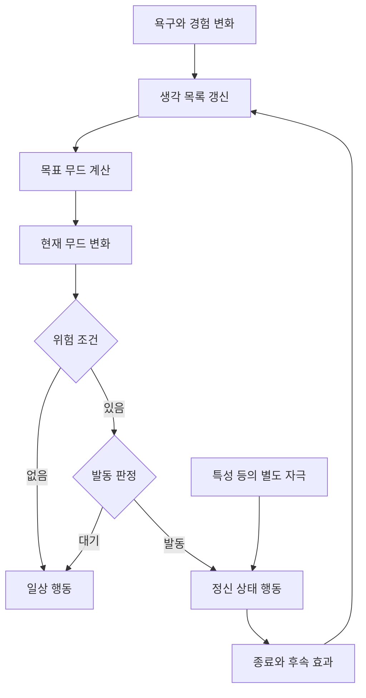

# 03. 욕구·생각·무드·정신 이상

[전체 목차](../README.md) · [인물과 사회관계](02_colonists_skills_relationships.md)

> 공개 문서 기반 분석이다. `[확인]`과 `[해석]`, `[제안]`을 구분하며 원작 내부 코드·확률을 재현했다고 주장하지 않는다.

## 1. 시스템 목적과 플레이 경험

[해석] 정착지의 운영 실패를 **개인의 불편 → 감정 악화 → 행동 변화 → 운영 부담 증가**로 전파하는 시스템이다. 식량·병상·주거·여가를 서로 독립된 목표로 끝내지 않고, 인물의 상태를 통해 연결한다.

[확인] 기본 욕구의 부족은 생각·무드·건강 등에 영향을 준다. [S1] 낮은 무드는 정신 이상 위험을 만들지만, 모든 정신 상태 변화가 낮은 무드에서만 시작되는 것은 아니다. [S3] 따라서 설계 질문은 “행복 수치를 어떻게 높일까?”보다 **“누구에게 무엇이 부족하며 언제 개입해야 할까?”**에 가깝다.

## 2. 범위와 입출력

| 구분 | 내용 | 경계 |
| --- | --- | --- |
| 입력 | 영양·휴식·여가 충족, 환경, 사건, 관계, 특성 | 다른 시스템의 결과를 수신 |
| 유지 상태 | 욕구 값, 활성 생각, 현재·목표 무드, 위험 상태 | 이 시스템 담당 |
| 출력 | 자율행동 요구, 위험 알림, 정신 상태 전이 | 작업·UI·전투에 전달 |
| 비담당 | 식사 제조, 침대 건축, 질병 치료 | 요구를 만족시키는 실제 행동은 각 시스템 담당 |
| DLC 경계 | 이념별 판단, 아동 학습, 혈액·기계 에너지 | Ideology·Biotech 등에서 별도 확장 |

## 3. 플레이어 조작과 제공 정보

[확인] 욕구 탭은 현재 값과 추세를 보여주며, 무드는 현재값과 목표값을 구분한다. [S1][S2] 여가는 반복한 활동 종류에 따라 만족 효율이 달라져 종류의 다양성이 중요하다. [S5]

[제안] 경고를 눌렀을 때 **현재 위험 → 주요 원인 → 실행할 수 있는 조치** 순서로 표시한다. “배고픔”은 식량 부족·정책 제한·접근 불가를 구별하고, “여가 부족”은 시간 부족·시설 부족·종류 편중을 구별한다. 시설을 지어도 해당 인물이 사용할 수 없다면 문제 해결로 표시하지 않는다.

## 4. 핵심 규칙

| ID | 조건 | 처리·결과 | 근거 |
| --- | --- | --- | --- |
| MOOD-01 | 음식 욕구 고갈 | 영양실조와 건강 악화 가능 | [확인] [S1] |
| MOOD-02 | 휴식 부족 | 피로·강제 수면과 연결 | [확인] [S1] |
| MOOD-03 | 상황 또는 기억 발생 | 해당 인물의 생각이 무드에 가감 | [확인] [S4] |
| MOOD-04 | 생각 구성이 변경 | 목표 무드가 바뀌며 현재 무드는 지연해 따라감 | [확인] [S2] |
| MOOD-05 | 위험 임계 아래에 머묾 | 심각도에 따른 정신 이상 발생 가능 | [확인] [S2][S3] |
| MOOD-06 | 특정 특성·약물 등 조건 | 낮은 무드와 별개로 정신 상태 유발 가능 | [확인] [S3] |
| MOOD-07 | 정신 이상 행동 진행 | 평상시 통제가 제한되거나 행동이 변경 | [확인] [S3] |
| MOOD-08 | 같은 여가 종류 반복 | 해당 종류에 대한 내성이 누적 | [확인] [S5] |
| MOOD-09 | 생각의 기간·중첩 조건 | 효과별 유효 기간과 중첩 규칙이 다름 | [확인] [S4] |
| MOOD-10 | 상태 변경 해제 | 남은 생각과 실제 환경을 재평가 | [제안] |

## 5. 상태와 처리 흐름

[제안] 아래의 위험 판정은 확률 모델의 위치를 설명한다. **임계값 진입 즉시 확정 발동하는 구조가 아니며**, 원작의 검사 주기와 평균 발생 간격을 그대로 옮긴 것은 아니다.



## 6. 데이터 모델 및 인터페이스

[제안] 욕구, 생각, 무드, 정신 상태를 독립된 레코드로 둔다. 무드 감소 이유를 문자열 하나로 덮어쓰면 원인 추적과 인물별 예외 처리가 어려워진다.

| 필드 | 타입·단위 | 역할 |
| --- | --- | --- |
| need_levels | map, 0..1 | 음식·휴식·여가 등 현재 충족 |
| thought_def_id | DefinitionId | 효과와 중첩 규칙의 정의 |
| thought_source_id | EntityId / EventId | 사건·상대·장소 연결 |
| expires_at | simulation_tick | 기억 만료 시각 |
| current_mood / target_mood | number, 0..1 | 현재 감정과 수렴 목표 |
| break_threshold_profile | DefinitionId | 개인별 위험 기준 |
| mental_state | state enum | 행동 정책 전환 |
| recreation_tolerance | map, 0..1 | 종류별 반복 사용 영향 |

```yaml
# 제안 예시. 계수와 숫자는 원작 상수가 아니다.
pawn_id: pawn_amy
current_mood: 0.31
target_mood: 0.47
thoughts:
  - thought_def_id: memory_rescued_friend
    thought_source_id: pawn_jin
    expires_at: 120000
mental_state: normal
```

[제안] `NeedActionRequested`는 작업 후보를 생성하고, `MoodRiskChanged`는 UI에 전달한다. 생각 만료와 새 생각 생성은 같은 갱신 묶음에서 계산해 경계 시각의 위험 경고가 잠깐 켜졌다 꺼지는 현상을 줄인다. 특성별 면제 조건은 생각 정의의 필터로 제공한다.

## 7. 수치와 밸런스

| 항목 | 구분 | 취급 |
| --- | --- | --- |
| 무드 표시 범위 0~100% | [확인] [S2] | 데이터 모델에서는 0..1 |
| 기본 위험 기준 35%·20%·5% | [확인] [S2] | 특성 등으로 달라지는 기준이며 고정 확률 아님 |
| 현재 무드의 목표값 추종 | [확인] [S2] | 즉시 회복과 구분 |
| 종류별 발동 확률·검사 주기 | [미확인] | 위키도 보완 필요 표기가 있어 확정하지 않음 |
| 제안 모델의 회복·하락 속도 | [제안] | 같은 환경 변화의 체감 지연을 측정해 조정 |

[해석] 목표값과 현재값의 차이는 플레이어가 개입할 시간을 만든다. 반대로 원인을 해결했다고 즉시 위기가 끝나지 않아, 짧은 휴식과 보호가 의미를 가진다. 반복 여가의 효율 감소는 시설 수보다 **사용 가능한 활동 종류**를 늘릴 동기를 만든다.

## 8. 대표 플레이 사례와 예외

[제안 사례] 부상당한 요리사가 고통·피로·식사 지연을 함께 겪는다. 플레이어가 급한 조리를 반복 지정해도 식량 생산이 안정되지 않는 상황을 구성한다. 병상 이동과 대체 인력 배정으로 원인을 해결하면 목표 무드가 먼저 개선되고 현재 무드는 이후 회복하도록 표현한다.

[제안] 정신 이상 행동이 실제로 발동하여 평상시 작업이 중단되면 일반 작업 예약을 안전하게 해제한다. 위험 경고만 발생한 단계에서는 작업을 자동 중단하지 않는다. 정신 이상 종료 후에는 원래 작업의 유효성을 다시 확인한다. 재료가 소모됐거나 목적지가 파괴됐을 수 있기 때문이다. 높은 무드에서도 별도 원인으로 발동하는 상태는 경고에 그 원인을 표시한다. 욕구 종류가 없는 대상에게 관련 경고를 생성하지 않는다.

## 9. 다른 시스템과의 연결

| 연결 문서 | 정보 | 방향 |
| --- | --- | --- |
| [인물·관계](02_colonists_skills_relationships.md) | 특성·사회 사건 | 사건 해석의 개인차 |
| [작업](04_work_priorities_jobs.md) | 욕구 행동·통제 상태 | 노동 시간과 예약 변경 |
| [방·건축](05_building_rooms_zones.md) | 사용 공간과 환경 | 생활 개선의 감정 효과 |
| [의료](09_health_medical_body.md) | 통증·질환·회복 | 신체 부담 → 무드 |
| [Ideology](../dlc/02_ideology.md) | 행동에 대한 가치 판단 | 생각 적용 조건 확장 |

## 10. 검증 시나리오

**[제안] 재구현 수용기준. 실행 미실시.**

| Given | When | Then |
| --- | --- | --- |
| 배고픔 생각이 활성 | 식사 완료 | 목표 무드가 개선되고 현재값은 정해진 속도로 변화 |
| 위험 기준 바로 위·아래 | 무드 값 경계 통과 | 경고와 위험 구분이 일관됨 |
| 같은 원인의 기억 여러 건 | 새 기억 추가 | 정의된 중첩 제한 적용 |
| 정신 상태 중 운반 예약 보유 | 평상시 작업 종료 | 예약이 해제되어 다른 인물이 사용 가능 |
| 서로 다른 여가 내성 | 같은 시간 여가 | 종류별 회복 효율 차이 표시 |
| 무드 정상, 별도 유발 조건 충족 | 특수 상태 발동 | 낮은 무드 때문이라는 잘못된 이유를 표시하지 않음 |

## 11. 설계 해석과 재구현 우선순위

[해석] 작은 불편이 여러 개 겹칠 때 위기가 생기는 구조는 정착지 전체를 하나의 안정성 문제로 보게 한다. 사용자에게는 총점뿐 아니라 합산 근거가 보여야 한다.

[제안] MVP는 음식·휴식·여가, 생각의 가감·만료, 현재·목표 무드, 비파괴적 정신 상태 하나로 검증한다. 후속 단계에서 위험도별 행동, 특성 예외, 관계 기억, DLC별 생각 체계를 추가한다. 모든 정신 이상 목록을 먼저 만드는 것보다 **원인을 찾아 개입하면 결과가 개선되는가**를 먼저 확인한다.

## 12. 출처와 확인 필요 사항

| 키 | 출처·유형 | 확인한 내용 |
| --- | --- | --- |
| S1 | [Needs](https://rimworldwiki.com/wiki/Needs) · 커뮤니티 | 욕구와 건강·감정의 연결 |
| S2 | [Mood](https://rimworldwiki.com/wiki/Mood) · 커뮤니티 | 현재·목표 무드, 위험 기준 |
| S3 | [Mental break](https://rimworldwiki.com/wiki/Mental_break) · 커뮤니티 | 상태 유발 원인, 통제 제한과 예외 |
| S4 | [Thoughts](https://rimworldwiki.com/wiki/Thoughts) · 커뮤니티 | 감정 효과, 만료와 중첩 |
| S5 | [Recreation](https://rimworldwiki.com/wiki/Recreation) · 커뮤니티 | 여가 종류와 반복 내성 |

확인일: 2026-11-13. 발동 확률의 완전한 조건식, 정신 상태별 종료 처리, 모든 특성·DLC 예외는 미검증이다. 표의 기본 임계값은 커뮤니티 자료의 기준값이며 모든 인물에게 동일하게 적용된다고 보장하지 않는다.
