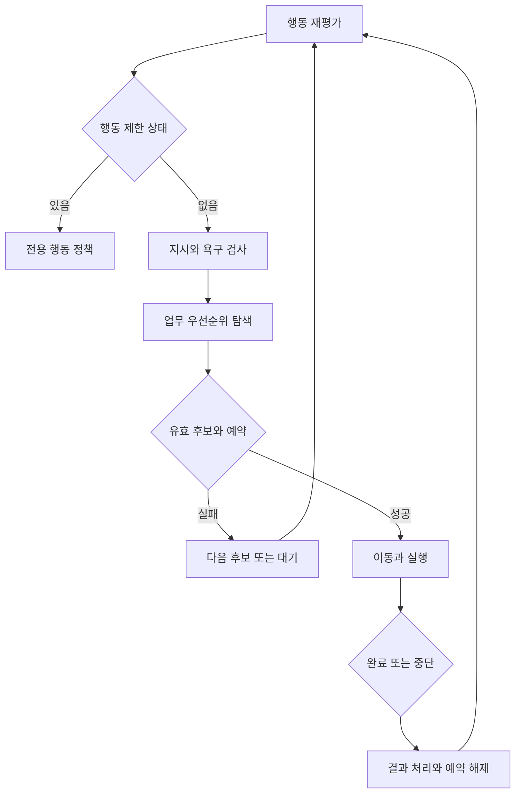

# 04. 작업 우선순위·스케줄·자율 행동

[전체 목차](../README.md) · [운반과 물류](06_items_storage_logistics.md)

> `[확인]`은 공개자료에 기술된 사용자 관점 규칙이다. 아래의 예약·상태기계·의사코드는 모두 `[제안]`이며 원작 AI 구현으로 단정하지 않는다.

## 1. 시스템 목적과 플레이 경험

[해석] 플레이어는 대부분의 생활 행동을 직접 클릭하기보다 **누가 어떤 일을 우선하도록 할지** 정한다. 정착민은 계획을 실행하며, 플레이어는 병목과 위기에 개입한다. 좋은 자동화는 높은 생산량뿐 아니라 “왜 이 일을 선택했는가”와 “왜 일을 하지 않는가”를 설명할 수 있어야 한다.

핵심 질문은 **전체 정착지의 목표를 개인별 정책으로 어떻게 표현할 것인가?** 모든 사람이 운반부터 하게 만들면 생산 설비가 멈출 수 있으므로, 우선순위는 노동 분업을 구성하는 도구로 해석한다.

## 2. 범위와 입출력

| 구분 | 내용 | 경계 |
| --- | --- | --- |
| 입력 | 업무 설정, 시간표, 허용 구역, 직접 지시, 작업 후보 | UI·다른 시스템에서 생성 |
| 유지 상태 | 현재 작업, 실행 단계, 대기 원인, 예약 | 제안 작업 실행 모델 |
| 출력 | 재료 소비·작업 진행·완료·중단 사건 | 생산·건축·의료 등에 전달 |
| 비담당 | 개별 레시피 결과, 수술 성공식, 경로 탐색 세부 알고리즘 | 각 도메인에서 제공 |
| DLC 경계 | 명상·육아·기계 작업 등 | 기능 활성 상태에 따라 후보 확장 |

## 3. 플레이어 조작과 제공 정보

[확인] 업무 탭은 허용 여부 또는 수동 우선순위를 설정한다. 지정한 업무는 대상 우클릭으로 우선 실행할 수 있고, 연속 지시를 예약할 수 있다. [S1] 스케줄은 하루의 시간대별 행동 방침을 설정하며, 시간대 변경이 언제나 현재 작업을 즉시 끊는다는 뜻은 아니다. [S2]

[제안] 인물 선택창에 `현재 단계 / 선택 이유 / 다음 단계 / 막힌 원인`을 표시한다. “쉬는 중”과 “가능한 일 없음”을 구분하고, 후자는 자격 부족·재료 없음·구역 제한·경로 불가·시설 점유로 나눈다. 플레이어가 우선순위를 바꿀 때는 기존 작업의 즉시 취소 여부를 분명히 알려준다.

## 4. 핵심 규칙

| ID | 조건 | 처리·결과 | 근거 |
| --- | --- | --- | --- |
| JOB-01 | 기본 업무 설정 사용 | 허용된 업무를 화면상 우선 순서로 탐색 | [확인] [S1] |
| JOB-02 | 수동 우선순위 사용 | 1이 가장 높고 4가 가장 낮음; 빈칸은 비활성 | [확인] [S1] |
| JOB-03 | 같은 우선순위 | 업무 열의 왼쪽이 우선 | [확인] [S1] |
| JOB-04 | 업무 불가능·미지정 | 평상시 해당 업무를 배정할 수 없음 | [확인] [S1] |
| JOB-05 | 스케줄 평가 시점 | 수면·여가·작업 등의 행동 방침과 욕구를 반영 | [확인] [S2] |
| JOB-06 | 허용 구역 제한 | 주로 작업 목적지를 제한하며 구역 밖 통행 자체의 절대 금지는 아님 | [확인] [S3] |
| JOB-07 | 같은 대상에 여러 작업자 | 대상·재료를 예약하여 중복 소비 방지 | [제안] |
| JOB-08 | 취소·죽음·상태 전환 | 진행 상태와 남은 자원을 정리하고 예약 해제 | [제안] |

## 5. 상태와 처리 흐름

[제안] 원작의 정확한 우선순위 트리 대신, 재구현에서 책임을 나누는 흐름이다. 욕구·긴급 모드와 직접 지시의 세부 선후 관계는 별도 정책으로 정의해야 한다.



## 6. 데이터 모델 및 인터페이스

[제안] 업무 유형, 작업 인스턴스, 실행 단계는 분리한다. 같은 운반 업무도 “창고 재배치”와 “건축 재료 공급”은 서로 다른 요청자와 완료 조건을 가진다.

| 필드 | 타입·단위 | 역할 |
| --- | --- | --- |
| work_policy | map, disabled 또는 1..4 | 사용자 업무 우선순위 |
| schedule | activity array, game_hour | 시간대 방침 |
| allowed_area_id | AreaId | 후보 목적지 검증 |
| job_id / owner_id | JobId / EntityId | 실행 소유권 |
| targets | EntityId / Cell list | 작업·재료·목적지 |
| execution_phase | state enum | 예약·이동·운반·작업·완료 |
| work_remaining | abstract work units | 재개 가능한 진행 |
| failure_reason | reason enum | 사용자 설명과 재시도 정책 |
| reservation | Owner/Target/Quantity/Expiry | 경합과 유실 방지 |

```yaml
# 제안 예시. 원작 Job 정의가 아니다.
job_id: job_build_104
owner_id: pawn_jin
targets:
  blueprint: blueprint_21
  ingredient: stack_steel_02
execution_phase: carry_material
reservation:
  owner: pawn_jin
  target: stack_steel_02
  quantity: 20
  expiry_simulation_tick: 48000
```

[제안] 도메인은 `EnumerateCandidates`, `CanStart`, `ExecuteStep`, `Cancel`에 해당하는 계약을 제공한다. 실패는 즉시 재시도·환경 변경 후 재시도·사용자 수정 필요로 구분한다. 접근 불가능한 동일 작업을 매번 선택해 지도를 왕복하는 루프를 방지한다.

## 7. 수치와 밸런스

| 항목 | 구분 | 적용 판단 |
| --- | --- | --- |
| 수동 우선순위 1~4 | [확인] [S1] | 기술 수준·작업 속도와 별개 |
| 하루 24시간의 스케줄 | [확인] [S2] | 실제 초와 구분 |
| 예약 만료·검색 반경 | [제안] | 성능과 응답성 측정 후 결정 |
| 작업 내부 하위 우선순위 전체 | [미확인] | 목록·패치·DLC에 따라 추가 검증 필요 |

[해석] 단순 우선순위는 예측 가능성이 높지만 전체 물류의 최적해를 보장하지 않는다. [제안] 원작 재현 모드에서는 우선순위 의미를 보존하고, 개선 모드에서 거리·마감·작업 전환 비용을 적용할 경우 별도 기능으로 표시한다. 두 행동을 섞으면 플레이어의 숫자 설정이 거짓 약속이 된다.

## 8. 대표 플레이 사례와 예외

[제안 사례] 운반을 1, 요리를 2로 둔 인물이 조리 가능한 지시가 있어도 멀리 있는 물건을 계속 나른다고 가정한다. 해결 방식은 생산 작업자의 주업무 우선화와 운반 전담 배치, 조리대 인근 재료 저장이다. 경로 속도를 높이는 것만으로는 업무 선택 문제를 해결하지 못한다.

[제안] 목적지가 파괴되면 작업을 취소하고 이미 든 물건은 안전한 배치 후보를 찾는다. 재료 일부만 운반한 상태에서 중단돼도 전량 소비한 것으로 계산하지 않는다. 허용 구역을 두 조각으로 나누는 UI에는 중간 통행 위험을 설명한다. 직접 지시도 존재하지 않는 재료나 물리적으로 막힌 경로를 만들어내지는 않는다.

## 9. 다른 시스템과의 연결

| 연결 문서 | 입출력 | 핵심 책임 |
| --- | --- | --- |
| [인물](02_colonists_skills_relationships.md) | 자격·기술 | 수행 가능한 후보 결정 |
| [욕구](03_needs_mood_mental_breaks.md) | 식사·수면 요구와 행동 상태 | 작업 지속 가능성 |
| [건축](05_building_rooms_zones.md) | 청사진·공사 진행 | 요청 생성과 완료 반영 |
| [물류](06_items_storage_logistics.md) | 재료와 수량 예약 | 중복 운반·소비 방지 |
| [전투](10_combat_defense_equipment.md) | 징집·부상·전투 지시 | 평상시 작업 중단 |

## 10. 검증 시나리오

**[제안] 재구현 수용기준. 실행 미실시.**

| Given | When | Then |
| --- | --- | --- |
| 두 업무의 우선순위가 다름 | 모두 실행 가능 | 높은 우선순위의 업무가 선택 |
| 같은 우선순위의 두 업무 | 후보 재평가 | 정해진 열 순서가 유지 |
| 두 인물이 같은 재료를 선택 | 동시에 예약 | 사용 가능한 수량을 초과하지 않음 |
| 작업 중 정신 상태 발생 | 평상시 작업 종료 | 재료·시설 예약 해제 |
| 경로가 막힌 작업 | 재평가 반복 | 실패 이유를 유지하며 무한 재선택을 억제 |
| 분리된 허용 구역 | 다른 조각으로 이동 | 작업 제한과 경로 차단을 혼동하지 않음 |

## 11. 설계 해석과 재구현 우선순위

[해석] 자동 행동의 신뢰성은 천재적인 최적화보다 설명 가능한 규칙과 일관된 취소 처리에서 생긴다. 작업을 하지 않는 이유를 발견하는 과정 자체가 운영 게임의 핵심 판단이다.

[제안] MVP는 업무 3종, 우선순위, 자격·경로 검사, 대상 예약, 취소 처리를 먼저 구현한다. 스케줄·욕구 전환과 직접 지시를 다음 단계에 결합한다. 이후 다단계 레시피, 장거리 후보 검색, 실패 원인의 UI 노출을 확장한다. 성능 최적화 이전에 이중 소비·영구 예약·도착 후 실패를 제거한다.

## 12. 출처와 확인 필요 사항

| 키 | 출처·유형 | 확인한 내용 |
| --- | --- | --- |
| S1 | [Work](https://rimworldwiki.com/wiki/Work) · 커뮤니티 | 우선순위, 업무 제한, 직접 지시 |
| S2 | [Menus — Schedule](https://rimworldwiki.com/wiki/Menus#Schedule) · 커뮤니티 | 시간표와 작업 전환의 의미 |
| S3 | [Allowed area](https://rimworldwiki.com/wiki/Allowed_area) · 커뮤니티 | 작업 구역과 통행 제한의 차이 |

확인일: 2026-11-13. S2는 `Schedule` 경로에서 Menus 문서로 연결되어 열람했다. 원작 예약 구조·검색 알고리즘·모든 행동 중단 순서는 미검증이다. Work 문서의 옛 직업 예시는 현재 DLC 작위 제한과 혼동될 수 있어 일반 규칙의 근거로 사용하지 않았다.
