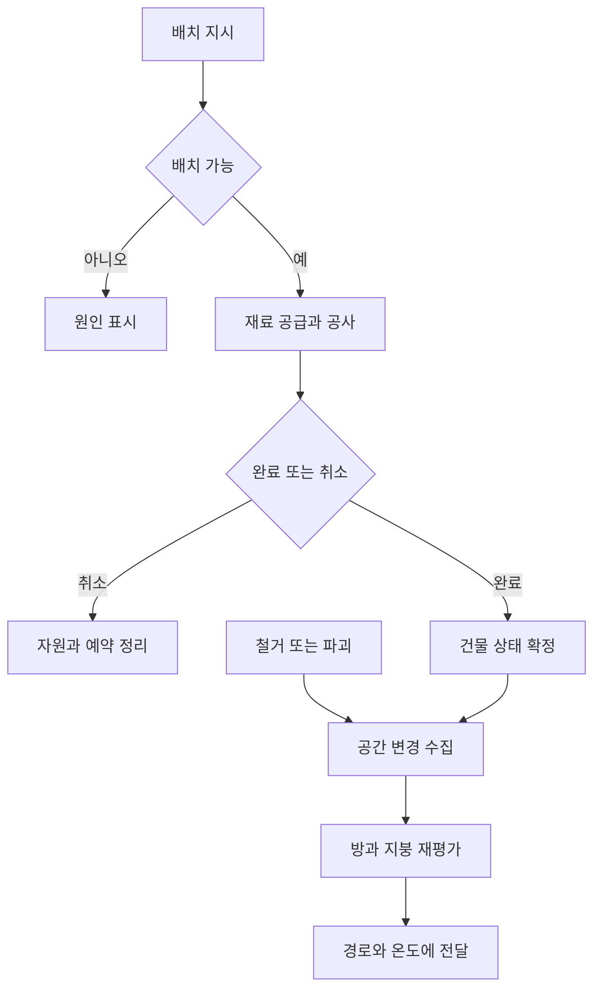

# 05. 건축·방 판정·지붕·구역

[전체 목차](../README.md) · [전력·온도·화재](08_power_temperature_fire.md)

> `[확인]`은 공개자료로 간접 확인한 규칙, `[해석]`은 설계 분석, `[제안]`은 재구현 방안이다. 아래의 공간 갱신 알고리즘은 원작 내부 구현을 설명하는 것이 아니다.

## 1. 시스템 목적과 플레이 경험

[해석] 건축은 자원으로 물체를 만드는 행위를 넘어, **동선·방어·온도·생산·감정이 작동하는 공간을 만드는 시스템**이다. 같은 수의 벽과 가구라도 배치와 방 구분에 따라 생활의 질과 운영 비용이 달라진다.

[확인] 벽은 이동·시야·방 형성 등 여러 환경 조건에 관여하고, 재료에 따라 내구·가연성 등이 달라진다. [S1] 핵심 질문은 **“어떤 건물을 더 지을까?”보다 “현재 공간을 어떻게 재구성해야 운영 문제가 해결될까?”**다.

## 2. 범위와 입출력

| 구분 | 내용 | 경계 |
| --- | --- | --- |
| 입력 | 배치·철거·재설치 지시, 재료, 노동, 지도 조건 | 플레이어와 물류 시스템에서 전달 |
| 유지 상태 | 건축 요청, 완성 건물, 방·지붕·구역 정보 | 이 시스템 담당 |
| 출력 | 통행·시야 변화, 방 특성, 생산 시설 가용성 | 경로·전투·온도·욕구가 소비 |
| 비담당 | 건축가 선택, 실내 온도 계산, 방 사용에 따른 감정 계산 | 작업·열·무드 시스템 담당 |
| DLC 경계 | 왕좌실·의식실·중력선 구조 | 개별 DLC 문서에서 조건 추가 |

## 3. 플레이어 조작과 제공 정보

[확인] 1.6에는 일부 기존 건물 위에 청사진을 놓아 재료 변경·교체를 진행하는 기능이 추가되었다. [S5] 일반 구역은 행동 정책을 표현하며, 허용 구역과 물리적인 벽은 다른 기능이다. [S4]

[제안] 배치 미리보기는 필요 재료와 노동 외에 출입구·상호작용 위치·지붕 지지를 표시한다. 완공 전에는 “재료 미도착”, “작업자 없음”, “접근 불가”를 구분한다. 공간 검사창은 방 이름만 표시하지 말고 면적·청결·지붕·사용 시설 등 판정 근거를 보여준다.

## 4. 핵심 규칙

| ID | 조건 | 처리·결과 | 근거 |
| --- | --- | --- | --- |
| BUILD-01 | 건물 재료 선택 | 내구·미관·가연성 등에 차이 | [확인] [S1] |
| BUILD-02 | 벽·문 등으로 공간 구성 | 방 형성과 통행·시야 조건에 영향 | [확인] [S1][S2] |
| BUILD-03 | 방의 내용물 변경 | 시설 구성에 따라 표시되는 방 역할이 결정 | [확인] [S2] |
| BUILD-04 | 방을 식사·여가 등에 사용 | 표시 역할 하나와 사용 효과의 범위가 항상 일치하지 않음 | [확인] [S2] |
| BUILD-05 | 지붕의 지지 상실 | 붕괴 위험이 발생 | [확인] [S3] |
| BUILD-06 | 지붕 종류가 다름 | 얇은 지붕과 두꺼운 산악 지붕의 제거 가능성 등 차이 | [확인] [S3] |
| BUILD-07 | 같은 “실내” 공간 판정 | 온도·작업·심리 효과가 동일한 한 조건만 사용하지 않음 | [확인] [S2] |
| BUILD-08 | 적합한 방의 생산 시설 | 1.6에서 일부 시설의 작업 효율에 방 용도가 관여 | [확인] [S5] |
| BUILD-09 | 지도 구조 변경 | 연결 공간과 영향 시스템만 다시 평가 | [제안] |

## 5. 상태와 처리 흐름

[제안] 건축 진행과 공간 재평가는 별개 상태다. 완공·파괴·철거가 같은 공간 변경 경로를 거치면 온도와 경로가 서로 다른 벽 상태를 읽는 문제를 줄일 수 있다.



## 6. 데이터 모델 및 인터페이스

[제안] 건물 정의와 건축 중 상태를 분리하고, 방은 배치 변화에서 도출한 공간 결과로 취급한다. 방 ID가 바뀌어도 시설·인물 ID는 유지한다.

| 필드 | 타입·단위 | 역할 |
| --- | --- | --- |
| building_def_id | DefinitionId | 크기·재료 조건·상호작용 위치 |
| build_request_id | EntityId | 계획과 공사 추적 |
| material_delivered | item quantity map | 실제 공급량 |
| work_remaining | work units | 공사 진행 |
| footprint / rotation | cells / enum | 점유와 방향 |
| room_id / revision | RoomId / integer | 공간 결과와 갱신 세대 |
| roof_type | enum | 없음·건설·자연 지붕 등 |
| room_uses | use tag set | 여러 사용 목적의 조건 |
| area_masks | map of AreaId | 홈·허용·저장 등 정책 영역 |

```yaml
# 제안 예시. 원작 방 판정 공식이 아니다.
room_id: room_12
revision: 4
role_label: dining_recreation
use_tags: [dining, recreation]
roof_coverage_ratio: 1.0
enclosure_checks:
  temperature: enclosed
  work: indoor
  psychological: indoor
```

[제안] `BuildingCompleted`, `TopologyChanged`, `RoomStatsChanged`를 나눈다. 문 개폐로 인한 통행·열 교환 변화와 벽 파괴로 인한 공간 병합은 서로 다른 비용의 갱신으로 처리한다. 실내 판정은 단일 `is_indoor` 값 대신 소비 시스템이 요구하는 질의를 제공한다.

## 7. 수치와 밸런스

| 항목 | 구분 | 적용 판단 |
| --- | --- | --- |
| 통상 지붕 지지 범위 약 6셀 | [확인] 커뮤니티 설명 [S3] | 기하·연결 조건까지 포함한 실행 확인 필요 |
| 방 인상·청결·면적 등의 가중치 | [미확인] | 원작 정확 공식 대신 질적 관계만 사용 |
| 작업실별 효율 배율 | [미확인] | 1.6 패치·시설별 별도 확인 |
| 방 변경 이벤트 배치 | [제안] | 같은 시뮬레이션 단계의 변경을 합쳐 처리 |

[해석] 건축 비용은 재료와 공사 시간만이 아니다. 공사 중 단절되는 동선, 냉장실의 일시적 개방, 방어벽 교체 중 노출도 비용이다. [제안] 교체 기능은 기존 물체가 실제로 언제 사라지는지 명시하고, 그 시점을 건축 상태와 연결한다.

## 8. 대표 플레이 사례와 예외

[제안 사례] 연구대·침대·조리대를 큰 방 하나에 모은 정착지를 기능별 방으로 분리한다. 작업 공간의 적합성은 좋아지지만 문과 복도 때문에 이동 시간이 늘어난다. 전후 성과는 방 이름이나 면적만 비교하지 말고 작업 시간·이동 시간·생활 만족을 함께 측정한다.

[제안] 벽을 철거하는 인물이 지붕 아래에 있는 경우, 붕괴 판정을 공사 완료 후 임의 지연시키지 않는다. 건물 재설치 도중 소유권과 내용물 상태를 중복 생성하지 않는다. 청사진이 문 앞을 막아 자기 공사 위치에 갈 수 없으면 배치 검증과 실행 검증 모두에서 이유를 반환한다. 방 병합 시 병상·침대 소유권은 그대로 보존한다.

## 9. 다른 시스템과의 연결

| 연결 문서 | 정보 | 방향 |
| --- | --- | --- |
| [지도·환경](01_world_map_environment.md) | 지면·지붕·점유 | 배치 가능성 ↔ 지도 변경 |
| [작업](04_work_priorities_jobs.md) | 공사 요청과 진행 | 요청 → 노동 → 완공 |
| [창고·물류](06_items_storage_logistics.md) | 재료 공급·회수 | 공사 자원 생명주기 |
| [전력·온도](08_power_temperature_fire.md) | 방 경계·열원 | 공간 → 환경 유지 비용 |
| [욕구·무드](03_needs_mood_mental_breaks.md) | 사용 공간의 환경 | 생활 환경 → 감정 |

## 10. 검증 시나리오

**[제안] 재구현 수용기준. 실행 미실시.**

| Given | When | Then |
| --- | --- | --- |
| 재료 일부 공급한 공사 | 취소 | 실제 공급량 기준으로 자원을 정리 |
| 두 방 사이 벽 존재 | 벽 제거 | 공간·경로·열 연결이 일관되게 갱신 |
| 지지 없는 지붕 상태 | 마지막 지지 제거 | 붕괴 조건과 피해가 정해진 시점에 적용 |
| 복합 용도의 방 | 식사와 여가 각각 수행 | 각 사용 조건을 개별 평가 |
| 외부와 연결된 허용 구역 | 인물 이동 | 구역을 물리 벽으로 처리하지 않음 |
| 진행 중인 건물 교체 | 저장 후 불러오기 | 기존 건물과 청사진 상태가 중복되지 않음 |

## 11. 설계 해석과 재구현 우선순위

[해석] 배치가 여러 시스템에 영향을 주기 때문에 작은 건축 선택이 장기 운영 결과로 확대된다. 방 이름을 결과로 보여주되, 플레이어가 원인을 이해할 수 있어야 한다.

[제안] MVP는 벽·문·지붕·청사진과 단순 방 구획이다. 재료 운반·취소·벽 파괴까지 일관된 상태를 만든 뒤 방 통계와 생산 시설 조건을 연결한다. 계획 도구·교체 건축·다양한 지붕은 후속 단계로 확장한다. 모든 방 판정 임계값을 한꺼번에 복제하기보다 공간 변화의 파급을 먼저 검증한다.

## 12. 출처와 확인 필요 사항

| 키 | 출처·유형 | 확인한 내용 |
| --- | --- | --- |
| S1 | [Structure](https://rimworldwiki.com/wiki/Structure) · 커뮤니티 | 구조물·재료·벽의 기능 |
| S2 | [Rooms](https://rimworldwiki.com/wiki/Rooms) · 커뮤니티 | 방 용도와 용도별 실내 판정 |
| S3 | [Roof](https://rimworldwiki.com/wiki/Roof) · 커뮤니티 | 지지·제거·붕괴·지붕 종류 |
| S4 | [Allowed area](https://rimworldwiki.com/wiki/Allowed_area) · 커뮤니티 | 구역 정책과 통행의 구분 |
| S5 | [Announcing Odyssey and update 1.6!](https://ludeon.com/blog/2025/06/announcing-odyssey-and-update-1-6/) · 공식 | 교체 건축과 방별 작업 효율 변화 |

확인일: 2026-11-13. S2는 `Room_stats`에서 연결되어 열람했다. S5는 직접 본문 접속이 제한되어 검색 서비스의 공식 문서 발췌를 확인했다. 일부 위키 방 역할 표는 갱신 상태를 보장할 수 없어 정확 점수·의료 침대 우선도를 채택하지 않았다. 방 통계와 지붕의 모든 경계 조건은 실행 검증이 필요하다.
