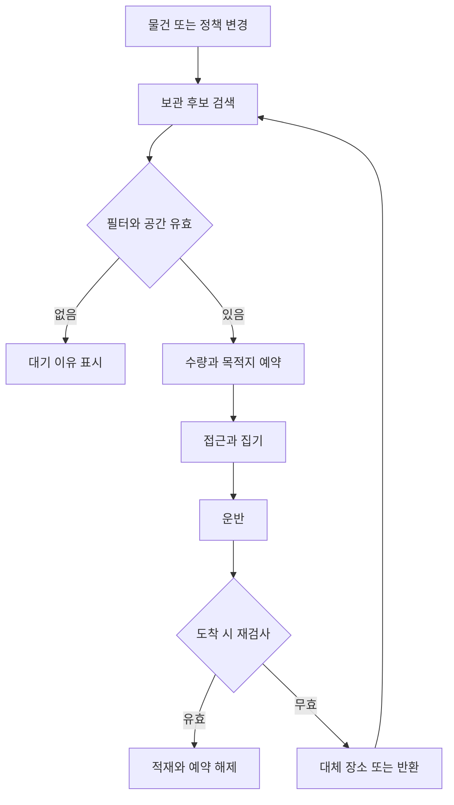

# 06. 아이템·보관·운반·물류

[전체 목차](../README.md) · [식량·생산](07_food_agriculture_production.md)

> `[확인]`은 공개자료로 간접 확인한 규칙이다. `[제안]` 데이터와 예약 모델은 원작 구현을 복제한 것이 아니며 `[해석]`과 구분한다.

## 1. 시스템 목적과 플레이 경험

[해석] 자원을 숫자만으로 보유하는 대신 **어디에 있고 누가 언제 쓸 수 있는가**를 운영 문제로 만든다. 생산량이 충분해도 잘못된 위치·필터·운반 배치 때문에 식사나 건축이 지연될 수 있다.

[확인] 보관 구역은 품목과 우선순위를 설정하고, 운반 작업자가 조건에 맞는 물건을 옮긴다. [S1] 핵심 질문은 **“더 많이 생산할까, 지금 가진 것을 더 빨리 공급할까?”**다. 창고는 저장 공간이면서 생산 설비와 생활시설을 연결하는 중간 버퍼로 해석한다.

## 2. 범위와 입출력

| 구분 | 내용 | 경계 |
| --- | --- | --- |
| 입력 | 물건 생성·소비·거래, 저장 필터, 우선순위, 운반 노동 | 생산·전투·경제·사용자에서 입력 |
| 유지 상태 | 개체·수량·위치·저장 정책·운반 예약 | 이 시스템 담당 |
| 출력 | 공급 가능 재고, 운반 요청, 품절·공간 부족 이유 | 생산·건축·UI에서 소비 |
| 비담당 | 레시피 생산식, 온도 계산, 거래 가격 공식 | 각 도메인에서 제공 |
| DLC 경계 | 폐기물·유전물질·특수 보관 등 | 품목 정의와 소비자 확장 |

## 3. 플레이어 조작과 제공 정보

[확인] 저장 설정은 허용 품목, 품질, 내구도 범위 등을 제공한다. 선반은 설정을 연결해 공유할 수 있다. [S1][S2]

[제안] UI에는 총보유량과 현재 공급 가능량을 분리한다. 예를 들어 `보유 100 / 예약 40 / 접근 불가 20 / 즉시 사용 40`처럼 병목을 보여준다. 저장 대상 선택은 물건 위치와 필터를 함께 강조하고, 빈 공간이 있어도 적합한 공간이 없으면 그 이유를 표시한다. 단순히 “창고가 가득 참”으로 합치지 않는다.

## 4. 핵심 규칙

| ID | 조건 | 처리·결과 | 근거 |
| --- | --- | --- | --- |
| ITEM-01 | 물건과 저장 필터 일치 | 빈 공간이 있는 유효 보관 후보로 운반 | [확인] [S1] |
| ITEM-02 | 더 높은 저장 우선순위 존재 | 이미 보관한 물건도 재배치 대상이 될 수 있음 | [확인] [S1] |
| ITEM-03 | 작업장 옆 고우선 저장소 | 재료를 작업장 가까이에 공급하는 운영 가능 | [확인] [S1] |
| ITEM-04 | 적합한 물건을 선반 보관 | 저장 밀도를 높이고 물건의 미관 불이익·환경 열화를 줄임 | [확인] [S2] |
| ITEM-05 | 선반에서 저장 불가능한 품목 | 일반 구역 등 별도 저장 수단 필요 | [확인] [S2] |
| ITEM-06 | 노출 환경의 열화 대상 | 내구도 감소와 최종 파괴 가능 | [확인] [S3] |
| ITEM-07 | 음식의 온도 기반 부패 | 내구도 열화와 독립된 과정 | [확인] [S3] |
| ITEM-08 | 재료를 여러 작업이 요구 | 사용 가능한 수량만 예약 | [제안] |
| ITEM-09 | 물건 분할·합치기 | 수량 보존과 호환 속성 검증 | [제안] |

## 5. 상태와 처리 흐름

[제안] 저장 정책이 물건을 순간이동시키지 않는다. 후보 선정과 실제 운반 완료 사이에 대상·공간이 바뀔 수 있으므로 도착 시 재확인이 필요하다.



## 6. 데이터 모델 및 인터페이스

[제안] 품목 정의와 개별 물건 상태를 구분한다. 기본 시장가치·기본 영양·허용 저장 유형은 정의에 두고, 내구도·부패 진행·품질·현재 위치는 개체 상태로 유지한다. 최종 시장가치는 재료·품질·해당 품목에 적용되는 내구도 보정 등을 반영해 계산하며, 실제 거래 가격은 경제 시스템에서 별도로 산정한다. 원작에서도 시장가치와 거래 가격은 구분된다.[S4]

| 필드 | 타입·단위 | 역할 |
| --- | --- | --- |
| item_id / item_def_id | EntityId / DefinitionId | 개체와 품목 구분 |
| quantity / stack_limit | integer | 수량과 적재 상한 |
| quality / hp_ratio | enum / 0..1 | 품질과 내구도 분리 |
| spoilage_progress | number, 0..1 | 식품 부패 상태 |
| location | map/cell/carrier/container | 물리적 소유 위치 |
| storage_filter_id | DefinitionId | 수용 가능한 속성 조건 |
| storage_priority | ordered enum | 저장소 간 공급 순서 |
| free_capacity | quantity by compatible slot | 현재 적재 가능량 |
| reservations | Owner/Target/Quantity/Expiry list | 예약량 추적 |

```yaml
# 제안 예시이며 원작 물건 직렬화 형식이 아니다.
item_id: item_meal_23
item_def_id: simple_meal_prototype
quantity: 8
hp_ratio: 1.0
spoilage_progress: 0.25
location:
  map_id: map_colony_001
  container_id: shelf_kitchen_02
reservation:
  owner: pawn_amy
  target: item_meal_23
  quantity: 1
  expiry_simulation_tick: 96000
```

[제안] `AvailableQuantity`는 총량에서 유효 예약량을 빼되, 소유권·접근성·필터 조건을 함께 평가한다. `ItemSplit`, `ItemMerged`, `ItemConsumed`는 수량 변화를 한 경로로 기록한다. 합치기는 부패·품질 등 상태를 보존하는 정책을 명시해 손상된 물건을 새 물건으로 세탁하는 오류를 막는다.

## 7. 수치와 밸런스

| 항목 | 구분 | 적용 판단 |
| --- | --- | --- |
| 일반 선반 2셀, 최대 6스택 | [확인] [S2] | 6개 물건이 아니라 스택 수; 품목 제한 존재 |
| 선반의 열화 보호 | [확인] [S2][S3] | 냉장·냉동 효과로 해석하면 안 됨 |
| 모든 품목의 스택 상한·열화율 | [미확인] | 전 품목 데이터셋은 본 문서 범위 밖 |
| 공급 가능량 계산 | [제안] | 재료 예약과 운반 중 수량의 중복 집계 방지 |

[해석] 저장 밀도를 높이면 창고 면적과 운반 거리를 줄일 수 있지만, 식품의 온도·출입 동선 문제를 자동으로 해결하지는 않는다. [제안] 물류 성능은 총이동 거리뿐 아니라 **생산자가 재료를 기다린 시간**, **수확물이 노출된 시간**, **긴급 치료까지 공급 시간**으로 평가한다.

## 8. 대표 플레이 사례와 예외

[제안 사례] 중앙 냉장실에 식재료가 충분하지만 요리사가 매번 멀리 걸어가 작업이 지연된다. 작업장 옆 작은 저장소를 더 높은 우선순위로 설정하고 운반 담당이 보충하게 한다. 이때 따뜻한 작업장에 과량을 쌓으면 부패 부담이 생기므로 버퍼 크기를 생산 속도와 함께 조절한다.

[제안] 목적지 저장 필터가 운반 도중 바뀌면 도착 시 적재를 다시 판단한다. 창고가 가득 찬 경우 물건을 삭제하거나 예약 상태로 방치하지 않는다. 운반자가 사망하면 실제 물건의 위치·소유자와 예약이 함께 갱신되어야 한다. 선반 보호와 식품 부패를 독립적으로 처리해, 더운 곳의 선반 속 식량도 부패 조건을 평가한다.

## 9. 다른 시스템과의 연결

| 연결 문서 | 정보 | 방향 |
| --- | --- | --- |
| [작업](04_work_priorities_jobs.md) | 운반 후보·예약·실패 이유 | 정책 → 실제 물류 |
| [건축](05_building_rooms_zones.md) | 공급 재료와 취소 회수 | 재고 ↔ 공사 자원 |
| [식량·생산](07_food_agriculture_production.md) | 재료 소비·제품 생성 | 생산 흐름과 재고 |
| [온도](08_power_temperature_fire.md) | 보관 온도 | 부패 진행 입력 |
| [세력·무역](14_factions_trade_prisoners.md) | 판매·구매 물건 | 소유와 위치 변경 |

## 10. 검증 시나리오

**[제안] 재구현 수용기준. 실행 미실시.**

| Given | When | Then |
| --- | --- | --- |
| 낮은 우선순위에 보관된 물건 | 유효한 높은 우선 저장소 생성 | 재배치 후보 생성 |
| 같은 스택을 두 작업이 사용 | 수량 동시 예약 | 예약 합계가 보유량을 넘지 않음 |
| 운반 중 저장 필터 변경 | 목적지 도착 | 적재 재검사와 대체 처리 |
| 뜨거운 실내 선반의 음식 | 시간 경과 | 열화 보호와 별개로 부패를 평가 |
| 분할한 물건 일부 소비 | 나머지 합치기 | 총수량과 상태가 정의한 정책에 맞게 보존 |
| 운반 인물 사망 또는 지도 이탈 | 작업 정리 | 예약 누수가 없고 물건 위치가 일치 |

## 11. 설계 해석과 재구현 우선순위

[해석] 운반은 생산과 소비를 연결하는 독립 노동이다. 이 비용 때문에 시설 배치와 전문 인력 분업이 전략이 된다. 공급 실패 원인이 보이지 않으면 플레이어는 같은 설정을 반복 바꾸게 된다.

[제안] MVP는 물건 ID·스택·바닥 저장·품목 필터·운반·수량 예약이다. 이후 저장 우선순위와 작업장 버퍼를 검증한 뒤 선반·연결 설정·열화·부패를 붙인다. 품목 다양화보다 수량 보존, 취소와 사망 시 정리, 저장 공간 경합 처리를 먼저 완성한다.

## 12. 출처와 확인 필요 사항

| 키 | 출처·유형 | 확인한 내용 |
| --- | --- | --- |
| S1 | [Stockpile zone](https://rimworldwiki.com/wiki/Stockpile_zone) · 커뮤니티 | 필터·저장 우선순위·보충 물류 |
| S2 | [Shelf](https://rimworldwiki.com/wiki/Shelf) · 커뮤니티 | 저장 용량·설정 연결·보호·품목 제한 |
| S3 | [Deterioration](https://rimworldwiki.com/wiki/Deterioration) · 커뮤니티 | 내구도 열화와 부패의 독립성 |
| S4 | [Market Value](https://rimworldwiki.com/wiki/Market_Value) · 커뮤니티 | 품질·재료·내구도 보정과 거래 가격의 구분 |

확인일: 2026-11-13. 모든 품목의 스택 합치기 방식, 운반 탐색 비용, 원작 예약 자료구조는 미검증이다. 선반에 적재할 수 없는 품목의 전체 목록과 품목별 열화 수치를 재현하지 않았다.
