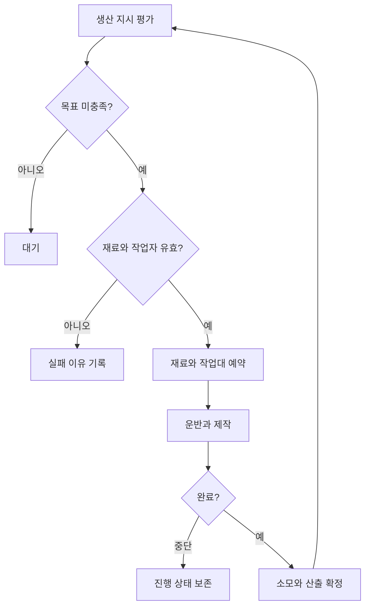

# 07. 식량·농업·생산

[목차](../README.md) · [물류](06_items_storage_logistics.md) · [전력·온도](08_power_temperature_fire.md)

> 실제 게임 실행과 원본 코드 확인은 수행하지 않았다. `[확인]`은 공개자료에 의한 간접 확인이며, 데이터와 알고리즘 예시는 `[제안]`이다.

## 1. 시스템 목적과 플레이 경험

[해석] 식량은 정착지를 유지하는 반복 지출이고, 생산은 노동과 원료를 생존 여유 또는 더 높은 성능으로 바꾸는 과정이다. 플레이어는 밭의 면적뿐 아니라 첫 수확까지의 시간, 수확 노동, 조리 능력, 보관 공간을 함께 계획해야 한다. 공방에서 무기를 만들고 있는 숙련자가 농사를 도와야 하는 상황처럼 서로 다른 생산 활동이 동일한 노동력을 경쟁한다.

**핵심 설계 질문:** 지금 소비할 양과 다음 위기를 견딜 비축량을 확보하면서, 성장에 투입할 노동을 얼마나 남길 수 있는가?

## 2. 범위와 입출력

| 구분 | 내용 |
| --- | --- |
| 담당 | 재배, 수확, 조리, 해체·가공, 제작 지시와 반복 생산 |
| 비담당 | 작업자 선택의 공통 규칙은 작업 시스템, 물품 이동은 물류 시스템 |
| 입력 | 재료, 레시피, 토양·빛·온도, 노동 가능 시간, 기술, 장비 작동 여부 |
| 상태 | 작물 성장, 미완성 제작물, 생산 지시, 제품 재고, 재료 예약 |
| 출력 | 식사·원료·장비, 소모 자원, 작업 경험, 식중독 위험, 재고 변화 |

## 3. 플레이어 조작과 제공 정보

[확인] 재배 구역에 작물을 정하고 작업대에는 생산 지시인 Bill을 등록한다. 지시에는 반복 횟수, 목표 재고, 계속 생산, 재료 범위, 작업자 제한 등이 있다. 음식 정책은 먹을 수 있는 종류를 제한한다. [S2][S3][S4]

[제안] 재구현 UI는 `생산 없음`을 하나의 상태로 표시하지 않는다. `재료 부족 / 작업자 조건 불일치 / 전원 없음 / 목표 충족 / 접근 불가`를 구분한다. 식재료와 완성 식사는 함께 합산하되, 먹을 수 없는 재료와 다른 정책에 배정된 재고를 별도로 보여주어 가용 식량을 과대평가하지 않게 한다.

## 4. 핵심 규칙

| ID | 조건 | 처리·결과 | 근거 |
| --- | --- | --- | --- |
| F01 | 재배에 적합한 땅·환경 | 작물이 성장하며 종별로 성장 조건이 다름 | [확인][S2] |
| F02 | 토양 비옥도 변화 | 성장 속도에 영향; 비옥도 자체가 수확량을 직접 늘리지는 않음 | [확인][S2] |
| F03 | 작물 선택 | 쌀은 빠른 회전과 잦은 노동, 옥수수는 긴 대기와 수확 손실 위험이라는 차이가 있음 | [확인][S1] |
| F04 | 작업대가 사용 가능 | 위쪽 지시부터 시도하되 작업 불가능한 지시는 건너뜀 | [확인][S3] |
| F05 | 목표 수량 방식 | 재고 조건에 따라 생산을 정지·재개할 수 있음 | [확인][S3] |
| F06 | 생식 또는 조리식 섭취 | 영양·기분·식중독 위험이 다르며 조리에는 별도 노동이 필요 | [확인][S4] |
| F07 | 식사를 조리 | 조리자의 능력과 주방 청결이 식중독 발생에 영향을 줌 | [확인][S4] |
| F08 | 품질을 가진 제작품 생성 | 품질에 따라 가치·성능 등의 속성이 달라짐 | [확인][S5] |

[해석] 생산 지시는 플레이어의 의도를 지속하는 규칙이다. 매번 한 개씩 명령하지 않아도 되는 대신, 필터와 목표 수량이 잘못되면 일관되게 잘못된 결과가 누적된다. 따라서 자동화의 편의와 오류의 설명 가능성이 함께 필요하다.

## 5. 상태와 처리 흐름

[제안] 아래 흐름은 공통 생산 작업의 재구현 모델이다. 재배 성장 자체는 별도 환경 갱신을 사용한다.



예약 이전에는 재고가 실제로 줄어들지 않는다. 중단된 작업의 원료를 완성품 산출과 다시 함께 소비하지 않도록 완료 처리는 한 번만 확정한다.

## 6. 데이터 모델 및 인터페이스

[제안] 정적 레시피와 실행 중인 생산 지시를 분리한다. 아래 필드명은 원작 API가 아니다.

| 데이터 | 주요 필드 | 역할 |
| --- | --- | --- |
| CropDefinition | `growth_work`, `fertility_curve`, `temperature_curve`, `yield` | 환경에 따른 생장과 산출 정의 |
| RecipeDefinition | `ingredient_filters`, `work_units`, `product_ids`, `quality_rule` | 재료·노동·산출 관계 |
| ProductionBill | `mode`, `target_count`, `resume_count`, `worker_filter` | 플레이어의 반복 의도 |
| CraftState | `bill_id`, `worker_id`, `reserved_inputs`, `work_done` | 중단·재개 가능한 실행 상태 |
| FoodPolicy | `allowed_foods`, `ingredient_restrictions` | 섭취 가능한 음식 판정 |

```yaml
# 재구현 예시: 수치는 원작 설정값이 아님
bill_id: meal_buffer_01
recipe_id: basic_meal
mode: until_target
count_scope: settlement_available_stock
target_count: 24
resume_count: 12
output_destination: kitchen_shelf
on_cancel: release_reservations
```

`ProductionCompleted`는 제품 ID와 수량을 물류에 전달한다. 목표 재고 조회는 `CountEligibleProducts`처럼 한 곳에서 수행하여 UI와 작업 선택이 같은 필터를 사용하게 한다.

## 7. 수치와 밸런스

| 항목 | 구분 | 적용 방식 |
| --- | --- | --- |
| 영양의 단위 | [확인] | 음식은 개수와 별도로 영양값을 가진다. [S4] |
| 재배 소요일 | [미확인] | 종별 표시 성장일과 실제 수확까지의 경과일을 구분하여 실행 검증 필요 |
| 목표 24개·재개 12개 | [제안] | 자동생산의 잦은 재개를 줄이는 예시; 정착민 수에 따라 변경 |
| 유효 식량일수 | [제안] | `섭취 가능한 총영양 / 현재 집단의 일일 예상 소비량` |
| 노동 병목 | [제안] | 수확·운반·조리 각각의 대기 시간을 따로 측정 |

[해석] 식량일수는 원료를 전부 즉시 조리할 수 있다고 가정하면 낙관적인 값이 된다. 조리기 고장이나 요리사 부상 사례에는 완성식 기준과 가공 가능 원료 기준을 나누어 비교하는 것이 유용하다.

## 8. 대표 플레이 사례와 예외

[해석] 첫 수확 전에는 비축 식량을 소비한다. 빠른 작물로 공백을 메운 뒤, 노동 부담이 낮은 장기 작물을 추가하면 일손을 건설로 돌릴 수 있다. 그러나 수확 직전에 습격이 발생하면 밭의 잠재 생산량은 식탁에 도착하지 않는다. 이때 실제 병목은 농지보다 운반과 조리 인력일 수 있다.

[제안] 예외 처리는 다음과 같이 명시한다.

- 조리 중 전원 상실: 진행 상태를 보존하고 예약 만료 정책에 따라 해제한다.
- 원료를 다른 작업자가 예약: 다음 지시를 검토하되 무한 재시도하지 않는다.
- 제품이 전부 음식 정책 위반: 총재고가 많아도 부족 경보를 유지한다.
- 작업 취소와 사망: 원료 소유권과 미완성물의 후속 처리 규칙을 별도로 적용한다.

## 9. 다른 시스템과의 연결

| 연결 | 주고받는 내용 | 영향 |
| --- | --- | --- |
| [작업](04_work_priorities_jobs.md) | 생산 가능 작업·숙련 조건 | 요리와 제작의 노동 배분 |
| [물류](06_items_storage_logistics.md) | 재료 예약·제품 운반 | 가까운 재료가 실생산량을 높임 |
| [전력·온도](08_power_temperature_fire.md) | 가동 여부·보존 환경 | 생산 중단과 부패 위험 |
| [동물](11_animals_taming_ranching.md) | 사료·축산물 | 사람과 동물의 식량 경쟁 |
| [기분](03_needs_mood_mental_breaks.md) | 식사 경험 | 고급 식사의 자원 비용과 만족 |

## 10. 검증 시나리오

다음은 재구현 수용기준이며 실행한 테스트가 아니다.

| Given | When | Then |
| --- | --- | --- |
| 상위 지시만 재료 부족 | 작업대 탐색 | 가능한 하위 지시가 선택됨 |
| 목표 재고에 도달 | 제품 생성 | 다음 제작을 시작하지 않음 |
| 작업 중 전원 상실 | 제작 일시 중단 | 재료·완성품 중복 생성이 없음 |
| 먹을 수 없는 식품만 보유 | 식량일수 계산 | 가용 영양에 포함하지 않음 |
| 같은 원료에 두 작업 경합 | 예약 시도 | 합계 예약 수량이 실제 수량 이하 |

## 11. 설계 해석과 재구현 우선순위

[해석] 이 시스템의 깊이는 레시피 개수보다 시간차와 공통 노동력에서 생긴다. `수확 예정량 → 확보량 → 가공량 → 실제 섭취량`의 손실을 추적하면 생산 실패가 납득 가능한 사건이 된다.

[제안] MVP는 작물 2종, 식사 1종, 가공품 1종, 목표 재고 Bill, 부패, 작업 중단부터 구현한다. 이후 품질, 재료별 효과, 고급 음식, 다단계 공정, 복잡한 음식 정책을 확장한다.

## 12. 출처와 확인 필요 사항

모든 출처 확인일: **2026-11-13**. 아래는 커뮤니티 문서이며 원작 코드의 직접 증거는 아니다.

- [S1 — Food production](https://rimworldwiki.com/wiki/Food_production): 작물별 생산 특성과 수확 위험.
- [S2 — Plants](https://rimworldwiki.com/wiki/Plants): 비옥도·온도·생장 조건.
- [S3 — Bill](https://rimworldwiki.com/wiki/Bill): 지시 순서, 반복, 작업자·재료 제한.
- [S4 — Food](https://rimworldwiki.com/wiki/Food): 영양, 섭취 정책, 조리와 식중독.
- [S5 — Quality](https://rimworldwiki.com/wiki/Quality): 품질을 가진 제품의 속성 차이.

[미확인] Bill 재고 집계에 포함되는 정확한 위치·착용·운송 상태, 동시 제작 완료 시 목표 초과 허용, 음식 오염의 스택 합병 처리, 1.6 세부 패치별 품질 확률은 실행 검증이 필요하다. 문서의 단순 재고 모델을 원작과 동일하다고 보지 않는다.
