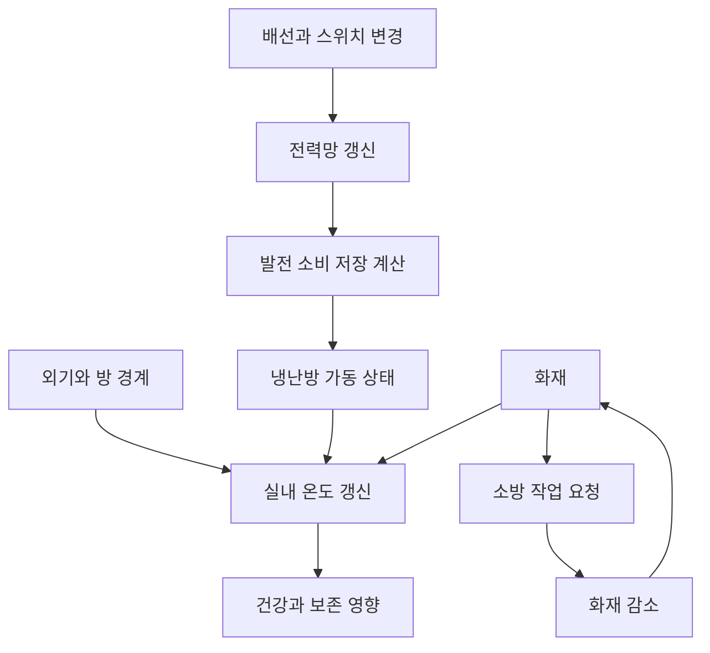

# 08. 전력·온도·화재

[목차](../README.md) · [건물·방](05_building_rooms_zones.md) · [식량·생산](07_food_agriculture_production.md)

> 공개 문서로 확인한 결과를 재구성했다. 실행·원본 코드 검증은 미실시이며, 처리 구조와 데이터 예시는 별도 재구현 제안이다.

## 1. 시스템 목적과 플레이 경험

[해석] 전력은 여러 시설을 하나의 공급망으로 연결하고, 온도는 공간의 경계와 생산 시설을 생존 조건으로 바꾼다. 화재는 재료 선택, 동선, 저장 설계의 약점을 빠르게 드러낸다. 발전기를 더 짓는 선택과 전력망을 분리하는 선택은 서로 다른 위험을 해결한다.

**핵심 설계 질문:** 평상시 효율을 높인 연결 구조가 사고 때 얼마나 넓은 피해를 전파하는가?

## 2. 범위와 입출력

| 구분 | 내용 |
| --- | --- |
| 담당 | 전력망의 공급·소비·저장, 실내외 열환경, 점화·연소·소화 |
| 비담당 | 방 경계의 생성은 건축, 구체 건강 효과는 건강 시스템 |
| 입력 | 발전량, 소비량, 전선 연결, 벽·문·지붕, 외기온, 연료와 가연물 |
| 상태 | 전력망별 잔여 전력, 배터리 저장량, 방 온도, 화재 위치·강도 |
| 출력 | 시설 가동 상태, 온도 노출, 식품 보존 변화, 피해와 소방 작업 |

## 3. 플레이어 조작과 제공 정보

[확인] 발전·저장·배전 건물을 배치하고 스위치로 전력망을 분리한다. 냉난방 시설은 실내 온도 관리에 쓰이며, 화재 진압 작업은 주거 구역 지정과 연결된다. [S1][S2][S3]

[제안] 선택한 시설에서 연결 전력망, 총발전, 총소비, 저장 에너지, 정지 이유를 함께 표시한다. 온도 표시는 목표와 실제를 구분한다. 화재 경보에는 위치뿐 아니라 병원·식량창고·전력실 등 피해 대상의 의미를 전달한다.

## 4. 핵심 규칙

| ID | 조건 | 처리·결과 | 근거 |
| --- | --- | --- | --- |
| P01 | 연결된 전력 전달 구조 | 같은 전력망의 발전·저장량을 공유 | [확인][S1] |
| P02 | 소비가 발전보다 큼 | 배터리에 저장된 에너지로 부족분을 충당 | [확인][S1] |
| P03 | 발전 초과분과 저장 공간 존재 | 충전 가능; 사용·저장되지 않은 전력은 남지 않음 | [확인][S1] |
| P04 | 실내 경계 또는 지붕 변경 | 실외와의 열교환 조건이 달라짐 | [확인][S2] |
| P05 | 식품을 낮은 온도로 보관 | 부패가 느려지거나 멈추지만 야외 내구도 저하는 별개 | [확인][S2] |
| P06 | 실내에서 화재 발생 | 물체 피해와 함께 열이 크게 증가 | [확인][S3] |
| P07 | 주거 구역 안의 화재 | 소방 가능한 정착민의 작업 대상; 징집자는 인접 화재를 진압 가능 | [확인][S3] |
| P08 | 전기 사고 | 일부 전선 또는 비에 노출된 전기 시설에서 발생 가능 | [확인][S4] |
| P09 | 숨겨진 전선 | 일반 전선의 무작위 합선 대상과 구분되며, 노출 시설의 날씨 위험까지 제거하지는 않음 | [확인][S4] |

## 5. 상태와 처리 흐름

[제안] 전기와 열은 다른 상태 그래프로 관리하고, 시설의 작동 여부만 공유한다.



전선이 끊겼다고 방 자체를 다시 만들 필요는 없다. 반대로 벽이 파괴되면 전력 공급이 정상이더라도 냉동고 성능이 사라질 수 있다.

## 6. 데이터 모델 및 인터페이스

[제안] 전력 `W`와 에너지 `Wd`를 혼용하지 않는다. 온도 단위는 예시 전체에서 `°C`로 통일한다.

| 데이터 | 필드 | 역할 |
| --- | --- | --- |
| PowerNetwork | `network_id`, `generation_w`, `demand_w`, `battery_ids` | 연결 집합별 수지 |
| BatteryState | `energy_wd`, `capacity_wd`, `charge_efficiency` | 저장·충전 상태 |
| ThermalZone | `room_id`, `temperature_c`, `boundary_links` | 방 단위 열환경 |
| ThermalDevice | `target_c`, `powered`, `heat_output` | 냉난방 장치의 제어 |
| FireState | `cell`, `intensity`, `fuel_refs`, `next_update_tick` | 연소와 확산 |

```yaml
# 원작 상수가 아닌 재구현 시험 상태
network_id: cold_storage_grid
net_power_w: -400
stored_energy_wd: 200
thermal_zone: freezer_01
target_temperature_c: -5
fault_reason: supply_below_demand
```

[제안] `PowerAvailabilityChanged`는 작업대와 온도 시설에, `RoomBoundaryChanged`는 열환경 계산에, `FireDetected`는 작업·알림에 전달한다. 열교환 근사식은 별도로 보정하고 원작의 계산식으로 표기하지 않는다.

## 7. 수치와 밸런스

| 항목 | 값 또는 관계 | 구분 |
| --- | --- | --- |
| 전력·에너지 단위 | W, Wd; 1 Wd는 1 W를 게임 내 하루 공급 | [확인][S1] |
| 기본 배터리 | 저장 한도 600 Wd, 충전 효율 50%로 위키에 기재 | [확인][S1]; 세부 빌드 재확인 권장 |
| 단순 방전 예시 | 200 Wd를 400 W 부족분에 사용하면 손실 무시 시 0.5 게임일 | [제안] 차원 확인 예시 |
| 실내 온도 변화 | 외기·경계·열원·냉각 조건의 결합 | [확인][S2] |
| 확산·발화 확률 | 본 문서에서 고정하지 않음 | [미확인] 패치별 검증 필요 |

[해석] 배터리는 장기적인 발전 부족을 해결하지 못한다. 진단 화면이 저장량만 보여주면 플레이어가 원인을 착각하기 쉽다. 일정 기간의 순전력과 남은 지속 시간을 함께 비교하면 발전 문제와 배선 문제를 구분하기 좋다.

## 8. 대표 플레이 사례와 예외

[해석] 폭염 중 냉동고의 전력망이 끊기면 식품이 바로 없어지는 것은 아니지만 보존 여유가 줄어든다. 정착민이 전선을 고치러 가는 동안 식중독이나 부상으로 노동이 부족할 수 있다. 화재가 창고 벽을 파괴하면 전력 복구만으로 냉각 기능이 회복되지 않는 복합 문제가 된다.

[제안] 꼭 분리할 예외는 다음과 같다.

- 전력 부족과 태양 플레어 같은 가동 금지는 서로 다른 정지 원인으로 기록한다.
- 문 개방과 방 자체의 실외 전환은 다른 열교환 상태로 처리한다.
- 소방 작업자는 화재까지 갈 수 있는지와 노출 위험을 재평가한다.
- 하나의 배터리가 여러 전력망의 저장량으로 중복 계산되지 않게 한다.

태양 플레어가 전기 시설을 정지시킨다는 사실은 [S4]에 근거하며, 위 상태 구분 방식은 구현 제안이다.

## 9. 다른 시스템과의 연결

| 연결 | 주고받는 내용 | 영향 |
| --- | --- | --- |
| [건축](05_building_rooms_zones.md) | 방 경계·재료·지붕 | 냉난방·연소 조건 |
| [식량](07_food_agriculture_production.md) | 보관 온도·시설 가동 | 부패와 조리 처리량 |
| [건강](09_health_medical_body.md) | 온도 노출·화상 | 이동·작업 능력 저하 |
| [작업](04_work_priorities_jobs.md) | 소방·수리 요청 | 일반 작업 중단 |
| [사건](12_storyteller_incidents_difficulty.md) | 폭염·합선·태양 플레어 | 기존 취약점의 동시 노출 |

## 10. 검증 시나리오

다음은 재구현 수용기준이며 실행 완료 결과가 아니다.

| Given | When | Then |
| --- | --- | --- |
| 발전기와 냉각기가 같은 전력망 | 중간 전선 파괴 | 분리된 부분의 공급이 중단됨 |
| 분리된 예비 배터리 | 다른 전력망 사고 | 예비 저장량이 함께 사라지지 않음 |
| 냉동고 가동 중 | 외벽 제거 | 방 상태와 온도 계산이 갱신됨 |
| 주거 구역 밖 화재 | 자동 작업 탐색 | 자동 소방 범위 정책이 적용됨 |
| 야외 식품의 온도만 낮음 | 시간 경과 | 부패와 내구도 저하를 독립 계산 |

## 11. 설계 해석과 재구현 우선순위

[해석] 전기·열·화재를 묶는 이유는 동일한 수학 모델을 쓰기 때문이 아니라 사고가 서로 영향을 주기 때문이다. 전력망에는 연결 무결성, 온도에는 공간 경계, 화재에는 확산과 작업 대응이 핵심이다.

[제안] MVP는 전력망 연결, 발전·소비·저장, 방 온도 근사, 단순 화재와 소방부터 만든다. 이후 기상 발전량, 배전 분리, 점화 조건, 방화 재료, 고급 소화 설비를 늘린다.

## 12. 출처와 확인 필요 사항

확인일: **2026-11-13**. 모두 커뮤니티 문서.

- [S1 — Power](https://rimworldwiki.com/wiki/Power): 전력망, W/Wd, 배터리와 소비.
- [S2 — Temperature](https://rimworldwiki.com/wiki/Temperature): 실내외 온도, 보존과 내구도의 차이.
- [S3 — Fire](https://rimworldwiki.com/wiki/Fire): 연소, 열, 소방 범위.
- [S4 — Events](https://rimworldwiki.com/wiki/Events#Zzztt): 합선 종류, 숨겨진 전선, 태양 플레어. `Short_circuit` 주소가 이 문서로 연결됨을 확인했다.

[미확인] 위키 Fire 문서에는 가연성과 피해 처리의 업데이트 필요 표시가 있다. 정확한 확산 상수, 과부하 시 기기별 차단 순서, 방·지붕 판정 임계치, 열전달 계산 순서는 확정하지 않았다. 원작은 일반적인 회로 시뮬레이터나 유체 열역학 시뮬레이터와 동일하다고 가정하지 않는다.
