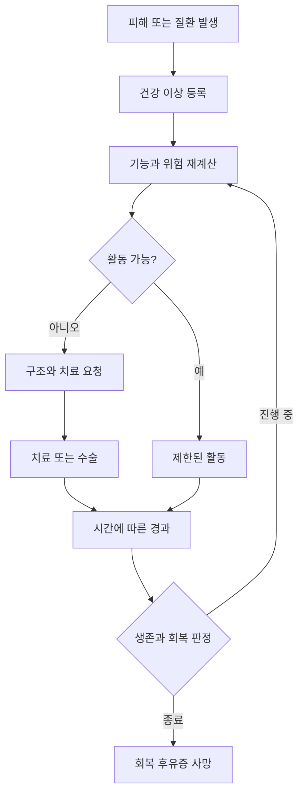

# 09. 건강·신체·의료

[목차](../README.md) · [전투](10_combat_defense_equipment.md) · [정착민](02_colonists_skills_relationships.md)

> 게임 시스템을 다루는 문서다. 공개자료에 의한 간접 확인이며 실제 플레이·원본 코드 검증은 수행하지 않았다.

## 1. 시스템 목적과 플레이 경험

[해석] 건강은 생존 여부뿐 아니라 일을 수행할 수 있는 정도를 바꾼다. 중요한 기술을 가진 한 명의 손상은 생산·치료·방어 전반에 영향을 줄 수 있다. 의료는 적을 쓰러뜨리는 단계 이후에도 시간 압박과 자원 배분을 지속시켜 전투의 결과를 일상으로 연결한다.

**핵심 설계 질문:** 제한된 의사·약품·병상으로 누구를 먼저 안정시키며, 남은 기능 저하를 어떻게 보완할 것인가?

## 2. 범위와 입출력

| 구분 | 내용 |
| --- | --- |
| 담당 | 신체 부위, 부상·질환, 출혈·통증, 능력치, 치료·수술·회복 |
| 비담당 | 명중과 방어 판정은 전투, 환자에게 가는 경로는 작업·이동 |
| 입력 | 부위별 피해, 환경 노출, 질병 사건, 약물, 의사·병상·의약품 |
| 상태 | 각 부위의 손상, 건강 이상 목록, 의식·이동·조작 능력, 치료 기록 |
| 출력 | 활동 불가·회복·사망, 노동 성능 변화, 약품 소비, 기분과 관계 변화 |

## 3. 플레이어 조작과 제공 정보

[확인] 건강 탭에서 부상과 능력 상태를 보고 치료 정책·수술 지시를 관리한다. 의료 작업에는 치료뿐 아니라 구조, 환자 급식, 자기 치료 등이 포함된다. [S1][S4]

[제안] 우선순위 UI는 `현재 위험 / 필요한 행동 / 제한 조건`을 나누어 표시한다. 예를 들어 출혈 중인 환자는 예상 시간과 치료 가능 여부를, 질병 환자는 진행과 면역 경과를 구별해 보여준다. `약 없음`과 `허용 정책 때문에 사용 불가`를 다른 상태로 안내한다.

## 4. 핵심 규칙

| ID | 조건 | 처리·결과 | 근거 |
| --- | --- | --- | --- |
| H01 | 특정 부위에 피해 | 해당 부위 건강과 기능에 영향을 주며 부위가 소실될 수 있음 | [확인][S2] |
| H02 | 통증·출혈 누적 | 활동 능력 저하나 행동 불능을 유발; 출혈은 별도 전신 상태 | [확인][S2] |
| H03 | 시각·이동·조작 등 능력 변화 | 사격·이동·노동 등 관련 성능에 파급 | [확인][S1] |
| H04 | 상처를 치료 | 출혈과 감염 위험을 관리하며 즉시 완전 복구와는 다름 | [확인][S2][S4] |
| H05 | 면역을 획득하는 질환 | 질병 진행과 면역 경과를 함께 관리 | [확인][S3][S4] |
| H06 | 일부 기생 질환 | 면역 경주 대신 누적 치료량이 회복 조건으로 사용됨 | [확인][S4] |
| H07 | 수술 지시 | 기술·의약품 등 조건이 필요하고 실패 가능성이 존재 | [확인][S4] |
| H08 | 질병 발생 | 일반 질병을 주민 간 접촉 전염으로 처리하지 않음. 1.6 Scaria 관련 감염은 감염 개체의 물기·긁기 등 별도 상처 조건으로 전파 | [확인][S3][S5] |

[해석] 모든 질환을 `체력 감소 → 약 사용 → 회복`으로 통일하면 대응 방식의 차이가 사라진다. 상처 안정화, 면역 확보, 누적 치료, 부위 교체는 서로 다른 목표 조건을 가져야 한다.

## 5. 상태와 처리 흐름

[제안] 하나의 체력값 대신 원인과 상태 효과를 합성하는 모델이다.



구조 완료와 치료 완료는 별개 이벤트다. 침대에 도착한 환자라도 아직 치료되지 않은 상처가 있으면 위험 경고를 유지한다.

## 6. 데이터 모델 및 인터페이스

[제안] 아래 명칭과 자료 구조는 독립적인 구현 예시다.

| 데이터 | 주요 필드 | 역할 |
| --- | --- | --- |
| BodyDefinition | `part_ids`, `parent_part`, `capacity_contributions` | 종별 신체 계층 |
| BodyState | `missing_parts`, `part_damage` | 개체별 손상·소실 |
| HealthCondition | `kind`, `part_id`, `severity`, `course_type` | 부상·질환의 공통 식별 |
| TreatmentRecord | `condition_id`, `quality`, `expires_tick` | 치료 효과와 유효 기간 |
| MedicalPolicy | `allowed_medicine`, `self_tend`, `care_enabled` | 플레이어 치료 방침 |
| OperationOrder | `recipe_id`, `target_part`, `reserved_resources` | 수술 예약과 결과 확정 |

```yaml
# 재구현용 상태 예시: 수치는 원작 질환 값이 아님
condition_id: wound_17
pawn_id: colonist_03
part_id: left_leg
kind: cut
severity: 0.30
bleeding_rate_per_game_hour: 0.02
treatment_state: untreated
```

`CapacitiesChanged`를 작업·전투·이동에 보내며, 죽거나 이동한 환자에 대한 치료 예약은 해제한다. 손상 원인과 후유증을 로그에 남겨 결과를 역추적할 수 있게 한다.

## 7. 수치와 밸런스

| 항목 | 구분 | 적용 기준 |
| --- | --- | --- |
| 부위 손상과 기능 | [확인] | 위치별로 결과가 달라짐. [S1][S2] |
| 치료 질과 수술 성공률 | [확인] | 다른 지표이므로 같은 숫자로 취급하지 않음. [S4] |
| 청결·빛 | [확인] | 감염·작업·수술에 대한 영향과 치료 질 자체에 대한 영향을 구분. [S4] |
| 질환 증가·회복 계수 | [미확인] | 개별 질환과 설정에 따라 달라 그대로 복제하지 않음 |
| 응급 우선순위 점수 | [제안] | 예상 위험 시간, 개선 가능한 위험, 접근 비용으로 구성 |

[해석] 좋은 의사를 한 명만 확보하는 전략은 일상에는 효율적이지만 그 사람이 쓰러졌을 때 취약하다. 의료 성능의 평균뿐 아니라 대체 인력 유무, 약품 재고, 병원까지의 이송 시간이 생존 가능성을 결정한다.

## 8. 대표 플레이 사례와 예외

[해석] 사격 담당자가 다리를 다치면 전투에서 빠지는 것뿐 아니라 병원까지의 이동도 느려진다. 다른 정착민이 구조하는 동안 출혈이 진행되고, 치료 후에도 완전한 작업 복귀까지 시간이 필요하다. 원작의 부위·출혈·능력 규칙을 연결하면 이 사건을 노동력 손실과 재활의 이야기로 읽을 수 있다. [S1][S2]

[제안] 구현 시 다음 예외를 분리한다.

- 수술별 대상 조건 재검증: 소실 부위를 대체하는 의수·의족 설치는 허용하고, 이미 제거된 부위의 적출처럼 해당 수술의 조건에 맞지 않는 지시만 중단한다.
- 의사 사망·징집·정신 이상: 환자와 약품의 예약을 풀고 재할당한다.
- 무약품 치료 가능 상황: 의약품이 없다는 이유만으로 모든 안정화 작업을 차단하지 않는다.
- 사망과 수술 완료가 같은 갱신에 발생: 결과 확정을 한 경로로 직렬화한다.

## 9. 다른 시스템과의 연결

| 연결 | 주고받는 내용 | 영향 |
| --- | --- | --- |
| [전투](10_combat_defense_equipment.md) | 피해 부위·종류, 행동 가능 여부 | 명중이 장기 기능 손상으로 전환 |
| [작업](04_work_priorities_jobs.md) | 구조·치료 요청과 작업 능력 | 응급 작업으로 일상 생산 중단 |
| [기분](03_needs_mood_mental_breaks.md) | 통증·상실 경험 | 부상 후 정신적 압박 |
| [건축](05_building_rooms_zones.md) | 병상과 치료 환경 | 이송·수술·회복 여건 |
| [동물](11_animals_taming_ranching.md) | 종별 신체와 치료 | 인간 이외 개체에도 건강 규칙 재사용 |

## 10. 검증 시나리오

재구현 수용기준이며 테스트 실행 결과가 아니다.

| Given | When | Then |
| --- | --- | --- |
| 다리에 손상이 있음 | 기능 재계산 | 이동 관련 성능이 갱신됨 |
| 환자가 병상에 도착했으나 미치료 | 위험 평가 | 구조 완료만으로 출혈 경보가 지워지지 않음 |
| 치료 가능한 상처와 약품 없음 | 무약품 치료 지시 | 허용 범위 안에서 안정화 시도 가능 |
| 수술 중 대상 부위가 무효 | 완료 처리 | 잘못된 부위와 자원을 중복 처리하지 않음 |
| 누적 치료형 질환 | 치료 누적 | 면역형 질환의 종료 조건을 잘못 적용하지 않음 |

## 11. 설계 해석과 재구현 우선순위

[해석] 정착민의 가치는 손상 위치와 기술 분포가 연결될 때 더 선명해진다. 범용 체력 시스템보다 구현 비용이 높지만, 동일한 전투 결과가 다양한 후속 과제를 만들 수 있다.

[제안] MVP는 신체 부위, 출혈·통증, 구조, 치료, 시간 회복, 사망으로 제한한다. 다음 단계에서 질환별 경과 모델, 수술, 의수·의족, 만성 상태를 추가한다. DLC 유전자와 초자연 회복은 별도 효과 계층으로 확장한다.

## 12. 출처와 확인 필요 사항

확인일: **2026-11-13**. 모두 커뮤니티 문서.

- [S1 — Health](https://rimworldwiki.com/wiki/Health): 건강 탭과 기능별 능력.
- [S2 — Injury](https://rimworldwiki.com/wiki/Injury): 부위 손상, 통증, 출혈, 후유증.
- [S3 — Disease](https://rimworldwiki.com/wiki/Disease): 질병 발생과 전염 예외.
- [S4 — Doctoring](https://rimworldwiki.com/wiki/Doctoring): 치료·수술·누적 치료량, 환경 요인 구분.
- [S5 — Scaria](https://rimworldwiki.com/wiki/Scaria): 1.6의 상처를 통한 감염과 일반 접촉 전염의 구분. 2026-11-13 확인.

[미확인] Doctoring 문서의 일부 표에는 오래된 버전과 재검증 표시가 있다. 따라서 상세 성공률, 통증·의식 임계치, 적의 쓰러짐과 사망 보정, 모든 질환의 진행 계수는 확정하지 않았다. 진료 환경의 유리함을 모든 의료 수치에 동일하게 곱하는 구현은 피한다.
