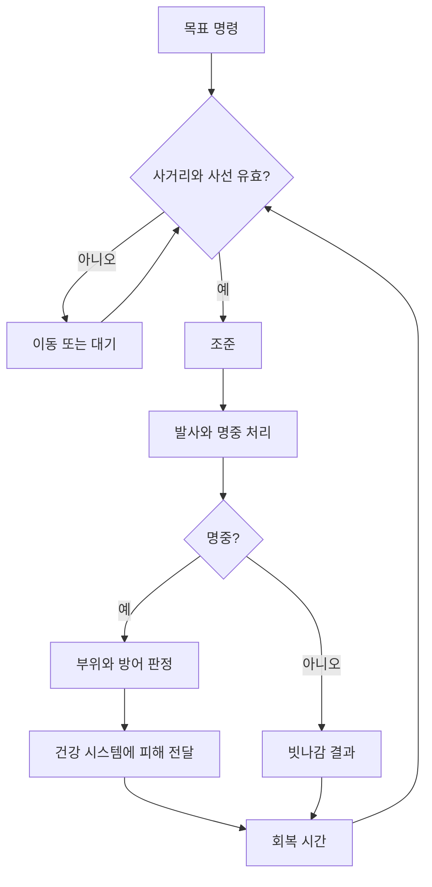

# 10. 전투·방어·장비

[목차](../README.md) · [건강](09_health_medical_body.md) · [사건·난이도](12_storyteller_incidents_difficulty.md)

> 공개 문서를 근거로 전투의 의사결정 구조를 분석했다. 실제 전투 재현, 원본 코드 검증, 확률 실험은 수행하지 않았다.

## 1. 시스템 목적과 플레이 경험

[해석] 전투는 일상에 투자한 장비·배치·의료 준비를 짧은 시간에 시험한다. 적을 모두 쓰러뜨리는 결과만으로 성공을 판단하기 어렵다. 숙련자 손실, 부상, 방화, 시설 파괴가 이후의 노동과 생존에 남기 때문이다.

**핵심 설계 질문:** 화력을 집중하면서 노출·접근·후퇴·구조 비용을 어떻게 통제할 것인가?

## 2. 범위와 입출력

| 구분 | 내용 |
| --- | --- |
| 담당 | 징집과 목표 명령, 원거리·근접 공격, 엄폐, 방어구·장비 |
| 비담당 | 습격 규모는 사건, 명중 이후의 부상 경과는 건강 |
| 입력 | 공격자 능력, 무기, 목표 위치, 사선·거리·엄폐, 방어구 |
| 상태 | 이동·조준·사격·회복 상태, 목표, 장비, 전술 배치 |
| 출력 | 명중·빗나감, 피해 종류·부위·량, 장비 손상, 전투 로그 |

## 3. 플레이어 조작과 제공 정보

[확인] 징집한 정착민에 이동·공격 대상을 지정하고 일시 정지 중에도 명령할 수 있다. 사격자의 목표에 대한 명중 설명과 개체의 전투 로그는 결과를 이해하는 수단이다. [S1][S5]

[제안] UI는 공격 가능 여부와 실패 원인을 구분한다. `사거리 밖 / 사선 차단 / 조준 중 / 회복 중 / 기능 상실`을 별도 상태로 표시한다. 대상 명중률은 전신 방어력 하나와 합쳐 최종 성공률처럼 보여주지 않는다.

## 4. 핵심 규칙

| ID | 조건 | 처리·결과 | 근거 |
| --- | --- | --- | --- |
| C01 | 정착민 징집 | 평상시 작업 대신 전술 명령을 수행 | [확인][S1] |
| C02 | 원거리 무기 공격 | 조준·발사·회복의 주기를 가짐 | [확인][S2] |
| C03 | 일반적인 총기 사용 | 대부분의 무기는 개별 탄약을 소비하지 않지만 예외 무기·포탄 체계가 있음 | [확인][S2] |
| C04 | 사선의 벽·엄폐 | 벽은 사선을 막고 낮은 엄폐는 사격을 차단할 가능성을 제공 | [확인][S3] |
| C05 | 공격 방향·거리 변화 | 같은 엄폐물도 보호 효과가 달라짐 | [확인][S3] |
| C06 | 자신과 밀착한 대상 | 해당 대상에게 원거리 사격 대신 근접전을 사용 | [확인][S1][S2] |
| C07 | 사격 능력과 신체 상태 변화 | 사격자의 정확도에 영향을 줌 | [확인][S5] |
| C08 | 방어구 착용 | 부위와 착용 층이 겹치는 장비는 함께 착용할 수 없음 | [확인][S4] |
| C09 | 피해가 방어구에 도달 | 맞은 부위를 덮는 장비를 바깥 층부터 판정하며 관통력을 고려 | [확인][S4] |
| C10 | 사격 주변에 아군 존재 | 조건에 따라 오사가 발생할 수 있음 | [확인][S1] |

[해석] 엄폐와 방어구는 해결하는 문제가 다르다. 엄폐는 명중 이전의 공간적 보호이고, 장비는 맞은 부위와 피해 종류에 대응한다. 긴 사거리 역시 공격 가능한 시간을 늘리는 대신 이동·엄폐·명중 조건과 함께 판단해야 한다.

## 5. 상태와 처리 흐름

[제안] 공격과 피해 전달을 분리한 재구현 흐름이다.



도중에 목표가 죽거나 사라지면 현재 상태와 무기 특성에 맞게 취소한다. 다이어그램은 원작의 모든 투사체·폭발·근접 세부 판정을 그대로 재현한 것이 아니다.

## 6. 데이터 모델 및 인터페이스

[제안] 무기 정의, 공격 실행 상태, 피해 결과를 각각 기록한다.

| 데이터 | 주요 필드 | 역할 |
| --- | --- | --- |
| WeaponDefinition | `range_cells`, `warmup_ticks`, `burst_count`, `cooldown_ticks` | 공격 주기와 유효 범위 |
| AttackContext | `attacker_id`, `target_id`, `weapon_id`, `origin_cell` | 한 공격의 식별과 추적 |
| CoverQuery | `direction`, `blocking_cells`, `cover_factors` | 공간 보호 평가 |
| ApparelDefinition | `layers`, `covered_parts`, `armor_by_type` | 착용 호환성과 방어 대상 |
| DamagePacket | `damage_type`, `amount`, `penetration`, `hit_part` | 건강 시스템으로 넘길 결과 |

```yaml
# 원작 무기 데이터가 아닌 테스트용 공격
attack_id: attack_0042
attacker_id: defender_02
target_id: raider_01
weapon_id: prototype_rifle
state: aiming
remaining_simulation_ticks: 40
hit_part: null
```

`DamageApplied`는 공격 ID를 포함하여 같은 발사의 중복 적용을 막는다. 공격 로그에는 목표 변경과 취소 이유도 보존한다.

## 7. 수치와 밸런스

[확인] 위키의 일반 방어 판정 설명에서 관통력은 방어 수치에서 차감하는 값이며, 방어력이 일정 비율로 항상 피해를 감소시키는 방식은 아니다. 판정 결과에는 완전 방어·절반 피해·그대로 통과가 있다. [S4]

**문서 규칙을 적용한 단일 층 계산 예:** 방어 80%, 관통 20%p라면 유효 방어는 60%이다. 이 단순 조건에서 완전 방어 30%, 절반 피해 30%, 통과 40%로 읽을 수 있다. 이는 특정 장비의 실제 성능 측정값이 아니며, 다층·특수 피해·부위 선택을 포함하지 않는다. [S4]

| 비교 지표 | 구분 | 사용 이유 |
| --- | --- | --- |
| 한 주기 기대 피해 | [제안] | 발사 피해뿐 아니라 조준·회복·명중을 포함 |
| 구조까지의 시간 | [제안] | 과도한 전진으로 발생하는 후속 손실 평가 |
| 부위별 보호 범위 | [확인][S4] | 몸통 보호와 팔다리 보호를 분리 |
| 총기별 정확도·주기 | [미확인] | 1.6 세부 빌드에 맞춘 수치 표를 별도 확보해야 함 |

## 8. 대표 플레이 사례와 예외

[해석] 원거리 사수가 엄폐 뒤에서 적을 지연시키고, 가까워진 적을 근접 담당자가 막는 배치는 두 무기의 유효 조건을 결합한다. 그러나 후퇴 경로가 한 곳뿐이면 부상자를 구조하러 나온 인원이 같은 사선에 노출된다. 방어선의 성능은 처치 속도뿐 아니라 부상자를 빼낼 수 있는 공간으로도 평가해야 한다.

[제안] 다음 예외를 반드시 처리한다.

- 조준 중 목표가 엄폐 뒤로 이동: 발사 시점의 유효성을 다시 평가한다.
- 범위 공격에 아군이 포함: 일반 총기 오사 규칙을 그대로 적용하지 않는다.
- 하나의 장비가 여러 층 점유: 동일 장비를 반복 방어 판정하지 않는다.
- 공격자 쓰러짐·정신 이상: 기존 명령과 공격 예약의 종료 이유를 기록한다.

## 9. 다른 시스템과의 연결

| 연결 | 주고받는 내용 | 영향 |
| --- | --- | --- |
| [건강](09_health_medical_body.md) | 부위 피해·능력 변화 | 전투와 부상 후 노동 연결 |
| [건축](05_building_rooms_zones.md) | 벽·문·엄폐·동선 | 공격 방향과 방어선 형성 |
| [생산](07_food_agriculture_production.md) | 무기·방어구·품질 | 투자한 노동의 전투 성능 전환 |
| [기분](03_needs_mood_mental_breaks.md) | 공포·통증·정신 이상 | 통제 가능한 전투력 변화 |
| [사건](12_storyteller_incidents_difficulty.md) | 적 유형·규모·도착 방식 | 동일 방어선의 대응 다양성 |

## 10. 검증 시나리오

재구현 수용기준이며 전투 실험을 실행했다는 뜻은 아니다.

| Given | When | Then |
| --- | --- | --- |
| 목표까지 벽이 존재 | 사격 명령 | 사선 차단을 설명하고 무효 발사하지 않음 |
| 같은 방어구가 두 층 점유 | 명중 피해 처리 | 해당 장비는 한 번만 판정 |
| 몸통만 보호하는 장비 | 보호되지 않은 부위 피격 | 몸통 방어를 전신에 적용하지 않음 |
| 조준 중 목표 제거 | 발사 갱신 | 무효 참조 없이 취소·재선택 |
| 전투 중 부상으로 이동 저하 | 후퇴 명령 | 건강 변화가 실제 이동에 반영됨 |

## 11. 설계 해석과 재구현 우선순위

[해석] 원작과 유사한 긴장감을 만들려면 무기 목록보다 공간 조건과 부상의 지속 효과가 먼저 필요하다. 피해 숫자가 커지는 것만으로는 생산·의료 시스템에 연결되는 전투를 만들기 어렵다.

[제안] MVP는 징집, 원거리·근접 각 1종, 사선, 엄폐, 한 층 방어구, 부위 피해, 구조부터 구현한다. 이후 무기군, 다층 방어, 폭발·화염, 포탑·공성, 장비 정책과 적 전술을 확장한다.

## 12. 출처와 확인 필요 사항

확인일: **2026-11-13**. 모두 커뮤니티 문서.

- [S1 — Combat](https://rimworldwiki.com/wiki/Combat): 징집, 전투 명령, 오사와 로그.
- [S2 — Weapons](https://rimworldwiki.com/wiki/Weapons): 공격 주기와 무기별 차이.
- [S3 — Cover](https://rimworldwiki.com/wiki/Cover): 사선, 높고 낮은 엄폐, 방향 효과.
- [S4 — Apparel](https://rimworldwiki.com/wiki/Apparel): 층·부위·관통·방어 판정.
- [S5 — Shooting Accuracy](https://rimworldwiki.com/wiki/Shooting_Accuracy): 사격 능력과 설명 UI.

[미확인] 오사 안전 거리의 경계, 투사체 빗나감과 중간 개체 판정, Sharp 피해의 변환과 후속 층 처리, 근접 공격 선택 가중치 등은 실제 빌드로 검증해야 한다. 위키에도 일부 항목의 재검증 요청이 있어 단일 공식으로 확정하지 않았다.
