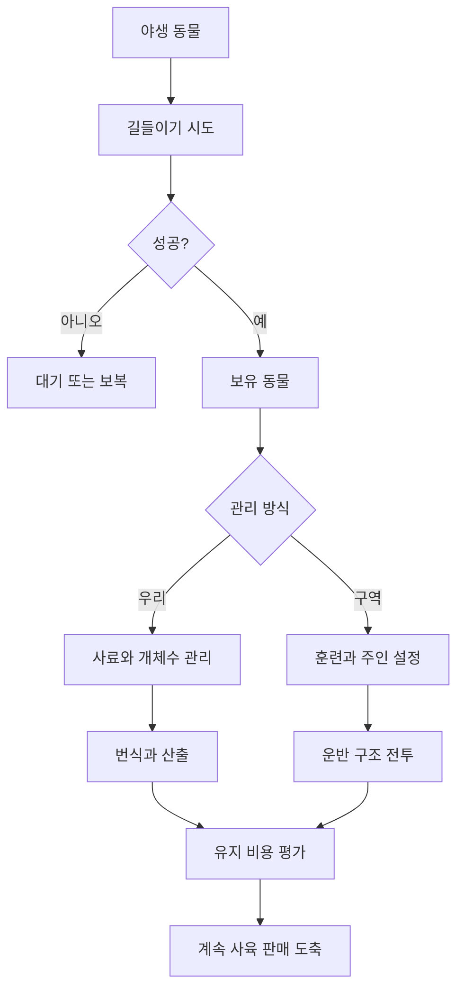

# 11. 동물·조련·목축

[목차](../README.md) · [식량·생산](07_food_agriculture_production.md) · [카라반](15_caravans_world_travel.md)

> 공개 문서에 근거한 역기획이다. 실제 동물 행동 실험과 원본 코드 열람은 미실시. DLC 추가 종·특수 훈련은 해당 DLC 문서의 범위다.

## 1. 시스템 목적과 플레이 경험

[해석] 동물은 자원 생산, 운반, 전투, 감정적 유대라는 다른 효용을 하나의 생명 개체에 묶는다. 늘어난 가축은 잠재적인 식량이지만 지금 먹여야 하는 소비자이기도 하다. 성장과 번식이 늦게 나타나므로 단기 이익만 보고 개체를 늘리면 겨울의 사료 부족으로 돌아올 수 있다.

**핵심 설계 질문:** 보유한 동물의 효용이 먹이·관리 노동·공간·위험 비용을 넘어서는가?

## 2. 범위와 입출력

| 구분 | 내용 |
| --- | --- |
| 담당 | 야생동물, 길들이기, 훈련, 사육 공간, 번식·축산물·개체수 관리 |
| 비담당 | 사냥 명중은 전투, 도축 후 가공은 생산, 개체 건강은 건강 시스템 |
| 입력 | 종 특성, 먹이, 조련자 능력, 우리·허용 구역, 계절과 개체 구성 |
| 상태 | 소유·야생 상태, 훈련, 주인, 나이·번식, 식욕, 사육 위치 |
| 출력 | 축산물·고기·운반·전투 지원·유대, 사료 소모·오물에 의한 청결 부담·위험 |

## 3. 플레이어 조작과 제공 정보

[확인] 야생동물에 길들이기를 지정하고, 보유 동물의 훈련·주인·도축·개체수 정책을 관리한다. 우리에 두는 동물과 허용 구역을 지정하는 동물은 이동 관리 방식이 다르다. [S1][S2][S3]

[제안] 동물 목록에는 현재 수만이 아니라 예상 먹이 부담, 번식 예정, 훈련 유지 부담을 함께 제공한다. 모든 동물에 동일한 구역 선택 UI를 노출하기보다 종의 관리 방식에 맞는 설정을 보여준다. 육성 목적이 운반인지 번식인지 반려인지 식별할 수 있게 하면 보호와 처분 정책을 구분하기 쉽다.

## 4. 핵심 규칙

| ID | 조건 | 처리·결과 | 근거 |
| --- | --- | --- | --- |
| A01 | 야생 개체와 적합한 조련자·먹이 | 길들이기 시도가 가능하며 종과 능력이 성공에 영향 | [확인][S3] |
| A02 | 길들이기 실패 | 일부 종은 보복 공격할 가능성이 있음 | [확인][S3] |
| A03 | 훈련 가능한 동물 | 훈련 목표에 따라 호위·전투 참전·구조·운반 등을 습득. Odyssey의 특정 목표 지정 공격 훈련과 구분 | [확인][S3], [DLC 경계](../dlc/05_odyssey.md) |
| A04 | 훈련 유지 중단 | 종별 조건에 따라 훈련이나 길들여짐을 잃을 수 있음 | [확인][S3] |
| A05 | 우리 관리 대상 | 일반 허용 구역 대신 우리 표식과 폐쇄된 경계로 관리 | [확인][S2] |
| A06 | 우리 경계가 열림 | 배회하거나 정착지를 떠날 위험이 생김 | [확인][S2] |
| A07 | 축산 가능한 종 | 우유·털·알·화학연료 등 종별 산출물을 제공 | [확인][S3] |
| A08 | 개체수 관리 설정 | 조건에 따라 자동 도축할 수 있고 유대·임신 개체 포함 여부를 조절 | [확인][S3] |
| A09 | 사람과 동물의 유대 | 사람의 기분과 상실 경험에 영향을 줌 | [확인][S1] |

[해석] `길들인 동물 = 완전히 통제되는 유닛`으로 보면 먹이 탐색과 유지 관리라는 주요 비용이 사라진다. 목적을 지정해도 행동은 개체의 상태와 접근 가능한 공간 안에서 이루어져야 한다.

## 5. 상태와 처리 흐름

[제안] 소유 상태와 활동 상태를 구분한 재구현 흐름이다.



길들이기 실패가 항상 보복을 의미하지는 않는다. 훈련 가능 여부, 사육 공간, 제품 생산 능력은 서로 독립된 종별 속성으로 둔다.

## 6. 데이터 모델 및 인터페이스

[제안] 개체별 상태와 종의 정의를 분리한다. 동물의 건강을 인간 전용 자료 구조에 억지로 맞추지 않고 종별 신체 정의를 공유한다.

| 데이터 | 필드 | 역할 |
| --- | --- | --- |
| AnimalSpecies | `diet`, `management_mode`, `trainable_roles`, `product_defs` | 종의 가능 행동 |
| AnimalState | `owner_faction`, `age_ticks`, `hunger`, `bonded_pawn_id` | 개체 상태와 관계 |
| TrainingState | `role_progress`, `maintenance_due_tick`, `master_id` | 학습·유지·주인 |
| PenState | `marker_id`, `boundary_valid`, `nutrition_supply` | 우리와 먹이 환경 |
| PopulationPolicy | `species_id`, `adult_limits`, `young_limits`, `protected_flags` | 번식과 처분 관리 |

```yaml
# 재구현용 사육 정책 예시; 원작 기본값이 아님
policy_id: herd_plan_01
species_id: prototype_grazer
adult_female_limit: 6
adult_male_limit: 1
protect_pregnant: true
protect_bonded: true
reserve_feed_game_days: 8
```

`PenBoundaryChanged`는 동물 담당 작업에, `AnimalProductReady`는 채집·생산에 전달한다. 판매·도축·카라반 편입이 같은 개체를 동시에 예약할 때 하나의 소유권 판정으로 해결한다.

## 7. 수치와 밸런스

| 항목 | 구분 | 분석 방식 |
| --- | --- | --- |
| 길들이기 성공과 보복 | [확인] | 종과 조련 조건을 고려하는 별도 결과. [S3] |
| 유지 효율 | [제안] | `(산출 가치 + 지원 효용) / (먹이 + 관리 노동 + 공간 비용)` |
| 사료 여유 | [제안] | 가용 영양을 현재 소비량과 성장 후 소비량으로 각각 계산 |
| 훈련 횟수·쿨다운 | [미확인] | 1.6 빌드 및 종별 데이터로 확정 필요 |
| 번식·성숙·생산 주기 | [미확인] | 전 종 공통 상수로 묶지 않음 |

[해석] 생산량만 비교하면 운반 동물이나 반려동물의 의미가 누락된다. 반대로 주관적 효용만 강조하면 먹이와 관리 인력의 부담을 보지 못한다. 평가 화면은 비용과 효용을 구분해 보여주고 최종 선택은 플레이어에게 남기는 편이 적절하다.

## 8. 대표 플레이 사례와 예외

[해석] 봄에 확보한 가축이 여름 동안 늘어나면 현재 먹이가 충분해 보여도 겨울에는 관리가 어려워질 수 있다. 판매로 규모를 줄일지, 비축 사료를 늘릴지, 번식 구조를 바꿀지 선택해야 한다. 유대가 있는 동물은 같은 시장 가격이어도 플레이어가 다르게 평가하게 된다.

[제안] 다음 예외를 별도 처리한다.

- 우리 입구가 파괴됨: 경계를 재계산하고 동물을 순간이동시키지 않는다.
- 관리 가능한 조련자가 없음: 기존 훈련 유지 작업의 실패 원인을 표시한다.
- 사료가 있어도 먹이 종류가 맞지 않음: 충분한 재고로 표시하지 않는다.
- 자동 도축 후보가 카라반에 편입됨: 중복 명령을 해제한다.
- 보호 대상만 남음: 개체수 한도를 넘더라도 정책을 무시하지 않고 경고한다.

## 9. 다른 시스템과의 연결

| 연결 | 주고받는 내용 | 영향 |
| --- | --- | --- |
| [식량](07_food_agriculture_production.md) | 사료·고기·축산물 | 식량 공급과 소비의 양면 |
| [물류](06_items_storage_logistics.md) | 운반 능력·허용 구역 | 사람의 운반 노동 절감 |
| [기분](03_needs_mood_mental_breaks.md) | 유대·상실 | 경제 가치와 다른 선택 기준 |
| [전투](10_combat_defense_equipment.md) | 공격·호위·피해 | 전력 증가와 동물 손실 위험 |
| [카라반](15_caravans_world_travel.md) | 짐 운반과 개체 편입 | 원정 능력과 잔류 사료 수요 변화 |

## 10. 검증 시나리오

재구현 수용기준이며 실행 검증은 미실시다.

| Given | When | Then |
| --- | --- | --- |
| 우리 관리 종 보유 | 허용 구역 변경 | 우리 관리 규칙과 혼용되지 않음 |
| 닫힌 우리 | 경계 한 곳 파괴 | 경계 상태와 배회 위험 갱신 |
| 부적합한 먹이만 보유 | 먹이 찾기 | 식품 개수만으로 포만 처리하지 않음 |
| 유대 보호 설정 | 자동 도축 평가 | 보호 개체를 후보에서 제외 |
| 판매와 카라반이 같은 동물 선택 | 작업 확정 | 개체 소유권이 중복 이동하지 않음 |

## 11. 설계 해석과 재구현 우선순위

[해석] 동물 시스템의 차별점은 종류의 수보다 종별 역할과 관리 방식의 차이에 있다. 사육만 하면 자동 이익이 쌓이는 구조보다 사료·공간·유지 노동이 함께 필요할 때 다른 시스템과 연결된다.

[제안] MVP는 야생 식생 소비, 가축 1종, 반려·운반 동물 1종, 길들이기, 우리, 사료, 제품 수확부터 구현한다. 이후 번식·자동 도축·유대·전투 훈련·카라반을 확장한다. Odyssey의 특수 훈련을 기본게임 규칙으로 합치지 않는다.

## 12. 출처와 확인 필요 사항

확인일: **2026-11-13**. 모두 커뮤니티 문서.

- [S1 — Animals](https://rimworldwiki.com/wiki/Animals): 동물의 기본 상태, 목록 UI, 유대.
- [S2 — Pen](https://rimworldwiki.com/wiki/Pen): 우리 관리와 허용 구역의 차이, 경계와 배회.
- [S3 — Animal husbandry](https://rimworldwiki.com/wiki/Animal_husbandry): 길들이기·훈련·축산·자동 도축. `Animal_training`이 이 문서로 연결됨을 확인했다.

[미확인] 동물 문서에는 DLC가 함께 섞여 있고 훈련 단계 관련 설명에도 재검증이 필요한 부분이 있다. 종별 학습 단계, 유지 감소, 번식 수치, 비행 동물과 우리 경계의 상호작용은 빌드와 DLC 구성을 고정한 후 확인해야 한다. 모든 종을 동일한 우리·훈련 모델로 처리하지 않는다.
