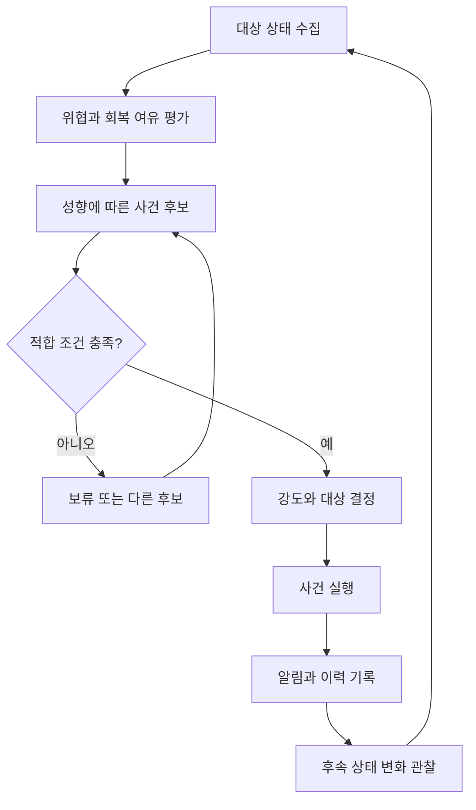

# 12. 스토리텔러·사건·난이도

[목차](../README.md) · [전투](10_combat_defense_equipment.md) · [퀘스트·엔딩](16_quests_endings.md)

> 공개 문서 기반 분석이다. 스토리텔러 내부 코드를 확인하거나 사건 빈도를 실측하지 않았다. 아래 스케줄러와 데이터 구조는 재구현 제안이다.

## 1. 시스템 목적과 플레이 경험

[확인] 공식 소개에서 스토리텔러는 습격·기상·방문자 같은 사건을 조절하여 정착지의 이야기를 만드는 장치로 설명된다. [S1]

[해석] 이 구조의 중요한 기능은 이야기를 문장으로 대신 쓰는 것이 아니라 기존 시스템에 압력을 가하고 사건 사이의 여유를 조절하는 것이다. 동일한 습격도 식량 부족, 의사 부상, 겨울 준비 상태에 따라 다른 결과를 만든다. 이 문서의 AI는 사건 선택·강도·시간 조절을 의미하며, 생성형 언어 모델을 전제하지 않는다.

**핵심 설계 질문:** 플레이어의 성장을 시험하면서 회복과 다음 계획을 세울 여유를 어떻게 배치할 것인가?

## 2. 범위와 입출력

| 구분 | 내용 |
| --- | --- |
| 담당 | 이야기 진행 성향, 사건 후보·시간·위협 규모, 난이도 옵션 |
| 비담당 | 개별 적 전투 AI, 자연스러운 인간관계, 모든 우발 사건의 발생 |
| 입력 | 정착지·인원·자산 상태, 최근 손실, 시간, 난이도, 사건 적합 조건 |
| 상태 | 사건 간격과 이력, 진행 성향, 위협 평가, 대기 중 사건 |
| 출력 | 습격·기상·지원 등 사건, 선택 창·알림, 외부 과제 |

## 3. 플레이어 조작과 제공 정보

[확인] 플레이어는 스토리텔러와 난이도를 별도로 선택하며 진행 중 변경할 수 있다. 커스텀 난이도는 위협 규모 등 여러 요소를 조정한다. 자산과 전투 규모의 관계를 파악하려면 역사·통계 정보가 도움이 된다. [S2][S3]

[제안] 플레이어용 UI에는 사건 종류·도착 위치·제한 시간을 제공한다. 개발용 UI에는 후보 탈락 이유, 평가 당시 상태, 적용한 난이도 배율, 사건 난수 식별을 보여준다. 게임의 불확실성은 유지하면서 개발자가 원인을 추적할 수 있게 두 표시 수준을 나눈다.

## 4. 핵심 규칙

| ID | 조건 | 처리·결과 | 근거 |
| --- | --- | --- | --- |
| ST-01 | Cassandra Classic 선택 | 위험과 회복을 반복하는 긴장 흐름을 지향 | [확인][S2] |
| ST-02 | Phoebe Chillax 선택 | 큰 사건 사이 여유가 길지만 높은 난이도의 공격 자체가 약하다는 보장은 없음 | [확인][S2] |
| ST-03 | Randy Random 선택 | 사건 조합과 간격의 변동이 큰 성향 | [확인][S2] |
| ST-04 | 난이도 변경 | 스토리텔러 성향과 별개로 위협·경제 등 설정에 영향 | [확인][S2] |
| ST-05 | 위협 규모 산정 | 자산·인원·전투 동물과 난이도·시작·적응 요인이 관여 | [확인][S3] |
| ST-06 | 습격 구성 | 사건 포인트와 적별 전투 비용을 이용해 규모를 구성 | [확인][S3] |
| ST-07 | 여러 정착지·카라반 | 대부분의 포인트는 대상별로 평가하지만 공유되는 적응 요소가 있음 | [확인][S3] |
| ST-08 | 사건 발생 | 알림·선택 창으로 전달; 퀘스트·우발 사건은 별도 규칙도 가짐 | [확인][S4] |

[해석] Randy를 무조건·무제한 무작위로 구현할 근거는 없다. 플레이 성향에 무작위성이 크다는 설명과 개별 사건의 적합 조건·활성화 요구가 사라진다는 주장은 다르다. 또한 모든 사고를 스토리텔러가 직접 발생시킨 것으로 해석하면 사람·환경 시뮬레이션의 원인을 놓친다.

## 5. 상태와 처리 흐름

[제안] 서술 규칙을 재현하기 위한 모듈형 사건 선택 흐름이다.



발생 간격을 결정하는 로직과 습격 규모를 산정하는 로직은 분리한다. 대상이 없어 실패한 사건을 이미 발생한 위협으로 계산할지도 명시적인 정책이 필요하다.

## 6. 데이터 모델 및 인터페이스

[제안] 원작 내부 클래스명이 아닌 분석용 인터페이스다.

| 데이터 | 필드 | 역할 |
| --- | --- | --- |
| StoryProfile | `category_weights`, `pacing_rules`, `recovery_rules` | 성향과 간격 |
| DifficultyProfile | `threat_scale`, `economic_modifiers`, `enabled_threats` | 강도와 옵션 |
| IncidentDefinition | `requirements`, `target_types`, `executor_id` | 사건의 가능 조건과 실행 |
| ColonySnapshot | `wealth`, `population`, `recent_losses`, `elapsed_time` | 평가 시점 상태 |
| IncidentRecord | `incident_id`, `target_id`, `planned_tick`, `outcome` | 중복 방지·추적 |

```yaml
# 독립 프로토타입 예시이며 원작 Cassandra 값이 아님
profile_id: alternating_pressure_demo
major_threat_enabled: true
threat_scale: 1.0
selection_policy: eligible_weighted_random
failure_policy: retry_with_new_candidate
record_evaluation_snapshot: true
```

`RequestIncident`와 `IncidentExecuted`를 분리한다. 사건 실행기는 생성 가능한 위치·세력·개체를 최종 검증하고 실제 결과를 반환한다.

## 7. 수치와 밸런스

[확인] 위키는 기본적인 자산 기반 설정에서 습격 포인트의 구조를 자산 포인트와 개체 포인트의 합에 난이도·초기·적응 요인을 적용하는 형태로 설명한다. 각 요인 자체가 별도 계산을 가지므로 `자산 × 고정 비율` 하나로 재현되지 않는다. 자산과 무관한 진행을 선택하는 사용자 정의 설정 등은 별도 조건이다. [S2][S3]

| 지표 | 구분 | 의미 |
| --- | --- | --- |
| 사건 빈도 | [제안] 계측 | 게임일당 사건 수와 큰 위협 간격 분포 |
| 회복 가능 시간 | [제안] 계측 | 치료·수리·보충이 끝나기 전에 다음 위협이 도착하는 비율 |
| 위협 포인트 | [확인][S3] | 적 수와 일대일 대응하지 않는 구성 예산 |
| 사건 동시성 | [제안] 계측 | 폭염·부상·습격 등 부담이 겹치는 시간 |
| 정확한 간격·곡선 | [미확인] | 스토리텔러별 실제 데이터와 빌드 검증 필요 |

[해석] 동일한 포인트라도 적의 사거리, 침입 방향, 기지 구조에 따라 체감 난이도가 달라진다. 평균 포인트만 맞추면 전투 결과 분산을 재현하지 못한다. 사건 강도와 시스템 조합을 함께 측정해야 한다.

## 8. 대표 플레이 사례와 예외

[해석] 판매용 고가 물품을 많이 비축했지만 장비를 개선하지 않은 정착지는 자산 증가가 방어력 증가와 일치하지 않는다. 이후 습격과 부상, 수확 지연이 연결되면 경제적 성공이 새로운 부담으로 돌아온다. 이는 자산과 위협이 연결되는 규칙을 설계 관점에서 읽은 예이며, 특정 날의 확정 습격을 예측하는 공식은 아니다. [S3]

[제안] 예외 처리 항목은 다음과 같다.

- 유효한 적 세력이 없음: 불가능한 사건 대신 다른 후보로 이동한다.
- 사건 대기 중 대상 맵 폐기: 실행을 취소하고 이력을 명시한다.
- 게임 저장 후 불러오기: 예정 사건이 중복 발생하지 않게 한다.
- 난이도 변경: 이미 예약된 사건과 이후 사건 중 적용 범위를 정한다.
- 큰 손실 직후: 적응 보정과 별개로 개별 사건의 필수 조건을 다시 검사한다.

## 9. 다른 시스템과의 연결

| 연결 | 주고받는 내용 | 영향 |
| --- | --- | --- |
| [경제·세력](14_factions_trade_prisoners.md) | 자산·세력·방문 | 자원 기회와 적 구성 |
| [전투](10_combat_defense_equipment.md) | 적 생성·규모·도착 방식 | 방어 능력 시험 |
| [환경](01_world_map_environment.md) | 기상·생물군계·위치 | 발생 가능한 사건 제한 |
| [건강](09_health_medical_body.md) | 손실·질병 | 회복 여유와 인력 압박 |
| [퀘스트](16_quests_endings.md) | 제안·수락된 위협 | 자발적 위험과 외부 사건의 결합 |

## 10. 검증 시나리오

재구현 수용기준이며 사건 시뮬레이션 실행 결과가 아니다.

| Given | When | Then |
| --- | --- | --- |
| 위협 규모만 변경 | 같은 후보를 평가 | 간격 정책과 강도 정책을 독립 적용 |
| 사건 필수 조건 불충족 | 후보 선택 | 실행되지 않고 이유가 기록됨 |
| 동일 포인트에 다른 적 구성 | 생성 | 포인트를 단순 적 수로 취급하지 않음 |
| 대기 사건 저장 후 불러오기 | 예정 시각 도달 | 한 번만 실행 |
| 사건 대상 맵 삭제 | 실행 단계 | 무효 참조 없이 취소 |

## 11. 설계 해석과 재구현 우선순위

[해석] 긴장과 회복의 리듬을 시스템으로 만들되 결과의 이야기는 플레이어가 해석하도록 남기는 구조다. 설명할 수 있는 실패 원인이 있어야 무작위 피해가 준비와 선택의 결과로 연결된다.

[제안] MVP는 적합 조건, 간격, 사건 이력, 자산·인원 기반 위협 추정, 습격·지원·기상 각 한 종류부터 시작한다. 이후 성향 프리셋, 적응, 다양한 사건 조합, 퀘스트와 다중 맵 연계를 추가한다. 데이터 계측을 먼저 마련하고 사건 개수를 늘린다.

## 12. 출처와 확인 필요 사항

확인일: **2026-11-13**.

- [S1 — RimWorld 공식 소개](https://rimworldgame.com/): 공식. 사건 제어를 통한 이야기 생성이라는 제품 설명.
- [S2 — AI Storytellers](https://rimworldwiki.com/wiki/AI_Storytellers): 커뮤니티. 성향과 난이도의 구분.
- [S3 — Raid points](https://rimworldwiki.com/wiki/Raid_points): 커뮤니티. 규모 산정 구조와 맵·카라반 구분.
- [S4 — Events](https://rimworldwiki.com/wiki/Events): 커뮤니티. 사건 전달 방식과 우발·월드 사건 구분.

[미확인] 사건별 가중치·주기, 적응 보정의 정확한 곡선, 커스텀 난이도 변경 시 예약 사건 처리, DLC 사건 풀과 포인트의 예외는 직접 검증이 필요하다. 위키 수식을 소스 확인 없이 버전 불변의 공식으로 취급하지 않는다.
