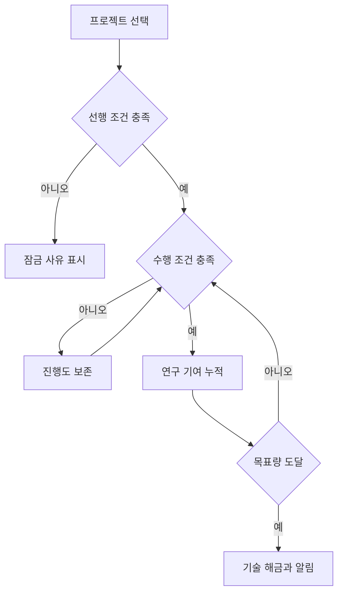

# 13. 연구와 기술 발전

[전체 목차](../README.md) · [작업](04_work_priorities_jobs.md) · [생산](07_food_agriculture_production.md)

> `[확인]`은 공개자료로 확인한 규칙이며 직접 실행 검증을 뜻하지 않는다. `[해석]`은 분석, `[제안]`은 재구현 사양이다. 예시 ID와 수치는 원작 데이터가 아니다.

## 1. 시스템 목적과 플레이 경험

[해석] 연구는 노동시간을 미래의 생산성·안전·선택권으로 교환하는 장치다. 당장 식량을 만들 사람을 연구대로 보내면 현재 생산은 줄지만 냉장·설비·장비 선택이 확장된다. 핵심 질문은 **“오늘의 병목을 해결할 기술에 투자할 것인가, 장기 목표의 선행 기술을 열 것인가?”**다.

연구 완료 자체를 보상으로 끝내지 않고 건설·재료 확보·숙련 작업까지 연결하면, 기술 해금과 실제 생활 개선 사이에 새로운 계획이 생긴다.

## 2. 범위와 입출력

| 구분 | 내용 |
| --- | --- |
| 담당 | 프로젝트 선행 조건, 진행도, 연구 가능성, 완료와 해금 |
| 비담당 | 재료 조달, 실제 건설, 제작 주문 실행; 각 담당 시스템으로 위임 |
| 입력 | 프로젝트 선택, 연구 가능 시설, 연구자의 유효 작업량, 별도 해금 조건 |
| 상태 | 프로젝트별 누적 진행도, 완료 집합, 현재 작업 대상 |
| 출력 | 새 건물·제작법 사용 가능, UI 완료 알림, 다음 선택 후보 |

## 3. 플레이어 조작과 제공 정보

[확인] 연구 탭에서 프로젝트를 선택하며, 일반 연구는 연구대와 연구 노동으로 진행한다. 선행 프로젝트 및 일부 시설 조건이 존재한다.[S1] 따라서 UI는 “기술을 선택할 수 없음”과 “선택했지만 수행할 연구자가 없음”을 다르게 보여야 한다는 것이 본 문서의 설계 제안이다.

[제안] 프로젝트 상세에는 비용·진행률·선행 기술·시설 요구·해금 목록을 함께 표시한다. 진행이 멈춘 경우 `연구자 부재`, `시설 부족`, `전력 부족`, `특수 해금 미충족`처럼 원인을 분리한다. 계획을 세우기 위한 목록과 실제 진행 대상도 구분한다.

## 4. 핵심 규칙

| ID | 조건 | 처리·결과 | 근거 |
| --- | --- | --- | --- |
| R13-01 | 일반 연구 선택 | 한 번에 하나의 일반 연구 프로젝트를 대상으로 연구대 작업 수행 | [확인][S1] |
| R13-02 | 여러 연구자와 연구대 | 동일 프로젝트에 작업 기여가 누적됨 | [확인][S1] |
| R13-03 | 연구 대상을 변경 | 기존 프로젝트의 누적 진행도 유지 | [확인][S1] |
| R13-04 | 선행 기술·시설 미충족 | 관련 연구 진행에 제약 | [확인][S1] |
| R13-05 | 연구자·시설 조건 차이 | 지적 능력과 연구 환경 등이 진행 속도에 관여 | [확인][S1] |
| R13-06 | 시작 세력의 기술 수준 차이 | 특정 연구 비용에 차이 발생 | [확인][S1] |
| R13-07 | 설계도 책을 읽음 | 해당 책이 지정하는 연구의 진행에 기여; 일반 연구대 선택과 구분 | [확인][S2] |
| R13-08 | DLC 특수 연구 | 기술 인쇄물·메카노이드 칩·이상현상 연구 등 별도 조건 존재 | [확인][S1] |

`R13-01`은 책·이상현상 연구를 포함해 모든 진행 경로가 전역 단일 슬롯이라는 뜻이 아니다. 이를 혼동하면 DLC와 독서의 병행을 잘못 제한하게 된다.

## 5. 상태와 처리 흐름

아래는 [제안] 상태 모델이다. 조건 잠김과 진행 중단을 별도 상태로 취급한다.



## 6. 데이터 모델 및 인터페이스

[제안] 정의는 연구 트리와 해금을, 상태는 세이브별 진행을 보유한다. 다음은 원작 내부 클래스가 아닌 독립 구현의 예다.

| 필드 | 타입·단위 | 역할 |
| --- | --- | --- |
| `project_id` | 안정 문자열 | 프로젝트 참조 |
| `prerequisites` | ID 배열 | 순환 없는 선행 관계 |
| `cost_points` | 양수, 연구 점수 | 기본 목표량 |
| `required_facilities` | 태그 배열 | 수행 시설 조건 |
| `unlock_ids` | 정의 ID 배열 | 건설·제작에 전달할 해금 |
| `progress_points` | 0 이상 | 연구별 누적 상태 |
| `contribution_source` | bench / reading / special | 진행 경로 구분 |
| `content_gate` | base 또는 DLC ID | 콘텐츠 가용성 |

```yaml
# [제안] 예시 기술이며 원작 수치가 아님
project_id: prototype_cold_storage
prerequisites: [prototype_electricity]
cost_points: 1000
required_facilities: [research_station]
unlock_ids: [prototype_cooler]
content_gate: base
```

인터페이스 예: `CanResearch(project, context)`는 가능 여부와 사유를 반환하고, `ApplyResearchContribution(project, source, points)`는 해당 프로젝트에만 기여한다. 완료 이벤트는 한 번만 발행한다.

## 7. 수치와 밸런스

[확인] 원작은 연구자의 능력, 시설, 난도 등으로 연구 속도가 달라지며 부족 시작은 일부 연구에 비용 불이익이 있다.[S1] 정확한 계수는 패치별 검증 대상이며 이 문서에서는 원작 상수로 고정하지 않는다.

[제안] 프로토타입은 `진행량 = 기준속도 × 연구자보정 × 시설보정 × 경과 게임시간`으로 시작할 수 있다. 책은 별도 경로이므로 연구대 계수를 자동 공유하지 않는다. 밸런스 지표는 기술별 소요 일수보다 **기술에 투입한 총 노동시간 대비 줄어든 반복 노동시간**으로 잡는다. 선행 기술 비용이 지나치게 크면 선택지가 사실상 한 경로로 수렴하는지 확인한다.

## 8. 대표 플레이 사례와 예외

[제안: 분석 사례] 겨울 전 식량 저장이 부족한 정착지에서 연구자를 투입한다. 냉각 기술을 해금해도 부품과 건설 노동이 부족하면 저장 문제는 해결되지 않는다. 이 사례는 기술 완료 알림과 실제 시설 가동 상태를 분리해야 하는 이유다.

예외 처리: 연구대 파괴 시 진행 보존, 연구자 징집 시 작업 예약 해제, 동일 틱의 복수 기여로 완료 중복 발생 방지, 이미 완료한 프로젝트에 들어온 기여 무시, DLC 비활성화로 사라진 기술 참조의 진단이 필요하다. 반복 연구나 무한 반복 보상은 별도 정의가 없는 한 허용하지 않는다.

## 9. 다른 시스템과의 연결

| 연결 | 주고받는 데이터 | 효과 |
| --- | --- | --- |
| [작업](04_work_priorities_jobs.md) | 연구 일감, 수행 가능 사유 | 노동 배정과 중단 |
| [건설](05_building_rooms_zones.md) | 시설 상태, 해금 ID | 연구 조건·건축 선택 확장 |
| [생산](07_food_agriculture_production.md) | 제작법 가용성 | 해금 후 실제 물자 공급 |
| [전력](08_power_temperature_fire.md) | 가동·정전 상태 | 시설별 수행 가능성 변경 |
| [거래](14_factions_trade_prisoners.md) | 책·재료 획득 | 다른 발전 경로 제공 |
| [Anomaly](../dlc/04_anomaly.md) | 별도 지식 진행 | 일반 연구와 분리된 확장 |

## 10. 검증 시나리오

다음은 [제안] 수용 기준이며 실행 결과가 아니다.

| Given | When | Then |
| --- | --- | --- |
| 연구 A 진행률 40% | B로 전환 후 A 재선택 | A의 누적 진행 유지 |
| 두 연구자가 같은 프로젝트 수행 | 같은 틱에 완료선 통과 | 해금·알림은 각각 한 번 |
| 기술은 해금됐지만 재료 없음 | 건축 명령 | 연구 잠금과 재료 부족을 구분 |
| 선행 프로젝트 미완료 | 후행 프로젝트 선택 | 선행 요구를 표시 |
| 일반 연구 A 선택, 책은 B 대상 | 책 읽기 | B에 기여하고 A 선택 유지 |

## 11. 설계 해석과 재구현 우선순위

[해석] 연구는 아이템 수집 보상보다 노동 배분의 장기 의사결정에 가깝다. 다른 시스템의 병목을 바꾸지만 기술 하나로 생존을 자동 해결하지 않는다.

**MVP:** 선행 그래프, 단일 일반 연구 선택, 다중 기여, 진행 보존, 해금 통지. **후속:** 연구실 환경, 책, DLC별 특수 자격, UI 검색. 기술 수백 개보다 대표적인 생존·생산·전투 기술 몇 개로 선택의 차이를 먼저 확인한다.

## 12. 출처와 확인 필요 사항

| 키 | 출처 | 근거 범위 |
| --- | --- | --- |
| S1 | [RimWorld Wiki — Research](https://rimworldwiki.com/wiki/Research) · 커뮤니티 · 2026-11-13 확인 | 연구대, 전환·기여, 선행 조건, 기술 수준과 DLC 차이 |
| S2 | [Ludeon — Anomaly expansion and update 1.5 announced](https://ludeon.com/blog/2024/03/anomaly-expansion-and-update-1-5-announced/) · 공식 · 2026-11-13 검색 본문 확인 | 무료 1.5의 책과 설계도 연구 |

[미확인] 세부 연구 비용표, 연구 속도 상수, 연구실 판정 계수, 패치별 독서·시설 중첩은 설치된 게임에서 재확인해야 한다. Wiki의 연구 문서에도 보완 필요 표시가 있으므로 그 표 전체를 확정 데이터로 복제하지 않았다.
