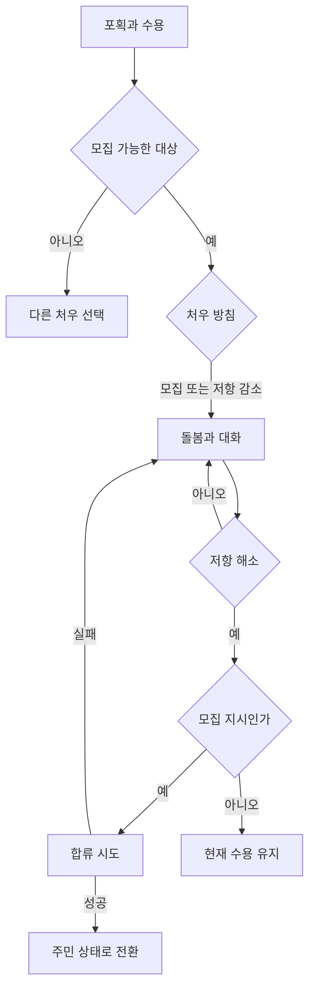

# 14. 세력 외교·거래·포로

[전체 목차](../README.md) · [전투](10_combat_defense_equipment.md) · [월드 이동](15_caravans_world_travel.md)

> 공개자료로 확인한 게임 규칙과 독립 구현 제안을 구분한다. 거래·포로는 외부 자원을 물자·인력·관계로 전환한다는 공통 경계로 묶었으며, 실제 내부 구현이 하나의 모듈이라는 뜻은 아니다.

## 1. 시스템 목적과 플레이 경험

[해석] 정착지는 폐쇄된 생산시설이 아니다. 희귀 재료를 구매하고, 적을 설득해 주민으로 받아들이며, 자원을 선물해 장기 위협을 바꾸는 사회적 선택을 제공한다. 핵심 질문은 **“이번 사건의 단기 이익과 이후 관계 중 무엇을 선택할 것인가?”**다.

포로 확보는 전투의 종료점에 새 선택을 만든다. 생존·돌봄·채용 능력이 부족하면 획득한 인물이 자산보다 부담이 된다.

## 2. 범위와 입출력

| 영역 | 입력 | 상태 | 출력 |
| --- | --- | --- | --- |
| 외교 | 선물, 적대 행위, 임무 결과 | 세력 관계·영구 적대 여부 | 거래·지원·적대 사건 조건 |
| 거래 | 교역자, 품목, 수량 | 재고, 은, 거래 접근성 | 소유권과 재고 변화 |
| 포로 | 포획, 처우·모집 지시 | 소속, 저항, 모집 가능성 | 합류·석방·탈주 등 결과 |

건강 회복과 음식 전달은 [의료](09_health_medical_body.md)·[작업](04_work_priorities_jobs.md) 시스템이 담당한다. 노예 노동·개종은 [Ideology](../dlc/02_ideology.md), 혈액 관련 기능은 [Biotech](../dlc/03_biotech.md) 범위다.

## 3. 플레이어 조작과 제공 정보

[확인] 세력 정보로 관계를 확인하며 교역 가능한 상대와 거래한다. 방문 상인에게 주민을 보내거나 통신 장치를 사용해 궤도 상인과 거래할 수 있다.[S1][S2] 포로는 개인 정보창에서 모집·저항 감소·석방 등 상호작용 방침을 설정한다.[S3]

[제안] 거래 확정 전에 양측 잔액·중량·재고·제외 품목 사유를 한 화면에서 비교한다. 포로 UI는 “저항을 낮추는 중”, “모집 시도 가능”, “기본 규칙으로 모집 불가”를 분리해야 한다. 낮은 저항과 성공 확률을 같은 값으로 표현하지 않는다.

## 4. 핵심 규칙

| ID | 조건 | 처리·결과 | 근거 |
| --- | --- | --- | --- |
| R14-01 | 세력 관계 차이 | 적대·중립·동맹에 따라 교류와 지원 가능성 달라짐 | [확인][S1] |
| R14-02 | 영구 적대 세력 | 일반적인 우호도 개선으로 동맹 전환 불가 | [확인][S1] |
| R14-03 | 상인 종류 차이 | 취급 품목과 재고가 달라짐 | [확인][S2] |
| R14-04 | 교섭 주민 능력 차이 | 사교 및 관련 신체 능력이 거래 조건에 영향 | [확인][S2] |
| R14-05 | 거래 상대 은 부족 | 무제한 판매 대금 지급 불가 | [확인][S2] |
| R14-06 | 궤도 거래 | 통신 장치와 관련 교역 신호기 범위 등 접근 조건 존재 | [확인][S2] |
| R14-07 | 포로 모집 | 저항을 먼저 낮춘 뒤 모집 시도; 저항 감소만 지시하면 모집하지 않음 | [확인][S3] |
| R14-08 | 확고한 충성 대상 | 기본 모집 절차로 합류시키지 못함 | [확인][S3] |
| R14-09 | 포로 감금 | 기본 게임 포로는 일반 주민처럼 일하지 않으며 음식·의료 관리가 필요 | [확인][S3] |

## 5. 상태와 처리 흐름

[제안] 외교는 거래·포로 판단에 영향을 주는 공통 상태이며, 아래 흐름은 포로 모집만 보여 준다.



## 6. 데이터 모델 및 인터페이스

[제안] 세력 소속과 현재 통제 상태를 분리한다. 포로라는 이유만으로 원래 세력 ID를 플레이어 것으로 덮어쓰지 않는다.

| 엔터티 | 주요 필드 | 설계 역할 |
| --- | --- | --- |
| `FactionRelation` | 양측 ID, goodwill, relation_kind, permanent_hostile | 외교 상태 |
| `TradeOffer` | item_id, quantity, unit_price, owner_id | 확정 전 견적 |
| `TradeSession` | trader_id, negotiator_id, revision | 재고 변경 탐지 |
| `CaptiveState` | pawn_id, origin_faction, custody_owner, policy | 소속과 수용 분리 |
| `RecruitmentState` | resistance, recruitable, attempt_cooldown | 절차와 자격 분리 |

```yaml
# [제안] 상태 예시
pawn_id: pawn_candidate_01
origin_faction: faction_outsiders
custody_owner: player
policy: reduce_resistance
recruitable: true
resistance: 0
# 저항 0이어도 policy가 recruit가 아니므로 자동 합류하지 않는다.
```

`CommitTrade(offer, expected_revision)`는 재고·잔액·자격을 다시 검증한 뒤 원자적으로 교환한다. `ChangeCustody`와 `ChangeFaction`은 별도 명령으로 둔다. 이는 거래 복제·포로 소속 오류를 막기 위한 재구현 제안이다.

## 7. 수치와 밸런스

[확인] 관계는 단순한 친함/싫음 이분법이 아니며, 거래 가치와 관계 변화도 동일 수치가 아니다.[S1][S2] 상세 가격 계수와 우호도 임계값은 본 문서에서 고정하지 않는다.

[제안] 외교 상태 전환에 서로 다른 진입·이탈 임계값을 두면 경계에서 상태가 반복 전환되는 문제를 줄일 수 있다. 포로 유지 비용은 식량·의료·간수 시간·감금 공간으로 계산하고, 새 주민의 예상 기여와 비교한다. 무작위 합류 확률을 올리는 것만으로 인구 균형을 맞추면 돌봄 선택의 의미가 사라질 수 있다.

## 8. 대표 플레이 사례와 예외

[제안: 분석 사례] 습격 후 숙련된 생존자를 수용한다. 현재 의약품과 간수 노동이 부족해 곧바로 모집을 목표로 할지, 치료 후 석방할지 선택한다. 동시에 상인에게 은을 써 약을 구입하면 외부 경제가 인구 확장 경로와 연결된다.

예외: 교섭 중 상인 사망·적대 전환·재고 소진 시 확정을 재검증한다. 포로의 탈주·죽음·이송은 침대와 간수 예약을 해제한다. 감금된 원래 주민의 석방과 다른 세력 포로의 석방을 동일한 “새 주민 획득”으로 처리하지 않는다. 구금 상태가 바뀌어도 관계 기록과 가족 연결은 보존한다.

## 9. 다른 시스템과의 연결

| 연결 | 주고받는 데이터 | 영향 |
| --- | --- | --- |
| [주민](02_colonists_skills_relationships.md) | 능력·인간관계·소속 | 교섭 가치와 합류 후 통합 |
| [기분](03_needs_mood_mental_breaks.md) | 처우·사건에 대한 생각 | 돌봄과 사회적 비용 |
| [의료](09_health_medical_body.md) | 부상·치료 요구 | 포로 생존·노동 부담 |
| [창고](06_items_storage_logistics.md) | 거래 대상 재고와 운반 | 교환 후 실제 가용성 |
| [사건](12_storyteller_incidents_difficulty.md) | 관계와 후보 세력 | 방문자·습격 후보 변화 |
| [원정](15_caravans_world_travel.md) | 인원·상품·목적지 | 능동적인 거래 경로 |

## 10. 검증 시나리오

[제안] 실행 전 수용 기준이다.

| Given | When | Then |
| --- | --- | --- |
| 상인 은 100, 판매 대금 150 | 거래 확정 | 부족액을 숨기지 않고 재조정 요구 |
| 견적 뒤 상품 일부가 소모됨 | 이전 견적 확정 | 재고 버전 차이로 재평가 |
| 포로 저항 0, 저항 감소 방침 | 간수 상호작용 | 자동 모집하지 않음 |
| 영구 적대 세력 | 선물 시도 | 일반 동맹 전환을 약속하지 않음 |
| 감금 중인 기존 주민 | 석방 | 원래 주민 상태 복귀와 예약 해제 |
| 포로가 원정으로 이동 | 출발 완료 | 본거지 침대·간수 작업에 잔여 참조 없음 |

## 11. 설계 해석과 재구현 우선순위

[해석] 외교는 피해를 줄이는 장기 투자, 거래는 공급 병목을 해결하는 우회로, 포로는 전투 결과를 사회적 변화로 이어 주는 장치다. 같은 사건을 세 관점으로 평가하게 만들어 플레이어의 가치 판단이 개입한다.

**MVP:** 세력 관계, 제한 재고 교역, 포로 돌봄·모집·석방. **후속:** 궤도 거래, 동맹 지원, 복잡한 관계 회복, DLC 처우. 초기 구현에서는 각 상태 전환의 소유권 일관성과 취소 처리가 가장 중요하다.

## 12. 출처와 확인 필요 사항

| 키 | 출처 | 근거 범위 |
| --- | --- | --- |
| S1 | [RimWorld Wiki — Factions](https://rimworldwiki.com/wiki/Factions) · 커뮤니티 · 2026-11-13 확인 | 관계 단계, 영구 적대, 외교 상호작용 |
| S2 | [RimWorld Wiki — Trade](https://rimworldwiki.com/wiki/Trade) · 커뮤니티 · 2026-11-13 확인 | 교역 채널, 가격·재고·은·신호기 |
| S3 | [RimWorld Wiki — Prisoner](https://rimworldwiki.com/wiki/Prisoner) · 커뮤니티 · 2026-11-13 확인 | 포로 상태, 저항·모집, 처우와 DLC 경계 |

[미확인] 세부 가격표·선물 환산식·탈주 확률·모집 성공식은 적용 패치를 고정한 재현이 필요하다. Trade 문서의 갱신 필요 표시와 Factions 내 과거 버전 설명을 고려해 세부 상수는 확정 사양으로 옮기지 않았다.
