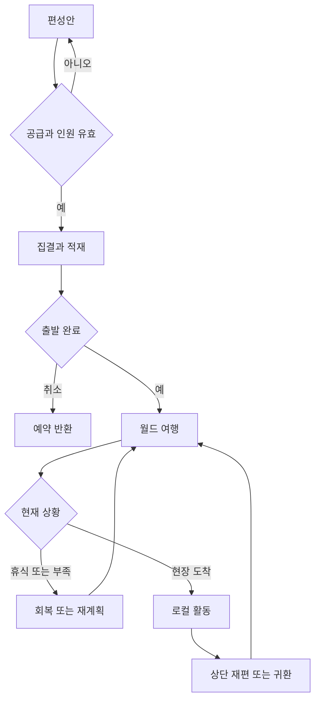

# 15. 상단과 월드 이동

[전체 목차](../README.md) · [세력·거래](14_factions_trade_prisoners.md) · [임무](16_quests_endings.md)

> 기본 게임의 지상 상단과 수송 포드를 다룬다. 이동 기지·궤도 탐험은 [Odyssey](../dlc/05_odyssey.md)에서 분리한다. 공개자료를 통한 간접 확인이며 아래 데이터와 테스트는 재구현 제안이다.

## 1. 시스템 목적과 플레이 경험

[해석] 상단은 기다리는 생존을 목적 있는 외부 활동으로 바꾼다. 플레이어는 원하는 물자와 임무를 찾아갈 수 있지만, 떠난 주민은 그동안 정착지의 생산·치료·방어에 참여하지 못한다. 핵심 질문은 **“누구를 얼마나 오래 밖으로 보낼 수 있는가?”**다.

월드 이동은 로컬 맵의 이동을 크게 확대해서 그리는 기능만이 아니다. 짐, 식량, 일정, 귀환 가능성으로 판단 단위를 바꾸는 별도의 운영 모드다.

## 2. 범위와 입출력

| 구분 | 내용 |
| --- | --- |
| 담당 | 편성, 짐 싣기, 맵 이탈, 월드 경로, 보급, 현장 진입, 귀환 |
| 비담당 | 현장 전투 판정과 거래 확정, 임무 성공 판정 |
| 입력 | 참가자, 동물, 물품, 목적지, 식사·약품 정책 |
| 상태 | 구성원 목록, 공동 재고, 경로 진행, 이동·휴식·정지 상태 |
| 출력 | 도착·부족·조우, 주민과 재고의 위치 변경 |

## 3. 플레이어 조작과 제공 정보

[확인] 월드에서 상단을 편성하며 주민·동물·포로·짐을 선택한다. 화면은 적재량과 이동 예상 시간을 제공한다.[S1]

[제안] 편성 UI의 핵심은 단순한 “출발 가능”보다 남는 정착지 인력과 왕복 공급을 보여 주는 것이다. `예상 여행시간`, `섭취 가능한 식량`, `운반 한계`, `거점 잔류 의료 인력`을 별도 지표로 둔다. 음식 총량과 정책상 실제 먹을 수 있는 양은 동일하지 않다.

## 4. 핵심 규칙

| ID | 조건 | 처리·결과 | 근거 |
| --- | --- | --- | --- |
| R15-01 | 상단 편성 | 인원과 짐을 선택하고 맵 내 준비 절차를 거침 | [확인][S1] |
| R15-02 | 운반 구성 변화 | 인원·짐승의 운반 여력과 적재 비율이 달라짐 | [확인][S1] |
| R15-03 | 월드 이동 | 지형·길·계절 조건과 탑승 동물 등이 여행 효율에 영향 | [확인][S1] |
| R15-04 | 식량·정책 불일치 | 재고가 있어도 허용된 음식이 부족할 수 있음 | [확인][S1] |
| R15-05 | 원정 중 생활 | 이동 외에 휴식·대기·정지 상태가 존재 | [확인][S1] |
| R15-06 | 교역·현장 도착 | 목적지에 따라 거래하거나 로컬 맵에서 활동 | [확인][S1] |
| R15-07 | 수송 포드 | 인물·동물·물품을 운송하는 일회용 수단 | [확인][S2] |
| R15-08 | 포드 출발 선택 | 연료에 따른 도달 범위와 적재 한계가 적용 | [확인][S2] |
| R15-09 | 여행 중 캠프 설치 | 1.6 기본 게임의 임시 로컬 맵에서 치료·보급·재정비 가능; 장기 체류에는 위험 존재 | [확인][S3] |
| R15-10 | 준비 중 즉시 출발 | 아직 적재·집결되지 않은 물품·동물·부상자를 남기고 출발 가능 | [확인][S1] |

## 5. 상태와 처리 흐름

[제안] 로컬 준비와 월드 여행은 소유권 전환 지점이므로 상태를 명시한다.



## 6. 데이터 모델 및 인터페이스

[제안] 로컬 맵에서 빠진 인물을 새로 복제하지 않고 같은 ID로 월드 집단에 이전한다. 맵에 있는 인물과 상단에 있는 인물은 동시에 활성 소유권을 가질 수 없다.

| 필드 | 타입·단위 | 역할 |
| --- | --- | --- |
| `caravan_id` | 안정 문자열 | 여행 집단 |
| `member_ids` | EntityId 배열 | 지속되는 인물 정체성 |
| `inventory` | 품목·수량 목록 | 공동 재고 |
| `mass_kg`, `capacity_kg` | kg | 적재 검증 |
| `route_tiles` | 월드 타일 ID 배열 | 예정 경로 |
| `travel_state` | preparing / moving / resting / stopped / local | 상태 |
| `food_policy_id` | 정책 ID | 음식 적격성 |
| `transfer_token` | 문자열 | 이동 중복 적용 방지 |

```yaml
# [제안] 예시 상태. 수치는 원작 이동 계수가 아니다.
caravan_id: expedition_west
member_ids: [pawn_medic, pawn_negotiator]
travel_state: preparing
route_tiles: [tile_home, tile_hill, tile_trade]
mass_kg: 70
capacity_kg: 100
food_policy_id: expedition_food
```

인터페이스는 `PreviewRoute`와 `ConfirmDeparture`를 분리한다. 예측 결과는 현재 재고·구성원 상태의 스냅샷이며, 실제 출발 시 조건을 재검증한다. 현장 조우는 구성원을 해당 로컬 맵으로 이관하고 종료 후 살아남은 대상만 다시 편성한다.

## 7. 수치와 밸런스

[제안] 원정 안전 여유는 `먹을 수 있는 보존식의 영양량 / 집단의 하루 소비량 - 예상 여행일수`로 비교한다. 실제 원작의 식량 계산식을 복제한 것이 아니며, 부패·식이 제한·동물 먹이·현장 체류를 별도 차감해야 한다.

편도 시간만 표시하면 귀환 비용을 과소평가한다. 왕복·목적지 체류·예비 일수를 나누어 보여 주는 편이 기획 검증에 유용하다. 지상 이동 속도의 세부 계수와 개별 동물 적재량은 이 문서에서 확정하지 않는다. 포드는 빠른 이동과 반복 건설 비용의 교환이며, 자동 귀환 수단으로 설계하지 않는다.[S2]

## 8. 대표 플레이 사례와 예외

[제안: 분석 사례] 부족한 부품을 사기 위해 의료 담당과 교섭 담당을 함께 출발시키려 한다. 거래 효율은 좋지만 정착지의 치료 능력이 사라진다. 인원을 바꾸거나 거래를 늦추는 판단은 여행 UI만의 숫자가 아닌 전 시스템 상태에서 나온다.

예외: 집결 중 주민 징집·정신 이상·사망, 적재할 물품의 소비, 도중 목적지 소멸, 짐승 손실로 인한 과적, 음식 정책 변경, 현장 철수 시 누락 인물 등을 처리한다. 출발 취소는 예약을 반환하고 “맵에도 없고 상단에도 없는” 인물이 남지 않도록 한다. 즉시 출발은 전체 적재 완료와 구분해 실제 동행·잔류 목록을 확정한다. 임시 캠프의 재편성과 정착지의 집결 절차도 구별한다. 포드와 지상 여행은 왕복 비용과 도착 방식을 공유 가정하지 않는다.

## 9. 다른 시스템과의 연결

| 연결 | 주고받는 데이터 | 영향 |
| --- | --- | --- |
| [월드](01_world_map_environment.md) | 타일·지형·계절 | 경로 비용과 목적지 |
| [물류](06_items_storage_logistics.md) | 적재 예약·재고 이동 | 출발 준비시간 |
| [식량](07_food_agriculture_production.md) | 보존·영양·식이 | 원정 지속 가능성 |
| [동물](11_animals_taming_ranching.md) | 운반·탑승·먹이 | 효율과 추가 유지비 |
| [거래](14_factions_trade_prisoners.md) | 상품·관계·교섭자 | 능동적 교역 |
| [임무](16_quests_endings.md) | 위치·시간 제한 | 이동과 목표 판정 |

## 10. 검증 시나리오

[제안] 실행되지 않은 수용 기준이다.

| Given | When | Then |
| --- | --- | --- |
| 집결 중인 주민과 예약 물품 | 출발 취소 | 모든 예약 반환, 맵 인물 유지 |
| 총 음식은 충분하나 허용 음식 없음 | 편성 확인 | 섭취 가능 음식 부족 경고 |
| 짐승 손실로 과적 발생 | 다음 여행 갱신 | 정지·재계획 사유가 표시됨 |
| 동일 출발 이벤트가 재전달됨 | transfer_token 재사용 | 인물·물품 중복 이동 없음 |
| 현장 맵에 부상자 잔류 | 귀환 편성 | 누락 상태를 명확히 표시 |
| 포드 출발 범위 밖 목적지 | 발사 선택 | 연료·범위 조건으로 거부 |
| 짐·동물·부상자 일부 미합류 | 즉시 출발 | 동행·잔류를 구분하고 복제·소실 없음 |

## 11. 설계 해석과 재구현 우선순위

[해석] 원정은 새로운 자원의 공급로인 동시에 정착지 내부 역할의 공백을 만든다. 이를 통해 안전한 기지에서도 외부 활동을 할 이유와 보내지 않을 이유가 함께 생긴다.

**MVP:** 월드 그래프, 인원·재고 이관, 식량 소모, 이동·휴식, 거래 목적지와 귀환. **후속:** 조우 맵, 다중 상단, 분리·합류, 포드. 초기 검증에서는 경로의 정밀도보다 이관과 취소의 일관성을 우선한다.

## 12. 출처와 확인 필요 사항

| 키 | 출처 | 근거 범위 |
| --- | --- | --- |
| S1 | [RimWorld Wiki — Caravan](https://rimworldwiki.com/wiki/Caravan) · 커뮤니티 · 2026-11-13 확인 | 편성, 상태, 짐·식량·월드 이동 |
| S2 | [RimWorld Wiki — Transport pod](https://rimworldwiki.com/wiki/Transport_pod) · 커뮤니티 · 2026-11-13 확인 | 일회용 운송, 적재·연료·목적지 |
| S3 | [RimWorld Wiki — Camping](https://rimworldwiki.com/wiki/Camping) · 커뮤니티 · 2026-11-13 확인 | 1.6 임시 캠프·재정비·체류 위험 |

[미확인] Caravan 문서의 기후·이동 세부에는 보완 요청이 있으며, Transport pod 문서에도 일부 동작의 사실 확인 표시가 있다. 정확한 속도 공식, 휴식 예외, 쓰러진 인물의 초기 편성·재편성 조건은 목표 패치에서 직접 재현해야 한다.
