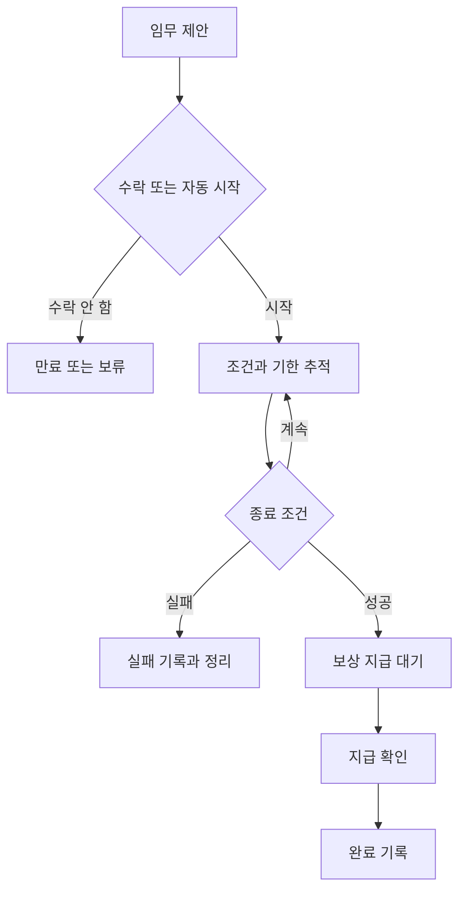

# 16. 임무·장기 목표·엔딩

[전체 목차](../README.md) · [사건](12_storyteller_incidents_difficulty.md) · [상단](15_caravans_world_travel.md)

> 이 문서는 엔딩 조건을 포함한다. 공개자료 기반 분석이며 목표 상태·이벤트 인터페이스는 재구현 제안이다. DLC의 상세 진행은 각 DLC 문서로 분리한다.

## 1. 시스템 목적과 플레이 경험

[해석] 임무는 플레이어가 감수할 위험을 선택하게 하고, 엔딩은 장기간 축적한 정착지 역량을 하나의 큰 계획으로 묶는다. 핵심 질문은 **“지금 감당할 수 있는 약속인가, 그 보상이 필요한가?”**다.

자동으로 닥치는 사건과 수락할 수 있는 임무는 통제감이 다르다. 같은 전투라도 자원을 얻기 위해 스스로 받아들인 위험이면 준비·실패 해석이 달라진다.

## 2. 범위와 입출력

| 구분 | 내용 |
| --- | --- |
| 담당 | 제안, 수락, 기한, 조건 추적, 성공·실패, 보상, 장기 목표 진행 |
| 비담당 | 실제 적 생성 규칙·전투·이동·건설 수행 |
| 입력 | 세력, 장소, 난도 맥락, 수락 선택, 관련 사건 결과 |
| 상태 | 제안/활성/완료/실패/만료, 조건별 진행, 선택한 보상 |
| 출력 | 사건 예약, 장소 생성, 보상 지급, 완료 기록·크레딧 |

## 3. 플레이어 조작과 제공 정보

[확인] 임무 탭에서 조건과 보상을 확인한다. 수락 제한 시간과 수행 제한 시간이 구분되며, 모든 임무가 수동 수락 또는 시간 제한을 갖는 것은 아니다.[S1]

[제안] UI는 위험의 대상 맵, 유지해야 할 대상, 도착·체류 시간, 선택 보상을 명시한다. 수락 창에서는 “보상 가치가 큼”보다 사용자의 기지에 어떤 부담이 생기는지 드러내는 것이 중요하다. 임무를 목록에서 숨기는 조작과 실제 포기는 별도 명령이어야 한다.

## 4. 핵심 규칙

| ID | 조건 | 처리·결과 | 근거 |
| --- | --- | --- | --- |
| R16-01 | 임무 제안 | 도전 조건과 보상을 제공 | [확인][S1] |
| R16-02 | 기한 존재 | 수락 기한과 완료 기한을 각각 적용할 수 있음 | [확인][S1] |
| R16-03 | 보상 선택지 존재 | 선택한 보상 묶음을 기준으로 진행 | [확인][S1] |
| R16-04 | 조건 위반·시간 초과 | 임무별 실패 가능; 세부 조건은 유형에 의존 | [확인][S1] |
| R16-05 | 기본 탈출 목표 | 우주선을 건설하거나 제시된 우주선으로 이동해 탈출 가능 | [확인][S2][S3] |
| R16-06 | 우주선 발사 준비 | 연결된 필요 부품, 가동된 원자로, 탑승자 조건 확인 | [확인][S3] |
| R16-07 | 원자로 가동 절차 | 방어를 요구하는 준비 기간이 존재 | [확인][S3] |
| R16-08 | 일부 인원만 탈출 | 남은 주민으로 이어갈 수 있는 엔딩이 있음 | [확인][S2] |

## 5. 상태와 처리 흐름

[제안] 보상 지급을 성공 판정과 분리해 중복 지급·저장 시점 오류를 막는다.



## 6. 데이터 모델 및 인터페이스

[제안] 문구와 실행 조건을 분리한다. “친구를 지켜 달라”는 텍스트 대신 대상 ID·생존 조건·기한을 저장하고, 텍스트는 그 데이터를 설명한다.

| 필드 | 타입 | 역할 |
| --- | --- | --- |
| `quest_id` | 안정 문자열 | 임무 정체성 |
| `issuer_id`, `target_map_id` | ID | 발행자와 부담 발생 위치 |
| `offer_expires_tick` | simulation_tick 또는 null | 수락 기한 |
| `objective_deadline_tick` | simulation_tick 또는 null | 수행 기한 |
| `objective_nodes` | 조건 노드 배열 | 생존·도착·물품·건설 조건 |
| `reward_choice_id` | ID 또는 null | 수락 시 선택 |
| `reward_claim_id` | ID | 중복 지급 방지 |
| `state` | enum | 진행 상태 |

```yaml
# [제안] 독립 구현용 예시 임무
quest_id: prototype_supply_contract
state: offered
objective_nodes:
  - type: deliver_items
    target_id: settlement_west
    item_id: prototype_medicine
    quantity: 10
reward_choices: [supplies, goodwill]
offer_expires_tick: null
```

`OnEntityRemoved`, `OnItemsDelivered`, `OnFactionRelationChanged` 등을 조건 평가기로 전달한다. 단, 모든 관계 변화가 모든 임무를 실패시키는 식의 전역 규칙은 피하고 임무별 계약에 명시한다.

## 7. 수치와 밸런스

[확인] 기본 우주선 원자로 준비 기간은 Wiki에서 게임 내 15일로 설명한다.[S3] 이는 현실 시간이나 모든 DLC 엔딩의 공통 타이머가 아니다. 세부 습격 주기는 이 문서에서 확정하지 않는다.

[제안] 임무 부담을 `원정 인력×이탈 시간`, `기지 유지 노동`, `예상 전투 손실`, `약속 유지 시간`으로 나누어 본다. 희귀 보상은 시장가치만으로 환산하기 어려우므로 기술·기동성·인구 변화와 함께 평가한다. 위험 정보가 불충분한 임무는 별도의 불확실성 표시가 필요하다.

## 8. 대표 플레이 사례와 예외

[제안: 분석 사례] 적 거점 습격 임무를 수락하기 전에 왕복 일수와 기지의 방어 인력을 확인한다. 원정은 성공했지만 부상자를 데리고 귀환하는 시간이 길어져 추가 식량이 필요해진다. 성공 판정과 귀환·재정비는 서로 다른 문제라는 점을 보여 준다.

[확인] 기본 탈출, Royalty의 귀족 관련 승천, Ideology의 아르코넥서스, Anomaly의 공허, Odyssey의 메카하이브는 서로 다른 종료 경로이며, 크레딧 이후 계속 가능 여부도 동일하지 않다.[S2] Biotech를 무조건 독자 엔딩 추가 DLC로 분류하지 않는다.

[제안] 목표 대상 사망·소멸, 목적지 제거, 중복 배달, 보상 배송 직전 저장, 임무 부대가 다른 맵으로 이동한 경우를 처리한다. 실패 이후 생성한 임시 대상의 정리 범위도 명시해 사용자의 기존 물자를 삭제하지 않게 한다.

## 9. 다른 시스템과의 연결

| 연결 | 주고받는 데이터 | 영향 |
| --- | --- | --- |
| [사건](12_storyteller_incidents_difficulty.md) | 위협 규모·사건 예약 | 약속된 위험 발생 |
| [상단](15_caravans_world_travel.md) | 위치·도착·물품 | 외부 목표 달성 |
| [외교](14_factions_trade_prisoners.md) | 관계·보상·발행자 | 성공 후 사회적 변화 |
| [연구](13_research_technology_progression.md) | 기술·해금 | 장기 목표 준비 |
| [UI](17_ui_controls_feedback.md) | 기한·상태·위치 | 계획과 실패 원인 이해 |
| [DLC](../README.md#dlc-확장-5개) | 전용 조건과 결말 | 기본 틀을 다른 목표로 확장 |

## 10. 검증 시나리오

[제안] 실행 결과가 아닌 수용 기준이다.

| Given | When | Then |
| --- | --- | --- |
| 수락 기한만 있는 임무 | 기한 내 수락 | 별도 수행 기한을 임의 생성하지 않음 |
| 보상 선택 후 활성 임무 | 보상 화면 재진입 | 원래 선택과 실제 계약 일치 |
| 성공 이벤트가 두 번 수신됨 | 보상 처리 | reward_claim_id 당 한 번 지급 |
| 목표 맵이 여러 정착지 중 하나 | 사건 발생 | 안내한 맵에 부담 발생 |
| 우주선 조건 일부 누락 | 발사 요청 | 누락된 조건을 구체적으로 표시 |
| 일부 주민만 탈출 | 엔딩 처리 | 남은 집단의 상태가 소실되지 않음 |

## 11. 설계 해석과 재구현 우선순위

[해석] 임무는 무작위 사건에 선택 가능한 목표를 더하고, 엔딩은 플레이어가 고른 시점에 생존 시스템 전체를 시험한다. 따라서 엔딩을 모든 플레이의 필수 종료로 강제할 필요는 없다.

**MVP:** 제안·수락·조건·기한·일회 보상·실패 기록과 한 종류의 장기 목표. **후속:** 선택 보상, 다중 조건 그래프, 장소 생성, 여러 엔딩. 콘텐츠 수보다 조건과 실제 결과가 일치하는지를 먼저 검증한다.

## 12. 출처와 확인 필요 사항

| 키 | 출처 | 근거 범위 |
| --- | --- | --- |
| S1 | [RimWorld Wiki — Quests](https://rimworldwiki.com/wiki/Quests) · 커뮤니티 · 2026-11-13 확인 | 제안·기한·보상·실패 |
| S2 | [RimWorld Wiki — Endings](https://rimworldwiki.com/wiki/Endings) · 커뮤니티 · 2026-11-13 확인 | 종료 경로와 이후 계속 가능성 |
| S3 | [RimWorld Wiki — Ship](https://rimworldwiki.com/wiki/Ship) · 커뮤니티 · 2026-11-13 확인 | 기본 우주선 구성·준비·발사 |

[미확인] 임무 발생 주기·별 등급의 세부 계수·DLC별 중복 진행 예외는 패치와 설정에 따라 재확인해야 한다. Quests 문서에서 검증 필요로 표시된 발생 간격을 확정 주기로 채택하지 않았다.
