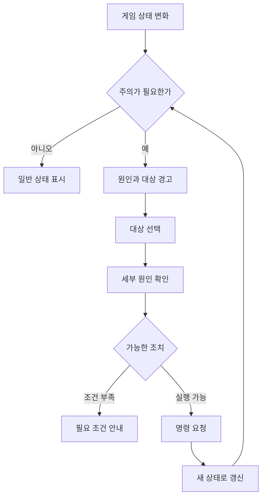

# 17. UI·조작·정보 피드백

[전체 목차](../README.md) · [작업](04_work_priorities_jobs.md) · [시간·저장](18_simulation_save_mods.md)

> 원작 UI 구조는 공개 문서로 확인했으며 픽셀 단위 화면 측정은 수행하지 않았다. 아래 레이아웃 해석과 데이터 바인딩은 재구현 제안이다.

## 1. 시스템 목적과 플레이 경험

[해석] 자율적으로 움직이는 주민에게 계획을 전달하고, 계획이 실행되지 않는 이유를 이해하도록 돕는 것이 UI의 핵심이다. 조작 횟수를 줄이는 것만큼 **“무엇 때문에 멈췄는가?”**를 빠르게 찾는 것이 중요하다.

정착지 전체를 보는 정보와 한 인물의 사정을 보는 정보가 연결되어야 한다. 식량 부족 경고에서 창고, 조리 주문, 조리 담당자의 부상까지 따라갈 수 있어야 플레이어가 규칙을 학습한다.

## 2. 범위와 입출력

| 구분 | 내용 |
| --- | --- |
| 담당 | 선택·카메라·정보 표시·명령 구성·경고·도움말·설정 |
| 비담당 | 명령의 최종 유효성 판정과 시뮬레이션 실행 |
| 입력 | 클릭·키·선택 집합·게임 상태·알림 이벤트 |
| 상태 | 선택 대상, 열린 탭, 필터, 표시 레이어, 일시정지 여부 |
| 출력 | 명령 요청, 상태 설명, 대상 위치 이동, 확인·취소 |

## 3. 플레이어 조작과 제공 정보

[확인] 선택 대상의 정보창, 상단 주민 바, 하단 관리 메뉴, 경고와 각종 표시 전환이 함께 정착지 화면을 구성한다.[S1] 좌클릭 선택과 우클릭 문맥 명령, 카메라 이동·확대, 일시정지·속도 조절을 제공한다.[S2]

| 정보 범위 | 플레이어 질문 | 우선 표시할 정보 — [제안] |
| --- | --- | --- |
| 전체 | 지금 가장 급한가? | 구조·식량·방어·정신 이상 경고 |
| 집단 | 담당자가 적절한가? | 작업 우선순위·시간표·정책 |
| 개체 | 왜 행동하지 않는가? | 현재 작업·부상·제약·기분 |
| 공간 | 이곳이 적합한가? | 온도·방·구역·동선·전력 |
| 외부 | 언제 돌아오는가? | 상단 위치·여행 시간·임무 기한 |

## 4. 핵심 규칙

| ID | 조건 | 처리·결과 | 근거 |
| --- | --- | --- | --- |
| R17-01 | 개체 선택 | 선택 대상의 세부 정보창 제공 | [확인][S1] |
| R17-02 | 주민 바 선택 | 해당 주민과 위치로 접근 | [확인][S1] |
| R17-03 | 문맥 조작 | 우클릭으로 가능한 명령 확인 | [확인][S2] |
| R17-04 | 시간 통제 | 일시정지와 여러 속도 단계 제공 | [확인][S2] |
| R17-05 | 표시 전환 | 구역·지붕 등 맵 해석용 정보 레이어 제공 | [확인][S1] |
| R17-06 | 관리 탭 사용 | 건축·작업·시간표·연구·월드 등의 기능에 접근 | [확인][S1] |
| R17-07 | 1.6 검색 기능 | 소지품·컨테이너·월드 등을 찾는 검색 개선 | [확인][S3] |
| R17-08 | 단축키 설정 | 기본 키 배치를 변경할 수 있음 | [확인][S2] |

일시정지는 판단 시간을 제공하는 기능이다. 아래 설계에서 명령 작성과 실제 작업 진행을 분리하는 이유가 된다. 실제 가속 배율을 UI 아이콘 수만으로 추정하지 않는다.

## 5. 상태와 처리 흐름

[제안] 경고를 해결 행동으로 이어 주는 정보 흐름이다.



## 6. 데이터 모델 및 인터페이스

[제안] 화면은 읽기 전용 상태를 표시하고 명령을 전달한다. UI가 자원·체력 값을 직접 수정하는 구조는 피한다.

| 데이터 | 필드 | 용도 |
| --- | --- | --- |
| `SelectionContext` | IDs, map_id, context_revision | 선택 일관성 |
| `CommandAvailability` | allowed, reason_code, required_targets | 비활성 사유 설명 |
| `Alert` | severity, subject_ids, cause_id, first_seen_tick | 우선순위·관련 대상 |
| `CounterView` | value, scope, filter_description | 숫자가 세는 범위 |
| `InspectionView` | value, unit, sources, last_update_tick | 상세 수치와 갱신 상태 |

```yaml
# [제안] 원작 UI 텍스트가 아닌 설명형 경고 예시
alert_id: food_supply_low
severity: warning
subject_ids: [colony_home]
scope: edible_and_allowed_inventory
reason_code: reserve_below_policy
actions: [inspect_storage, inspect_cooking_bills]
```

명령 요청은 `CommandRequest(type, subject_ids, target, expected_revision)` 형태로 전달한다. 선택 대상을 삭제하거나 맵을 바꾼 뒤 들어오는 늦은 응답은 현재 선택에 덮어쓰지 않는다. 표시용 계산과 실제 소비·판정 계산은 같은 규칙 서비스를 참조한다.

## 7. 수치와 밸런스

[제안] UI 효율은 한 화면의 항목 수보다 `경고 발생→원인 파악→수정 명령`에 걸리는 시간으로 측정한다. 같은 문제의 경고가 여러 주민에게 발생하면 집계하되, 구조가 필요한 개체는 개별 이동 버튼을 유지한다.

기분·전력·재고 등 서로 다른 단위에 같은 색만 부여하면 오해가 생긴다. 색에 아이콘과 텍스트를 함께 사용하고, 총량·가용량·예약량을 구분한다. 알림 빈도 제한은 단순 일정 시간 무시보다 원인이 변했는지를 기준으로 설계한다.

## 8. 대표 플레이 사례와 예외

[제안: 분석 사례] “먹을 음식 부족” 경고가 떴지만 창고에는 곡물이 있다. 플레이어가 경고에서 음식 집계 범위를 확인하고 조리 주문으로 이동한다. 조리 담당자는 치료 중이고 대체 인력의 우선순위가 낮다는 원인을 발견한다. 좋은 피드백은 음식 숫자를 크게 보여 주는 데서 끝나지 않는다.

예외: 여러 개체 선택 시 서로 다른 값은 혼합 상태로 표시한다. 명령 불가 이유가 여러 개면 가장 먼저 해결해야 할 원인을 우선한다. 대상 사망·지도 전환·DLC 비활성화로 정보창이 무효화되면 안전하게 닫거나 설명으로 교체한다. 원정 주민을 로컬 맵의 존재하지 않는 좌표로 이동시키지 않는다.

## 9. 다른 시스템과의 연결

| 연결 | 주고받는 데이터 | 효과 |
| --- | --- | --- |
| [작업](04_work_priorities_jobs.md) | 명령 가능 사유·대기 원인 | 행동 이해와 개입 |
| [기분](03_needs_mood_mental_breaks.md) | 현재값·원인·위험 | 예방적 판단 |
| [건설](05_building_rooms_zones.md) | 청사진·공간 제약 | 계획과 실행 구분 |
| [물류](06_items_storage_logistics.md) | 전체·가용·예약 재고 | 모순된 숫자 방지 |
| [임무](16_quests_endings.md) | 조건·기한·위치 | 계약 이해 |
| [시뮬레이션](18_simulation_save_mods.md) | 상태 버전·시간 | 표시와 실행의 일치 |

## 10. 검증 시나리오

[제안] 수용 기준이며 사용자 테스트를 수행한 결과는 아니다.

| Given | When | Then |
| --- | --- | --- |
| 실행 불가능한 작업 대상 | 문맥 메뉴 열기 | 불가 이유와 해결할 조건 표시 |
| 서로 다른 건강 상태의 다중 선택 | 정보창 열기 | 임의의 한 값으로 대표하지 않음 |
| 선택 대상이 사망·삭제됨 | 다음 화면 갱신 | 잘못된 참조 없이 상태 변경 안내 |
| 창고 전체 재고와 가용 재고가 다름 | 수치 확인 | 집계 범위와 예약량 추적 가능 |
| 상단 주민을 주민 바에서 선택 | 위치 찾기 | 올바른 월드 위치로 접근 |
| 게임을 멈춘 상태 | 계획 명령 입력 | 작업 진행과 명령 저장이 분리됨 |

## 11. 설계 해석과 재구현 우선순위

[해석] 림월드의 UI 가치는 많은 숫자를 노출하는 데보다 원인과 선택을 연결하는 데 있다. 자동화된 주민을 신뢰하려면 결과뿐 아니라 거부·대기의 이유가 보여야 한다.

**MVP:** 선택·문맥 명령, 일시정지, 주민 정보, 작업표, 핵심 경고. **후속:** 검색·정책 일괄 편집·정보 레이어·고급 필터. 정보가 많은 후반부에서도 동일 원인에 대한 중복 경고가 핵심 문제를 가리지 않는지 확인한다.

## 12. 출처와 확인 필요 사항

| 키 | 출처 | 근거 범위 |
| --- | --- | --- |
| S1 | [RimWorld Wiki — User interface](https://rimworldwiki.com/wiki/User_interface) · 커뮤니티 · 2026-11-13 확인 | 패널·주민 바·관리 메뉴·정보 레이어 |
| S2 | [RimWorld Wiki — Controls](https://rimworldwiki.com/wiki/Controls) · 커뮤니티 · 2026-11-13 확인 | 선택·문맥 명령·시간 조작·키 변경 |
| S3 | [Ludeon — Announcing Odyssey and update 1.6](https://ludeon.com/blog/2025/06/announcing-odyssey-and-update-1-6/) · 공식 · 2026-11-13 검색 본문 확인 | 검색과 UI 개선 |

[미확인] 두 Wiki 페이지의 최고 일반 가속 배율 표기가 서로 다르므로 이 문서에서는 정확한 배율을 채택하지 않았다. 패널 좌표·단축키·화면 크기별 배치는 설치된 1.6 빌드와 언어 설정에서 확인해야 한다.
