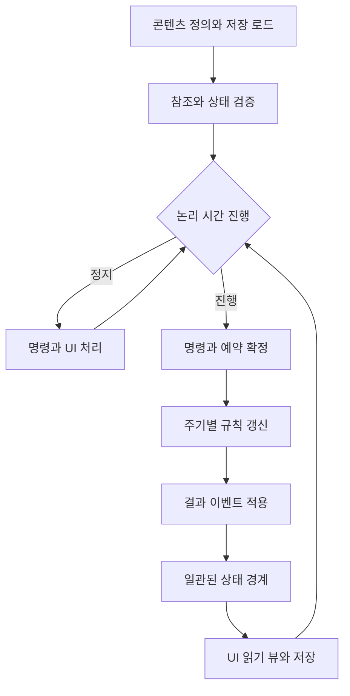

# 18. 시뮬레이션·시간·저장·확장 구조

[전체 목차](../README.md) · [시스템 의존성](../meta/02_system_dependencies.md) · [검증 계획](../meta/05_acceptance_tests.md)

> **게임 내부 소스와 실행 파일은 검사하지 않았다.** 사용자 관점의 시간 조작과 공식적으로 공개된 버전·호환·성능 변경을 `[확인]`으로 다룬다. 아래 실행 순서·저장 스키마·API·스레드 구조는 모두 재구현을 위한 `[제안]`이며 원작 구현의 복원이 아니다.

## 1. 시스템 목적과 플레이 경험

[해석] 플레이어가 같은 인물과 기지를 오랜 기간 관리하려면, 서로 영향을 주는 상태가 빠르고 일관되게 갱신되어야 한다. 일시정지·가속은 판단과 대기 시간을 조절하고, 저장은 축적된 사건의 연속성을 유지한다.

핵심 질문은 **“작업·욕구·부상·사건이 동시에 바뀌어도 인물과 물자의 이력이 일관되는가?”**다. 프레임 속도뿐 아니라 결과의 설명 가능성과 저장 후 연속성이 필요하다.

## 2. 범위와 입출력

| 구분 | 내용 |
| --- | --- |
| 담당 — 제안 | 논리 시간, 상태 소유권, 갱신 스케줄, 저장·복원, 콘텐츠 정의 참조 |
| 비담당 | 각 게임 규칙의 세부 계수와 실제 렌더링 엔진 구현 |
| 입력 | 플레이어 명령, 콘텐츠 구성, 논리 시간 진행 |
| 상태 | 월드·맵·개체·진행 중 계약·예약·난수 상태 |
| 출력 | 일관된 게임 상태, 이벤트, 저장 스냅샷, UI 읽기 뷰 |

## 3. 플레이어 조작과 제공 정보

[확인] 시간 정지·속도 단계는 기본 조작에 포함된다.[S1] 공식 1.6 출시 공지는 무모드 1.5 저장의 1.6 로드 가능과 일부 구버전 모드의 업데이트 필요를 구분한다.[S2]

[제안] 저장 선택 화면에는 게임 버전·콘텐츠 집합·마지막 저장 시각을 제시한다. 호환 경고에서 “버전 문자열이 다름”과 “필수 정의를 찾지 못함”을 구분해야 한다. 플레이어가 알아야 하는 것은 내부 직렬화 클래스명이 아니라 자신의 정착지가 제대로 이어지는지다.

## 4. 핵심 규칙과 공개된 기술 사실

| ID | 조건·범위 | 공개된 내용 | 근거 |
| --- | --- | --- | --- |
| R18-01 | 기본 플레이 | 일시정지와 속도 조절 제공 | [확인][S1] |
| R18-02 | 1.5 → 1.6 | 무모드 저장 호환을 개발사가 안내 | [확인][S2] |
| R18-03 | 1.6 모드 구성 | 일부 모드는 업데이트 필요 | [확인][S2] |
| R18-04 | 1.6 성능 변경 | 경로 탐색 배치·멀티스레드 및 조명 멀티스레드 개선을 공개 | [확인][S3] |
| R18-05 | 2026-10-12 발표 | 1.7은 Waylith 엔진으로 전환하는 unstable 시험 버전으로 발표 | [확인][S4] |
| R18-06 | 같은 1.7 발표 | 게임플레이 유지와 1.6/1.7 저장 호환을 개발사가 설명 | [확인][S4] |

위 호환 설명은 특정 공지의 주장이다. 모든 모드 조합·이후 패치의 호환을 보증하거나 직접 측정한 결과가 아니다. 1.7 공지는 1.6 분석에 구현 엔진을 혼합하지 않기 위해 별도로 기록했다.

## 5. 상태와 처리 흐름

다음 전체 흐름은 [제안]이다. 원작의 실제 Tick 순서나 스레드 스케줄을 의미하지 않는다.



## 6. 데이터 모델 및 인터페이스

[제안] 변경이 적은 정의와 플레이 중 바뀌는 상태를 분리한다. 같은 물건의 정의 ID와 월드 안 개별 물건의 EntityId도 구분한다.

| 데이터 | 예시 필드 | 저장 원칙 |
| --- | --- | --- |
| 콘텐츠 명세 | definition_id, content_pack_id, schema_version | 참조와 호환성 확인 |
| 시간 | current_tick, calendar_state | 현실 시계와 분리 |
| 개체 | entity_id, owner_id, location, state | 인물·물품의 지속성 |
| 계약 | bills, quests, policies, research | 플레이어의 의도 보존 |
| 예약 | owner, target, quantity, expiry | 복원 또는 재계획 정책 명시 |
| 난수 | stream_id, state | 재현 가능한 실험 지원 |

```yaml
# [제안] 원작 저장 포맷이 아님
save_schema: 1
current_tick: 123456
content_manifest: [prototype_base]
world_id: world_sample
active_maps: [map_home]
event_cursor: 520
transient_job_policy: replan_after_validation
```

로드 순서는 정의 확인 → 개체 생성 → ID 참조 연결 → 불변조건 검사 → 임시 작업 재계획으로 정할 수 있다. 예약을 재구축한다면 운반 중 물품의 실제 소유권·위치를 먼저 복원하고, 새 운반 작업이 같은 물품을 복제하지 않도록 한다.

## 7. 수치와 성능 검증

[제안] 시간은 `simulation_tick`으로 일관되게 표현하고 현실 초 변환은 설정으로 둔다. 정상 속도·가속에서 같은 게임시간을 진행했을 때 욕구 소모·생산량이 프레임 수에 비례해서 달라지면 안 된다.

성능은 인구·동물·활성 맵·열린 일감·경로 요청 수에 따른 논리 갱신 시간으로 측정한다. 욕구처럼 허용 오차가 있는 계산은 주기를 나누되, 전투·예약 확정처럼 순서가 중요한 계산은 명확한 적용 경계를 둔다. 병렬 계산은 후보를 읽기 전용으로 계산한 뒤 유효성 검사를 거쳐 반영한다는 구조를 우선 검토한다.

[미확인] 본 작업은 원작 TPS·메모리·경로 탐색 비용을 측정하지 않았다. 개발사 성능 홍보 수치를 본 프로젝트의 재구현 목표치로 전환하지 않는다.

## 8. 대표 플레이 사례와 예외

[제안: 분석 사례] 한 주민이 마지막 약을 운반하는 중 저장한다. 로드 후 같은 약이 창고와 인벤토리에 동시에 생기거나 다른 의사가 다시 예약하면 치료·경제가 함께 깨진다. 중요한 것은 작업 애니메이션의 재개보다 약의 소유권과 처방의 일관성이다.

예외: 저장 중 이벤트 발생, DLC 정의 누락, 대상이 없는 참조, 작업자 사망 직후 예약 잔류, 중복 보상 이벤트, 가속 중 긴 계산 지연을 처리한다. 오류가 있는 저장에 대해 원본을 덮어쓰며 조용히 값을 초기화하지 말고, 별도 복구 정책과 진단 결과를 제시하는 것이 재구현 권장안이다.

## 9. 다른 시스템과의 연결

| 연결 | 핵심 계약 | 이유 |
| --- | --- | --- |
| [작업](04_work_priorities_jobs.md) | 작업 취소·예약 해제 | 중복 수행 방지 |
| [물류](06_items_storage_logistics.md) | 단일 소유권·수량 보존 | 복제·소실 방지 |
| [건강](09_health_medical_body.md) | 신체 상태의 지속 | 부상·치료의 연속성 |
| [사건](12_storyteller_incidents_difficulty.md) | 예약 사건·난수 상태 | 저장 후 사건 연속성 |
| [상단](15_caravans_world_travel.md) | 맵과 월드 간 이관 | 동일 인물 중복 방지 |
| [임무](16_quests_endings.md) | 조건·보상 처리 ID | 중복 지급 방지 |

## 10. 검증 시나리오

다음은 [제안] 개발 수용 기준이다. 원작 또는 구현물을 실행해 통과시킨 테스트가 아니다.

| Given | When | Then |
| --- | --- | --- |
| 동일 초기 상태와 입력 | 같은 논리시간을 다른 프레임 속도로 진행 | 규칙 결과가 허용 오차 내 일치 |
| 운반 중 저장 | 로드 후 작업 재계획 | 물품 수량·소유자가 하나로 유지 |
| 보상 지급 직전 저장 | 로드 후 성공 이벤트 재평가 | 보상 중복 없음 |
| 삭제된 정의 ID가 포함된 저장 | 로드 | 누락 콘텐츠를 진단하고 정책에 따라 중단·복구 |
| 예약 소유자가 사망 | 다음 검증 경계 | 예약 해제와 대체 작업 가능 |
| 오래된 병렬 경로 결과 도착 | 문이 막힌 현재 맵에 적용 | 현재 상태 검증 후 폐기·재탐색 |

## 11. 설계 해석과 재구현 우선순위

[해석] 다수의 독립 규칙이 예측 가능한 상태를 공유할 때 예상하지 못한 이야기가 생긴다. 모든 결과를 미리 쓰는 대신, 물자·인물·시간의 일관성을 유지하는 기반이 필요하다.

**MVP:** 단일 권위 상태, 고정된 논리시간, ID 참조, 상태 저장·복원, 예약 정리. **후속:** 계산 주기 분산·병렬 후보 탐색·콘텐츠 모듈·스키마 이행. 최적화는 실제로 측정한 병목에 적용하며, 원작이 특정 구조를 쓴다는 추정으로 설계를 정당화하지 않는다.

## 12. 출처와 확인 필요 사항

| 키 | 출처 | 근거 범위 |
| --- | --- | --- |
| S1 | [RimWorld Wiki — Controls](https://rimworldwiki.com/wiki/Controls) · 커뮤니티 · 2026-11-13 확인 | 플레이어 시간 조작 |
| S2 | [Ludeon — Odyssey expansion is out now](https://ludeon.com/blog/2025/07/the-rimworld-odyssey-expansion-is-out-now/) · 공식 · 2026-11-13 검색 본문 확인 | 1.6 저장·모드 호환 공지 |
| S3 | [Ludeon — Announcing Odyssey and update 1.6](https://ludeon.com/blog/2025/06/announcing-odyssey-and-update-1-6/) · 공식 · 2026-11-13 검색 본문 확인 | 경로·조명 성능 변경 |
| S4 | [Ludeon — Announcing the Waylith Engine and Update 1.7](https://ludeon.com/blog/2026/10/announcing-the-waylith-engine-and-update-1-7/) · 공식 · 2026-11-13 검색 본문 확인 | 1.7 시험 발표와 공개 호환 설명 |

[미확인] 실제 소스의 갱신 순서·직렬화 필드·실제 난수 스트림·스레드 경계는 열람하지 않았다. 1.7의 시험 이후 배포 상태와 실설치 버전도 별도 확인 대상이다. 따라서 본 문서는 현재 배포판의 엔진 구조를 단정하는 기술 보고서가 아니다.
