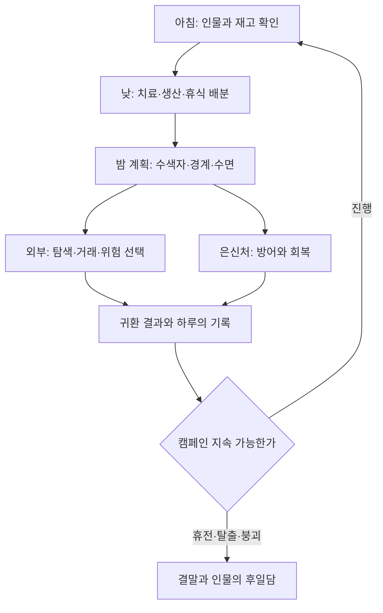

# 01. 핵심 경험과 전체 게임 루프

> 대상: PC판 This War of Mine: Final Cut의 클래식 생존 모드  
> 조사 기준일: 2026-11-13 · 정확한 실행 빌드 번호: 미확인  
> 성격: 공개 자료를 토대로 작성한 역기획. 실제 실행·소스 코드·게임 데이터 추출 검증은 수행하지 않았다.  
> 표기: **[확인]** 공개 근거가 있는 내용 / **[분석]** 설계 해석 / **[재구성안]** 재현을 위한 제안 / **[검증 필요]** 미확정 규칙·수치

## 1. 게임을 한 문장으로 정의하기

**[분석]** 제한된 시간과 물자를 여러 민간인에게 배분하면서, 생존을 위해 내린 선택의 신체적·사회적·심리적 결과를 종전까지 감당하는 소규모 집단 생존 게임이다.

**[확인]** 개발사는 민간인의 관점, 식량·약품 부족, 낮의 은신처 관리와 밤의 외부 수색을 기본 경험으로 설명한다. [P01](https://11bitstudios.com/games/this-war-of-mine/)

역기획에서 가장 중요한 대상은 개별 아이템보다 **누구에게 어떤 비용을 전가하는가**라는 선택 구조다. 같은 식량 하나라도 환자의 회복, 오늘 밤 수색자의 수행 능력, 굶주린 방문자에 대한 도움 사이에서 다른 의미를 가진다.

## 2. 범위와 분석 단위

| 구분 | 분석 범위 | 주의점 |
|---|---|---|
| 기준 게임 | PC Final Cut 클래식 생존 | 현재 패치별 정확한 상수는 별도 측정 대상 |
| 캠페인 단위 | 시작 조합부터 휴전·탈출 또는 집단 붕괴까지 | 종료 경로와 길이는 시나리오에 따라 구분 |
| 하루 단위 | 아침 결과 확인, 낮 운영, 밤 계획, 현장 수색, 귀환 | UI 시간과 시스템 정산 시점을 구분 |
| 인물 단위 | 능력, 상태, 노동, 선택 반응, 생존 이력 | 단순 전투력 점수로 환원하지 않음 |
| 공간 단위 | 은신처, 외부 지역, 지역별 상황 변형 | 전체 도시를 실시간 연속 월드로 가정하지 않음 |
| 확장 범위 | The Little Ones, Stories, Forget Celebrations | [19번 문서](19_Expansions_and_Mode_Differences.md)에서 모드별 분리 |
| 제외 | 보드게임, 미출시/별도 리메이크, 모드 고유 규칙 | 본편 기능과 섞지 않음 |

## 3. 설계 기둥

다음은 공개 규칙과 개발진 설명을 종합한 **[분석]**이다.

| 설계 기둥 | 플레이에서 드러나는 문제 | 시스템이 만드는 압력 | 경험 목표 |
|---|---|---|---|
| 취약한 개인 | 한 사람이 다치면 여러 역할에 공백 | 탐색·방어·제작 기회 감소 | 한 명의 상실을 크게 느끼기 |
| 공유되는 부족 | 모두가 같은 재고를 사용 | 같은 물자가 여러 용도와 경쟁 | 공동체 안에서 우선순위 결정 |
| 불완전한 정보 | 현장의 위험과 미래 상황을 전부 알 수 없음 | 탐색과 준비에도 비용 발생 | 확신 없이 결정하는 긴장 |
| 지연되는 결과 | 오늘 선택이 내일의 노동·관계에 반영 | 단기 이득과 장기 비용 분리 | 결과를 되돌아보는 경험 |
| 지속되는 삶 | 전투 외에 요리·휴식·대화가 반복 | 일상의 유지 자체가 목표 | 생활 단위로 전쟁을 체감 |
| 선택의 기억 | 행동의 맥락이 인물과 기록에 남음 | 행동과 서사 사이의 연속성 | 자신의 플레이를 이야기로 기억 |

**[확인]** 개발진의 GDC 발표는 인물의 신념·심리적 특성, 트라우마, 선택의 결과를 강조하며, 레벨업 중심의 영웅 성장 모델과 다른 방향을 설명한다. [P05](https://media.gdcvault.com/gdc2019/presentations/Drozdowski_Marszal_Why_Make_Games.pdf), 슬라이드 18–23.

## 4. 핵심 루프

아래는 게임 코드의 호출 순서가 아니라 **[분석] 플레이어가 반복하는 의사결정 순서**다.



### 4.1 순간 루프

목표 지점이나 상호작용을 고르고, 이동·행동 시간을 지불하고, 결과를 확인한다. 밤에는 위험 인지와 귀환 판단이 여기에 추가된다.

### 4.2 하루 루프

당장 필요한 물자를 생산·회복에 쓰면서 다음 밤에 사용할 인력과 장비를 남긴다. 하루의 좋은 운영은 재고 증가만으로 평가할 수 없다. 재고를 많이 얻었더라도 수색자가 다치고 경계 인력이 탈진했다면 이후 운영 능력은 낮아질 수 있다.

### 4.3 캠페인 루프

초기 생존 기반을 만들고, 외부 환경 변화에 적응하며, 손실을 회복할 수 있는 여유를 확보한다. 후반에는 새로운 시설의 장기 수익보다 이미 지켜 온 사람과 자원을 유지하는 가치가 커진다.

## 5. 게임의 실질적인 자원

다음 분류는 **[분석]**이다. UI가 모두 같은 종류의 수치로 제공한다는 뜻은 아니다.

| 자원 층 | 예 | 사용하면 줄어드는 것 | 보충 방식 | 다른 자원으로의 전환 |
|---|---|---|---|---|
| 물질 | 식량, 부품, 목재, 약품 | 재고 | 수색, 거래, 생산 | 음식·시설·회복·교환품 |
| 시간 | 낮 작업 시간, 밤 체류 시간 | 하루의 행동 기회 | 다음 날 도래 | 제작·탐색·대화·수면 |
| 수행 능력 | 건강한 인원, 피로 여유 | 안전하게 수행 가능한 역할 | 휴식, 치료 | 노동력·운반·방어 |
| 공간 | 배치 공간, 운반 슬롯 | 사용할 수 있는 빈자리 | 정리, 설비 배치, 가방 선택 | 처리량·귀환 자원량 |
| 정보 | 현장 구조, 날씨·뉴스, NPC 의도 | 잘못 판단할 위험 | 관찰, 라디오, 방문 | 위험 감소·선제 준비 |
| 정서적 여유 | 안정, 신뢰, 희망 | 선택을 견딜 능력 | 생활 개선, 관계 행동 등 | 장기적인 집단 유지 |

따라서 핵심 경제는 돈의 흐름보다 **물자 → 생존 상태 → 행동 가능성 → 다음 물자**의 순환으로 읽는 편이 적절하다. 정서적 여유는 물자와 완전히 교환 가능한 화폐가 아니라 행동 선택에 제약을 주는 별도 축으로 다룬다.

## 6. 시스템 간 의존 관계

| 선행 변화 | 직접 결과 | 2차 영향 | 최종 의사결정 |
|---|---|---|---|
| 수색자 부상 | 이동·전투·활동 부담 | 치료 자원과 휴식 시간 요구 | 다른 사람을 수색에 투입할 것인가 |
| 연료 부족 | 조리·난방 등 사용처 경쟁 | 건강·식량 계획 동시 압박 | 시설 투자, 구매, 목재 반입 중 선택 |
| 운반 슬롯 부족 | 모든 물자를 가져올 수 없음 | 도구와 귀환 물자의 경쟁 | 탐색 범위를 줄일 것인가 |
| 경계 인원 축소 | 은신처 방어 여유 감소 | 습격 피해가 재고·건강에 전파 | 이번 밤 수색을 포기할 것인가 |
| 인물의 심리 악화 | 행동과 집단 유지에 부담 | 다른 인물의 돌봄 시간 소요 | 즉시 이득을 만드는 행동을 멈출 것인가 |
| 도움 요청 수락 | 재고 또는 인력 지출 | 미래 상황·인물 반응 변화 | 즉시 손해를 감수할 것인가 |

인과 방향을 기술할 때 정확한 내부 가중치가 확인되지 않았으면 “반드시 발생” 대신 “부담 증가”, “가능성”, “조건에 따라”를 사용한다. 예를 들어 배고픔·부상·심리 상태가 어떤 행동을 어느 단계부터 막는지는 개별 검증 대상이다.

## 7. 플레이어가 실제로 최적화하는 문제

**[재구성안]** 설계 논의를 위한 목적함수는 다음처럼 여러 목표를 병렬로 둘 수 있다.

```text
EvaluatePlan(plan) = {
    survival_risk,
    minimum_household_stock,
    next_day_available_labor,
    recovery_capacity,
    moral_and_relationship_cost,
    unresolved_future_risk
}
```

이는 원작의 숨겨진 점수식이 아니다. 또한 여섯 축을 한 숫자로 합산해 게임 내 정답을 제공하자는 뜻도 아니다. 기획 단계에서 “이 계획이 왜 매력적이면서 위험한가”를 설명하기 위한 평가 틀이다.

예를 들어 부품이 많은 위험 지역은 시설 개선에는 유리하지만 수색 실패 시 다음 날을 버틸 인원이 사라질 수 있다. 식량만 조금 있는 안전한 지역은 총자산 증가에는 불리해도 집단을 안정화할 때 유리하다. 플레이어의 취향과 현재 상태가 계획의 순위를 바꾼다.

## 8. 하나의 선택이 여러 시스템을 움직이는 예

> **[재구성안] 사례용 상황. 원작의 고정 시나리오·수치·퀘스트가 아니다.**

세 명 중 한 명은 치료가 필요하고, 한 명은 피곤하며, 한 명은 상대적으로 건강하다. 음식과 연료가 모두 부족하다. 방문자는 치료에 쓸 물자를 요청한다.

| 대안 | 즉시 얻는 것 | 지불하는 것 | 이후 조사할 결과 |
|---|---|---|---|
| 요청을 받아준다 | 도움이라는 행동 이력 | 치료 물자 감소 | 집단의 정서 반응, 자체 치료 지연 |
| 요청을 거절한다 | 치료 여력 보존 | 관계·정서적 부담 가능성 | 인물별 반응과 미래 이벤트 |
| 건강한 인물을 수색에 보낸다 | 조달 가능성 증가 | 은신처의 가용 인력 감소 | 경계·부상 위험, 회복 지연 |
| 수색을 쉬고 회복한다 | 다음 밤 수행 능력 | 오늘의 외부 수입 | 소비를 감당할 재고가 있는가 |
| 연료를 난방에 우선 사용한다 | 회복 환경 개선 가능성 | 조리 여력 감소 | 식단·거래 계획 재편 |

한 선택을 누르면 “선택 보상”이 따로 지급되는 구조만 분석해서는 이 경험을 설명할 수 없다. 선택으로 물자가 사라진 뒤 다음 밤 계획이 바뀌고, 그 결과가 다시 사람의 상태를 바꾸는 연결이 중요하다.

## 9. 진행 곡선

아래 구간은 고정 일자별 공략이 아니라 **[분석] 역할 변화**다.

| 구간 | 플레이어의 주요 질문 | 필요한 시스템 | 기획상 위험 |
|---|---|---|---|
| 초기 적응 | 오늘 무엇부터 해야 하나 | 잔해 정리, 기본 생활, 첫 수색 | 중요 정보 누락으로 이해 불가능한 실패 |
| 기반 형성 | 다음 부족을 어떻게 막나 | 시설, 작업 분업, 거래 | 한 개의 빌드가 항상 정답이 되는 문제 |
| 외부 압력 증가 | 현재 기반이 바뀐 환경에서도 통하나 | 겨울, 범죄, 지역 접근 변화 | 예고 없는 겹침으로 대응 불능 |
| 누적 선택의 회수 | 누구를 어떤 상태로 지킬 것인가 | 치료, 심리, 관계, 위험 관리 | 재고만 많으면 다른 축이 무의미해지는 문제 |
| 종결 | 우리가 해 온 일이 어떻게 남는가 | 일지, 인물별 후일담 | 결말이 행동 이력과 불일치 |

## 10. 재현 시 유지해야 할 관계

**[재구성안]** 유사 구조를 설계한다면 콘텐츠 수보다 다음 관계를 먼저 검증한다.

1. 야간에 데려가는 사람과 장비가 은신처의 방어·휴식 여유를 실제로 바꾸는가.
2. 부품을 시설에 쓰면 즉시 생활 문제를 처리할 여력이 줄어드는가.
3. 동일한 사건에 대한 인물별 반응이 역할 효율과 다른 판단축을 만드는가.
4. 외부 위험을 피하는 전략도 생존 가능하지만 그에 맞는 비용을 지불하는가.
5. 실패 이후에도 남은 인물에게 계속 플레이할 이유가 생기는가.
6. 플레이어가 결과를 완벽히 예측하지 못해도 원인 일부를 설명할 수 있는가.

**[확인]** 참여 디자이너 Kacper Kwiatkowski는 개인 회고에서 게임 행동과 결과가 서사의 재료가 된다는 점, 실패도 플레이의 이야기로 다뤄야 한다는 점을 설명한다. 회사 전체의 공식 입장과는 구별한다. [P06](https://www.gamedeveloper.com/design/7-things-i-ve-learnt-from-designing-this-war-of-mine)

## 11. 관찰·평가 지표

모두 **[재구성안]**이며 실제 개발사의 지표가 아니다.

| 질문 | 기록할 항목 | 해석할 때 주의점 |
|---|---|---|
| 같은 상황에서도 선택이 나뉘는가 | 집단 상태별 수색·투자·도움 선택 | 단순 선택률만으로 도덕 판단을 하지 않음 |
| 위기가 이해되는가 | 실패 직전 재고·상태·예고 열람 | 결과를 납득하는지 별도 인터뷰 필요 |
| 인물이 교환 가능한 노동력으로만 보이는가 | 인물 상실 후 설명, 역할 재배치 | 생존률이 높다고 애착이 강한 것은 아님 |
| 후반에도 선택이 의미 있는가 | 재고 안전 여유, 위험 지역 방문 이유 | 숙련자의 최적화와 초심자 경험 분리 |
| 도덕적 선택이 단순 보상 파밍이 되는가 | 동일 호의 반복, 이득 계산 표현 | 도움 선택률이 높다는 이유만으로 성공 아님 |

## 12. 연결 문서와 근거

- 시간과 정산: [02](02_Time_Campaign_and_Phase_Resolution.md)
- 생존자·상태·심리: [03](03_Characters_and_Traits.md), [04](04_Needs_Health_and_Recovery.md), [05](05_Morale_Relationships_and_Ethics.md)
- 경제와 생활: [07](07_Resources_Inventory_and_Carrying.md), [08](08_Crafting_Recipes_and_Upgrades.md), [09](09_Food_Water_and_Heating.md)
- 밤의 의사결정: [11](11_Night_Roles_and_Raids.md)–[14](14_Combat_Injury_and_Escape.md)
- 구현용 모델과 검증: [20](20_Reconstructed_Data_and_Architecture.md), [21](21_Balance_Validation_and_Test_Cases.md)

| 출처 | 수준 | 이 문서에서 사용한 범위 |
|---|---|---|
| P01 · 개발사 게임 소개 | 1차, 검색 색인 확인 | 민간인·부족·낮밤이라는 기본 설정 |
| P05 · 2019 GDC 발표 | 1차, 공개 슬라이드 원문 | 인물과 선택에 관한 개발진 방향 |
| P06 · 참여 디자이너 개인 회고 | 1차 개인 증언, 원문 | 행동·실패와 서사의 연결 |

플레이어의 목적함수, 진행 구간, 평가 지표와 시스템 연결 해석은 본 역기획서의 분석이다. 전체 출처와 미확인 항목은 [22번 문서](22_Reference_and_Verification_Ledger.md)를 따른다.

[목차로 돌아가기](README.md)
