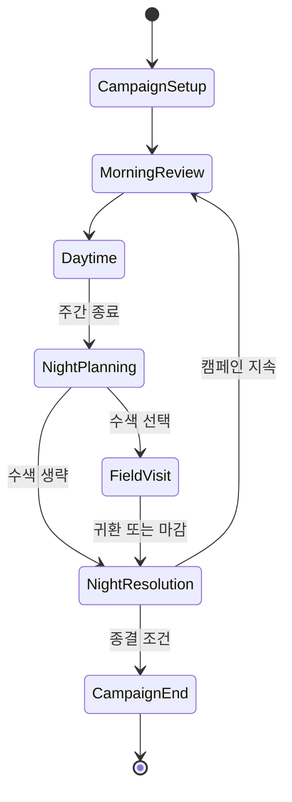

# 02. 시간·캠페인·페이즈 전환

> 기준: PC Final Cut 클래식 생존 모드 · 조사일: 2026-11-13  
> 정확한 빌드 번호 및 실시간 배속 실측: 미확인  
> [확인] 공개자료의 설명 / [분석] 설계 해석 / [재구성안] 제안 모델 / [검증 필요] 실행 검증 필요

## 1. 시스템의 목적

**[분석]** 시간은 행동에 가격을 붙이고, 낮과 밤을 분리해 자원 확보와 자원 사용을 번갈아 선택하게 만드는 장치다. 낮에 완료하지 못한 휴식은 밤 역할 선택에 영향을 주고, 밤에 얻지 못한 물자는 다음 날 제작·치료 계획을 제한한다.

하루는 플레이어의 계획 단위이자 결과를 서사로 묶는 단위다. 개별 행동은 작은 이득을 주지만, 아침에는 그 행동과 은신처에서 발생한 결과를 함께 돌아보게 된다.

## 2. 시간 표기 기준과 충돌 처리

**[확인·커뮤니티]** 현행 위키의 Time 문서는 낮 06:00–20:00, 외부 수색 현장 21:00–05:00을 설명한다. 구 아카이브에는 수색 20:00 시작이라는 기록도 있다. 본 문서는 **20:00 야간 계획 전환과 21:00 현장 시작을 구분**한다. 플랫폼·패치에 걸친 보편 상수로 확정하지 않는다. [W01](https://this-war-of-mine.fandom.com/wiki/Time), [W08](https://thiswarofmine-archive.fandom.com/wiki/Scavenge)

| 단계 | 문서에서 쓰는 기준 | 플레이어가 하는 일 | 확인 수준 |
|---|---|---|---|
| 아침 | 06:00 | 지난밤 결과와 생존자 상태 확인 | 커뮤니티 공개 자료 |
| 낮 | 06:00–20:00 | 생활, 시설, 제작, 치료, 방문 응대 | 커뮤니티 공개 자료 |
| 밤 계획 | 20:00 전환 화면 | 수색·경계·수면, 지역, 반출 물자 선택 | 계획 단계로 분리한 분석 |
| 외부 현장 | 21:00–05:00 | 직접 조작 수색·거래·회피·전투 | 커뮤니티 공개 자료 |
| 마감·귀환 | 종료 조건에 따라 | 정상 귀환 또는 지연/피해 결과 | 세부 판정 검증 필요 |
| 다음 아침 | 다음 날짜 | 결과가 반영된 상태에서 재계획 | 정산 내부 순서 미확인 |

수색 종료 후 아침 사이의 시간이 모두 직접 조작 가능한 이동 구간이라는 뜻은 아니다. 야간 계획 화면에서 실제 게임 시계가 흘러가는지, 각 UI가 일시정지를 적용하는지는 빌드별로 별도 기록한다.

## 3. 세 가지 시간 축

다음은 **[재구성안] 분석·구현용 구분**이다.

| 시간 축 | 표현 | 사용처 | 잘못 합치면 생기는 문제 |
|---|---|---|---|
| 캠페인 시간 | 날짜, 시나리오 진행도 | 겨울·종전·대규모 사건 | 매번 로드할 때 전쟁 기간 재추첨 |
| 페이즈 시간 | 낮 또는 밤의 현재 시각 | 행동 기회, 방문·귀환 마감 | 낮의 남은 시간을 밤에 잘못 승계 |
| 개별 작업 시간 | 작업 진행도, 대기 완료 시점 | 생산, 치료 관찰, 휴식 | 일시정지 중 제작만 진행 |

작업에는 수행자가 계속 붙어 있어야 하는 작업과 설치·투입 후 경과를 기다리는 작업이 있을 수 있다. 각 작업의 실제 유형은 [08번 제작 문서](08_Crafting_Recipes_and_Upgrades.md)에서 분리한다. 모든 작업을 “시간이 지나면 자동 완료”로 통합하지 않는다.

## 4. 플레이 상태와 전환

아래 상태명과 전이 구조는 **[재구성안]**이다.



| 상태 | 진입 시 필요한 정보 | 허용 행동 | 종료 전 점검 |
|---|---|---|---|
| CampaignSetup | 시나리오·인물·지역 세트 | 설정 선택 | 필수 데이터와 모드 호환성 |
| MorningReview | 지난밤 결과 묶음 | 상태·일지 열람 | 결과 중복 적용 금지 |
| Daytime | 재고·가용 인물·시설 | 여러 생존자에게 행동 지시 | 진행 작업과 방문 상태의 처리 |
| NightPlanning | 역할 후보·가방·지역 접근성 | 역할·물자 조합 변경 | 역할 충돌·반출 재고 검증 |
| FieldVisit | 한 수색자·선택 지역·가방 | 직접 탐색 조작 | 귀환 사유와 반입 물자 확정 |
| NightResolution | 수색·은신처 결과 | 시스템 정산 | 동일 사건 한 번만 반영 |
| CampaignEnd | 종전·전멸 등 종결 정보 | 후일담·결과 열람 | 인물별 결과와 기록 일치 |

원작이 이 이름의 상태머신을 사용한다는 주장이 아니다. 외부에서 관찰되는 기능 경계를 문서화한 것이다.

## 5. 주간 종료의 의미

**[분석]** 주간 종료는 “내가 오늘 더 지시할 것이 없다”는 선언이면서, 남은 시간에 일어날 수 있는 기회를 닫는 선택이다. 방문자, 진행 중 작업, 휴식 등이 여기에 연결된다.

**[검증 필요]** 주간 종료를 눌렀을 때 모든 작업이 즉시 취소되는지, 이미 지시한 행동이 20시까지 진행되는지, 자동 생산이 얼마만큼 경과하는지는 작업별 확인이 필요하다. 이를 단일 규칙으로 단정하지 않는다.

재현할 때는 다음 항목을 명시해야 한다.

| 작업 종류 | 종료 시 정책 후보 | 필요한 UI |
|---|---|---|
| 직접 제작 | 남은 낮 시간까지 진행 후 저장 또는 취소 | 완료 예상·남은 재료 |
| 수면·휴식 | 종료까지 경과 반영 | 회복 결과와 밤 역할 가능성 |
| 자동 생산 | 캠페인 시각에 따라 잔여시간 갱신 | 완료 여부·수령 대기 |
| 방문자 대화 | 미응대 종료·보류·취소 정책 | 놓치는 요청이 있는지 |
| 잔해 정리·개방 | 진행도 보존 여부 선택 | 다음 날 이어서 가능한지 |

이 표는 구현 정책 후보이며, 특정 후보가 실제 원작의 동작이라는 뜻은 아니다.

## 6. 밤 역할 확정과 원자성

**[재구성안]** 밤 시작 명령은 여러 독립 설정을 하나의 확정된 계획으로 묶는다.

1. 수색 가능한 인물과 방문 가능한 지역을 검증한다.
2. 수색자·경계자·수면자를 서로 겹치지 않게 배정한다.
3. 가방의 슬롯과 스택 조건을 검사한다.
4. 반출 물자를 은신처 재고에서 분리한다.
5. 선택된 지역의 지속 상태를 불러온다.
6. 계획에 유효한 ID를 부여하고 현장 또는 야간 정산으로 이동한다.

예외가 발생하면 전체 명령을 실패시켜야 한다. 인물은 수색 중인데 물자가 은신처에도 남아 있거나, 역할만 확정된 채 지역 로드가 실패해 자원이 사라지는 상태를 만들면 안 된다.

## 7. 아침 정산 모델

원작의 정확한 정산 순서는 공개되지 않았다. 아래는 **[재구성안] 일관된 재현을 위한 순서**다.

| 순서 | 처리 | 핵심 불변식 |
|---|---|---|
| 1 | 밤 계획과 이전 상태 스냅샷 고정 | 이후 변경이 과거의 조건을 바꾸지 않음 |
| 2 | 외부 현장 결과 확정 | 사망·지연·정상 귀환을 중복 판정하지 않음 |
| 3 | 은신처 방어·손실 결과 계산 | 밖에 가져간 장비와 물자를 집에서 중복 사용하지 않음 |
| 4 | 귀환 물자의 반입 | 귀환 자원이 지난밤 방어에 소급 사용되지 않음 |
| 5 | 상태 변화·지속 작업 반영 | 동일 시간 경과가 두 번 적용되지 않음 |
| 6 | 사건에 대한 인물 반응 생성 | 사건 당 인물별 처리를 식별 가능 |
| 7 | 종결 조건과 후일담 입력 갱신 | 죽거나 떠난 인물에 잘못된 노동 배정 금지 |
| 8 | 저장 및 아침 보고 생성 | 보고와 실제 상태가 같은 결과 묶음을 가리킴 |

질병 악화와 식사, 부상과 회복, 귀환과 습격을 어떤 순서로 처리하느냐는 밸런스를 바꿀 수 있다. 리플레이나 검증 도구에서는 순서와 난수 입력을 고정해야 한다.

## 8. 캠페인 길이와 시나리오

**[확인·개발사 문서]** Cold Crisis 모딩 안내에는 시나리오의 타임라인과 전쟁 기간, 주요 사건 기간을 설정하는 항목이 나온다. 따라서 모든 플레이의 종전일이 동일하다고 전제할 수 없다. 문서는 구세대 모딩 자료이며 현재 패치의 내부 전부를 설명하지 않는다. [P07](https://pwrcontroller.com/wp-content/uploads/2022/04/Modding-Instructions.pdf)

**[분석]** 종전까지 남은 기간을 완전히 알 수 없으면 시설 투자 판단에 불확실성이 생긴다. 오래 쓸 시설은 초반에는 유리해도 마지막 며칠에는 투자 회수가 어렵다. 반대로 정확한 종료일을 알면 플레이어가 모든 재고를 마지막 날에 맞춰 소비하는 최적화가 쉬워진다.

**[재구성안]** 시나리오 데이터는 다음 정보를 분리한다.

```yaml
scenario:
  id: example_household_survival
  ruleset: classic_like
  initial_roster: example_roster
  location_pool: example_city
  war_end_policy: timeline_defined
  winter_timeline: example_weather
  crime_timeline: example_security
  enabled_content: [base]
  random_seed: stored_once_at_start
```

모든 ID는 설명용 가상 값이다. 원작 파일명·설정값을 복원한 데이터가 아니다.

## 9. 시간 예산 사례

> **[재구성안] 수치 없는 계획 예. 원작의 제작 시간이나 회복 시간을 재현한 표가 아니다.**

| 인물 | 오전 우선 작업 | 오후 우선 작업 | 밤 배정 의도 |
|---|---|---|---|
| A | 방문 대응·긴급 조리 | 수면 | 수색자의 피로를 줄임 |
| B | 회복에 필요한 휴식 | 상태를 보고 가벼운 업무 | 회복 우선 |
| C | 시설 개선·정리 | 경계 준비와 필요 생산 | 방어 담당 |

방문자가 A의 외출 도움을 요청하면 야간 수색 담당도 다시 검토해야 한다. 시간표를 한 번 정하면 끝나는 퍼즐보다, 예상하지 못한 사건으로 우선순위를 다시 정하는 구조가 중요하다.

## 10. 오류와 검증 사례

| ID | 조건 | 확인할 결과 |
|---|---|---|
| TIME-01 | 낮 종료 직전 제작 완료 | 결과물이 한 번만 생성 |
| TIME-02 | 밤 계획 중 가방 수정 후 취소 | 공용 재고와 가방 수량 보존 |
| TIME-03 | 수색 없이 모두 휴식 | 야간 경과와 방어 정산은 정상 수행 |
| TIME-04 | 마감 직전 탈출점 도착 | 정상·지연 판정 경계 일관 |
| TIME-05 | 귀환과 습격이 같은 밤 발생 | 반입 자원의 소급 사용 없음 |
| TIME-06 | 하루 중 종료 후 재개 | 저장된 체크포인트 정책대로 복구 |
| TIME-07 | 마지막 생존자가 외출 중 | 일시 부재를 전멸로 판단하지 않음 |
| TIME-08 | 종전일에 지연 귀환자 존재 | 인물 상태와 결말 정책 일치 |
| TIME-09 | DLC 시나리오를 클래식으로 전환 | 별도 규칙과 타임라인이 섞이지 않음 |
| TIME-10 | 일시정지·배속·UI 진입 반복 | 작업·NPC·시계의 경과 기준 일치 |

위 표는 원작의 결함 목록이 아니라 재현 및 추가 관찰을 위한 시험 목록이다.

## 11. 출처와 미확정 사항

| 출처 | 접근 수준 | 사용 범위 |
|---|---|---|
| W01 · Time | 커뮤니티 문서 검색 색인 | 낮·현장 수색 시간 |
| W08 · Scavenge 아카이브 | 커뮤니티 문서 검색 색인 | 20시 시작 표기 충돌 |
| P07 · Cold Crisis Modding Instructions | 개발사 저작 문서의 공개 복제본 원문 | 시나리오·기간 설정의 존재 |

실시간 분량, UI별 정지 여부, 주간 조기 종료 처리, 귀환 지연 확률, 정산 내부 순서, 종료 판정 우선순위는 실행 검증으로 보완해야 한다.

연결: [10 낮 운영](10_Daytime_Labor_and_Visitors.md) · [11 밤 역할](11_Night_Roles_and_Raids.md) · [16 세계 사건](16_World_Events_Winter_and_War.md) · [18 저장과 UI](18_UI_UX_Audio_and_Save.md) · [20 데이터 구조](20_Reconstructed_Data_and_Architecture.md)

[목차로 돌아가기](README.md)
