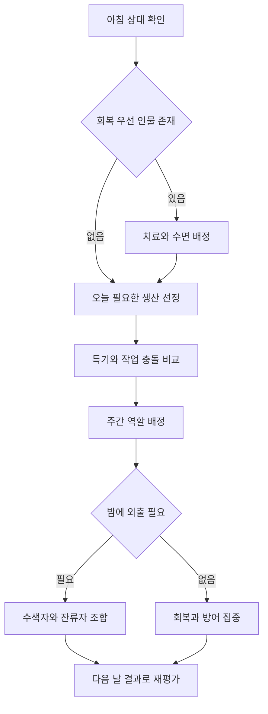

# 03. 생존자 구성·고유 특성·역할 배분

> **기준:** PC판 This War of Mine: Final Cut의 클래식 생존 모드. DLC 전용 인물·아동은 명시한 절에서만 포함한다.  
> **조사일:** 2026-11-13. 정확한 현재 패치 번호 및 게임 실행 검증은 미확인.  
> **표기:** [확인] 공개 자료에서 확인한 규칙 / [분석] 설계 해석 / [재구성안] 구현 참고 모델 / [검증 필요] 수치·예외 확인 대상. 커뮤니티 자료의 확인은 공식 소스코드 검증을 뜻하지 않는다.

## 1. 시스템의 역할

**[분석] 생존자는 노동력, 운반 능력, 위험 감수 주체, 이야기의 주인공을 동시에 담당한다.** 인원수를 늘리면 가능한 작업이 많아지지만 식량·치료·수면 수요도 증가한다. 따라서 이 게임의 인물 구성은 병력을 많이 모으는 성장 곡선보다, 서로 다른 강점과 취약성을 가진 집단을 유지하는 조합 문제에 가깝다.

같은 식재료를 얻어도 요리 담당자가 누구인지, 같은 밤에 누가 밖으로 나가고 누가 경계하는지에 따라 다음 날의 선택지가 달라진다. 이때 중요한 변수는 단순한 캐릭터 등급이 아니라 **현재 상태와 그날 해야 하는 일의 조합**이다. 운반 능력이 좋은 인물을 계속 수색에 투입하는 선택은 단기 수입을 늘리지만, 그 인물이 다치거나 잠을 못 자면 집단 전체가 특정 인물에게 의존한 대가를 치르게 된다.

### 시스템 입출력

| 구분 | 내용 | 설계상 의미 |
|---|---|---|
| 입력 | 시작 구성, 고유 특성, 현재 상태, 보유 시설, 방문자, 야간 목적지 | 하루의 실행 가능 범위를 결정 |
| 플레이어 결정 | 작업자 선택, 수색자·경계자·수면자 배치, 휴식, 영입 수락 | 같은 자원으로 어떤 미래 상태를 만들지 선택 |
| 출력 | 작업 시간·비용 차이, 운반량, 거래 조건, 위험 노출, 인물 반응 | 경제·전투·서사에 결과 전달 |
| 지속 정보 | 생존·부재 여부, 상태 이력, 개인 기록, 관계 정보 | 다음 날과 결말에 이어지는 정체성 |

이 표의 구분은 **[재구성안]**이며 원작 내부 클래스 구조를 나타내지 않는다.

## 2. 공개 자료로 확인되는 구성 요소

**[확인·커뮤니티]** 인물마다 가방 용량, 특기, 배경, 도덕적 반응과 생활 습관이 다르게 정리되어 있다. 이 차이를 하나의 공통 능력치로 환산하는 공식은 공개 확인하지 못했다. [C02](https://this-war-of-mine.fandom.com/wiki/Characters), [C03](https://this-war-of-mine.fandom.com/wiki/Playable_Characters)

클래식에서 자주 다루는 성인 인물을 다음과 같이 비교한다. 아래 표는 전 캐릭터 숨은 수치 도감이 아니라 실제 특기가 어떤 결정을 만드는지 정리한 것이다.

| 인물 | 확인한 대표 특징 | 기획적으로 만들어지는 질문 |
|---|---|---|
| Marko | 수색 특기, 가방 15칸 | 많이 운반할 수 있는 인물을 위험에 계속 노출할 것인가? |
| Boris | 가방 17칸, 느린 이동 | 용량의 이득이 이동 시간과 탈출 위험을 상쇄하는가? |
| Bruno | 요리 특기 | 다른 작업보다 조리를 우선 배정할 만큼 절감 효과가 필요한가? |
| Katia | 거래 특기 | 거래가 있는 날과 수색이 필요한 날의 역할을 어떻게 바꿀 것인가? |
| Marin | 시설·작업대 제작에 필요한 재료 절감 특기 | 아끼는 자원과 해당 인물이 작업에 묶이는 시간을 어떻게 비교할 것인가? |
| Pavle | Fast Runner, 빠른 달리기 | 넓은 지역의 이동 시간과 복귀 여유를 어떻게 확보할 것인가? |
| Arica | Sneaks Quietly, 조용한 이동 | 운반량보다 들키지 않는 접근이 중요한 장소인가? |
| Roman | Trained in Combat, 전투 특기 | 현장 투입과 은신처 경계 중 어디에 전투 능력이 필요한가? |
| Zlata | Bolsters Spirits, 사기 유지 특기 | 직접 생산보다 집단의 상태 유지가 필요한 시점인가? |
| Cveta | Loves Children, 아동을 좋아하는 특기 | 아동 포함 시나리오에서 누가 돌봄 시간을 맡을 것인가? |
| Emilia | Talented Lawyer라는 표시 특기 | 표시 특기명과 실제 숨은 효과를 구분해서 평가하고 있는가? |
| Anton | Good Mathematician이라는 표시 특기 | 이름만으로 존재하지 않는 제작 할인이나 자동화를 가정하지 않는가? |

특징은 [C02](https://this-war-of-mine.fandom.com/wiki/Characters), [C04](https://this-war-of-mine.fandom.com/wiki/Skills), [C26](https://this-war-of-mine.fandom.com/wiki/Character_Details)의 공개 정리에 근거한다. 오른쪽 열은 **[분석]**이다. 할인율, 탐색 속도, 숨은 전투 수치까지 이 표의 사실로 확장하면 안 된다. Anton의 가방·생활 습관처럼 커뮤니티 페이지 사이에서 충돌한 항목은 이 표의 확정 수치에서 제외했다.

### 실제 구성 예시에서 생기는 역할 차이

**[분석]** Marko·Bruno·Katia를 비교하면 수색 용량, 조리, 거래라는 서로 다른 이득을 읽을 수 있다. 식량 부족은 Marko의 수색량을 늘려 해결할 수도 있고, Bruno의 조리 효율을 활용하거나 Katia의 거래로 필요한 재료를 바꾸어 해결할 수도 있다. 이는 특정 세 인물이 모든 시나리오에서 동시에 시작한다는 뜻이 아니라, 실제 특성들의 관계를 비교한 예시다.

반면 Boris와 Pavle의 선택에서는 가방 용량과 이동 여유가 경쟁한다. 가까운 물자 더미를 옮기는 임무와 넓고 위험한 장소에서 빠르게 빠져나오는 임무가 같은 인물을 요구할 이유는 없다. 역기획에서는 운반 슬롯을 기록하는 것에 더해, 같은 경로를 다녀오는 시간과 복귀 실패 위험을 같이 기록해야 이러한 차이를 재현할 수 있다.

## 3. 고유 특성과 현재 상태의 분리

**[재구성안]** 역기획 데이터를 만들 때 다음 세 층을 구분하면 캐릭터 차이를 유지하면서도 상황 변화에 대응하기 쉽다.

| 층 | 예시 데이터 | 갱신 시점 |
|---|---|---|
| 인물 정의 | 이름, 초상화, 배경, 기본 가방, 특기, 생활 습관 | 콘텐츠 로드 시 |
| 지속 상태 | 허기, 질병, 부상, 피로, 심리, 생존·부재 상태 | 식사·피격·휴식·사건 및 날짜 경과 |
| 작업 배정 | 현재 작업, 사용 시설, 야간 역할, 대기 명령 | 플레이어 명령과 작업 완료 시 |

가령 `좋은 요리사`는 조리 계산에 관여하는 지속적인 특성이지만, `부상`은 그날 수행 가능한 작업이나 이동에 영향을 줄 수 있는 상태다. 역할 UI에서는 두 정보가 동시에 읽혀야 한다. 특기 아이콘만 강조하고 작업 제한을 숨기면 사용자는 “좋은 인물을 골랐는데 왜 실행되지 않는가”라는 혼란을 겪게 된다.

### 역할 적합도 모델

다음 식은 **[재구성안]**으로, 원작의 자동 역할 배정 공식이 아니다.

```text
역할 적합도 = 예상 기여
             - 해당 역할의 위험 비용
             - 포기하는 다른 작업의 가치
             - 회복을 미뤄서 늘어나는 미래 비용
```

여기서 가방 용량은 수색 적합도의 한 항목일 뿐이다. 목표가 부족한 약 한 개를 거래하는 것이라면 운반량보다 거래 조건, 이동 가능 여부, 안전한 복귀가 더 중요할 수 있다. 이 식을 플레이어에게 점수로 보여줄 필요는 없다. 디자이너가 특정 캐릭터의 역할이 언제나 정답으로 고정되는지 확인하는 용도로 사용할 수 있다.

## 4. 하루 단위 역할 배분

**[재구성안]** 다음 흐름은 플레이어 의사결정을 정리한 것이며 자동 AI의 실제 구현이 아니다.



### 예시: 거래 담당자와 부상자가 같은 사람일 때

**[분석·가상 사례]** 거래에 유리한 인물이 부상 중이고, 다른 인물은 침대를 사용하고 있다고 가정한다. 여기에는 “거래 담당자가 더 잘하니 무조건 거래”라는 답이 없다.

1. 거래가 방문 상인과의 짧은 교환이라면 회복 계획의 작은 변경으로 해결할 수 있다.
2. 야외 방문을 전제로 한다면 부상으로 인한 이동·복귀 위험을 추가로 고려해야 한다.
3. 지금 얻을 약이 부상 회복에 필요한 것이라면 외출의 위험과 약을 구하지 못할 위험을 비교해야 한다.
4. 다른 사람이 대신 거래하면 교환 조건은 불리하더라도 핵심 인물을 보호할 수 있다.

이 사례는 실제 특정 날의 이벤트를 재현한 공략이 아니다. 같은 특기가 상황에 따라 다른 판단을 유도한다는 설계 설명이다.

## 5. 인원 증가와 감소의 비용 구조

**[분석]** 새 생존자를 받아들이는 결정에는 즉시 생기는 소비와 나중에 얻는 노동력이 함께 들어간다. 새 인물이 좋은 상태라면 당일부터 병렬 작업을 늘릴 수 있다. 치료나 휴식이 필요하다면 초기에는 순소비자가 될 수 있다. 따라서 영입 판단을 `인원 +1`로만 표현하면 경제적·정서적 의미를 놓친다.

| 변화 | 즉시 영향 | 중장기 영향 |
|---|---|---|
| 새 인물 합류 | 식량·침대·치료 수요 증가 가능 | 역할 분산, 위험 분산, 특기 보완 |
| 핵심 인물 부상 | 작업 배정 축소 | 자원 생산·수색·회복의 연쇄 지연 |
| 인물 장기 부재 | 남은 인물의 작업과 경계 부담 증가 | 특정 특기에 의존한 계획 수정 |
| 사망·이탈 | 노동력·관계의 지속 손실 | 집단의 심리와 이후 이야기 변화 |

이 표는 **[분석]**이다. 사건별 자원 증가·감소량이나 영입 상한을 확정하지 않는다. 합류, 부재, 사망, 이탈은 저장 데이터에서 별도 상태로 관리하는 편이 좋다. 부재 중 인물을 사망으로 취급하면 반환 이벤트와 결말 처리에서 모순이 생긴다.

## 6. 특수 인물은 예외 규칙의 집합

**[확인·커뮤니티]** Final Cut의 Livia는 임신 상태를 가진 인물로 소개되며, 질주·외출·야간 경계에 제한이 있다. [C05](https://this-war-of-mine.fandom.com/wiki/Livia)

**[분석]** 이 경우 “요리를 잘하지만 밖에 못 나가는 인물”이라는 조합이 집단의 역할 분담을 강하게 규정한다. 이를 일반 캐릭터의 이동 속도 수치만 낮춰 흉내 내면, UI에 보이는 역할 선택지와 실제 제약이 맞지 않을 수 있다.

**[재구성안]** 전역 `CanAct` 하나 대신 행동별 허용 조건을 둔다.

| 행동 범주 | 필요한 판정 예시 |
|---|---|
| 이동 | 이동 가능한 상태인가, 목적지가 연결되어 있는가 |
| 질주 | 인물 고유 제약과 현재 상태가 허용하는가 |
| 제작 | 필요한 시설·재료·작업 권한이 있는가 |
| 야간 수색 | 외출 가능 인물인가, 상태 제한에 걸리지 않는가 |
| 경계 | 경계 가능한 인물인가, 역할 중복이 없는가 |
| 돌봄 | 상대와 행동 조건이 성립하는가, 양쪽 작업을 예약할 수 있는가 |

아동의 권한·돌봄·교육은 [19_Expansions_and_Mode_Differences.md](19_Expansions_and_Mode_Differences.md)에서 별도로 다룬다. 성인과 아동을 기본 수치만 다른 동일 역할 집합으로 모델링하지 않는다.

## 7. 데이터 구조 예시

**[재구성안] 아래 필드명과 분해 방식은 이 문서를 위한 설계 제안이다. 원작 파일·스크립트를 추출한 결과가 아니다.**

| 데이터 | 주요 필드 | 주의점 |
|---|---|---|
| `SurvivorDefinition` | `id`, `displayName`, `baseCarrySlots`, `traitIds`, `backgroundId` | 고정 정의를 세이브마다 복제하지 않아도 됨 |
| `SurvivorState` | `survivorId`, `lifeState`, `conditionTracks`, `currentLocationId` | 사망·이탈·일시 부재를 구분 |
| `ActionPolicy` | `actionType`, `requiredTags`, `blockedTags`, `reasonTextId` | 금지 이유를 UI와 판정이 공유 |
| `TraitModifier` | `scope`, `operation`, `value`, `priority` | 조리 할인과 시설 제작 할인을 다른 범위로 적용 |
| `Assignment` | `actorId`, `phase`, `taskId`, `reservedFacilityId` | 같은 인물이 두 작업에 중복 예약되지 않음 |
| `PersonalRecord` | `eventId`, `role`, `day`, `reactionTag` | 실제로 가담한 역할과 집단 반응을 구분 |

캐릭터 이름을 조건문에 직접 넣기보다 특기와 행동 제약을 데이터로 분리하면, Livia나 아동처럼 규칙이 다른 인물을 추가할 때 기존 역할 시스템을 재사용할 수 있다. 다만 서사상 고유 사건에는 인물 ID를 명시적으로 사용하는 편이 더 정확하다. 모든 고유 사건을 범용 태그로 바꾸면 이야기의 주체가 흐려질 수 있다.

## 8. 다른 시스템과의 연결

| 연결 대상 | 제공하는 정보 | 되돌아오는 결과 |
|---|---|---|
| [욕구·건강](04_Needs_Health_and_Recovery.md) | 인물 식별, 특수 제약 | 작업 가능 여부·회복 요구 |
| [심리·관계](05_Morale_Relationships_and_Ethics.md) | 성향, 사건 참여자 | 명령 수행 상태·관계 변화 |
| 제작·거래 | 특기 적용 주체 | 자원 변화·작업 시간 |
| 야간 역할 | 역할 후보·장비·현재 상태 | 피로·부상·획득물·부재 |
| [서사·결말](17_Narrative_Choices_and_Endings.md) | 인물 이력과 최종 상태 | 개인별 후일담 |

이 연결 계약은 **[재구성안]**이다. 공통 인물 ID와 사건 ID를 통해 이력을 연결하면, 같은 행동이 심리·일지·엔딩에서 서로 다른 사람에게 적용되는 오류를 줄일 수 있다.

## 9. 밸런스에서 관찰할 지표

**[재구성안]** 단순 생존율과 함께 역할의 다양성을 측정한다.

- 같은 인물의 수색 점유율: 한 인물이 매일 선택된다면 대체 역할의 가치가 약할 수 있다.
- 인물별 회복에 사용한 낮 시간: 강한 특기의 실질 비용이 드러난다.
- 영입 직후 일정 기간의 자원 수지: 인원 증가가 항상 정답인지 확인한다.
- 핵심 인물 부상 후 생산량 감소폭: 한 번의 사고가 회복 불가능한 붕괴로 이어지는지 본다.
- 인물 조합별 첫 시설 선택과 거래 빈도: 조합이 실제 플레이 차이를 만드는지 확인한다.
- 역할 변경 횟수: 특기가 있어도 상황에 따라 배치를 바꿀 필요가 있는지 관찰한다.

성능 차이를 완전히 제거하는 것이 목표는 아니다. 어떤 조합은 외출에 강하고 어떤 조합은 내정에 강해야 반복 플레이의 출발점이 달라진다. 다만 특정 조합에서 필수 행동 자체가 불가능하다면 의도한 도전인지 콘텐츠 누락인지 구분해야 한다.

## 10. 예외·검증 항목

| ID | 확인할 상황 | 확인할 결과 |
|---|---|---|
| CH-01 | 제작 특기 인물이 작업을 시작한 뒤 중단 | 비용 할인과 재료 환급 기준 일관성 |
| CH-02 | 다른 인물이 중단된 작업을 이어받음 | 할인·속도 적용 주체가 중복 계산되지 않음 |
| CH-03 | 밤 역할 선택 후 상태가 달라짐 | 출발 시점 최종 유효성 검사 |
| CH-04 | 마지막 행동 가능 인물이 부재 | 진행·패배·귀환 처리의 우선순위 |
| CH-05 | 특수 제약 인물을 여러 입력 경로로 선택 | UI·단축키·저장 복원에서 동일 제약 |
| CH-06 | 새 인물이 부상 상태로 합류 | 침대·치료·먹거리 배정 가능, 잘못된 기본 상태 방지 |
| CH-07 | 인물이 사망하거나 이탈 | 작업 예약 해제, 장비·기록 처리, 관계 참조 정리 |
| CH-08 | DLC 없는 저장과 DLC 인물 정의 | 콘텐츠 의존성 오류가 사용자에게 명확히 표시됨 |

위 항목은 재구현 검증용이다. 원작에서 해당 버그가 존재한다는 뜻이 아니다.

## 11. 출처와 추가 실측 범위

| ID | 출처 | 접근·근거 수준 | 이 문서에서 사용한 범위 |
|---|---|---|---|
| C02 | [Characters](https://this-war-of-mine.fandom.com/wiki/Characters) | 커뮤니티 위키 검색 색인; 직접 본문 접근 제한 | 대표 인물의 특기·가방 |
| C03 | [Playable Characters](https://this-war-of-mine.fandom.com/wiki/Playable_Characters) | 커뮤니티 위키 검색 색인 | 인물별 성격·배경·상태 구분 |
| C04 | [Skills](https://this-war-of-mine.fandom.com/wiki/Skills) | 커뮤니티 위키 검색 색인 | Katia·Marin의 특기 방향 |
| C05 | [Livia](https://this-war-of-mine.fandom.com/wiki/Livia) | 커뮤니티 위키 검색 색인; 직접 본문 접근 제한 | 임신과 행동 제한 |
| C26 | [Character Details](https://this-war-of-mine.fandom.com/wiki/Character_Details) | 커뮤니티 위키 검색 색인 | 클래식 성인 인물의 표시 특기명 |

**[검증 필요]** 정확한 비용 할인율, 숨은 전투·회복 수치, 가방 수정 가능 여부, 버전별 인물 목록, 작업 인계 시 특기 재평가, 영입 상한은 실행 빌드를 고정한 뒤 확인한다. 자료가 일치하지 않는 특기 설명을 사실로 채택하지 않았으며, 본 문서는 인물별 완전 수치표를 대신하지 않는다.

↩ [전체 목차](README.md)
