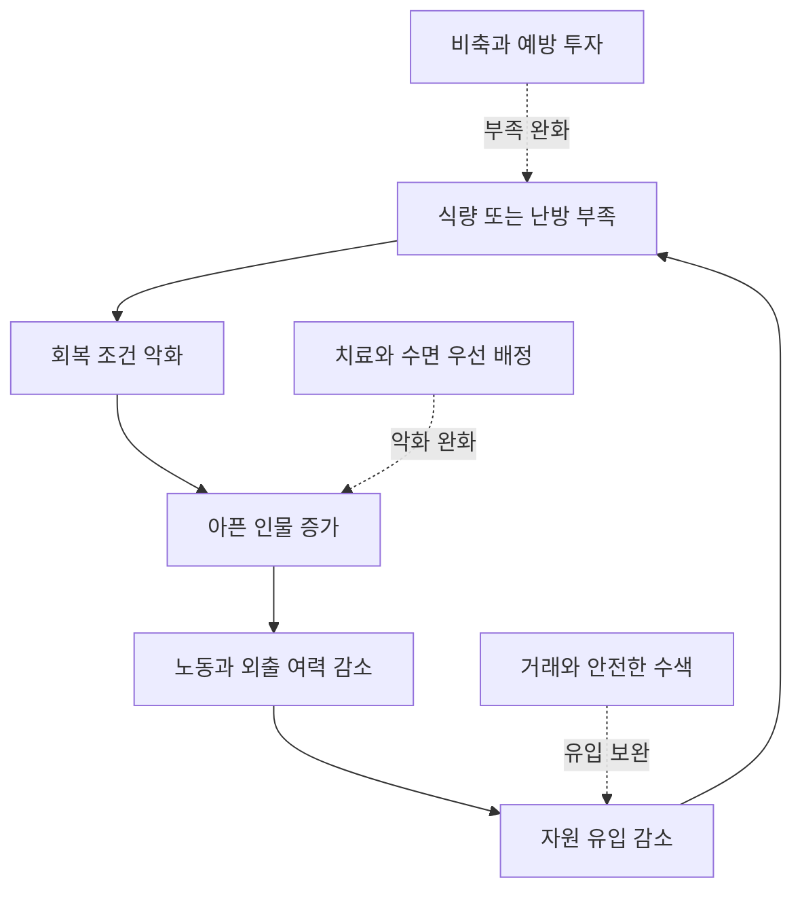

# 04. 욕구·건강·수면·회복 시스템

> **기준:** PC판 Final Cut 클래식 생존 모드. 아동·Stories 전용 상태는 본편 수치와 혼합하지 않는다.  
> **조사일:** 2026-11-13. 정확한 현재 패치 번호와 게임 실행 실측은 미확인.  
> **표기:** [확인] 공개 자료의 규칙 / [분석] 설계 해석 / [재구성안] 제안 모델 / [검증 필요] 미확정 수치. 여기의 건강 용어는 게임 상태를 뜻한다.

## 1. 핵심 설계

**[분석] 이 시스템은 자원을 소비하는 이유와 자원을 얻을 능력을 동시에 조절한다.** 식량·약·침대가 부족해지면 인물의 상태가 나빠지고, 상태가 나빠진 인물은 노동과 외출에 제약을 받는다. 생산력이 떨어지면 필요한 자원을 더 구하기 어려워진다. 이 되먹임 때문에 작은 부족을 방치한 결과가 며칠 뒤 큰 위기로 나타난다.

그러나 모든 부족이 즉시 실패를 일으켜서는 선택의 여지가 사라진다. 가벼운 허기나 피로를 견디며 시설에 투자할지, 지금 회복시켜 안전성을 높일지가 일상적인 판단이 된다. 역기획의 초점은 “상태가 나쁘다”는 표시 자체보다 **경고에서 기능 저하, 회복 곤란으로 이어지는 시간차**에 있다.

## 2. 관리하는 상태 축

**[확인·커뮤니티]** 공개 자료는 허기, 질병, 부상, 피로, 수면 상태, 심리를 서로 연관된 상태로 구분한다. 심리는 별도 문서에서 다룬다. [C06](https://this-war-of-mine.fandom.com/wiki/Character_States)

| 축 | 대표 화면 표현 | 주된 관리 수단 | 설계상 구분 |
|---|---|---|---|
| 허기 | Hungry, Very Hungry, Starving 등 | 먹거리 소비 | 얼마나 오랫동안 먹지 못했는가 |
| 질병 | Slightly Sick, Sick, Severely Ill 등 | 약품·휴식·환경 관리 | 시간에 따라 악화·회복되는 질환 |
| 부상 | Slightly Wounded, Wounded 등 | 붕대·휴식 | 외부 충격의 지속 결과 |
| 피로 | Tired, Very Tired 등 | 수면 | 노동·외출과 회복 사이의 시간 부채 |
| 수면 상태 | Slept Poorly 등 | 적절한 수면 조건 | 단순 피로량과 구별되는 수면의 질 |
| 심리 | Sad, Depressed, Broken 등 | 돌봄·생활 조건·사건 대응 | 감정과 수행 능력의 연결 |

표의 용어·구분은 [C06](https://this-war-of-mine.fandom.com/wiki/Character_States), [C07](https://this-war-of-mine.fandom.com/wiki/Hunger), [C08](https://this-war-of-mine.fandom.com/wiki/Injuries), [C09](https://this-war-of-mine.fandom.com/wiki/Illness), [C10](https://this-war-of-mine.fandom.com/wiki/Tiredness), [C11](https://this-war-of-mine.fandom.com/wiki/Sleep)에 근거한 요약이다. 한국어 표기는 설명용이며 공식 번역 문자열의 완전 목록이 아니다.

**[분석]** 이 여섯 축을 하나의 체력 게이지로 합치면 대응 방식이 사라진다. 음식은 충분하지만 붕대가 없는 상황과, 부상자는 없지만 모두 잠을 못 잔 상황은 다른 행동을 요구해야 한다. 여러 종류의 부족이 있다는 사실이 제작·거래·시설의 가치를 만든다.

### 원작 상태의 진행 단계와 기능 차이

**[확인·커뮤니티]** 다음은 공개 상태표에서 확인한 단계명과 대표 제약이다. 단계 사이의 소요 일수는 포함하지 않았다.

| 축 | 가벼운 상태에서 심한 상태로의 표시 | 확인한 대표 차이 |
|---|---|---|
| 허기 | Hungry → Very Hungry → Starving → Extremely Starving | 장기 결식이 생존 위기로 이어짐 |
| 질병 | Slightly Sick → Sick → Severely Ill → Terminally Ill | Severely Ill에는 야간 수색 제약이 보고됨 |
| 부상 | Slightly Wounded → Wounded → Severely Wounded → Lethally Wounded | Lethally Wounded는 수색·경계 불가 |
| 피로 | Tired → Very Tired → Exhausted → Extremely Exhausted | Exhausted는 수색 불가, 최상위 단계에서는 일반 행동이 제한됨 |

허기는 [C07](https://this-war-of-mine.fandom.com/wiki/Hunger), 질병은 [C09](https://this-war-of-mine.fandom.com/wiki/Illness), 부상은 [C08](https://this-war-of-mine.fandom.com/wiki/Injuries), 피로는 [C10](https://this-war-of-mine.fandom.com/wiki/Tiredness)에 근거한다. `Normal` 상태나 `Well Fed` 같은 양호 상태는 악화 경로와 구분한다.

## 3. 허기: 즉시 섭취와 장기 공급

**[확인·커뮤니티]** 허기는 단계적으로 악화되며, 심한 허기는 다른 악조건과 함께 행동과 회복에 불리하게 작용한다. 조리식·통조림과 생식 재료의 포만 효과는 같지 않다고 정리되어 있다. [C07](https://this-war-of-mine.fandom.com/wiki/Hunger)

**[확인·커뮤니티·일반 성인]** 조리식 또는 통조림 한 번으로 `Very Hungry`에서 `Hungry`처럼 한 표시 단계를 개선할 수 있다. 생고기·채소는 그보다 작은 포만 효과를 가져, 한 번 먹고도 `Still Hungry`처럼 일부 허기가 남는 표현이 나타날 수 있다. 따라서 심하게 굶주린 인물에게 한 번 먹였다고 모든 허기가 사라지는 구조가 아니다. 아동의 섭취 효과는 성인과 구분한다. [C07](https://this-war-of-mine.fandom.com/wiki/Hunger)

### 플레이어의 결정

- 지금 한 명을 충분히 먹일지, 여러 명의 악화를 조금씩 늦출지 결정한다.
- 조리 재료를 즉시 소비할지, 연료·물·작업 시간을 확보하여 조리할지 판단한다.
- 야간 외출자와 회복 중인 인물 중 누구를 우선 지원할지 정한다.
- 오늘 먹을 양과 다음 자원 획득 기회까지 필요한 양을 구분한다.

**[분석]** 음식의 가치는 그 자체의 거래 가치와 다를 수 있다. 오늘 굶주림을 완화하는 한 끼가 다음 밤의 운반 능력을 유지해 준다면, 간접적으로 여러 자원을 보존한다. 반대로 모든 인물을 항상 최상 상태로 유지하면 시설 투자와 비축을 포기하게 될 수 있다. 이 간격이 배급 선택을 만든다.

### 허기 수치를 역기획할 때의 함정

**[검증 필요]** 같은 `Hungry` 표시가 정확히 같은 내부 진행도를 뜻하는지는 UI 문자열만 보고 판단할 수 없다. 공개 커뮤니티 설명은 일부 표시 단계 안에 세부 단계가 있다고 정리한다. 따라서 `Hungry = 하루`, `식사 한 번 = 완전 회복`처럼 단순 대응시키지 않는다. 배급 주기를 재현하려면 식사 이전 상태, 음식 종류, 다음 날 변화까지 함께 기록해야 한다.

물은 이 문서의 독립적인 갈증 게이지로 새로 추가하지 않는다. **[재구성안]** 물 소비와 생산은 자원·조리 시스템에 연결하고, 원작과 다른 갈증 시스템을 도입한다면 별도 확장 규칙으로 표시한다.

## 4. 질병과 부상: 원인·치료 자원의 분리

**[확인·커뮤니티]** 부상에는 붕대, 질병에는 약품 계열과 휴식이 대응하며, 심각한 상태에는 행동 제한과 사망 위험이 따른다. 병원에서 도움을 받을 수 있는 경우도 공개 자료에 정리되어 있다. [C08](https://this-war-of-mine.fandom.com/wiki/Injuries), [C09](https://this-war-of-mine.fandom.com/wiki/Illness)

**[확인·커뮤니티]** 가벼운 부상은 침대 휴식만으로 나을 가능성이 있지만 확정 회복은 아니다. 부상은 외부 전투뿐 아니라 야간 습격이나 집단 내부 다툼에서도 생길 수 있다. [C08](https://this-war-of-mine.fandom.com/wiki/Injuries) 약품도 같은 종류로 묶이지 않는다. Herbal Meds는 경증 질병에 쓰이며, 중증인 Severely Ill·Terminally Ill에는 사용할 수 없다고 정리되어 있다. [C32](https://this-war-of-mine.fandom.com/wiki/Herbal_Meds)

**[분석]** 부상은 위험한 행동의 비용을 집으로 가져오는 장치다. 밤의 전투가 끝나도 결과가 끝나지 않는다. 붕대를 쓰고 침대를 차지하며 작업을 쉬는 동안, 다른 인물이 그 노동을 대신해야 한다. 질병은 환경과 생활 관리의 누적 실패를 개인 상태로 드러내는 역할을 한다.

| 비교 항목 | 부상에 대한 설계 해석 | 질병에 대한 설계 해석 |
|---|---|---|
| 비용 발생 형태 | 위험한 접촉 이후 즉시 또는 빠르게 드러남 | 환경·생활 조건과 시간 경과로 누적될 수 있음 |
| 자원 연결 | 붕대, 방어 장비, 안전한 동선 | 약품, 난방, 휴식 환경 |
| 플레이어 질문 | 싸울 필요가 있었는가, 다음 외출을 미룰 것인가 | 예방 투자를 했어야 하는가, 지금 약을 쓸 것인가 |
| 파급 | 전투 담당자·수색자의 공백 | 여러 인물에게 동시 부담이 생길 수 있음 |

이 비교는 원작 내부 확률식이 아니라 **[분석]**이다. 특정 실내 온도 이하에서 무조건 발병한다거나, 약을 한 번 쓰면 다음 날 반드시 낫는다는 보장은 두지 않는다.

### 회복을 하나의 버튼으로 표현하지 않기

**[재구성안]** 치료는 `약품 사용`, `회복 조건 확보`, `경과 판정`을 분리한다. 약품 사용 직후 자원은 줄지만, 상태의 최종 변화는 별도의 경과 판정에서 일어날 수 있다. UI는 “치료받음”과 “완치됨”을 구분해야 사용자가 자원이 사라진 것과 치료 실패를 혼동하지 않는다.

```text
치료 요청
  → 치료 가능 여부와 자원 확인
  → 아이템 소비 및 치료 기록
  → 휴식·식사·환경·시간 조건 누적
  → 회복 / 유지 / 악화 판정
  → 상태 표시와 일지 갱신
```

위 흐름은 재구현을 위한 분해다. 원작의 판정 순서나 난수 호출 위치는 확인되지 않았다.

## 5. 피로와 수면: 낮과 밤의 작업 시간을 교환

**[확인·커뮤니티]** 수색·경계 등으로 생긴 피로와 수면 부족은 침대 사용 및 휴식 계획에 연결된다. 바닥 수면의 불리함은 피로 수치와 별도 수면 상태로 설명된다. [C10](https://this-war-of-mine.fandom.com/wiki/Tiredness), [C11](https://this-war-of-mine.fandom.com/wiki/Sleep)

**[분석]** 침대의 가치는 시설 개수보다 회전율과 배정 방식에서 드러난다. 밤에 깨어 있던 인물이 낮에 자면 외출 능력을 되찾는 대신 낮 작업 시간이 줄어든다. 따라서 침대를 충분히 지었다고 피로 관리가 끝나는 것은 아니다. 언제 누가 사용할지까지 계획해야 한다.

### 작업 계획 사례

**[분석·가상 사례]** 세 인물 중 한 명이 수색, 한 명이 경계, 한 명이 수면을 맡았다고 가정한다. 아침에는 수색자·경계자의 피로 회복과 생산 작업이 같은 시간대를 요구한다. 전날 잔류자가 미리 조리를 해 두었다면 다음 날 침대 배정을 여유 있게 할 수 있다. 반면 재료가 밤에 도착해야만 생산이 가능하다면, 도착 직후 누가 생산을 시작할지 다시 정해야 한다.

이 관계는 `피로 증가량` 하나로 설명되지 않는다. 밤 결과와 낮 작업 시작 시점이 연결되어야 한다. 정확한 필요 수면 시간, 도중에 깨웠을 때 누적 시간이 유지되는지, 낮 수면이 밤의 수면 상태를 얼마나 대체하는지는 버전 고정 실측 대상으로 남긴다.

## 6. 악화의 연쇄와 개입 지점

다음은 공개 규칙을 바탕으로 정리한 **[분석]**이다. 모든 화살표가 직접적인 내부 수치 연산을 뜻하지는 않는다.



좋은 밸런스에서는 플레이어가 이 연쇄를 조기에 읽고 중간에서 끊을 수 있어야 한다. 경고가 충분했는데도 위험을 감수했다면 결과를 받아들이기 쉽다. 상태가 갑자기 여러 단계 악화되고 원인을 알 수 없다면, 같은 실패도 임의적인 벌처럼 느껴질 수 있다.

## 7. 상태 데이터와 갱신 계약

**[재구성안]** 상태 표현은 시뮬레이션 값, 화면 단계, 행동 제약을 분리한다.

| 계층 | 필드 예시 | 목적 |
|---|---|---|
| 진행 정보 | `severity`, `elapsedAtStage`, `lastChangedAt` | 같은 화면 단계 안에서도 경과를 추적 |
| 회복 정보 | `treatmentApplied`, `restExposure`, `caregiverId` | 치료·돌봄을 중복 적용하지 않음 |
| 화면 표시 | `displayStage`, `localizedStatusText`, `changeReason` | 읽을 수 있는 경고와 설명 |
| 행동 제약 | `blockedActions`, `speedModifierGroup` | UI와 실행 판정에 같은 규칙 적용 |
| 기록 | `sourceEventId`, `previousStage`, `newStage` | 일지·세이브·검증의 근거 |

### 날짜 전환 처리안

원작의 실제 순서가 아니라 **재구현에서 결과를 설명하기 위한 한 가지 제안**이다.

1. 직전 구간의 식사·치료·수면·환경 노출을 확정한다.
2. 판정 입력 스냅샷을 만든다.
3. 각 상태의 변화 후보를 계산한다.
4. 상호작용 규칙과 최대·최소 범위를 적용한다.
5. 사망·행동 불가 등 종단 조건을 판정한다.
6. 상태 변화에 따른 심리 사건과 기록을 발행한다.
7. 결과 화면과 다음 구간 UI를 갱신한다.

입력 스냅샷을 두는 이유는 인물 순회 순서에 따라 결과가 달라지는 문제를 방지하기 위해서다. 예를 들어 첫 번째 인물의 사망 반응이 두 번째 인물의 같은 시점 회복 판정에 즉시 끼어드는지, 다음 처리 단계로 미루는지 명시해야 한다. 어느 방식이 원작과 같다고 단정하지 않는다.

## 8. 돌봄과 작업 충돌

**[분석]** 상태가 심각해진 인물은 자신의 회복에 필요한 작업을 수행하기 어려워질 수 있다. 이때 회복에는 아이템뿐 아니라 다른 인물의 시간이 추가로 필요하다. 돌봄은 자원 사용을 개인 문제에서 집단 문제로 바꾼다.

**[재구성안]** 돌봄 행동은 두 인물을 동시에 예약한다. 돌보는 사람과 대상이 서로 다른 작업에 묶여 있으면 먼저 작업 취소·중단 규칙을 적용한다. 치료 대상이 도중에 이동할 수 없게 되거나 사라지면 아이템 소비와 작업 완료 처리를 분리해 중복 소모를 막는다.

| 충돌 | 필요한 처리 |
|---|---|
| 두 사람이 같은 대상에게 같은 치료를 시도 | 먼저 성립한 치료만 예약하거나 명시적으로 순차 수행 |
| 치료 중 낮 종료 | 완료·이월·취소 중 선택한 정책 적용 |
| 대상이 이미 같은 치료를 받음 | 추가 사용 가능 여부와 UI 설명 일치 |
| 침대가 다른 인물에게 예약됨 | 회복 계획의 실패 이유 표시 |
| 회복 직후 야간 출발 | 최종 상태로 출발 가능 여부 재검사 |

## 9. 밸런스 조절 대상

**[재구성안]** 아래는 기획 변수의 종류이며 원작의 공개 파라미터명이 아니다.

| 변수 | 높이거나 강화했을 때의 예상 결과 | 관찰할 위험 |
|---|---|---|
| 초기 경고 단계의 지속 시간 | 예방·투자 판단 여유 증가 | 부족을 계속 무시하는 고정 전략 |
| 중증 상태의 회복 소요 | 사고의 후유증 증가 | 한 번 실수 후 회복 불가 |
| 치료 자원의 획득 안정성 | 건강 회복의 계획 가능성 증가 | 치료가 의미 없는 소모 절차로 축소 |
| 수면에 필요한 작업 시간 | 침대·역할 배치의 중요성 증가 | 낮 관리가 대기 시간으로 채워짐 |
| 상태 간 악화 영향 | 생존 압박과 연쇄 서사 강화 | 복합 상태에서 원인 파악 불가능 |
| 예방 시설의 효과 | 사전 계획 보상 | 시설 완성 후 위험 소멸 |

평가 지표는 사망률만으로 충분하지 않다. 경고 발생부터 대응까지 걸린 시간, 회복이 시작되기까지의 비용, 한 인물의 부상으로 추가된 다른 인물의 노동시간을 함께 기록하면 상태 시스템이 실제로 만드는 선택을 볼 수 있다.

## 10. 검증 시나리오

| ID | 조건 | 확인 항목 |
|---|---|---|
| HE-01 | 같은 화면 허기 단계에서 서로 다른 날에 식사 | 세부 진행도와 음식 효과를 분리 기록 |
| HE-02 | 생식·조리식·통조림 비교 | 섭취량, 상태 변화, 소비 자원 |
| HE-03 | 경상자에게 휴식만 제공 | 자연 회복 확률·유지·악화 빈도 |
| HE-04 | 동일 상태에서 치료 유무만 변경 | 치료 효과와 환경 효과의 분리 |
| HE-05 | 낮 수면을 완료·중단·재개 | 누적 수면 처리와 상태 표시 |
| HE-06 | 침대 없음·침대 있음 비교 | 피로와 수면 질의 별도 변화 |
| HE-07 | 동일 인물이 질병·부상·허기를 동시에 가짐 | 행동 제한 우선순위와 복합 악화 |
| HE-08 | 밤 결과에서 피격과 회복이 함께 발생 | 판정 순서 및 설명의 일관성 |
| HE-09 | 특수 인물·아동을 같은 조건에 배치 | 일반 성인 규칙의 잘못된 공통 적용 방지 |
| HE-10 | 상태 변화 직전 저장·복원 | 치료·식사·수면 중복 계산 방지 |

표는 **[재구성안]**이다. 확률 규칙은 한 번의 결과로 확정하지 않고 동일 조건의 반복 결과와 오차를 함께 기록한다. 실행 검증을 수행하지 않은 이 문서에는 실측 확률을 기재하지 않는다.

## 11. 출처와 남은 불확실성

| ID | 출처 | 접근·근거 수준 | 사용 범위 |
|---|---|---|---|
| C06 | [Character States](https://this-war-of-mine.fandom.com/wiki/Character_States) | 커뮤니티 위키 검색 색인 | 상태 축과 상호 연관 |
| C07 | [Hunger](https://this-war-of-mine.fandom.com/wiki/Hunger) | 커뮤니티 위키 검색 색인 | 허기 단계, 식품 종류별 효과 차이 |
| C08 | [Injuries](https://this-war-of-mine.fandom.com/wiki/Injuries) | 커뮤니티 위키 검색 색인 | 부상·붕대·중증 제약 |
| C09 | [Illness](https://this-war-of-mine.fandom.com/wiki/Illness) | 커뮤니티 위키 검색 색인 | 질병·약품·환경·병원 |
| C10 | [Tiredness](https://this-war-of-mine.fandom.com/wiki/Tiredness) | 커뮤니티 위키 검색 색인 | 피로와 수면 회복 |
| C11 | [Sleep](https://this-war-of-mine.fandom.com/wiki/Sleep) | 커뮤니티 위키 검색 색인 | 수면 질과 침대 |
| C32 | [Herbal Meds](https://this-war-of-mine.fandom.com/wiki/Herbal_Meds) | 커뮤니티 위키 검색 색인 | 약초 약품의 적용 상태 제한 |

**[검증 필요]** 정확한 허기 단계의 내부 값, 상태별 사망 시점, 확정적인 회복 일수, 온도 임계치, 수면 시간, 약품별 회복 확률, 캐릭터별 저항력은 공개 설명만으로 확정하지 않는다. 커뮤니티 공략의 권장 배급 주기는 원작의 공식 난이도 규칙과 구분한다.

연결 문서: [생존자 구성](03_Characters_and_Traits.md) · [심리·관계](05_Morale_Relationships_and_Ethics.md) · [전체 목차](README.md)
