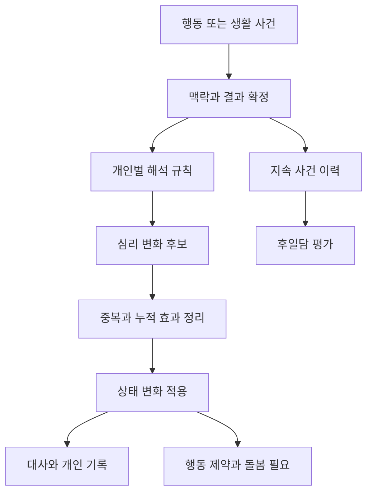

# 05. 심리·관계·도덕적 선택의 비용

> **기준:** PC판 Final Cut 클래식 생존 모드. 아동의 보호자 관계는 The Little Ones 추가 규칙으로 분리한다.  
> **조사일:** 2026-11-13. 정확한 현재 패치 번호 및 게임 실행 검증은 미확인.  
> **표기:** [확인] 출처로 확인한 규칙 / [분석] 설계 해석 / [재구성안] 제안 모델 / [검증 필요] 수치·특정 사건 예외. 아래 심리 용어는 게임 상태명이다.

## 1. 설계 목적

**[분석] 이 시스템은 생존에 유리한 행동과 인물이 감당할 수 있는 행동을 일치시키지 않는다.** 재고가 늘었다는 사실만으로 그 선택이 성공했다고 결론내릴 수 없게 한다. 다른 사람의 물건을 가져오거나 폭력을 행사한 뒤, 식량은 확보했지만 다음 날 집단 운영이 더 어려워지는 식의 결과가 가능해진다.

핵심은 처벌 점수의 크기가 아니라 결과의 시간차와 분산이다. 선택한 인물, 현장에 없던 동료, 이후의 작업 능력과 기록이 서로 다른 방식으로 반응하면 플레이어는 행동을 자원 계산과 인간관계 양쪽에서 해석하게 된다. 따라서 심리를 단순한 행복도 보너스로 취급하면 이 게임의 중요한 의사결정이 사라진다.

## 2. 공개 규칙의 최소 정리

**[확인·커뮤니티]** 심리는 Content, Normal, Sad, Depressed, Broken 등으로 표시되며, 심한 악화는 행동 불능·이탈·사망 사건과 연결될 수 있다. 사건, 생활 상태, 타인의 고통, 도움과 위로가 영향을 준다고 정리되어 있다. 표시되지 않는 중간 단계도 언급된다. [C12](https://this-war-of-mine.fandom.com/zh/wiki/Moods)

**[확인·커뮤니티]** 도덕적 사건에 대한 반응은 인물과 현장 상황에 따라 다르게 정리된다. 특정 인물이 모든 도둑질이나 모든 전투에 동일하게 반응한다고 일반화할 수 없다. [C13](https://this-war-of-mine.fandom.com/wiki/Sympathy)

| 화면 단계 | 역기획에서 읽어야 할 의미 |
|---|---|
| 안정·만족 | 당장의 위기를 넘어서 생활의 질을 확보한 상태 |
| 슬픔 | 지속 관리가 필요하다는 초기 경고 |
| 우울 | 자원 문제가 노동·돌봄 문제로 번지는 구간 |
| 붕괴 | 스스로 회복 행동을 하기 어려운 위기 |

이 표의 오른쪽은 **[분석]**이다. 정확한 점수 구간, 발생 확률, 단계별 이동 배수는 실측 없이 넣지 않는다.

### 실제 행동에서 드러나는 심리 변화

**[확인·커뮤니티]** Depressed에서는 이동이 느려지거나 행동 중 멈춤이 발생할 수 있고, Broken에서는 일반 명령 수행과 수색·경계가 제한된다. 이때 동료가 식사·치료를 돕는 돌봄이 필요해진다. 우울한 인물에게 표시되는 대화 아이콘을 다른 인물이 사용하면 위로 대화를 진행할 수 있다. 위로 후 내부 상태가 개선되어도 화면 단계가 즉시 바뀌지 않을 수 있다. [C27](https://this-war-of-mine.fandom.com/wiki/Morale)

## 3. 자원 비용과 심리 비용의 결합

**[분석]** 도덕적 선택의 구조를 이해하려면 결과를 네 가지로 나누는 것이 유용하다.

| 결과 층 | 예시 | 플레이어에게 돌아오는 질문 |
|---|---|---|
| 즉시 자원 | 식량·약품 획득 또는 지출 | 오늘의 부족을 해결했는가? |
| 즉시 위험 | 발각·폭력·부상 | 그 물건을 가져오는 과정은 안전했는가? |
| 지연 운영 | 회복·위로·휴식에 필요한 시간 | 다음 날 누가 일을 대신할 것인가? |
| 지속 서사 | 개인 기록·사건 기억·후일담 | 살아남은 뒤 무엇이 남았는가? |

생존 압박이 없으면 타인을 돕는 선택의 비용이 약해진다. 반대로 도움의 비용이 언제나 회복 불가능한 손실이라면 선행은 사실상 금지된다. 이 시스템의 긴장은 양쪽 선택 모두 현실적인 이유를 가지는 범위에서 발생한다.

### 가상 사례: 마지막 붕대를 줄 것인가

**[분석·가상 사례]** 은신처에 경상자가 있고, 방문자가 붕대를 요청한다고 가정한다. 플레이어는 단순히 물건 하나를 주거나 보관하는 결정을 내리는 것이 아니다.

1. 현재 경상자를 자연 회복에 맡겨도 되는지 불확실하다.
2. 다음 상인 방문이나 수색에서 붕대를 구할 수 있을지 알 수 없다.
3. 요청을 도와준 결과는 물질적 보상과 별개로 해석될 수 있다.
4. 거절한 뒤의 집단 반응이 이후 작업 계획에 영향을 줄 수 있다.

위 사례는 특정 원작 이벤트의 정확한 조건·보상표를 재현한 것이 아니다. 생존과 연민이 같은 재고를 사용하도록 연결되는 설계 원리를 보여준다.

## 4. 사건의 의미와 행위자의 분리

**[재구성안]** `누군가 죽었다`는 결과만 저장하면 상황에 맞는 심리 반응을 만들기 어렵다. 사건에는 행위자, 대상, 소유권, 위협 맥락, 사건 결과를 별도로 기록해야 한다.

| 사건 정보 | 필요한 이유 |
|---|---|
| `actorId` | 직접 행동한 인물의 책임과 개인 기록 |
| `targetId` 또는 `ownerId` | 피해·도움의 대상과 재산 소유자를 구분 |
| `actionType` | 절도·교환·구조·공격 등 행위 종류 |
| `contextTags` | 위협, 민간인, 자원 소유, 구조 요청 같은 맥락 |
| `outcomeTags` | 실제 획득·부상·사망·도움 완료 여부 |
| `participants` | 직접 참여자, 목격자, 이후 소식을 받은 집단 |
| `eventId` | 같은 사건의 중복 반응 방지 |

이는 원작이 해당 구조를 사용한다는 주장이 아니다. 역기획한 행동 결과를 데이터로 재현할 때의 제안이다. 특히 `적대 NPC`라는 전투 태그와 `도덕적으로 비난받지 않는 대상`이라는 서사 태그를 자동으로 같게 만들면, 현장 맥락을 제대로 표현하기 어렵다.

**[검증 필요]** 특정 장소의 사유 재산이 NPC 사망 후 어떻게 취급되는지, 위협을 가하던 NPC를 공격했을 때 모든 인물이 동일 반응을 보이는지, 현장을 보지 않은 동료에게 어떤 사건이 전파되는지는 장소별로 확인한다. 공략에서 “도덕 페널티가 없는 지역”이라고 부르는 분류를 전역 규칙으로 채택하지 않는다.

## 5. 심리 반응의 시간 구조

아래 그림은 **[재구성안]**이다. 실제 엔진의 업데이트 순서가 아니라 필요한 책임을 분리한 흐름이다.

여기서 심리 상태와 지속 사건 이력을 나누는 이유가 중요하다. 플레이 도중 위로받아 기분이 회복되더라도 과거 사건의 기록이 자동으로 없어져야 하는 것은 아니다. 반대로 마지막 날 기분이 나빴다는 이유만으로 전체 경험을 한 줄로 판단해서도 안 된다. 원작 결말의 정확한 평가식은 [17_Narrative_Choices_and_Endings.md](17_Narrative_Choices_and_Endings.md)의 검증 범위로 남긴다.

## 6. 관계 시스템의 범위

**[분석]** 성인 간 관계를 역기획하면서 모든 조합에 호감도 수치가 있다고 가정할 필요는 없다. 집단 반응, 위로 행동, 배경 관계, 사건 기록만으로도 상호 의존을 만들 수 있다. 공개 UI에 보이지 않는 전면적인 사회관계 그래프를 원작의 확인된 기능처럼 문서화하지 않는다.

**[확인·커뮤니티·DLC]** The Little Ones에서는 아동이 성인과 교류하며 유대·보호자 관계를 형성할 수 있고, 아동의 상태는 은신처의 공동 평가에도 반영된다. [C17](https://this-war-of-mine.fandom.com/wiki/Children), [C14](https://this-war-of-mine.fandom.com/wiki/Some_thoughts)

**[분석]** 이 관계는 보호 대상의 안녕을 집단 운영의 성과로 바꾼다. 아동이 노동에 얼마나 기여하는지만 계산하면 돌봄의 의미가 빠진다. 관계를 만들고 유지하는 시간을 소모하게 하는 것 자체가, 플레이어가 무엇을 우선시하는지를 드러내는 장치다.

### 재구성할 때의 관계 데이터

| 데이터 | 필요한 범위 | 과잉 구현을 피하는 방법 |
|---|---|---|
| 배경 관계 | 시나리오 시작 시의 친족·지인 정보 | 모든 인물 쌍에 연애·친구 점수를 만들지 않음 |
| 돌봄 관계 | 아동과 보호자, 반복 교류 이력 | 특정 DLC 기능으로 명시 |
| 사건 참여 관계 | 도움을 주고받은 사람과 기억 | 이벤트별 기록에 연결 |
| 공동 상태 평가 | 동료의 사망·고통·안정에 대한 반응 | 개인 감정과 집단 보고를 분리 |

이 표는 **[재구성안]**이다.

## 7. 회복 수단의 설계 역할

### 원작에 존재하는 관리 수단

| 수단 | 확인한 플레이 기능 | 근거 |
|---|---|---|
| 동료의 위로 | 우울·붕괴한 인물에게 대화를 걸어 상태 회복에 관여 | C27 |
| 충분한 식사·도움 행동 | 심리 개선의 입력으로 작동 | C12 |
| 기타 | 부서진 기타를 개선된 작업대에서 수리; 연주할 수 있는 인물이 사용하면 사기 유지에 도움 | C28 |
| 책 | 은신처의 생활 여건에 도움; 필요하면 연료로 전환 가능 | C29 |
| 라디오의 음악 | 음악 채널을 켜 두는 것이 심리 관리에 도움 | C31 |
| 커피 | 해당 습관을 가진 인물이 재고에서 일상적으로 소비 | C30 |
| 아동과의 교류 | 아동과 성인의 상태 및 유대에 연결 | C17 |

각 행은 **[확인·커뮤니티]**이며 정확한 보너스 수치를 뜻하지 않는다. 기타는 누구에게나 동일한 연주 능력이 있는 시설이 아니다. 공개 자료는 Zlata, Katia, Roman, Pavle, Arica의 연주 능력을 구분한다. [C28](https://this-war-of-mine.fandom.com/wiki/Guitar) 책을 연료로 바꾸는 선택은 같은 물건의 생활 가치와 난방·조리 가치를 교환한다는 점에서 이 게임의 경제·심리 연결을 잘 보여준다. 마지막 문장은 **[분석]**이다.

**[분석]** 심리 회복 수단은 각각 다른 자원을 소모하도록 배치할 때 의미가 있다. 먹거리는 생존 자원, 위로는 다른 인물의 시간, 생활 편의 시설은 초기 투자와 공간, 기호품은 재고·거래 선택에 연결될 수 있다. 한 가지 값싼 수단이 모든 위기를 즉시 없애면 이전 선택의 비용이 사라진다.

**[재구성안]** 회복 입력은 다음처럼 범주화할 수 있다.

| 회복 입력 | 비용의 종류 | 구현 시 확인할 점 |
|---|---|---|
| 기본 생활 안정 | 식사·휴식·환경 | 같은 생활 상태를 매 프레임 중복 보상하지 않기 |
| 대인 돌봄 | 두 인물의 시간 | 행동 불능 대상에게도 적절한 접근 제공 |
| 긍정적 사건 | 자원·위험·외부 선택 | 단순 반복으로 무한 회복이 되지 않도록 사건 식별 |
| 생활 편의·문화 | 제작 재료·공간·접근 | 시설 존재 효과와 직접 사용 효과 구분 |
| 개인 습관 충족 | 특정 재고 소비 | 자동 소비 시점과 타인의 소비를 구분 |

원작의 책·음악·대화·기호품 효과를 모두 동일한 회복량으로 환산한 표가 아니다. 실제 효과의 대상, 갱신 시점, 최대 중첩은 별도 검증이 필요하다.

## 8. 사용자 피드백

**[분석]** 수치와 이유를 모두 숨기면 이해하기 어려워지고, 모든 반응을 점수로 공개하면 도덕적 판단이 계산 문제로 축소될 수 있다. 따라서 단계와 원인 단서는 읽을 수 있게 하되, 모든 결과의 정답을 미리 표시하지 않는 균형이 필요하다.

**[재구성안]** 피드백을 세 층으로 나눈다.

1. **상태 표시:** 지금 이 인물이 일을 할 수 있는지, 돌봄이 필요한지 알려준다.
2. **상황 대사·개인 기록:** 최근 무엇에 영향을 받았는지 설명한다.
3. **장기 기록:** 어떤 선택을 거쳐 여기까지 왔는지 되돌아볼 수 있게 한다.

주의할 점은 말풍선이 기분 단계와 완전히 같은 주기로 바뀔 필요가 없다는 것이다. 그러나 긍정적 말을 하면서 행동 불능인 상태가 오래 유지된다면, 플레이어가 상황을 이해할 수 있는 추가 설명이 있어야 한다. 원인을 설명하는 피드백과 결과를 확정하는 피드백을 구분한다.

## 9. 밸런스 검토

| 점검 질문 | 문제가 있음을 보여주는 징후 | 조절 방향의 예 |
|---|---|---|
| 자원을 얻는 폭력적 선택이 항상 우월한가? | 이후 비용이 거의 없고 대체 경로가 약함 | 간접 비용·비폭력 경로의 현실성 검토 |
| 선행이 언제나 정답인가? | 비용을 충분히 상쇄하는 즉시 보상 | 보상을 항상 확정하지 않는 사건 설계 |
| 특정 회복 수단이 모든 문제를 해결하는가? | 같은 행동만 반복 | 효과 범위·중첩·시간 비용 분리 |
| 위기에서 복구할 여지가 있는가? | 모두 붕괴해 아무 행동도 못 하는 빈도 과다 | 조기 경고·돌봄 경로·위기 진입 속도 검토 |
| 인물 차이가 읽히는가? | 같은 사건에 사실상 동일 반응 | 성향의 차이를 대사와 비용 양쪽에서 확인 |

이 표는 **[재구성안]**이며 원작에 특정 밸런스 결함이 있다고 판정한 내용은 아니다. 테스트 지표로는 심리 위기 발생 후 복구율, 돌봄에 사용한 시간, 같은 행동의 반복 횟수, 사건별 반응 이해도를 사용할 수 있다.

## 10. 예외·검증 시나리오

| ID | 상황 | 검증 내용 |
|---|---|---|
| MO-01 | 같은 물건을 여러 스택으로 나눠 가져옴 | 절도 반응의 단위가 아이템·컨테이너·사건 중 무엇인지 |
| MO-02 | NPC가 먼저 적대 행동을 한 뒤 사망 | 전투 태그와 도덕 반응의 연결 |
| MO-03 | 동료가 없는 은신처에서 사건 발생 | 사건 전파와 개인 반응의 범위 |
| MO-04 | 위로를 시작한 뒤 대상 상태가 바뀜 | 작업 취소·완료·중복 회복 규칙 |
| MO-05 | 같은 날 긍정·부정 사건이 함께 발생 | 적용 순서, 최대 중첩, UI 설명 |
| MO-06 | 인물이 이탈한 뒤 도움 이벤트가 완료됨 | 존재하지 않는 대상에게 반응을 적용하지 않음 |
| MO-07 | 아동 보호자가 장기 부재·사망 | 일시 부재와 영구 상실의 구분 |
| MO-08 | 마지막 날 기분만 회복한 저장 | 엔딩 이력과 현재 심리의 독립성 확인 |
| MO-09 | 사건 직후 저장·불러오기 | 같은 사건의 심리 효과가 재적용되지 않음 |

위 항목은 재구현과 추가 조사 계획이다. 내부 점수표나 실제 버그 목록으로 읽지 않는다.

## 11. 출처·불확실성

| ID | 출처 | 접근·근거 수준 | 사용 범위 |
|---|---|---|---|
| C12 | [Moods](https://this-war-of-mine.fandom.com/zh/wiki/Moods) | 검색 색인에 제공된 영문 본문; 커뮤니티 위키 | 심리 단계, 악화·회복 입력, 숨은 단계 |
| C13 | [Sympathy](https://this-war-of-mine.fandom.com/wiki/Sympathy) | 커뮤니티 위키 검색 색인 | 인물·사건 맥락별 반응 차이 |
| C14 | [Some thoughts](https://this-war-of-mine.fandom.com/wiki/Some_thoughts) | 커뮤니티 위키 검색 색인 | 아동 상태와 공동 평가 |
| C17 | [Children](https://this-war-of-mine.fandom.com/wiki/Children) | 커뮤니티 위키 검색 색인 | 아동 유대·보호자 관계 |
| C27 | [Morale](https://this-war-of-mine.fandom.com/wiki/Morale) | 커뮤니티 위키 검색 색인 | 행동 제약·위로·화면 단계 |
| C28 | [Guitar](https://this-war-of-mine.fandom.com/wiki/Guitar) | 커뮤니티 위키 검색 색인 | 기타 수리·연주·인물 차이 |
| C29 | [Book](https://this-war-of-mine.fandom.com/wiki/Book) | 커뮤니티 위키 검색 색인 | 책의 심리·연료 용도 |
| C30 | [All Basic Items](https://this-war-of-mine.fandom.com/wiki/All_Basic_Items) | 커뮤니티 위키 검색 색인 | 커피의 일상 소비 |
| C31 | [All Household Items](https://this-war-of-mine.fandom.com/wiki/All_Household_Items) | 커뮤니티 위키 검색 색인 | 라디오 음악의 심리 효과 |

**[검증 필요]** 숨은 심리 점수 범위, 사건별 가중치, 위로 성공 확률, 성향별 회복 속도, 이탈·사망 사건의 확률, 정확한 엔딩 판정식은 확정하지 않았다. “선행 하나가 범죄 하나를 상쇄한다” 같은 단순 계산식도 채택하지 않는다.

연결 문서: [욕구·건강](04_Needs_Health_and_Recovery.md) · [서사·결말](17_Narrative_Choices_and_Endings.md) · [확장 콘텐츠](19_Expansions_and_Mode_Differences.md) · [전체 목차](README.md)
