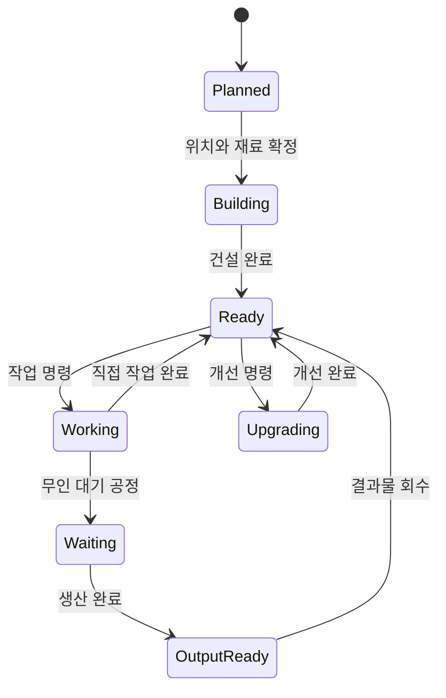

# 06. 피난처 공간·시설 시스템 역기획

> 기준: PC 《This War of Mine: Final Cut》 클래식 생존 모드 / 조사일: 2026-11-13 / 정확한 현재 패치 번호 미확인.  
> **[확인]**은 공개 자료에 기재된 규칙이며 본 문서의 실플레이 검증을 의미하지 않는다. **[분석]**은 설계 해석, **[재구성안]**은 재현을 위한 제안, **[검증 필요]**는 버전·세부 동작 확인 항목이다.

## 1. 시스템의 역할

**[분석]** 피난처는 자원을 넣으면 자동으로 수익을 내는 도시가 아니라, 제한된 인원과 하루의 시간을 배분하는 생활 공간이다. 침대 하나는 휴식 장소이면서 야간 경비 인력을 회복시키는 생산 설비이고, 작업대 업그레이드는 새로운 시설을 여는 투자이면서 오늘 사용할 생존 재료를 묶는 비용이다.

이 시스템의 목표는 다음 세 가지로 해석할 수 있다.

- 집단의 생존 상태를 한 화면에서 읽게 한다. 누가 누워 있고, 누가 일하고, 무엇이 아직 완성되지 않았는지가 현재 위기의 표현이 된다.
- 단기 소비와 장기 투자의 선택을 공간에 남긴다. 시설을 늘린 흔적 자체가 지난 선택의 기록이다.
- 시설의 존재, 사용 가능 여부, 담당자의 상태를 함께 판단하게 한다. 생산 능력이 있다고 즉시 생산할 수 있는 것은 아니다.

**[확인]** 주간에는 제작·조리·휴식 등 피난처 활동을 수행하며, 공용 소지품과 집단 상태는 `Our Things` 및 관련 요약 화면으로 확인한다. [E01](https://this-war-of-mine.fandom.com/wiki/Our_Shelter)

## 2. 경계와 입출력

| 구분 | 내용 | 설계상 책임 |
|---|---|---|
| 입력 | 공용 자원, 생존자 가용 시간, 건설 가능 시설, 현재 시설 단계 | 건설·사용 요청의 성립 조건 제공 |
| 공간 상태 | 접근 가능한 구역, 기존 시설, 설치 위치, 작업 중 오브젝트 | 이동 및 상호작용 가능성 표현 |
| 시설 상태 | 사용 가능, 작업 중, 생산 대기, 생산 완료, 업그레이드 중 | 행동 가능한 명령 결정 |
| 출력 | 새로운 생산 기능, 휴식 기회, 방어 보강, 쾌적함, 소모 자원 | 다른 시스템에 효과 전달 |
| 외부 의존 | 인물 상태, 제작 레시피, 밤의 습격, 날씨 | 시설의 실제 효용과 수요 변화 |

**[재구성안]** 이 표는 시스템 분할안이다. 원작의 내부 모듈이나 클래스 이름을 확인한 것은 아니다. 피난처가 자원·질병·전투 공식을 모두 소유하기보다, 각 시설이 어떤 기능을 제공하는지만 선언하도록 나누면 규칙을 검토하기 쉽다.

## 3. 공간이 제공하는 선택

### 3.1 개방과 사용의 순서

**[확인]** 시작 피난처에는 장애물을 치우거나 잠금을 해제해 확보하는 공간과 자원이 존재한다. [E17](https://thiswarofmine-archive.fandom.com/wiki/Our_Shelter)

**[분석]** 초기 정리는 짧은 튜토리얼과 자원 확보를 겸한다. 즉시 밖으로 나가야만 첫 시설을 만들 수 있는 구조보다, 안전한 내부에서 행동 시간과 도구의 효용을 먼저 학습시킬 수 있다. 여기서 핵심 질문은 “모두 정리할 것인가”보다 “오늘 밤 준비에 필요한 만큼만 정리할 것인가”이다.

초기 공간 개방을 다음처럼 해석할 수 있다.

1. 장애물 때문에 아직 접근하지 못하는 자원을 확인한다.
2. 맨손 작업의 시간 비용과 도구 확보 비용을 비교한다.
3. 오늘 필요한 시설의 재료를 우선 얻는다.
4. 남은 시간은 휴식·조리·추가 정리 중 하나에 쓴다.

### 3.2 배치와 동선

**[분석]** 층간 이동과 시설 사이 왕복은 하루의 유효 작업 시간을 줄인다. 시설의 효율은 레시피 비용뿐 아니라 “이용자가 언제 어디에 있는가”에 의해서도 달라진다. 다만 이를 곧바로 원작에 방 단위 열전달, 배관망, 전력망, 정교한 물류 운반이 구현되어 있다는 뜻으로 확장하면 안 된다.

| 배치 판단 | 기대 효과 | 역기획에서 확인할 관찰값 |
|---|---|---|
| 자주 쓰는 시설을 이동이 쉬운 곳에 설치 | 반복 이동 감소 | 명령부터 실제 작업 시작까지의 시간 |
| 휴식 시설을 여러 이용자가 접근하기 쉽게 배치 | 작업 전환 비용 감소 | 취침 명령 후 이동 시간 |
| 여러 작업 시설을 같은 층에 배치 | 한 인물의 연속 작업에 유리 | 시설 간 왕복 횟수 |
| 대형 시설 자리를 미리 확보 | 후반 확장 선택 보존 | 실제 설치 가능한 위치·폭 |

**[검증 필요]** 일반 시설의 이동·해체·재료 환급은 모드나 개별 시설에 따라 다를 수 있다. 오래된 커뮤니티 글에는 설치 후 자유로운 재배치가 불가능하다는 설명이 있으나, 이를 현재 모든 시설의 공통 규칙으로 확정하지 않는다. [E19](https://steamcommunity.com/app/282070/discussions/0/617320628087655283/) 기본 문서는 “자유로운 재배치를 전제로 최적화하지 않는다”는 보수적 기준을 사용한다.

## 4. 시설군과 의사결정

아래 기능 분류는 **[분석]**이며, 시설의 제작 계층과 대표 기능은 작업대 자료를 참조했다. [E03](https://this-war-of-mine.fandom.com/wiki/Workshop)

| 시설군 | 대표 시설 | 플레이어가 해결하는 문제 | 경쟁하는 투자 |
|---|---|---|---|
| 휴식 | 침대, 의자, 안락의자 | 피로 회복·생활 여건 | 같은 재료의 생산 설비 |
| 음식·물 | 스토브, 빗물 집수기 | 재료를 섭취 가능한 공급으로 전환 | 난방용 연료, 공작용 부품 |
| 난방 | 난로 | 추위에 대한 대응 | 조리와 급수의 연료 |
| 제작 | 기본 작업대, 금속 작업대, 약품 제작 시설 | 필요한 도구·소모품 확보 | 즉시 구매 또는 외부 조달 |
| 장기 생산 | 덫, 재배 시설, 주류 생산 시설 | 반복 조달과 교환 재원 | 초기 건설비·대기 기간 |
| 방어 | 판자 보강, 강화문 | 야간 손실 완화 | 오늘의 소비·내일의 확장 |
| 정서·정보 | 라디오, 기타, 생활 가구 | 상황 인식·생활 안정 | 직접 생존에 쓰는 재료 |

**[분석]** 모든 시설이 매번 필요한 것은 아니다. 이미 외부에서 얻을 수 있는 도구를 내부에서 만들기 위해 고급 작업대를 올리면, 실제 필요보다 큰 투자를 하게 된다. 반대로 거래 경로가 막히면 평소에는 비효율적이던 내부 생산이 유일한 대안이 될 수 있다.

## 5. 시설의 상태 전이

**[재구성안]** 위 상태도는 제작 시설을 구현할 때의 공통 모델이다. 모든 시설이 모든 상태를 사용하는 것은 아니다. 침대는 `Working`을 이용자 점유로, 난로는 지속 소비 상태로 해석할 수 있고, 작업이 끝나면 자동으로 재고에 들어가는 생산물에는 회수 상태가 필요 없을 수 있다. 원작의 실제 회수 방식은 시설마다 확인해야 한다.

설계상 분리할 요소는 다음과 같다.

- **시설 존재:** 해당 오브젝트가 완성되어 있는가.
- **기능 해금:** 현재 단계로 해당 명령을 제공하는가.
- **즉시 가용성:** 다른 인물이 사용 중이거나 입력이 부족하지 않은가.
- **생산 진행:** 인력이 계속 필요한가, 기다리기만 하면 되는가.
- **결과 보관:** 공용 재고와 별도로 시설 안에 결과물이 남는가.

이 다섯 항목을 하나의 `enabled` 값으로 합치면, UI는 사용 불가 이유를 설명하기 어렵고 저장 복원 시 작업이 중복되기 쉽다.

## 6. 데이터 설계 예시

### 6.1 시설 정의와 배치 인스턴스

**[재구성안]** 다음 데이터는 원작 추출값이 아니라 동등한 선택 구조를 표현하기 위한 제안이다.

| 데이터 | 필드 예시 | 사용 목적 |
|---|---|---|
| `FacilityDefinition` | ID, 기능 태그, 설치 제한, 단계, 가능한 명령 | 변하지 않는 시설 종류 정의 |
| `FacilityInstance` | 인스턴스 ID, 위치, 현재 단계, 사용 인물 | 현재 캠페인의 배치 상태 |
| `BuildRequest` | 요청 인물, 레시피, 예약 재료, 진행 시간 | 건설 도중 중단·저장 처리 |
| `FacilityJob` | 입력, 노동 시간, 대기 시간, 결과물, 완료 상태 | 다양한 제작 공정을 공통 표현 |
| `FacilityEffect` | 휴식/열/방어/정보 등 효과 종류와 대상 | 외부 시스템과의 연결 |

시설 종류는 레시피 목록을 참조하고, 개별 배치 시설은 자신의 상태만 가진다. 같은 시설이 여러 개 있을 때 다른 작업을 동시에 실행할 수 있어야 하며, 업그레이드 시 기존 작업과 투입 자원의 처리 정책을 명시해야 한다.

### 6.2 공간 검증

**[재구성안]** 설치 명령은 다음 순서로 검사한다.

1. 시설 해금 및 개수 제한 확인.
2. 설치 후보 공간의 충돌·접근 가능성 확인.
3. 실제 시작 시점의 재고 재확인 및 예약.
4. 작업자에게 상호작용 위치 할당.
5. 건설 완료 후 시설 기능 활성화.

사용자가 위치를 고르는 동안 다른 작업이 재료를 사용해도 화면상 비용과 실제 비용이 일치해야 한다. 이 문제는 원작 버그의 주장이라기보다 동시 작업을 갖는 게임의 필수 검토 항목이다.

## 7. 하루 사례: 침대와 생산 설비 중 무엇을 먼저 만들 것인가

**[분석 사례 / 수치는 설명용 가정]** 생존자 세 명 중 두 명이 피곤하고, 그날 밤에는 외부 조달과 경비가 모두 필요하다고 하자. 사용할 수 있는 재료로 침대 또는 추가 생산 시설 중 하나만 지을 수 있다.

| 선택 | 당장 얻는 것 | 다음 단계의 부담 |
|---|---|---|
| 침대 | 주간 회복 기회 확대 | 외부 조달 의존이 더 오래 유지됨 |
| 생산 시설 | 향후 재료 변환 능력 | 오늘 밤 담당자의 상태가 나쁠 수 있음 |
| 둘 다 연기 | 재료 비축과 긴급 대응 여유 | 생활·생산 병목이 그대로 남음 |

단순한 건설 목록만으로는 정답을 정할 수 없다. 인물 상태, 외부 지역의 안전성, 거래 방문 여부, 추위 예상에 따라 우선순위가 바뀐다. 좋은 시설 선택 UI는 “만들 수 있음”과 함께 “지금 사용 가능한 기능” 및 “다음 업그레이드에 필요한 부족분”을 읽기 쉽게 보여 주어야 한다.

## 8. 다른 시스템과의 연결

| 연결 문서 | 주고받는 정보 |
|---|---|
| [04. 욕구·건강](04_Needs_Health_and_Recovery.md) | 휴식·온도·음식이 상태 회복에 미치는 영향 |
| [07. 자원·인벤토리](07_Resources_Inventory_and_Carrying.md) | 건설 비용과 공용 재고, 반입 자원 |
| [08. 제작·개선](08_Crafting_Recipes_and_Upgrades.md) | 시설 단계와 레시피 해금 |
| [09. 음식·물·난방](09_Food_Water_and_Heating.md) | 생산 시설과 생존 공급망 |
| [10. 주간 노동·방문](10_Daytime_Labor_and_Visitors.md) | 이용자 배치와 시간 경쟁 |
| [11. 야간 역할·습격](11_Night_Roles_and_Raids.md) | 방어 설비와 재고 손실 위험 |

## 9. 밸런스 변수와 검증 기준

**[재구성안]** 다음은 역기획 기반 프로토타입을 검증할 때 조절할 변수이다.

| 조절 변수 | 너무 낮을 때 | 너무 높을 때 |
|---|---|---|
| 기본 시설 건설비 | 초반 선택이 사라짐 | 첫 실패를 회복하기 어려움 |
| 작업 시간 | 인원 배치 의미 감소 | 이동·대기만으로 주간이 소진됨 |
| 시설 개수 제한 | 한 기능을 과도하게 복제 | 다양한 인물 조합을 수용 못 함 |
| 개선 비용 | 매번 같은 즉시 개선 순서 | 개선을 하지 않는 것이 항상 유리 |
| 장기 설비 회수 기간 | 외부 조달이 빠르게 무의미해짐 | 캠페인 종료 전 투자 회수가 불가 |

### 확인할 테스트

- 재료가 부족한데 건설 위치만 확정했을 때 잘못된 시설이 생성되지 않는가.
- 다른 인물이 같은 시설을 점유할 때 명령이 대기·취소·거절 중 어떤 방식으로 처리되는가.
- 건설 도중 작업자를 바꾸거나 주간을 종료할 때 진행도와 재료가 일관적인가.
- 업그레이드 전에 투입한 연료·재료·결과물이 어떻게 처리되는가.
- 설치 위치가 화면에서는 유효하지만 실제 작업자가 도달할 수 없는 경우를 막는가.
- 시설 효과가 한 인물, 한 방, 피난처 전체 중 어디에 적용되는지 UI와 판정이 일치하는가.

## 10. 근거와 남은 확인

| ID | 자료 | 확인한 범위 | 접근·신뢰 수준 |
|---|---|---|---|
| E01 | [Our Shelter](https://this-war-of-mine.fandom.com/wiki/Our_Shelter) | 주간 활동, 공용 재고 및 상태 화면 | 커뮤니티 위키 검색색인 확인; 직접 페이지 열기는 실패 |
| E03 | [Workshop](https://this-war-of-mine.fandom.com/wiki/Workshop) | 시설군과 작업대 개선 구조 | 커뮤니티 위키 검색색인 본문 확인 |
| E17 | [Our Shelter — archive](https://thiswarofmine-archive.fandom.com/wiki/Our_Shelter) | 초기 장애물 정리와 자원 확보 | 보존 위키 검색색인 확인; 사이트 명칭의 Official은 개발사 검증을 뜻하지 않음 |
| E19 | [Can I move items after placement?](https://steamcommunity.com/app/282070/discussions/0/617320628087655283/) | 설치 후 재배치에 관한 오래된 사용자 기록 | 2014년 커뮤니티 토론; 현재 버전 규칙 확정에 사용하지 않음 |

**[검증 필요]** 설치 가능 위치의 내부 표현, 피난처별 배치 제한, 모든 시설의 이동·해체 정책, 업그레이드 중 점유 규칙, 연료 및 결과물 승계는 빌드별 재현 실험으로 보완해야 한다. 내부 경로 탐색 자료구조나 공간 분할 방식은 본 문서에서 확인하지 않았다.
