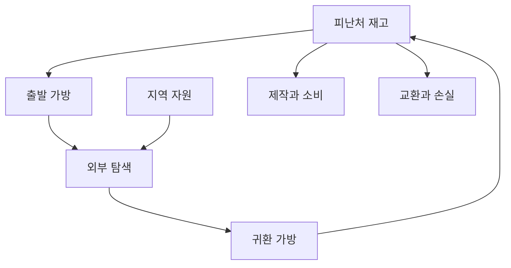

# 07. 자원·인벤토리·운반 시스템 역기획

> 기준: PC 《This War of Mine: Final Cut》 클래식 생존 모드 / 조사일: 2026-11-13 / 정확한 현재 패치 번호 미확인.  
> **[확인]** 공개 자료의 규칙, **[분석]** 설계 해석, **[재구성안]** 제안 데이터·알고리즘, **[검증 필요]** 실제 빌드에서 추가 확인할 항목. 직접 플레이 및 게임 데이터 추출은 수행하지 않았다.

## 1. 핵심 설계: 가치와 운반성의 분리

**[분석]** 이 게임에서 자원의 가치는 상인에게 얼마를 받는지만으로 정해지지 않는다. 오늘 필요한 기능, 한 번에 반입할 수 있는 양, 가져오는 데 쓰는 시간, 사용했을 때 없어지는 다른 선택까지 함께 고려해야 한다.

- 약은 치료 수단이면서 교환 재원이다.
- 나무는 건축 재료이면서 연료의 원재료다.
- 도구는 그날의 전리품 공간을 줄이지만 잠긴 자원에 접근할 수 있게 한다.
- 집에 많은 물건이 있어도 오늘 밤 가방에 넣어 가져갈 수 있는 양은 제한된다.

**[확인]** 외부 탐색 인물의 가방 용량은 인물마다 다르며, 피난처에는 `Our Things`로 조회하는 공용 재고가 있다. [E14](https://this-war-of-mine.fandom.com/wiki/Scavenge) [E01](https://this-war-of-mine.fandom.com/wiki/Our_Shelter)

이 두 보관 영역의 차이가 장기 축적과 단기 선택을 분리한다. 역기획에서는 피난처 공용 재고와 탐색 가방에 같은 용량 제한이 있다고 가정하면 안 된다.

## 2. 자원의 기능 분류

다음 표는 **[분석]**을 위한 분류다. 아이템 원문 목록이나 전체 수량표를 복제한 것이 아니다. 한 아이템에 여러 기능 태그가 붙을 수 있다.

| 자원군 | 대표 항목 | 1차 기능 | 다른 사용처와의 경쟁 |
|---|---|---|---|
| 기초 건설재 | 부품류, 나무 | 시설 건설·개선 | 도구·소모품 제작, 연료 변환 |
| 기술 재료 | 전자 부품, 무기 부품 | 고급 시설·장비 | 판매·긴급 교환 |
| 식량 | 생식 재료, 채소, 통조림 | 식사와 조리 | 일부 생산 공정·교환 |
| 물·열 | 깨끗한 물, 연료 | 조리·급수·난방 | 장기 생산 및 교환 |
| 의료 | 붕대, 약품 | 상처·질병 대응 | 교환 재원 |
| 생활 소비재 | 담배, 커피, 책 등 | 생활 여건·기호 | 교환 또는 원재료 전환 |
| 도구·무기 | 삽, 쇠지레, 톱, 방어용 장비 | 접근·작업·전투 | 가방 용량 및 거래 가치 |
| 중간 생산물 | 필터, 주류 등 | 다음 공정의 입력 | 즉시 사용·판매 |

## 3. 보관 위치와 소유 관계

### 3.1 재고는 단일 숫자가 아니다

**[재구성안]** 같은 품목이라도 어디에 있는지를 별도로 기록한다.

| 보관 영역 | 기능 | 필요한 상태 |
|---|---|---|
| 피난처 공용 재고 | 제작·생활·거래의 공통 공급 | 품목별 가용 수량, 예약 수량 |
| 출발 가방 | 탐색에 가져갈 장비·거래 물품 | 슬롯 수, 스택, 반출 확정 여부 |
| 탐색지 용기·더미 | 해당 장소에 남은 물건 | 소유권, 조사 여부, 잔량 |
| 시설 내부 | 투입 중·생산 완료 상태 | 공정 ID, 잠긴 입력, 결과 보관 |
| 거래 제안 | 확정 전 교환 품목 | 양쪽 수량, 승인 가능성 |

**[분석]** 이렇게 구분하면 “소지품 총량”과 “지금 제작에 사용할 수 있는 양”이 달라질 수 있음을 설명할 수 있다. 다만 원작의 각 시설이 실제로 별도 재고를 구현하는 방식, 습격이 어느 보관 영역을 대상으로 하는지는 별도 규칙이다. 제안한 보관 분류만으로 도난 면제까지 추론하면 안 된다.

### 3.2 소유권은 윤리·위험 속성이다

**[확인]** 외부 자원은 자유롭게 가져갈 수 있는 물건과 타인의 소유물로 구분되며, 절도는 정서와 현장 반응에 연결된다. [E14](https://this-war-of-mine.fandom.com/wiki/Scavenge)

**[분석]** 자원 레코드에 소유권 문맥을 남기면 “동일한 약 한 개”가 서로 다른 의사결정을 만든다. 안전한 폐허의 약은 시간 비용이고, 민간인의 약은 물질적 이득과 윤리적 비용의 결합이다. UI는 소유권이 있는 물건을 일반 회수 동작과 구별해 보여 주어야 한다.

## 4. 슬롯과 스택

**[확인]** 커뮤니티 아이템 자료에서 나무는 한 칸에 2개, 연료는 한 칸에 4개로 정리되어 있다. 이 값은 대표적인 운반성 차이만 설명하는 데 사용하며 전체 아이템 표로 일반화하지 않는다. [E08](https://this-war-of-mine.fandom.com/wiki/Fuel)

**[재구성안]** 동일 품목·동일 속성의 물건이 합쳐지는 단순 모델에서 필요한 칸 수는 다음처럼 표현할 수 있다.

\[
Slots(i)=\left\lceil\frac{Quantity(i)}{StackLimit(i)}\right\rceil
\]

\[
\sum_i Slots(i)\le BackpackCapacity
\]

이는 관찰된 슬롯 제약을 검증하기 위한 수학적 표현이며 원작 코드의 자료구조를 뜻하지 않는다. 내구도·개별 상태가 다른 아이템이 합쳐지는지 여부는 별도 검증 대상이다.

### 예시: 똑같은 자원 개수라도 차지하는 공간이 다르다

| 선택 품목 | 수량 | 예시 스택 상한 | 사용 칸 |
|---|---:|---:|---:|
| 나무 | 6 | 2 | 3 |
| 연료 | 8 | 4 | 2 |
| 합계 | 14 | 해당 없음 | 5 |

**[분석]** 여기서 연료가 항상 더 좋다는 결론은 나오지 않는다. 내일 시설을 만들려면 나무가 필요하고, 이미 연료로 바꾼 물건은 건축 선택에 사용할 수 없기 때문이다. 운반 효율과 기능 유연성이 경쟁한다.

## 5. 가방 편성의 세 단계

### 5.1 출발 전: 접근 능력 구입

**[분석]** 도구나 거래 물품을 가져가는 것은 그날 탐색에서 얻을 수 있는 선택지를 늘리는 행위다. 출발 가방의 좋은 구성은 모든 도구를 넣는 것이 아니라, 방문 목적에 필요한 접근 수단과 긴급 대응 여유를 갖추는 것이다.

| 방문 목적 | 가방 편성의 우선 질문 |
|---|---|
| 알려진 안전 장소에서 건축재 회수 | 이미 개방한 경로에 불필요한 도구를 다시 가져가는가 |
| 처음 방문하는 장소 조사 | 되돌아와야 하는 잠금·장애물에 대비할 것인가 |
| 거래 방문 | 돌아올 물품을 받을 공간까지 계산했는가 |
| 위험한 장소 | 방어 준비가 얻을 수 있는 전리품보다 중요한가 |

### 5.2 탐색 중: 발견한 물건의 재평가

**[재구성안]** UI가 표시하는 가격 하나로 자동 정렬하기보다, 플레이어가 다음 네 기준을 비교할 수 있게 한다.

1. **긴급도:** 오늘 또는 다음 주기에 반드시 필요한가.
2. **대체 가능성:** 집의 다른 물건이나 가까운 거래로 바꿀 수 있는가.
3. **운반 효율:** 한 칸이 해결하는 수요가 얼마나 큰가.
4. **접근 비용:** 다음 방문에서 같은 물건을 다시 얻기 쉬운가.

이 기준은 분석용이며 원작에 노출되는 자동 점수표가 아니다. 가방을 비우는 선택에 정답을 표시하지 않는 것이 게임의 판단 부담과 잘 맞는다.

### 5.3 귀환 전: 반입 확정

**[분석]** 마지막 순간에 남은 공간을 저가 자원으로 채우는 행위는 “완벽한 품목 조합”보다 생존자의 귀환이 우선이라는 긴장을 만든다. 탐색 시간 종료와 인벤토리 정리가 결합하면, 가방 UI를 오래 보고 있는 것 자체가 위험 비용이 된다. 메뉴를 열었을 때 시간이 흐르는 조건은 플랫폼·화면별로 직접 확인해야 한다.

## 6. 재고 흐름과 보존 규칙

**[재구성안]** 재현 구현에서는 모든 물품 이동에 출발지와 목적지를 둔다. `수량 감소`와 `수량 증가`를 각각 독립 명령으로 처리하면 저장·취소·중복 입력 중 복제 또는 소실이 발생하기 쉽다.

권장하는 검증 불변식은 다음과 같다.

- 회수·반납만으로 전체 수량이 증가하지 않는다.
- 제작과 소비는 승인된 레시피·행동에 의해서만 수량을 바꾼다.
- 거래는 양쪽 재고 변경이 함께 확정된다.
- 가방의 빈 칸 계산과 실제 반입 가능성이 일치한다.
- 중도 종료 후 불러오기에서 확정 전 제안과 확정 후 이동을 구분한다.

이 항목들은 원작의 내부 구현 설명이 아니라 동일한 사용자 경험을 재현할 때 필요한 품질 기준이다.

## 7. 데이터 모델

**[재구성안]** 수량형 자원과 개별 장비를 구분하되, 공통 UI에는 하나의 아이템 목록으로 노출한다.

| 데이터 | 주요 필드 | 이유 |
|---|---|---|
| `ItemDefinition` | ID, 태그, 스택 상한, 사용처, 표시 이름 | 변하지 않는 품목 정보 |
| `ItemStack` | 품목 ID, 수량, 결합 조건 | 같은 물건 묶음 관리 |
| `ItemInstance` | 인스턴스 ID, 내구 상태, 부가 속성 | 개별 상태가 필요한 장비 지원 |
| `Inventory` | 위치 ID, 용량 정책, 아이템 목록 | 가방과 공용 재고의 제약 분리 |
| `ItemTransfer` | 출발·도착, 수량, 사유, 확정 ID | 이동 원자성과 중복 방지 |
| `OwnershipContext` | 소유자, 허용 행동, 사건 문맥 | 절도 및 NPC 반응 연결 |
| `Reservation` | 요청 ID, 품목, 예약량, 해제 조건 | 병렬 제작과 거래 충돌 방지 |

원작이 장비를 개별 인스턴스로 저장하는지, 품목에 내구 단계만 붙이는지, 모든 아이템을 같은 컨테이너로 관리하는지는 확인하지 않았다. 이 모델의 목적은 게임 규칙을 검토 가능한 단위로 나누는 것이다.

## 8. 자원 부족을 만드는 방법

**[분석]** 단순히 맵에 물건을 적게 놓는 것만으로는 좋은 부족 경험을 만들기 어렵다. 필요한 물건은 존재하지만 오늘 가져올 수 없거나, 가져올 수 있지만 다른 생존 조건을 포기해야 할 때 의미 있는 선택이 발생한다.

| 부족의 종류 | 나타나는 문제 | 플레이어의 대응 |
|---|---|---|
| 절대량 부족 | 필요한 물건이 거의 없음 | 소비 절감·거래·대체 생산 |
| 운반량 부족 | 현장에는 많지만 가방이 작음 | 더 적합한 인물·목적별 방문 |
| 접근 부족 | 잠금·적대자·장애물 | 도구 확보·경로 변경 |
| 시간 부족 | 회수 가능하나 귀환 시간이 촉박함 | 저가 물품 포기·다음 방문 |
| 정보 부족 | 실제 재고 위치를 모름 | 탐색·기억·지도 정보 활용 |
| 사용처 충돌 | 같은 자원을 여러 곳에서 요구 | 오늘 소비와 장기 투자의 조정 |

## 9. 연동과 검증 사례

| 연결 문서 | 핵심 연결 |
|---|---|
| [08. 제작](08_Crafting_Recipes_and_Upgrades.md) | 재료 예약, 중간재, 제작 완료 |
| [09. 음식·물·난방](09_Food_Water_and_Heating.md) | 다중 사용처와 겨울의 연료 경쟁 |
| [12. 지도·수집](12_World_Map_and_Scavenging.md) | 지역별 잔여 자원과 접근 가능성 |
| [15. 거래](15_Trade_and_Barter_Economy.md) | 운반 효율과 교환 가치의 차이 |
| [05. 사기·윤리](05_Morale_Relationships_and_Ethics.md) | 획득 경로의 도덕적 비용 |

**[재구성안]** 다음 테스트는 단순 클릭 반복보다 실제 오류 가능성을 겨냥한다.

- 남은 칸이 없지만 기존 스택에 여유가 있을 때 같은 아이템을 추가할 수 있는가.
- 한 스택만 옮기는 입력과 모든 수량을 옮기는 입력이 일관적으로 작동하는가.
- 거래에서 최종 수령품을 담을 수 없는 경우 확정 전에 이유를 알리는가.
- 제작 예약 자원이 다른 거래나 제작에서 다시 사용되지 않는가.
- 도구 파손·소모 직후 슬롯과 아이템 수가 함께 갱신되는가.
- 특정 소유물의 일부만 가져가도 올바른 사건이 생성되는가.
- 저장 복원 후 지역 더미와 가방에 같은 물품이 중복 존재하지 않는가.

## 10. 근거와 남은 확인

| ID | 자료 | 확인한 범위 | 접근·신뢰 수준 |
|---|---|---|---|
| E01 | [Our Shelter](https://this-war-of-mine.fandom.com/wiki/Our_Shelter) | 공용 재고 조회 | 커뮤니티 위키 검색색인 확인 |
| E08 | [Fuel](https://this-war-of-mine.fandom.com/wiki/Fuel) | 연료·나무의 대표 스택 크기, 연료 용도 | 커뮤니티 위키 검색색인 본문 확인 |
| E14 | [Scavenge](https://this-war-of-mine.fandom.com/wiki/Scavenge) | 인물별 가방 차이, 자원 소유권 | 커뮤니티 위키 검색색인 본문 확인 |

**[검증 필요]** 전 품목 스택 상한, 장비 상태별 결합 가능성, 시설 내부 자원과 습격 판정의 관계, 외부 보관물의 유지·소실 조건, 거래 수령 시 용량 초과 처리, 실제 시간 정지 조건은 실행 빌드에서 확인해야 한다. 본 문서는 숨겨진 무게 시스템이나 피난처의 임의 용량 상한을 추가하지 않는다.
