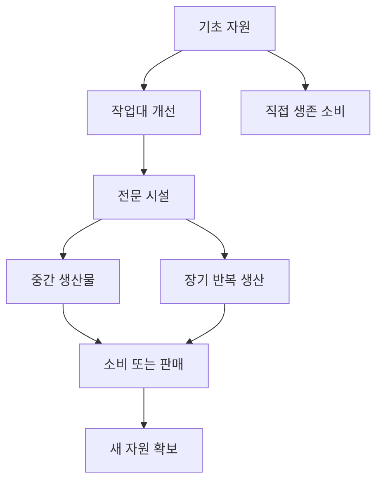

# 08. 제작·레시피·시설 개선 시스템 역기획

> 기준: PC 《This War of Mine: Final Cut》 클래식 생존 모드 / 조사일: 2026-11-13 / 정확한 현재 패치 번호 미확인.  
> **[확인]**은 공개 자료의 규칙, **[분석]**은 설계 해석, **[재구성안]**은 구현·밸런스 제안, **[검증 필요]**는 미확정 항목이다. 아래 데이터 이름과 수식은 원작의 코드·공식이 아니다.

## 1. 시스템의 역할

**[분석]** 제작은 필요한 아이템을 얻는 대체 경로이면서 자원 사용의 우선순위를 결정하는 장치다. 같은 재료로 오늘의 연료, 내일의 도구, 다음 주의 생산 시설을 만들 수 있으므로, 제작 목록은 곧 생존 계획의 선택지 목록이 된다.

이 시스템은 네 비용을 교환한다.

| 비용 | 의미 | 플레이어가 묻는 질문 |
|---|---|---|
| 재료 | 제작에 소모되는 물건 | 이 재료를 다른 곳에 써야 하지 않는가 |
| 노동 | 작업자가 직접 일하는 시간 | 누가 오늘 이 일을 맡을 수 있는가 |
| 대기 | 결과물을 얻기까지의 경과 시간 | 필요한 시점 전에 완성되는가 |
| 선행 투자 | 시설·개선·중간 부품 | 몇 번 사용해야 투자할 가치가 있는가 |

**[확인]** 공개 제작표는 일부 생산을 준비 작업 시간과 추가 대기 시간으로 구분하며, 시설 개선은 새로운 제작 기능이나 비용 효율과 연결된다. [E02](https://this-war-of-mine.fandom.com/wiki/Crafting)

## 2. 연구 트리보다 설비 의존망에 가까운 진척

**[확인]** 기본 작업대는 개선 작업대와 고급 작업대로 두 차례 개선할 수 있다. 그 단계에 따라 다른 시설·생활 물품·방어 기능에 접근한다. [E03](https://this-war-of-mine.fandom.com/wiki/Workshop)

**[분석]** 이 구조에서 플레이어가 지불하는 것은 추상적인 경험치보다 구체적인 자원과 시간이다. 다음 단계가 보이더라도 오늘 식량이 부족하면 개선을 미루게 된다. 기술 진척 자체가 항상 최우선 목표가 되지 않도록 생존 수요가 투자 속도를 제어한다.

| 계층 | 대표 기능 | 설계상 효과 |
|---|---|---|
| 기본 생활 기반 | 침대·조리·집수·기초 도구 시설 | 최소 생존 루프 성립 |
| 중간 개선 | 추가 생산·방어·생활 기능 | 외부 조달 의존 완화 |
| 고급 개선 | 고급 중간 부품·정교한 생산·추가 방어 | 장기 전략의 분화 |

위 표는 **[분석]**용 기능 묶음이다. 모든 시설이 정확히 같은 단계 수를 갖는다는 뜻이 아니며, 개별 제작 가능 단계는 해당 시설 정의로 관리해야 한다.

## 3. 시설별 제작 책임

**[확인]** 금속 작업대는 접근 도구와 장비 제작·수리에, 약품 제작 시설은 의료·담배 계열 생산에 사용된다. [E04](https://this-war-of-mine.fandom.com/wiki/Metal_Workshop) [E05](https://this-war-of-mine.fandom.com/wiki/Herbal_Workshop)

| 시설 계열 | 입력의 성격 | 결과의 성격 | 선택의 초점 |
|---|---|---|---|
| 기본 작업대 | 범용 자재 | 시설·생활 도구·일부 소모품 | 다른 생산 기능을 먼저 열 것인가 |
| 금속 작업대 | 자재·부품·고장 장비 | 도구·수리 장비 | 탐색 접근성을 높일 것인가 |
| 스토브 | 식재료·물·연료 | 식사, 추운 시기의 급수 | 현재 생존 수요를 충족할 것인가 |
| 약품 제작 시설 | 의료 재료·중간 생산물 | 의료·생활 소비재 | 자체 소비와 판매 중 무엇인가 |
| 장기 생산 시설 | 물·미끼·원재료 등 | 일정 시간 후의 생산물 | 투자와 기다림을 감당할 수 있는가 |

**[분석]** 생산 책임이 시설로 분산되면 “레시피를 안다”와 “지금 만들 수 있다”가 분리된다. UI에는 미해금, 재료 부족, 시설 사용 중, 작업자 부적합 같은 서로 다른 이유가 각각 표시되어야 한다.

### 3.1 원작에서 확인되는 대표 해금

**[확인 / 커뮤니티 위키]** 다음은 실제 시설명의 대표 묶음이다. 전 레시피 목록이 아니라, 단계 변화가 어떤 선택을 여는지 보여 주는 최소 목록이다. [E03](https://this-war-of-mine.fandom.com/wiki/Workshop)

| 작업대 단계 | 대표적으로 만들 수 있는 것 | 생존 선택의 변화 |
|---|---|---|
| Simple Workshop | 침대, 스토브, 난로, 라디오, 금속 작업대, 집수기, 밀주 제조기 | 기본 생활 및 제작 경로 확보 |
| Improved Workshop | 작은 동물 덫, 허브 정원, 약품 제작대, 판자 보강, 기타 | 내부 생산·방어·정서 대응 확대 |
| Advanced Workshop | 알코올 증류기, 강화문, Heat Lamp, Mixer, Thermo Regulator | 고급 설비의 선행 부품과 방어 확보 |

금속 작업대의 기초 단계에는 쇠지레·자물쇠 따개·삽·칼, 개선 단계에는 톱날·도끼 같은 추가 도구가 연결된다. [E04](https://this-war-of-mine.fandom.com/wiki/Metal_Workshop) 이 해금은 단순 공격력 증가보다 잠금·잔해·목제 가구 등 외부 자원에 접근하는 방법을 바꾼다.

### 3.2 실제 제작 사슬

아래의 투입·결과 관계는 **[확인]**, 오른쪽 열의 의미는 **[분석]**이다. 정확한 수량과 시간은 일부 대표값을 제외하고 생략했다.

| 생산 경로 | 실제 변환 관계 | 설계상 의미 | 근거 |
|---|---|---|---|
| 필터 | 기초 자재 → 일회용 필터 → 물 확보 또는 알코올 증류 | 범용 자재가 생활 공급에 계속 소모됨 | [E22](https://this-war-of-mine.fandom.com/wiki/Filter) |
| 밀주 | 설탕 + 물 + 연료 → Moonshine | 생활용 입력을 교환 재원으로 전환 | [E20](https://this-war-of-mine.fandom.com/wiki/Moonshine_Still) |
| 증류 | 밀주 + 필터 + 연료 → Pure Alcohol | 추가 가공으로 다른 제작 사슬 연결 | [E21](https://this-war-of-mine.fandom.com/wiki/Alcohol_Distiller) |
| 허브 약 | 허브 + 순수 알코올 → Herbal Meds | 재배·주류·의료 생산이 연결 | [E25](https://this-war-of-mine.fandom.com/wiki/Herbal_Meds) |
| 정식 약품 | Med Ingredients 등이 필요한 개선 약품 제작대 경로 | 희소 입력 때문에 완전한 자급에 제한 | [E25](https://this-war-of-mine.fandom.com/wiki/Herbal_Meds) |
| 동물 덫 | 날음식·통조림·비료 중 미끼 → 대기 → 날음식 | 현재 자원을 미래 식량으로 바꿈 | [E23](https://this-war-of-mine.fandom.com/wiki/Trap_for_Small_Animals) |
| 채소 | 물 + 비료 → 재배 대기 → 채소 | 음식과 원재료의 순환에 시간 비용 추가 | [E26](https://this-war-of-mine.fandom.com/wiki/Vegetables) |
| 묶음 식사 | 날음식에 채소를 더해 조리 → 두 끼 식사 | 식재료 조합으로 조리 효율 개선 | [E24](https://this-war-of-mine.fandom.com/wiki/All_Basic_Items) |

**[분석]** 이 사슬의 특징은 여러 전문 시설이 독립적인 공장이 아니라 같은 물·연료·자재를 공유한다는 점이다. 밀주 수익을 늘리면 당장 식사와 급수에 쓸 여유가 줄 수 있고, 채소를 비료로 돌리면 미래 생산은 이어지지만 오늘의 묶음 조리 재료가 줄어든다. 완전한 자급 가능성은 시설 유무만으로 판단하지 말고 입력의 지속 조달까지 계산해야 한다.

## 4. 제작 요청의 전 과정

### 4.1 요청 생성

**[재구성안]** 플레이어가 시설을 선택하면 다음 정보를 한 화면에서 비교할 수 있어야 한다.

- 선택한 작업자가 적용받는 실제 비용.
- 한 번의 명령으로 얻는 결과물 수량.
- 지금 부족한 입력과 이미 보유한 입력.
- 작업자가 계속 필요할 시간과 무인 대기 시간.
- 완료된 결과를 어디에서 얻거나 사용할 수 있는지.

원작 UI의 모든 화면에 이 정보가 동일한 형식으로 노출된다는 주장이 아니라, 역기획에서 확인할 정보 요구사항이다.

### 4.2 확정과 투입

**[재구성안]** 명령을 수락하는 시점에 시설 조건·레시피 조건·실제 재고를 재검사한다. 재료를 언제 차감하고, 취소 시 무엇을 돌려주는지는 사용자 경험에 큰 영향을 주므로 레시피의 명시적인 정책으로 둔다.

| 정책 항목 | 선택 가능한 설계 | 원작 확인 항목 |
|---|---|---|
| 입력 차감 | 명령 시, 작업 시작 시, 완료 시 | 시설·레시피별 실제 시점 |
| 중단 | 일시 정지, 취소, 다른 인물 인계 | 진행도 유지 여부 |
| 환급 | 전액, 일부, 없음 | 건설과 소모품 제작의 차이 |
| 완료 처리 | 자동 입고, 시설 내 보관 | 재고·습격·섭취와의 관계 |
| 주기 전환 | 계속 진행, 다음 낮에 재개 | 밤의 대기 시간 반영 방식 |

### 4.3 노동과 대기의 분리

**[분석]** 준비 작업 뒤 기다리는 공정은 인원 관리에 완충을 제공한다. 직접 일하는 동안에는 다른 행동을 할 수 없지만, 준비를 마치면 휴식·거래·다른 제작으로 이동할 수 있기 때문이다. 이때 대기는 무료가 아니다. 완료 전까지 재료가 묶이며, 즉시 필요한 물건에는 사용할 수 없다.

## 5. 레시피 데이터 재구성

**[재구성안]** 레시피를 UI 문자열 안에 숨기지 않고 구조화된 데이터로 정의한다.

| 필드 | 의미 | 예외 처리 목적 |
|---|---|---|
| `recipeId` | 안정적인 레시피 식별자 | 저장·번역·통계 연결 |
| `stationType` / `minimumTier` | 생산 시설 조건 | 해금과 가용성 구분 |
| `inputs` / `alternatives` | 필수 재료와 대체 재료 | 여러 원재료 경로 지원 |
| `outputs` | 결과 품목과 수량 | 단품·묶음 생산 표현 |
| `activeWork` | 직접 노동 시간 | 작업자 점유 계산 |
| `passiveWait` | 경과 시간 | 기다리는 공정 표현 |
| `batchRule` | 최소·최대 묶음, 반복 처리 | 수량 입력과 시간 계산 |
| `actorModifiers` | 작업자별 비용·시간 영향 | 특성 적용 범위 제한 |
| `environmentConditions` | 계절·시설 상태 조건 | 추위 등 생산 가능성 변화 |
| `cancelPolicy` / `outputPolicy` | 중단·환급·완료 정책 | 자원 복제·소실 방지 |

### 단위 테스트용 가상 레시피

```json
{
  "recipeId": "example_process_A",
  "stationType": "example_station",
  "minimumTier": 1,
  "inputs": [{"item": "resource_A", "count": 2}],
  "outputs": [{"item": "product_A", "count": 1}],
  "activeWorkMinutes": 20,
  "passiveWaitMinutes": 180,
  "cancelPolicy": "refund_before_processing",
  "outputPolicy": "station_buffer"
}
```

모든 이름·수치는 **설명용 가정**이다. 실제 레시피 표로 가져다 쓰면 안 된다. 특히 원작에서 여러 개를 제작할 때 준비 시간이 선형으로 증가하는지, 대기 시간이 공유되는지는 레시피별로 검증해야 한다.

## 6. 특성과 시설 효율의 결합

**[확인]** 공개 제작 자료는 Marin 계열의 건설 비용 차이와 Bruno 계열의 조리 비용 차이를 구분한다. 개선 스토브는 물·연료 효율에 영향을 준다. [E02](https://this-war-of-mine.fandom.com/wiki/Crafting) [E06](https://this-war-of-mine.fandom.com/wiki/Stove)

**[분석]** 동일한 재료라도 누구에게 일을 맡기는지에 따라 미래 가용 자원이 달라진다. 인물 특성은 캐릭터 설명에 머물지 않고 피난처의 생산 계획으로 이어진다. 그러나 특정 인물을 항상 제작 전담으로 고정하면 피로·질병·방문객 같은 다른 상황을 놓칠 수 있다.

**[재구성안]** 재현 구현에서는 다음 질문을 분리한다.

1. 이 특성이 해당 레시피에 적용되는가.
2. 적용 대상이 모든 재료인가, 특정 품목인가.
3. 비용이 정수로 반올림될 때 최소 소모량은 얼마인가.
4. 묶음 생산 시 개별 반올림인가, 총량 계산 후 반올림인가.
5. 시설 효율과 인물 효율이 어떤 순서로 결합하는가.

원작의 정확한 할인율·반올림 규칙을 확인하지 못했으므로 일괄적인 `20% 감소` 같은 상수를 이 문서의 확정 규칙으로 쓰지 않는다.

## 7. 투자 회수와 선택의 의미

**[재구성안]** 시설 개선의 손익분기 시점을 비교하는 분석식은 다음과 같다.

\[
ExpectedPaybackCycles = \frac{UpgradeOpportunityCost}{ExpectedSavingsPerCycle}
\]

여기서 비용과 절약분은 같은 평가 단위로 환산해야 한다. 나무·전자 부품·물·시간을 아무 근거 없이 단순 합산하면 안 된다. 실제 의사결정에서는 교환 가능성, 현재 부족 자원, 남은 캠페인 기간에 따라 환산 가치가 달라진다.

**[분석 사례]** 오늘 식사가 부족한 집단에서 조리 효율 개선은 장기적으로 유리하더라도, 개선에 사용한 재료 때문에 오늘의 연료를 만들지 못하면 손해가 된다. 반대로 앞으로 조리를 많이 해야 하고 거래 접근도 불안하다면 같은 개선의 가치가 커진다. 따라서 “만들 수 있으면 즉시 개선”이 항상 최선인 구조로 설계하면 게임의 시간적 판단이 약해진다.

## 8. 생산 의존 관계



**[분석]** 마지막 연결은 자원이 무한히 늘어난다는 뜻이 아니다. 생산에는 입력·시간·거래 상대·운반 공간이 필요하다. 특정 제작물의 판매가 항상 이익이라도 거래 재고와 접근성이 제한되면 완전 자동화된 수익 루프가 되지 않는다. 이 조건들이 약하면 최적 공정 하나가 다른 생존 선택을 압도할 수 있다.

## 9. 데이터 오류와 버전 차이

**[검증 필요]** 열람한 커뮤니티의 종합 제작표와 개별 금속 작업대 문서에는 일부 총기 수리의 해금 단계가 서로 다르게 기재되어 있다. 따라서 본 문서는 총기 종류별 확정 해금표를 제공하지 않는다. [E02](https://this-war-of-mine.fandom.com/wiki/Crafting) [E04](https://this-war-of-mine.fandom.com/wiki/Metal_Workshop)

검증용 레시피 시트에는 다음 열이 필요하다.

| 열 | 기록 내용 |
|---|---|
| 빌드·플랫폼 | PC 빌드 번호, DLC·모드 사용 여부 |
| 작업자 | 인물 이름과 적용 특성 |
| 시설 | 종류·단계·기존 작업 유무 |
| 요청 | 제작물·묶음 수량 |
| 전후 재고 | 실제 감소·증가한 품목과 개수 |
| 시간 | 직접 작업·대기·완료 시각 |
| 중단 조건 | 취소·교체·주간 종료·저장 복원 |

## 10. 연동·밸런스·테스트

| 연결 문서 | 검토할 관계 |
|---|---|
| [03. 인물·특성](03_Characters_and_Traits.md) | 제작 전문성과 대체 인력 |
| [06. 시설](06_Shelter_Layout_and_Facilities.md) | 공간·점유·개선 상태 |
| [07. 재고](07_Resources_Inventory_and_Carrying.md) | 재료 예약과 결과물 이동 |
| [09. 음식·물·난방](09_Food_Water_and_Heating.md) | 연료·물의 다중 사용처 |
| [15. 거래](15_Trade_and_Barter_Economy.md) | 제조와 외부 구매의 대체 관계 |

**[재구성안]** 최소 검증 사례는 다음과 같다.

- 같은 레시피를 일반 인물과 특성 보유자가 실행할 때 UI 비용과 실제 비용이 일치한다.
- 재료가 딱 맞는 경우와 한 개 부족한 경우를 구분한다.
- 두 시설이 같은 재료의 마지막 수량을 동시에 예약해도 음수 재고가 생기지 않는다.
- 묶음 수량 변경 시 생산량·작업 시간·대기 시간이 올바르게 갱신된다.
- 취소·인계·저장 복원 후 완료 이벤트가 한 번만 발생한다.
- 개선 도중 이전 단계의 레시피를 실행하는 요청을 일관적으로 처리한다.
- 계절이 변하는 동안 진행 중인 생산의 중단·유지 정책이 명확하다.

## 11. 근거와 남은 확인

| ID | 자료 | 확인 범위 | 접근·신뢰 수준 |
|---|---|---|---|
| E02 | [Crafting](https://this-war-of-mine.fandom.com/wiki/Crafting) | 준비·대기 시간 구분, 제작 특성, 개선 구조 | 커뮤니티 위키 검색색인 본문 확인; 개별 표 간 불일치 존재 |
| E03 | [Workshop](https://this-war-of-mine.fandom.com/wiki/Workshop) | 기본 작업대의 두 번 개선 | 커뮤니티 위키 검색색인 본문 확인 |
| E04 | [Metal Workshop](https://this-war-of-mine.fandom.com/wiki/Metal_Workshop) | 도구·장비 제작 및 개선 기능 | 커뮤니티 위키 검색색인 본문 확인 |
| E05 | [Herbal Workshop](https://this-war-of-mine.fandom.com/wiki/Herbal_Workshop) | 의료·생활 소비재 생산 | 커뮤니티 위키 검색색인 본문 확인 |
| E06 | [Stove](https://this-war-of-mine.fandom.com/wiki/Stove) | 개선 스토브의 물·연료 효율 | 커뮤니티 위키 검색색인 본문 확인 |
| E20 | [Moonshine Still](https://this-war-of-mine.fandom.com/wiki/Moonshine_Still) | 밀주 투입 자원 | 커뮤니티 위키 검색색인 본문 확인 |
| E21 | [Alcohol Distiller](https://this-war-of-mine.fandom.com/wiki/Alcohol_Distiller) | 밀주에서 순수 알코올 생산 | 커뮤니티 위키 검색색인 본문 확인 |
| E22 | [Filter](https://this-war-of-mine.fandom.com/wiki/Filter) | 일회용 필터의 급수·증류 용도 | 커뮤니티 위키 검색색인 본문 확인 |
| E23 | [Trap for Small Animals](https://this-war-of-mine.fandom.com/wiki/Trap_for_Small_Animals) | 미끼 종류와 식량 생산 | 커뮤니티 위키 검색색인 본문 확인 |
| E24 | [All Basic Items](https://this-war-of-mine.fandom.com/wiki/All_Basic_Items) | 채소를 포함한 묶음 조리 | 커뮤니티 위키 검색색인 본문 확인 |
| E25 | [Herbal Meds](https://this-war-of-mine.fandom.com/wiki/Herbal_Meds) | 약품의 입력·시설 경로 | 커뮤니티 위키 검색색인 본문 확인 |
| E26 | [Vegetables](https://this-war-of-mine.fandom.com/wiki/Vegetables) | 채소 재배 입력 | 커뮤니티 위키 검색색인 확인 |

정확한 레시피 비용·작업 시간·할인 반올림·묶음 규칙·취소 환급은 고정하지 않았다. 원작 규칙을 그대로 재현하려면 최신 실행 빌드의 UI와 전후 재고 기록으로 데이터 표를 보완해야 한다.
