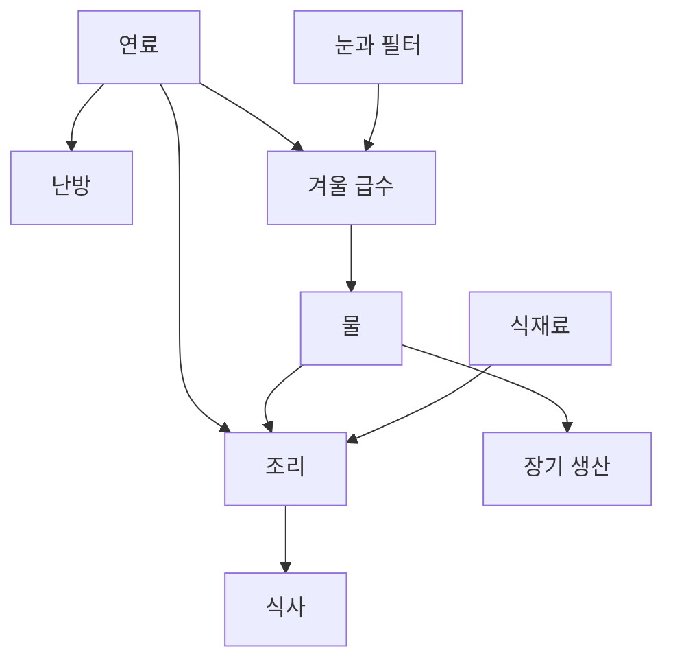

# 09. 식량·물·난방 시스템 역기획

> 기준: PC 《This War of Mine: Final Cut》 클래식 생존 모드 / 조사일: 2026-11-13 / 정확한 현재 패치 번호 미확인.  
> **[확인]** 공개 자료 규칙, **[분석]** 설계 해석, **[재구성안]** 제안 모델, **[검증 필요]** 확인되지 않은 수치·조건. 실제 생존·의료 지침이 아닌 게임 시스템 분석이다.

## 1. 세 시스템을 함께 읽어야 하는 이유

**[분석]** 음식·물·난방을 각각 독립 게이지로 보면 이 게임의 경제를 놓치기 쉽다. 식량이 있어도 조리에 필요한 물과 연료가 부족할 수 있고, 겨울에는 물을 얻기 위한 과정이 난방과 같은 연료를 요구한다. 위기는 한 자원에서 시작해 여러 생존 기능으로 퍼진다.

**[확인]** 연료는 조리·눈을 녹이는 급수·난방·주류 생산에 사용된다. 물은 수집과 거래 외에 집수기 또는 추운 시기 스토브의 눈 녹이기 경로로 확보한다. [E08](https://this-war-of-mine.fandom.com/wiki/Fuel) [E09](https://this-war-of-mine.fandom.com/wiki/Clean_Water)

**범위 원칙:** 이 문서는 별도의 개인별 갈증 게이지를 설계에 추가하지 않는다. 확인한 물의 핵심 역할은 생산 투입재다. 인물의 허기·질병·회복 단계는 [04. 욕구·건강](04_Needs_Health_and_Recovery.md)에서 다룬다.

## 2. 공급망 개요

**[분석]** 연료는 두 개 이상의 생활 기능이 공유하는 병목이다. 겨울에 난방 수요만 늘어나는 것이 아니라 물 생산 경로까지 연료를 요구하면, 같은 재고 감소가 다음 날 음식 준비에도 영향을 준다. 따라서 겨울 대비는 난로를 만드는 행위 하나보다 입력망 전체의 여유를 확보하는 문제다.

## 3. 음식: 섭취와 조리의 구분

**[확인]** 스토브는 식사를 만들며, 개선 스토브와 조리 특성은 투입 물·연료의 효율에 영향을 준다. [E06](https://this-war-of-mine.fandom.com/wiki/Stove)

**[분석]** 음식 시스템에는 최소한 다음 두 시점이 존재한다.

- **준비:** 보유 재료를 식사로 전환할지 결정한다.
- **배분:** 준비한 음식 또는 바로 사용할 수 있는 식량을 누가 먼저 먹을지 결정한다.

생산 효율이 높은 조리를 해도 정작 필요한 인물에게 배분하지 않으면 집단 운영은 나빠질 수 있다. 반대로 긴급한 상황에서는 효율보다 즉시 섭취 가능성이 중요해진다.

| 판단 | 비교하는 비용 | 연결되는 결과 |
|---|---|---|
| 지금 조리할 것인가 | 물·연료·노동과 향후 필요 | 오늘 이용 가능한 음식 |
| 어떤 조리 경로를 쓸 것인가 | 보유 식재료 조합과 효율 | 재료별 남는 재고 |
| 누가 조리할 것인가 | 전문성 이득과 노동 기회비용 | 다음 작업에 쓸 인력 |
| 누가 먼저 먹을 것인가 | 상태 악화 위험과 역할 수행 | 주간 노동·야간 임무 |
| 얼마나 비축할 것인가 | 당장 사용과 미래 불확실성 | 공급 중단 대응력 |

일반 성인의 음식별 표시 허기 단계 변화는 [04. 욕구·건강·회복](04_Needs_Health_and_Recovery.md)에 공개 자료의 규칙으로 정리했다. **[검증 필요]** 일정 간격의 최적 배급 공략, 표시 단계 내부의 진행도, 아동·특수 인물의 예외는 모드와 인물 상태를 포함해 추가 확인한다. 플레이 공략의 효율 계산을 모든 상황의 규칙으로 일반화하지 않는다.

### 3.1 실제 음식 형태의 차이

**[확인 / 커뮤니티 위키]** 통조림은 별도의 조리 없이 먹을 수 있다. 조리식은 스토브에서 만들고 완성 후 스토브에 남으며, 채소를 사용하는 조합은 두 끼를 만들어 단독 조리를 두 번 하는 것과 효율이 다르다. [E24](https://this-war-of-mine.fandom.com/wiki/All_Basic_Items)

| 음식 형태 | 시스템상 특징 | 의사결정 의미 |
|---|---|---|
| 통조림 | 바로 섭취 가능 | 물·연료·노동이 막힌 상황에 대응 |
| 날음식·채소 | 섭취 또는 조리 입력으로 사용 | 즉시 사용과 더 효율적인 준비 사이 선택 |
| 스토브의 조리식 | 공용 가방 물품과 다른 완료 상태 | 생산 완료와 실제 섭취를 구분 |

오른쪽 열은 **[분석]**이다. 음식 보관 형태의 차이를 일반적인 부패·냉장 시뮬레이션으로 확대하지 않는다. 이 문서에서 실시간 부패나 냉장고 전력 소비를 원작 규칙으로 추가하지 않았다.

## 4. 물: 계절에 따른 생산 경로 전환

### 4.1 따뜻한 시기의 경로

**[확인]** 집수기를 이용한 물 확보에는 필터가 사용되며, 겨울에는 이 경로를 이용할 수 없다는 설명이 있다. [E09](https://this-war-of-mine.fandom.com/wiki/Clean_Water)

**[분석]** 집수 설비의 가치는 무제한 물 공급이 아니라 조달 방식의 전환이다. 외부에서 물을 운반하는 대신 재료·설비·시간을 사용해 내부에서 공급한다. 집수기를 여러 개 늘릴 가치가 있는지는 필터 재료와 물 소비량이 결정한다.

### 4.2 추운 시기의 경로

**[확인]** 겨울에는 피난처 앞의 눈을 이용하며, 물로 전환할 때 필터와 연료가 필요하다. [E16](https://this-war-of-mine.fandom.com/wiki/Snow)

**[분석]** 이 경로는 기존 수요를 없애지 않고 공급 비용만 바꾼다. 여름의 물 사용량을 그대로 유지하면 겨울의 연료 수요가 커질 수 있다. 따라서 다음 행동들이 경쟁한다.

- 추워지기 전에 물을 더 모아 둔다.
- 연료와 그 원재료를 확보한다.
- 효율을 높일 시설에 투자한다.
- 물을 쓰는 장기 생산을 잠시 줄인다.
- 외부 거래로 물이나 즉시 식량을 확보한다.

### 4.3 물은 보이지 않는 생산 비용이다

**[분석]** 플레이어가 재배·주류 생산의 결과물만 보면 물 소비를 과소평가하기 쉽다. 생산품 하나의 수익을 계산할 때 물 자체의 교환 가치뿐 아니라 물을 확보하는 필터·연료·노동까지 포함해야 한다. 이미 물이 충분한 집단과 물이 부족한 집단에서 같은 레시피의 실제 가치는 달라진다.

## 5. 난방: 즉각적 소비와 상태 악화 예방

**[확인]** 난로는 피난처 온도를 높이는 시설이며, 개선형은 난방 효율과 도달 가능한 온도에 영향을 준다. [E18](https://this-war-of-mine.fandom.com/wiki/Heater)

**[분석]** 난방은 사용 즉시 눈에 띄는 물건을 만들어 내지 않는다. 대신 향후 상태 악화와 노동력 손실을 줄이는 예방 투자다. 때문에 즉시 식량을 만드는 소비보다 우선순위가 낮게 느껴질 수 있으나, 추위가 심해질수록 그 판단의 대가가 커진다.

| 고려 요소 | 플레이어의 판단 |
|---|---|
| 현재 온도 | 당장 연료를 추가할 것인가 |
| 야간·다음 날 상황 | 현재 표시값만 보고 준비를 끝내도 되는가 |
| 연료 잔량 | 조리·급수까지 가능한가 |
| 난로 개선 비용 | 연료 확보와 설비 효율 중 무엇이 더 급한가 |
| 인물 상태 | 아픈 인원이 있을 때 여유를 얼마나 확보할 것인가 |

**[검증 필요]** 특정 온도 이상이면 모든 인물이 반드시 병에 걸리지 않는다는 보장, 난로 수와 온도의 단순 선형 관계, 야간에 정확히 몇 도 떨어진다는 고정 공식은 확인하지 않았다. 공개 공략의 온도 기준은 관찰된 운용 목표로 사용할 수 있어도 내부 확률 공식으로 취급하면 안 된다.

## 6. 생산 시설은 식량 위기의 완전한 해답이 아니다

**[확인]** 재배 시설의 채소 생산에는 입력 자원과 완료까지의 대기 기간이 있다. [E07](https://this-war-of-mine.fandom.com/wiki/Garden)

**[분석]** 덫과 재배 등 반복 생산의 역할은 외부 조달의 의존도를 낮추는 것이다. 하지만 시설 건설비와 생산 대기는 초기 위기를 즉시 해결하지 못한다. 장기 생산에 사용할 물이나 미끼가 필요한 사람의 당장 소비와 충돌할 수 있다.

역기획에서 구분해야 할 세 시점은 다음과 같다.

1. **투자 시점:** 시설을 만들기 위해 오늘 자원을 지출한다.
2. **가동 시점:** 결과를 얻기 전에 추가 입력을 넣는다.
3. **회수 시점:** 기다린 뒤 결과물을 실제로 사용할 수 있다.

캠페인 종료가 가까우면 회수 시점 전에 전쟁이 끝날 수 있고, 거래가 차단되면 초기 비용이 크더라도 내부 생산의 안전 가치가 높아진다. 이 변화가 반복 생산 시설의 의미를 상황에 따라 바꾼다.

### 6.1 덫·정원·조리의 연결

**[확인]** 작은 동물 덫은 날음식·통조림·비료 중 하나를 미끼로 사용하며, 기다린 뒤 날음식을 얻는다. 채소는 물과 비료를 이용해 재배하고, 다시 비료로 바꿀 수도 있다. [E23](https://this-war-of-mine.fandom.com/wiki/Trap_for_Small_Animals) [E26](https://this-war-of-mine.fandom.com/wiki/Vegetables)

**[분석]** 이 조합은 식량을 아무 비용 없이 복제하는 장치가 아니다. 건설비·초기 미끼·물·조리용 연료·대기 시간을 계속 부담한다. 특히 미끼로 쓸 수 있는 물건이 실제로 먹을 수 있는 음식이기도 하므로, 굶주린 집단에서는 “오늘 먹을 것을 넣어 미래의 더 많은 식량을 기다릴 것인가”라는 선택이 생긴다.

**[검증 필요]** 덫의 포획 주기는 자료마다 범위가 다르며, 배치 장소나 특정 인물이 확률을 바꾼다는 설명에는 추정이 섞여 있다. 이를 고정 생산 주기나 확정 보너스로 사용하지 않는다. 덫은 지연·변동성이 있는 생산 경로로 모델링하고, 세부 분포는 직접 측정해야 한다.

## 7. 자원 수지 모델

아래는 **[재구성안]**이며 원작의 실제 소비 공식이 아니다. 동일한 공급 압박을 실험하는 분석 모델이다.

\[
Water_{next}=Water_{now}+Water_{collected}+Water_{traded}-Water_{cooking}-Water_{production}
\]

\[
Fuel_{next}=Fuel_{now}+Fuel_{acquired}-Fuel_{heating}-Fuel_{cooking}-Fuel_{snow}-Fuel_{production}
\]

수지는 품목의 단위 수량으로 계산한다. 허기·온도·질병과 같은 인물 상태는 이 숫자에 바로 더하지 않고, 각 시스템에서 별도 판정한다.

### 경고 우선순위

**[재구성안]** 단순히 물·연료가 몇 개 남았는지만 보여 주는 대신, 현재 계획을 기준으로 부족 원인을 설명하면 판단을 도울 수 있다.

| 경고 | 의미 | 필요한 설명 |
|---|---|---|
| 조리 불가 | 식재료는 있으나 다른 입력 부족 | 부족한 물 또는 연료 |
| 급수 경로 중단 | 계절 때문에 기존 경로 사용 불가 | 가능한 대체 경로 |
| 장기 생산 과소비 | 현재 물 생산보다 소비가 큼 | 중단 가능한 생산 작업 |
| 난방 여유 부족 | 현재 준비로 추위 대응이 불안함 | 난로·연료·상태를 함께 표시 |

이는 원작에 미래 수요 예측 UI가 존재한다는 주장이 아니라, 재현 프로젝트에서 제공할 정보의 후보이다. 원작의 불확실성과 긴장을 유지하려면 정확한 미래 확률을 자동으로 알려 주는 기능은 신중하게 선택해야 한다.

## 8. 사례: 겨울 직전의 세 가지 준비

**[분석 사례 / 정량 결과는 가정하지 않음]** 음식 재료는 있지만 물과 연료 여유가 적고, 장기 생산 시설 하나가 물을 사용 중이라고 하자.

| 준비 방향 | 장점 | 감수하는 비용 |
|---|---|---|
| 물을 선제 비축 | 겨울 급수의 연료 부담 감소 | 지금 필터 재료·노동 사용 |
| 난로 효율 개선 | 앞으로의 난방 대응력 확보 | 개선 비용으로 다른 시설 지연 |
| 연료·식량 직접 거래 | 즉시 생활 안정 | 판매할 귀중품과 거래 접근 필요 |

어떤 준비가 좋은지는 추위 시작 시점, 물 생산 가능 기간, 방문 상인의 재고, 생존자의 가용 시간에 따라 달라진다. 생존 게임의 계획은 하나의 이상적인 건설 순서보다 조건부 대안 묶음으로 설명하는 편이 정확하다.

## 9. 밸런스와 실패 연쇄

**[분석]** 이 결합망은 위험하지만 읽을 수 있어야 한다. 연료가 사라진 뒤 물·음식·난방이 동시에 막히는데 원인이 보이지 않으면 플레이어는 시스템을 임의적인 처벌로 받아들일 수 있다.

| 설계 변수 | 너무 느슨할 때 | 너무 엄격할 때 |
|---|---|---|
| 대체 수급 경로 | 계절 변화 의미 약화 | 한 번의 준비 실패가 즉시 패배 |
| 식량 생산 지연 | 장기 투자 선택 감소 | 새 시설이 위기에 전혀 도움 못 줌 |
| 연료 공통 사용처 | 자원 간 연결 약화 | 한 품목 실패가 회복 불가능한 붕괴 |
| 개선 효율 | 개선의 보상 불명확 | 항상 같은 개선을 강제 |
| 날씨 예고 | 준비의 정보 가치 감소 | 예측 불가능한 손실이 과도해짐 |

좋은 실패 연쇄는 “무엇이 원인이었고 무엇을 바꿀 수 있는가”를 사후에 이해하게 한다. 재고 변화, 라디오 정보, 상태 메시지와 시설 사용 불가 사유가 같은 원인을 일관적으로 가리켜야 한다.

## 10. 검증 시나리오와 연동

**[재구성안]** 실제 빌드를 확인하거나 재현 구현을 검증할 때 다음 사례를 사용한다.

- 식재료는 충분하지만 물만 부족할 때 조리 불가 이유가 정확하다.
- 겨울 전환 전후 집수 시설의 가동 상태와 진행 중 작업이 일관적이다.
- 눈·필터·연료 중 하나만 부족해도 해당 급수 명령이 올바르게 제한된다.
- 같은 인물·같은 식재료로 기본/개선 스토브의 전후 재고를 비교한다.
- 난로에 연료를 넣고 현재 표시 온도와 다음 주기의 상태 변화를 별도로 기록한다.
- 같은 자원을 장기 생산·조리·난방에서 동시에 쓰려 할 때 중복 사용이 없다.
- 저장 후 불러오기로 완료 대기 생산이 사라지거나 중복되지 않는다.

연결 문서: [04. 욕구·건강](04_Needs_Health_and_Recovery.md), [06. 시설](06_Shelter_Layout_and_Facilities.md), [08. 제작](08_Crafting_Recipes_and_Upgrades.md), [15. 거래](15_Trade_and_Barter_Economy.md), [16. 세계 사건·겨울](16_World_Events_Winter_and_War.md).

## 11. 근거와 남은 확인

| ID | 자료 | 확인한 범위 | 접근·신뢰 수준 |
|---|---|---|---|
| E06 | [Stove](https://this-war-of-mine.fandom.com/wiki/Stove) | 조리 및 개선 효율 | 커뮤니티 위키 검색색인 본문 확인 |
| E07 | [Garden](https://this-war-of-mine.fandom.com/wiki/Garden) | 재배의 입력과 대기 | 커뮤니티 위키 검색색인 본문 확인 |
| E08 | [Fuel](https://this-war-of-mine.fandom.com/wiki/Fuel) | 연료의 다중 사용처 | 커뮤니티 위키 검색색인 본문 확인 |
| E09 | [Clean Water](https://this-war-of-mine.fandom.com/wiki/Clean_Water) | 집수·눈 녹이기의 계절별 경로 | 커뮤니티 위키 검색색인 확인 |
| E16 | [Snow](https://this-war-of-mine.fandom.com/wiki/Snow) | 눈·필터·연료를 통한 급수 | 커뮤니티 위키 검색색인 확인 |
| E18 | [Heater](https://this-war-of-mine.fandom.com/wiki/Heater) | 난방·개선 효율 | 커뮤니티 위키 검색색인 본문 확인; 보장 온도·소비율은 미확정 |
| E23 | [Trap for Small Animals](https://this-war-of-mine.fandom.com/wiki/Trap_for_Small_Animals) | 미끼 기반 식량 생산 | 커뮤니티 위키 검색색인 본문 확인; 주기·특성 효과는 미확정 |
| E24 | [All Basic Items](https://this-war-of-mine.fandom.com/wiki/All_Basic_Items) | 통조림·조리식·묶음 조리 | 커뮤니티 위키 검색색인 본문 확인 |
| E26 | [Vegetables](https://this-war-of-mine.fandom.com/wiki/Vegetables) | 재배와 비료 변환 | 커뮤니티 위키 검색색인 확인 |

본 문서는 식량 전 품목의 영양값, 전 인물의 소비 주기, 난방의 정확한 시간별 온도 공식, 질병 발생 확률을 제공하지 않는다. 해당 값은 출처만으로 검증할 수 없는 내부 규칙이며, 재현 실험과 빌드 기록이 필요하다.
