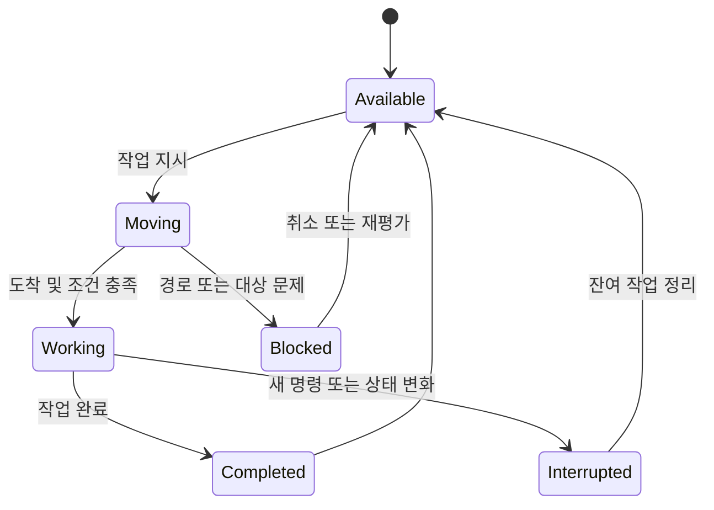

# 10. 낮의 노동 배분과 방문 이벤트

> 기준: PC Final Cut 클래식 생존 모드 · 조사일: 2026-11-13  
> [확인] 공개 자료 / [분석] 설계 해석 / [재구성안] 설명용 모델 / [검증 필요] 실행·패치 확인 필요

## 1. 역할

**[분석]** 낮 운영은 소수 인물의 시간을 생산·회복·생활 유지에 나누는 문제다. 방문자는 이미 세운 시간표에 외부의 요청과 거래 기회를 끼워 넣어 계획을 다시 판단하게 만든다.

여기서 노동력은 인원수와 같지 않다. 같은 세 명이라도 누가 아프고, 누가 밤을 새웠으며, 누가 어떤 작업에 적합한지에 따라 하루에 할 수 있는 일이 달라진다. 일을 하지 않는 수면이나 대화 역시 다음 날의 수행 능력을 위해 시간을 배분한 결과로 분석한다.

## 2. 확인된 기능의 경계

**[확인]** 공식 도움말은 낮의 주요 활동으로 은신처 유지, 제작, 거래, 생존자 돌봄을 제시한다. [P04](https://dlassets-ssl.xboxlive.com/public/content/cdebd7f5-a913-420b-8195-ef4d90195e48/GameManual/caf4db5e-ee78-47f1-b98a-7fbbc3b78352/en-US/index.html)

**[확인·개발사 문서]** Cold Crisis 모딩 안내는 방문을 Helper, Trader, Dweller, Quest로 나누고 조건·누적값·우선순위를 설명한다. 즉, 방문 전체를 일정 간격의 단순 주사위로만 설명하기 어렵다. 이는 당시 도구의 설명이며 현재 빌드의 정확한 조건값은 미확인이다. [P07](https://pwrcontroller.com/wp-content/uploads/2022/04/Modding-Instructions.pdf), Visits 절.

**[확인·커뮤니티]** 이웃은 도움을 요청하거나 물자를 제공할 수 있고, 일부 도움은 생존자의 외출을 요구한다. 방문별 시각과 귀환 결과가 다르다는 점이 기록되어 있다. [W06](https://this-war-of-mine.fandom.com/wiki/Neighbors)

## 3. 낮 행동의 분류

다음은 관찰 항목을 조직하기 위한 **[분석] 분류**다.

| 행동군 | 입력 | 결과 | 경쟁하는 시간 |
|---|---|---|---|
| 초기 정리 | 인물, 접근 가능한 장애물, 도구 여부 | 이동·배치·수색 가능 범위 확대 | 생산과 휴식 |
| 제작·설치 | 재료, 시설 조건, 작업자 | 도구·시설·소비재 | 방문 대응과 회복 |
| 조리·가공 | 음식·물·연료 등 | 사용할 생활 자원 | 시설과 인물 점유 |
| 회복 지원 | 침대, 치료품, 인물 상태 | 회복 여건·상태 변화 | 당일 노동 |
| 생활·심리 대응 | 대화, 생활 물품, 여유 시간 | 관계·정서 관련 피드백 | 긴급 생산 |
| 정보 확인 | 라디오·인물 기록·재고 UI | 다음 선택의 근거 | 행동 전환 비용 |
| 방문 응대 | 문까지 이동, 요청 검토, 거래 자원 | 거래·부재·합류·사건 이력 | 기존 일정 |

시설에 물자를 넣은 뒤 기다리는 작업과 수행자가 계속 붙어 있어야 하는 작업은 따로 기록한다. 대기형 생산을 시작했다는 이유만으로 작업자까지 하루 종일 묶는 모델은 원작 재현 시 잘못된 생산량을 만들 수 있다.

## 4. 인물별 작업 계획

**[재구성안]** 하루 작업표에는 효율뿐 아니라 밤 역할과 긴급 대응 여유를 함께 적는다.

| 필드 | 의미 | 계획에서의 용도 |
|---|---|---|
| 생존자 ID | 인물의 지속 식별자 | 상태·기억·일정 연결 |
| 현재 상태 | 건강, 피로, 심리, 외출 여부 | 작업 가능성 판단 |
| 선호 역할 | 조리, 제작, 운반, 거래 등 | 능력에 따른 분업 |
| 밤 예정 역할 | 수색, 경계, 수면 | 낮 휴식 우선순위 |
| 점유 작업 | 현재 지시와 예상 종료 | 다른 지시와 충돌 방지 |
| 반응 여유 | 방문 대응 가능한 시간 | 모든 인물을 장시간 작업에 묶지 않기 |

인물을 가장 효율적인 작업에 계속 붙이면 단기 산출은 늘지만 밤 역할을 수행할 여유가 줄 수 있다. 반대로 모두를 충분히 쉬게 하면 오늘의 조달·시설 개선이 늦어진다. 낮 운영의 핵심은 이 둘의 균형이다.

## 5. 작업 지시 상태 모델

아래 상태명은 **[재구성안]**이다. 원작 엔진의 실제 태스크 시스템을 뜻하지 않는다.



작업이 끊길 때 어떤 값이 보존되는지 반드시 명세한다. 재료 차감, 작업 진행도, 대상의 점유권, 도구 내구도, 생산 결과 생성 시점은 각각 다른 정책일 수 있다. “취소” 하나로 모두 초기화하면 물자 복제 또는 소실이 생긴다.

## 6. 방문의 기능별 분석

| 유형 | 시스템상 역할 | 플레이어의 판단 | 기획상 효과 |
|---|---|---|---|
| 지원 방문 | 부족한 상태에서 외부 자원 공급 | 즉시 수령·응대할 것인가 | 완전한 붕괴를 늦추거나 관계 경험 형성 |
| 상인 방문 | 피난처에서 재고를 바꿀 기회 | 지금 팔 것과 남길 것 | 외부 수색 위험을 일부 대체 |
| 합류 요청 | 인물·능력·소비량 변화 | 추가 노동력과 부양 부담 비교 | 집단 구조를 장기적으로 변경 |
| 도움·사건 요청 | 물자 또는 인력 지출 요구 | 자체 필요와 타인의 필요 비교 | 경제 선택을 서사 선택으로 연결 |

**[분석]** 도움의 가치는 반환 물자만으로 평가하기 어렵다. 요청을 받아들이면 당일 일정이 흔들리고, 거절하면 자신이 보존한 자원과 거절한 이유를 플레이어가 기억한다. 방문자는 외부 세상을 배경 설명 없이 은신처 문앞으로 가져오는 역할을 한다.

## 7. 방문 처리 흐름

**[재구성안]** 실제 방문 대사·보상 조건을 복원한 것이 아니라 콘텐츠 구현을 위한 계약이다.

1. 현재 날짜와 시나리오에서 가능한 방문 후보를 찾는다.
2. 이미 처리한 사건, 등장 불가 인물, 모드가 맞지 않는 후보를 제외한다.
3. 조건값과 우선순위에 따라 한 방문을 예약한다.
4. 문앞 도착 후 플레이어가 응대할 수 있는 상태를 만든다.
5. 선택마다 필요한 물자·인물·선행 조건을 다시 검사한다.
6. 수락·거절·보류·미응답을 서로 다른 결과로 저장한다.
7. 외출이 있으면 부재와 귀환 예정 상태를 등록한다.
8. 관련 인물 반응과 후속 이벤트 조건을 갱신한다.

보류 선택이 모든 방문에 존재한다거나, 한 번 거절한 요청이 반드시 다시 온다는 가정은 하지 않는다. 요청별 대화와 재방문 정책을 개별 콘텐츠 데이터로 둔다.

## 8. 대표 방문 데이터

**[재구성안] 가상 요청 예. 필드와 수치는 원작 데이터가 아니다.**

```yaml
visit:
  id: example_neighbor_supply_request
  kind: request
  prerequisites:
    campaign_active: true
    prior_outcome: unresolved
  options:
    accept:
      requires: available_supply
      effects:
        - consume_requested_supply
        - record_help_event
        - evaluate_character_responses
    decline:
      effects:
        - record_decline_event
        - evaluate_character_responses
  unanswered_policy: record_separately
  followup:
    eligibility: scenario_defined
  presentation:
    request_text: localized_request_key
    consequence_hint: localized_hint_key
```

도움을 주는 행위와 그 행위가 각 인물에게 주는 감정 효과는 다른 단계로 분리한다. 같은 사건을 모두가 동일하게 평가한다고 가정하면 개성의 역할이 약해진다.

## 9. 일정 충돌 사례

> **[재구성안] 검토용 하루. 원작의 특정 방문 체인을 재현한 것이 아니다.**

수색 예정 인물이 낮에 쉬고 있고, 제작 담당자는 긴 작업 중이며, 다른 한 명은 회복 중이다. 방문자가 오늘 인력 지원을 요청한다.

| 대응 | 보존되는 계획 | 변경해야 하는 계획 | 확인할 위험 |
|---|---|---|---|
| 제작 담당자를 보낸다 | 수색자 휴식 | 시설 완성 시점 | 오늘 필요한 도구 미완성 |
| 수색 예정자를 보낸다 | 제작 진행 | 밤 수색자 재선정 | 운반량·안전·피로 변화 |
| 회복 중인 인물을 보낸다 | 다른 역할 유지 | 회복 계획 | 요청 수행 가능 여부·귀환 결과 |
| 지원을 거절한다 | 기존 시간표 | 관계와 심리 대응 | 인물별 반응 |

균형이 좋은 상황은 항상 가장 비효율적인 인물을 보내면 해결되는 구조가 아니다. 도움에 필요한 조건과 각 인물의 현재 상태 때문에 선택 비용이 달라져야 한다.

## 10. 노동력의 분석 지표

모두 **[재구성안]**이다.

| 지표 | 정의 | 알 수 있는 것 |
|---|---|---|
| 가용 인물 시간 | 행동 가능한 인물별 시간의 합 | 실제 노동 공급 |
| 이동 비중 | 이동 시간 / 활동 시간 | 시설 배치와 경로의 부담 |
| 회복 투자 비중 | 회복·휴식 시간 / 총시간 | 오늘 생산과 내일 능력의 교환 |
| 작업 중단 비용 | 재지시로 잃는 시간·진행도 | 방문이 과도한 방해인지 |
| 밤 준비 완료율 | 예정 역할을 가능한 상태로 맞춘 비율 | 낮 운영과 밤 운영의 연결 |
| 방문 인지율 | 방문을 알아차린 플레이 비율 | 기회 상실이 선택인지 UI 실수인지 |

수치가 높을수록 무조건 좋다고 해석하지 않는다. 회복 시간 증가가 성공적인 준비일 수도 있고, 전날의 무리한 행동이 초래한 손실일 수도 있다.

## 11. 예외와 QA

| ID | 검증 상황 | 기대하는 일관성 |
|---|---|---|
| DAY-01 | 시설 점유 중 두 번째 지시 | 작업자·시설 점유 충돌이 명확히 처리됨 |
| DAY-02 | 재료 부족 상태에서 시작 클릭 | 일부만 차감되지 않음 |
| DAY-03 | 방문 응대 때문에 작업 중단 | 진행도·재료 처리 정책과 UI 일치 |
| DAY-04 | 외출자를 밤 수색에 배정 | 부재 상태 검증으로 차단 또는 정해진 복귀 적용 |
| DAY-05 | 합류 후 침대·식량 부족 | 새 인원의 소비·상태가 정상 반영 |
| DAY-06 | 수락 후 앱 종료·재개 | 물자·후속 사건·기억 중복 생성 없음 |
| DAY-07 | 거절과 시간 만료 | 기록·인물 반응 정책이 구분됨 |
| DAY-08 | 거래 방문과 퀘스트 조건 동시 충족 | 우선순위와 지연 정책 일관 |
| DAY-09 | 낮 조기 종료 직전 노크 | 미응답 처리와 사용자 피드백 일치 |
| DAY-10 | 마지막 인물이 일시 외출 | 집단 붕괴와 일시 부재 구분 |
| DAY-11 | Stories 전용 방문을 클래식에 로드 | 모드별 적격성 검사 |
| DAY-12 | 언어 변경 후 대화 재진입 | 선택 의미와 결과 ID 유지 |

## 12. 근거와 추가 검증

| 출처 | 수준 | 사용 범위 |
|---|---|---|
| P04 · 공식 Xbox 도움말 | 1차 원문, The Little Ones 판 | 낮의 기본 활동 |
| P07 · Cold Crisis 모딩 안내 | 개발사 저작 문서 공개 복제본 | 방문 유형과 조건 기반 구조 |
| W06 · Neighbors | 커뮤니티 검색 색인 | 도움·자원 제공·외출 요청 |

현재 PC 빌드에서의 방문 확률, 도착 시각, 재방문 간격, 수락 후 부재 기간, 방문 중 조기 종료의 정확한 효과는 고정값으로 쓰지 않는다. 유형별 실제 플레이 로그가 확보되면 방문 데이터 표를 확장한다.

연결: [02 시간](02_Time_Campaign_and_Phase_Resolution.md) · [03 인물](03_Characters_and_Traits.md) · [05 심리](05_Morale_Relationships_and_Ethics.md) · [08 제작](08_Crafting_Recipes_and_Upgrades.md) · [15 거래](15_Trade_and_Barter_Economy.md)

[목차로 돌아가기](README.md)
