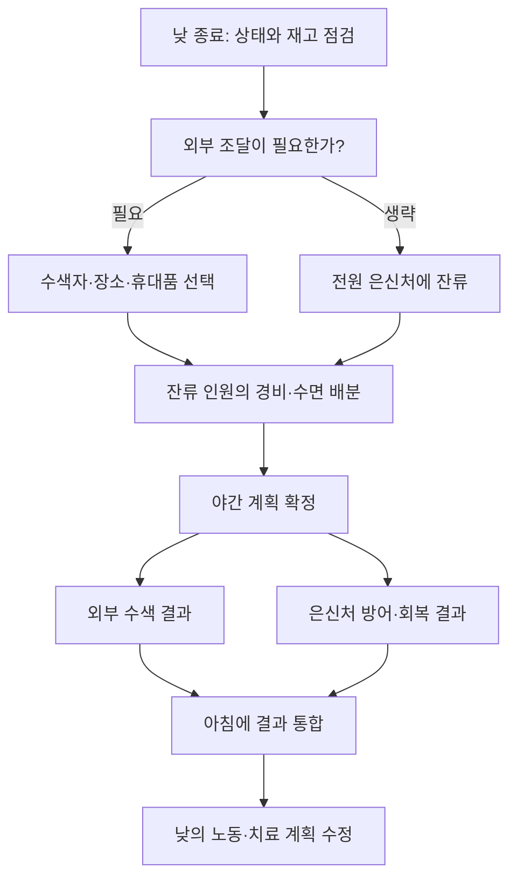

# 11. 야간 역할 배분과 은신처 습격

> 기준: PC **Final Cut의 클래식 생존 모드**. 조사일: **2026-11-13**. 게임 실행·원본 코드 검증 없이 공개 자료를 분석한 역기획서다. 플랫폼, 시나리오, 추가 콘텐츠에 따라 행동 자격과 사건이 달라질 수 있다.
>
> **[확인]**은 공개 자료에서 확인한 규칙이며 공식 자료와 커뮤니티 자료를 구별한다. **[분석]**은 그 규칙의 설계적 해석이다. **[재구성안]**은 같은 경험을 구현하기 위한 제안으로 원작 내부 구조가 아니다. **[검증 필요]**는 실제 빌드에서 확인해야 할 항목이다.

## 1. 시스템의 목적

**[분석]** 야간 배분은 사람 한 명의 가치를 `외부 조달 능력`, `내부 방어 기여`, `회복이 필요한 노동력`으로 동시에 평가하게 한다. 수색대를 강하게 만들면 은신처가 약해질 수 있고, 방어를 강화하면 다음 날 쓸 노동 시간이 줄어든다. 플레이어가 선택하는 것은 그날 밤의 행동뿐 아니라 다음 날의 작업 가능 인원이다.

설계적으로 중요한 질문은 세 가지다.

- 오늘 필요한 물자를 얻기 위해 누구를 보낼 것인가?
- 남은 사람과 장비로 저장한 물자를 지킬 수 있는가?
- 내일도 같은 운영을 지속할 수 있도록 누구를 쉬게 할 것인가?

이 결정을 독립 메뉴로 두면 낮의 시설 투자와 밤의 역할 배분이 서로 다른 시간 규모의 대응 수단이 된다. 시설은 여러 밤에 영향을 주는 투자이고, 역할은 오늘의 상태에 반응하는 조정이다.

## 2. 공개 자료로 확인되는 규칙

| 항목 | 확인 내용 | 근거와 범위 |
| --- | --- | --- |
| 외부 조작 인원 | 밤에는 민간인 한 명을 외부 장소로 보내는 구조다. | **[확인: 공식]** [N01](https://dlassets-ssl.xboxlive.com/public/content/cdebd7f5-a913-420b-8195-ef4d90195e48/GameManual/caf4db5e-ee78-47f1-b98a-7fbbc3b78352/en-US/index.html). 콘솔판 설명과 클래식 규칙의 공통 부분 |
| 시간 구분 | PC 위키는 낮 06:00–20:00, 현장 수색 21:00–05:00을 구분한다. | **[확인: 커뮤니티]** [N02](https://this-war-of-mine.fandom.com/wiki/Time). 20시의 계획 화면과 현장 시작 시각을 혼동하지 않는다. |
| 습격 처리 | 은신처 습격은 야간에 화면 밖에서 처리되며, 수색을 생략해도 직접 전투로 방어하지 않는다. | **[확인: 커뮤니티]** [N03](https://this-war-of-mine.fandom.com/wiki/Raids) |
| 남은 인원의 역할 | 경비와 수면을 배분한다. 침대 사용 여부가 역할 선택에 등장한다. | **[확인: 커뮤니티]** [N03](https://this-war-of-mine.fandom.com/wiki/Raids) |
| 방어 수단 | 경비 인원, 은신처에 남은 무기, 방어 시설이 습격 대응에 관계된다. | **[확인: 커뮤니티]** [N03](https://this-war-of-mine.fandom.com/wiki/Raids) |
| 실패 결과 | 물자 손실과 부상이 생길 수 있고, 방어 실패가 사기에 영향을 준다. | **[확인: 커뮤니티]** [N03](https://this-war-of-mine.fandom.com/wiki/Raids) |
| 인물 능력 | 수색 중 전투 능력과 은신처 경비 능력을 동일 수치로 간주할 수 없다. | **[확인: 커뮤니티]** [N03](https://this-war-of-mine.fandom.com/wiki/Raids)의 별도 경비 평가 |
| 외부 정보 | 라디오는 치안 악화 같은 상황을 알리는 정보 수단이다. | **[확인: 커뮤니티]** [N06](https://this-war-of-mine.fandom.com/wiki/Radio) |

**[검증 필요]** 습격의 정확한 발생 일정, 공격력 산식, 무기 자동 배분 순서, 부상 확률은 이 문서에서 원작의 확정 규칙으로 제시하지 않는다. 커뮤니티의 경비 등급표도 공식 스탯 테이블로 옮기지 않는다.

## 3. 플레이어의 의사결정 흐름

**[재구성안]** 다음 도식은 관찰 가능한 역할 분리를 표현한 기획용 흐름이다. 원작의 실제 업데이트 순서나 스레드 구조를 뜻하지 않는다.



### 역할 선택의 경제적 의미

| 선택 | 즉시 얻으려는 것 | 포기하는 것 | 다음 날 확인할 지표 |
| --- | --- | --- | --- |
| 외부 수색 | 물자, 거래 기회, 장소 정보 | 해당 인원의 경비·수면 기회 | 실제 반입량, 귀환 상태, 피로 |
| 경비 | 저장 자산과 동료의 보호 | 수면을 통한 회복 | 피해 유무와 경비자의 회복 필요 |
| 침대 수면 | 다음 날의 활동 기반 | 경비 배분 여유, 침대 이용권 | 치료·제작을 수행할 수 있는 인원 |
| 일반 수면 | 제한된 시설 안에서의 회복 | 더 나은 휴식 배정의 가능성 | 잔존 피로와 병목 시설 |
| 수색 생략 | 위험한 출행의 회피, 내부 운영 안정 | 외부 자원 유입 | 재고가 버틸 수 있는 시간 |

**[분석]** 각 행은 무조건 좋은 행동이 아니다. 식량이 충분한 밤에는 수색 생략의 가치가 커질 수 있고, 의약품이 절실한 밤에는 안전한 은신처를 갖췄더라도 출행의 가치가 커질 수 있다. 따라서 자동 추천이 있다면 한 가지 점수보다 현재의 결핍을 이유로 보여주는 편이 적합하다.

## 4. 경비를 전투와 분리해서 분석해야 하는 이유

**[분석]** 현장 전투는 이동, 위치 선정, 은신, 공격 시점이라는 플레이어 숙련의 영향을 받는다. 은신처 경비는 낮에 준비한 시설과 저녁에 정한 배치가 결과로 돌아오는 관리 문제다. 두 시스템의 인물 평가를 합치면, 현장 조작이 뛰어난 플레이어가 같은 캐릭터를 항상 외부에 보내는 단일 해법이 생기기 쉽다.

역기획 데이터에는 다음 항목을 분리해 두는 것이 타당하다.

| 평가 축 | 다루는 질문 | 다른 축으로 대체하면 생기는 문제 |
| --- | --- | --- |
| 수색 적합성 | 필요한 물자를 시간 안에 가져올 수 있는가? | 운반 능력을 전투 능력으로 오판 |
| 현장 생존성 | 위험 장소에서 귀환할 수 있는가? | 안전 장소에도 전투 전문가만 투입 |
| 경비 기여 | 잔류 그룹의 방어에 얼마나 도움이 되는가? | 외부 전투 등급을 방어 공식으로 오용 |
| 회복 필요 | 활동을 멈춰야 할 이유가 얼마나 큰가? | 당장의 방어만 최적화해 다음 날 붕괴 |
| 대체 가능성 | 이 사람이 빠졌을 때 낮 운영을 누가 맡는가? | 음식·제작 담당의 장기 부재를 무시 |

**[재구성안]** 위 값들은 반드시 숫자로 노출할 필요가 없다. 기획 도구에서는 수치를 사용할 수 있지만 플레이어 화면에서는 설명형 특성과 상태, 지난밤 결과로 판단하게 할 수 있다. 원작이 내부적으로 이 다섯 값을 사용한다는 주장은 아니다.

## 5. 야간 계획에 필요한 입력과 출력

### 입력 계약

| 입력 | 내용 | 반드시 구분할 사항 |
| --- | --- | --- |
| 인원 목록 | 현재 은신처에 있는 생존자와 외출·이탈 상태 | 파티 명단과 실제 잔류 명단 |
| 행동 자격 | 역할을 선택할 수 있는지와 불가 사유 | 상태 제한과 시나리오 제한 |
| 상태 스냅샷 | 피로, 부상, 질병, 사기 등 | 출발 직전 값과 아침 정산 후 값 |
| 휴대 물품 | 수색자가 가져가는 장비와 교환 재료 | 은신처에 남아 있는 동일 품목 |
| 시설 | 침대 등 이용 가능한 시설, 방어 보강 | 건설 예약과 완성된 시설 |
| 외부 위험 정보 | 오늘의 위협과 불확실성 | 확정 사건과 플레이어에게 전달된 정보 |

### 출력 계약

**[재구성안]** `NightResult`는 단순 성공·실패가 아니라 다음 항목을 묶은 결과로 설계한다.

- `returned_items`: 외부에서 실제로 반입된 물품.
- `lost_items`: 은신처에서 유실된 물품.
- `consumed_defense_items`: 방어 과정에 소모된 자원.
- `survivor_changes`: 휴식, 부상, 피로 등 인물별 변화.
- `absences`: 아직 귀환하지 않았거나 사망·이탈한 인물.
- `world_changes`: 외부 장소나 사건 진행의 변화.
- `report_entries`: 플레이어가 결과의 이유를 이해할 수 있는 기록.

이 구분의 목적은 물품 획득과 습격 손실을 하나의 순증감 숫자로 합쳐 원인을 숨기지 않는 데 있다. 예를 들어 의약품을 가져왔지만 같은 밤 다른 물자가 사라졌다면, 조달은 성공하고 방어는 실패한 것이다.

## 6. 정산 재구성안과 일관성 조건

**[재구성안]** 구현 시 다음 순서를 하나의 가능한 설계로 사용할 수 있다. 순서는 제안이며 원작 코드의 재현 결과가 아니다.

1. 야간 계획을 확정하면서 수색자, 잔류자, 휴대품, 완공 시설을 기록한다.
2. 휴대품을 은신처 재고에서 분리해 같은 물건이 외부와 방어에 동시에 쓰이지 않게 한다.
3. 현장 수색을 실행한다. 은신처 쪽에는 이 밤의 계획 식별자를 연결한다.
4. 시나리오의 사건 정책에 따라 습격 여부와 그 조건을 결정한다.
5. 방어 결과, 소모품, 잔류자의 변화와 수면 효과를 계산한다.
6. 수색자의 정상 귀환·지연 귀환·사망 결과를 각각 별도 처리한다.
7. 아침에 확정 가능한 결과만 한 번 적용하고 보고서를 생성한다.

### 반드시 유지할 조건

- 수색자의 가방 속 총이나 도구를 같은 밤 은신처 무기 목록에 중복 계산하지 않는다.
- 침대 한 개의 이용권을 서로 충돌하는 배정에 중복 제공하지 않는다. 추가 콘텐츠의 동침 규칙은 별도 정책으로 취급한다.
- 수면 역할을 선택했다는 이유만으로 무조건 모든 부정 상태를 제거하지 않는다.
- 수색자를 보내지 않은 경우에도 방어 및 회복 단계는 실행한다.
- 같은 밤의 저장 파일을 불러올 때 이미 적용한 손실을 재적용하지 않는다.
- 귀환이 늦은 인물의 물자를 실제 도착 전부터 사용할 수 있게 만들지 않는다.
- 사망, 지연, 정상 귀환을 하나의 `isReturned` 불리언으로 표현하지 않는다.

### 기획용 데이터 예시

```yaml
# 재구성안: 필드와 값은 원작의 파일 포맷이 아니다.
night_plan:
  id: campaign_a_day_12
  scavenger_id: survivor_a
  location_instance_id: district_b_variant_1
  carried_item_stacks: [tool_stack_1, barter_stack_2]
  residents:
    - survivor_id: survivor_b
      role: guard
    - survivor_id: survivor_c
      role: sleep_in_bed
      bed_id: bed_1
  shelter_snapshot_id: shelter_before_departure
  threat_profile_id: scenario_defined_profile
  committed: true
```

## 7. 세 가지 상황으로 보는 역할 배분

아래 사례는 **[분석]**을 위한 가정이며 원작의 특정 시나리오, 공격력, 확률을 재현한 것이 아니다.

### 사례 A: 재고는 부족하지만 모두 건강하다

세 명이 있고 식재료와 건설 재료가 부족하다. 비교적 위험이 낮은 장소를 알고 있다. 이 경우 외부에서 물자를 가져오는 사람과 최소한의 내부 보호를 담당할 사람, 내일의 활동 여유를 확보할 사람을 나눌 이유가 생긴다.

핵심은 가방을 전투 장비로 채우기 전에 그 장소의 요구를 확인하는 것이다. 불필요한 장비의 반출은 운반량과 은신처 방어에 동시에 비용을 만들 수 있다. 수색 대상의 위험도와 도구 요구가 역할 배분보다 먼저 확정되어야 한다는 뜻이다.

### 사례 B: 한 사람이 치료를 필요로 한다

동일한 세 명 중 한 명의 회복이 시급하다. 남은 두 명만으로 출행과 경비를 나누면 다음 날 피로 문제가 커질 수 있다. 이때는 이미 확보한 재고, 앞으로 필요한 의약품, 외부에서 기대하는 성과를 비교해야 한다.

이번 밤을 쉬는 선택은 자원 유입을 포기하지만, 이후 여러 날 쓸 활동 시간을 보존할 수 있다. 반대로 치료 물품을 구하지 못하면 쉬는 것만으로 위기를 해결하지 못할 수 있다. 수색 생략 버튼이 있는 것만으로는 충분하지 않고, 현재 재고와 치료 요구를 함께 보여주는 정보가 중요하다.

### 사례 C: 치안 악화가 예상된다

방어 준비가 약한 상태에서 외부 위험을 알게 되었다. 가능한 대응은 경비 인원을 늘리는 것, 필요한 무기를 은신처에 남기는 것, 그날 낮에 방어 시설을 우선하는 것처럼 여러 시간 규모에 걸쳐 있다.

**[분석]** 이때 최적화의 대상은 한 번의 습격 피해가 아니라 악화 기간을 버티는 운영 능력이다. 경비 인원을 계속 늘릴 수 없다면 시설 투자가 노동력을 절약하는 효과를 갖게 된다. 위험 예고는 단순 분위기 장치가 아니라 투자 시점을 앞당기는 정보다.

## 8. 결과 보고와 학습

**[분석]** 자동 정산 시스템의 공정성은 결과만큼 원인 설명에 달려 있다. 플레이어는 직접 피격을 보지 않았으므로, 무엇이 부족했는지 학습할 단서가 필요하다.

**[재구성안]** 아침 보고서는 다음 순서로 묶는다.

| 우선순위 | 보여줄 내용 | 목적 |
| --- | --- | --- |
| 1 | 사망, 미귀환, 심각한 부상 | 당장 바뀐 인원 계획 파악 |
| 2 | 습격 여부와 대응 결과 | 외부 수색의 결과와 구분 |
| 3 | 잃은 물자와 사용한 자원 | 부족 원인을 역추적 |
| 4 | 휴식 결과와 피로 잔존 | 낮의 배치 수정 |
| 5 | 다음 밤에 적용 가능한 단서 | 같은 실패의 반복 방지 |

보고서는 내부 방어 공식을 공개하지 않아도 된다. 다만 결과를 설명하는 문장과 실제 원인이 어긋나면 플레이어가 잘못된 학습을 하므로, 텍스트와 계산에 동일한 결과 데이터를 사용해야 한다.

## 9. 밸런스 분석 항목

| 조정 축 | 지나치게 강할 때 | 지나치게 약할 때 | 검증 지표 제안 |
| --- | --- | --- | --- |
| 수색 수익 | 은신처 손실을 무시하고 출행만 반복 | 외부 방문의 동기 상실 | 획득의 목적별 사용률 |
| 경비의 효용 | 항상 경비를 늘리는 정답 고착 | 역할 선택이 장식이 됨 | 배분별 손실·회복 비교 |
| 시설의 장기 효용 | 일찍 완성하면 야간 관리가 사라짐 | 투자보다 임시 대응만 유리 | 건설 이후 확보한 노동 시간 |
| 휴식의 중요도 | 피로 복구만 하느라 선택 폭 축소 | 같은 인원이 모든 밤을 담당 | 인원별 야간 역할 편중 |
| 결과의 불확실성 | 준비와 결과의 관계가 안 보임 | 숫자 맞추기 퍼즐로 수렴 | 유사 준비 수준의 결과 분산 |
| 정보 예고 | 모든 사건을 확정적으로 최적화 | 대응할 기회 없이 손실 | 경고 후 준비 행동 변화 |

**[재구성안]** 위 지표는 설계 검증용이다. 원작 텔레메트리의 존재나 실제 측정 결과를 뜻하지 않는다. 특정 승률을 목표로 고정하기보다, 같은 결과에 도달하는 서로 다른 운영 방식이 남아 있는지 평가한다.

## 10. 예외와 QA 체크리스트

| ID | 시험 조건 | 기대하는 일관성 |
| --- | --- | --- |
| NGT-01 | 모든 잔류 인원을 수면에 배치 | 경비 없음과 은신처에 사람 없음이 구분됨 |
| NGT-02 | 유일한 생존자가 외출 | 실제 잔류 명단은 비어 있음. 습격 발생 여부와 방어 실패를 혼동하지 않음 |
| NGT-03 | 유일한 총과 탄약을 외부로 반출 | 같은 자원이 은신처 정산에 다시 사용되지 않음 |
| NGT-04 | 총만 남기고 사용 가능한 탄약이 없음 | 무기 보유와 사용 가능 상태를 구분함 |
| NGT-05 | 한 개 침대를 두 명에게 배정 시도 | 본편 규칙에 맞게 배정 제한 또는 명확한 안내 |
| NGT-06 | 출발 전에 인물의 역할 자격이 변경 | 계획을 재검증하고 이유를 표시함 |
| NGT-07 | 수색을 생략하고 밤 진행 | 방어·회복·사건 정산이 누락되지 않음 |
| NGT-08 | 수색자 귀환이 지연 | 아침 재고에 휴대품이 먼저 들어오지 않음 |
| NGT-09 | 밤 결과 적용 중 저장·복구 | 손실·획득·소모가 중복 적용되지 않음 |
| NGT-10 | 방어 시설이 낮 종료 직전에 완공 | 완공 상태 기준과 적용 시점이 일관됨 |
| NGT-11 | 본편과 아이 포함 시나리오 전환 | 성인 일반 규칙을 아이의 역할 자격에 그대로 적용하지 않음 |
| NGT-12 | 치안 사건이 시작·종료하는 밤 | 위험 프로필 변경이 예고·보고와 모순되지 않음 |

이 표는 **[재구성안]**의 수용 기준이며 실제 버그를 발견했다는 의미는 아니다.

## 11. 다른 문서와의 연결

- [02. 시간과 페이즈 정산](02_Time_Campaign_and_Phase_Resolution.md): 낮 종료, 계획 확정, 귀환과 아침 처리의 경계.
- [03. 인물과 특성](03_Characters_and_Traits.md): 수색·경비·회복 역할의 인물별 차이.
- [06. 은신처와 시설](06_Shelter_Layout_and_Facilities.md): 침대와 방어 보강의 투자 의미.
- [07. 자원과 인벤토리](07_Resources_Inventory_and_Carrying.md): 출발 재고 분리와 귀환 반입.
- [12. 지도와 수색](12_World_Map_and_Scavenging.md): 외부 목적지가 역할 배분에 미치는 영향.
- [14. 전투와 탈출](14_Combat_Injury_and_Escape.md): 직접 전투와 자동 방어의 경계.

## 12. 출처와 검증해야 할 부분

| ID | 출처 | 이 문서에서 사용하는 범위 | 접근·신뢰 수준 |
| --- | --- | --- | --- |
| N01 | [공식 Xbox 온라인 설명서](https://dlassets-ssl.xboxlive.com/public/content/cdebd7f5-a913-420b-8195-ef4d90195e48/GameManual/caf4db5e-ee78-47f1-b98a-7fbbc3b78352/en-US/index.html) | 야간에 한 명을 외부로 보내는 기본 구조 | 공식 원문 열람. 콘솔판 자료이므로 PC 세부 수치의 근거로 사용하지 않음 |
| N02 | [Time](https://this-war-of-mine.fandom.com/wiki/Time) | 낮과 현장 수색의 시간 구분 | 커뮤니티 검색 본문 확인. 게임 실행 대조 없음 |
| N03 | [Raids](https://this-war-of-mine.fandom.com/wiki/Raids) | 화면 밖 정산, 역할·장비·시설, 손실 유형 | 커뮤니티 검색 본문 확인. 수치·테스트 표는 채택하지 않음 |
| N06 | [Radio](https://this-war-of-mine.fandom.com/wiki/Radio) | 외부 위험을 전하는 정보 수단 | 커뮤니티 검색 본문 확인 |

**[검증 필요]** 실제 PC 빌드에서 역할 제한 목록, 침대 수면과 일반 수면의 정확한 회복 차이, 무기 및 탄약 할당 우선순위, 습격 정책의 시나리오별 차이를 확인해야 한다. 구 위키의 20시 수색 시작 표기는 계획 화면과 현장 시간의 경계를 구분하지 않았을 수 있어 기준 수치로 사용하지 않았다.
