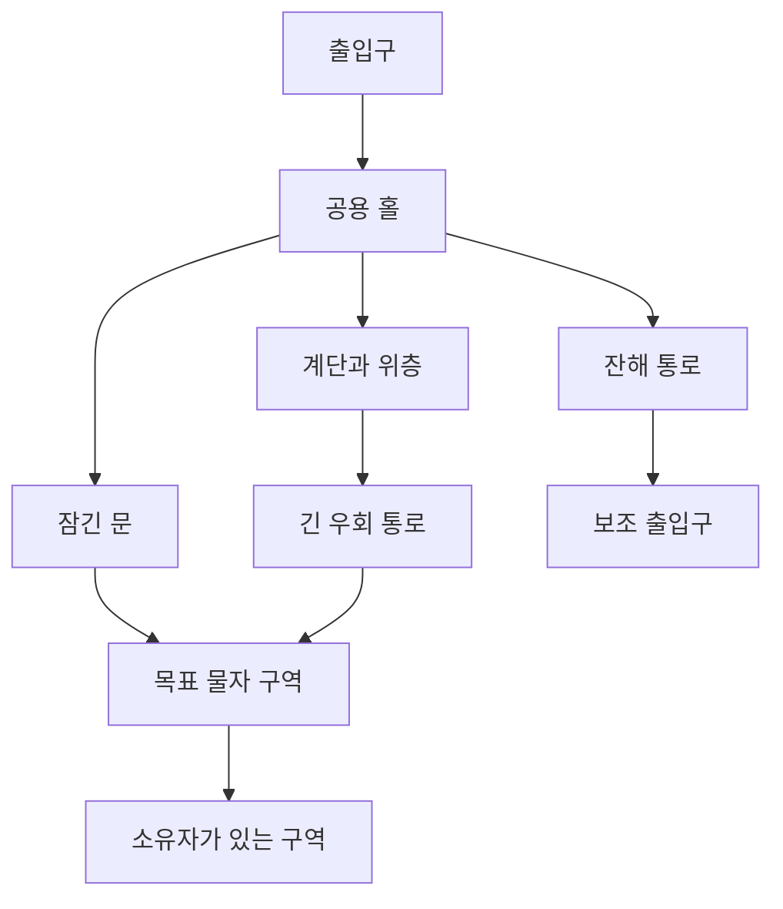

# 12. 도시 지도, 장소 선택과 야간 수색

> 기준: PC **Final Cut의 클래식 생존 모드**. 조사일: **2026-11-13**. 실제 게임 실행과 원본 코드 확인 없이 공개 자료에서 규칙을 수집하고 설계 구조를 분석했다. Stories의 동명 장소는 별도 변형으로 취급한다.
>
> **[확인]** 공개 자료에 기록된 규칙. **[분석]** 설계 해석. **[재구성안]** 구현·데이터 제안으로 원작 내부 구조가 아님. **[검증 필요]** 버전 또는 실제 실행 확인이 필요한 내용.

## 1. 수색의 핵심 경험

**[분석]** 수색은 제한 시간 안에 많은 물건을 클릭하는 활동을 넘어선다. 부족한 물자, 인물의 운반 능력, 도구가 여는 접근 경로, 타인의 소유, 귀환 가능성을 동시에 고려하는 조달 계획이다. 가져온 물자가 은신처의 문제를 해결해야 비로소 성과가 된다.

같은 장소에서 같은 양을 가져와도 의미는 달라진다. 난방이 필요한 날의 재료와 치료가 필요한 날의 의약품은 현재 문제를 해결하는 가치가 다르다. 이 때문에 장소의 가치는 고정 보상보다 **현재 은신처의 결핍과의 적합성**으로 분석해야 한다.

## 2. 확인되는 외형 규칙

| 항목 | 공개 자료에서 확인한 내용 | 근거 |
| --- | --- | --- |
| 야간 방문 | 수색은 한 명을 선택해 한 장소에서 진행한다. | **[확인: 커뮤니티]** [N04](https://this-war-of-mine.fandom.com/wiki/Scavenge) |
| 접근 가능 장소 | 초기에는 일부 장소만 이용할 수 있고, 진행 중 추가 장소가 나타난다. | **[확인: 커뮤니티]** [N05](https://this-war-of-mine.fandom.com/wiki/Locations) |
| 일시적 차단 | 전투와 날씨 때문에 장소가 일시적으로 접근 불가가 될 수 있다. | **[확인: 커뮤니티]** [N05](https://this-war-of-mine.fandom.com/wiki/Locations) |
| 사전 정보 | 장소 설명에는 자원 종류·대략적인 양·위험·거래 가능성 같은 단서가 있다. | **[확인: 커뮤니티]** [N05](https://this-war-of-mine.fandom.com/wiki/Locations) |
| 현장 소유권 | 수집과 절도는 상호작용 표시로 구별한다. | **[확인: 커뮤니티]** [N04](https://this-war-of-mine.fandom.com/wiki/Scavenge) |
| 귀환 시간 | 마감을 넘기면 귀환이 늦거나 부상할 수 있다. | **[확인: 커뮤니티]** [N04](https://this-war-of-mine.fandom.com/wiki/Scavenge). 결과의 전체 범위는 미검증 |
| 장소 변형 | 같은 명칭의 장소에도 다른 주민·사건 구성이 있다. | **[확인: 커뮤니티]** [N14](https://this-war-of-mine.fandom.com/wiki/Supermarket), [N15](https://this-war-of-mine.fandom.com/wiki/Hotel) |

시간 경계는 [02. 시간과 페이즈](02_Time_Campaign_and_Phase_Resolution.md)를 따른다. 도시 선택 화면의 위치가 이동 비용이나 물리적 거리 시뮬레이션에 사용된다는 근거는 확보하지 못했다.

## 3. 두 종류의 공간을 분리해서 읽기

### 도시 지도: 후보를 비교하는 공간

**[분석]** 도시 지도는 어디에 갈지 결정하는 전략 화면이다. 선택지는 `필요한 자원`, `기대 위험`, `접근 가능 여부`, `이미 아는 정보`를 비교하는 형태로 읽힌다. 여기에 현장 동선을 그대로 표시하면 탐색의 정보 가치가 줄어들고, 아무 정보도 없으면 출발 장비 선택이 추측만으로 결정된다.

### 개별 장소: 시간과 위험을 소비하는 공간

**[분석]** 현장은 문, 층, 계단, 장애물, 수색 대상, 주민의 행동이 연결되는 공간이다. 같은 물자라도 어느 경로를 거쳐야 하는지에 따라 실제 획득 비용이 바뀐다. 장소 이름이나 표시된 자원량만으로 결과를 예측할 수 없다는 점이 중요하다.

| 정보 단계 | 알 수 있는 내용의 예 | 플레이어 판단 | 설계적으로 남겨둘 불확실성 |
| --- | --- | --- | --- |
| 출발 전 설명 | 자원 범주와 위험 단서 | 오늘의 목적지 선택 | 모든 물자 위치와 주민 행동 |
| 현장 첫 관찰 | 출입 경로와 즉시 보이는 사람 | 접근 방식 수정 | 보이지 않는 구역의 상태 |
| 장애물 확인 | 필요한 도구와 우회 가능성 | 탐색 지속 또는 준비 후 재방문 | 아직 열지 않은 구역의 보상 |
| 수색 후 | 실제 확보 물자와 가방 여유 | 가져갈 품목 교체 | 다른 장소의 상대 가치 |
| 귀환 후 | 다음 낮에 해결한 결핍 | 다음 출행 계획 | 미래 사건과 장소 접근성 |

표는 **[분석]**이며 원작의 정보 공개 단계가 정확히 다섯 개의 코드 상태로 존재한다는 뜻은 아니다.

## 4. 수색 목적을 구분하는 기획 분류

**[재구성안]** 방문 목적을 데이터로 관리한다면 다음과 같이 나눌 수 있다. 원작이 이런 분류를 저장한다는 주장은 아니다.

| 목적 | 우선 확보 대상 | 준비의 중심 | 성공 판단 |
| --- | --- | --- | --- |
| 당장의 생존 | 현재 부족한 식재료·의약품 등 | 짧고 예측 가능한 경로 | 필요한 양을 안전하게 귀환시켰는가 |
| 시설 투자 | 예정된 제작에 필요한 재료 | 운반 효율과 장애물 도구 | 병목 레시피를 완성할 수 있는가 |
| 거래 | 교환할 물품과 거래 기회 | 거래 담당과 휴대 재고 | 필요한 품목을 합리적 비용으로 얻었는가 |
| 경로 개척 | 잠금과 잔해 제거 | 필요한 도구와 시간 | 이후 방문의 비용이 줄었는가 |
| 정보 획득 | 위험·주민·구역 구성 확인 | 관찰과 빠른 철수 | 다음 결정의 불확실성이 줄었는가 |
| 사건 개입 | 도움이 필요한 사람이나 사건 조건 | 목적에 맞는 물품·행동 여유 | 사건을 원하는 방향으로 진행했는가 |

**[분석]** 이 분류는 ‘이번 밤에 가방을 가득 채웠는가’만으로 수색을 평가하는 오류를 줄인다. 빈 가방으로 돌아왔더라도 위험한 통로를 확인하고 다음 준비를 정확히 할 수 있었다면 정보의 성과가 있다. 반대로 가방을 채웠더라도 가장 시급한 결핍을 해결하지 못했다면 운영 성과가 낮다.

## 5. 도구가 장소의 가치를 바꾸는 방식

| 장애물·기회 | 알려진 대응 | 설계적 교환 관계 | 출처 |
| --- | --- | --- | --- |
| 잠긴 문·수납 | 지렛대 또는 락픽 | 반복 사용 가능성과 소음·속도·소모품 비용의 비교 | **[확인: 커뮤니티]** [N07](https://this-war-of-mine.fandom.com/wiki/Crowbar), [N08](https://this-war-of-mine.fandom.com/wiki/Lock_Pick) |
| 잔해 | 손으로 치우거나 삽으로 작업 | 도구를 싣는 공간과 현장 시간의 교환 | **[확인: 커뮤니티]** [N09](https://this-war-of-mine.fandom.com/wiki/Shovel) |
| 특정 철창 | 톱날 사용 | 소모품을 써서 추가 공간 또는 지름길 확보 | **[확인: 커뮤니티]** [N10](https://this-war-of-mine.fandom.com/wiki/Saw_Blade) |
| 우회 가능한 차단 | 다른 층·문·통로 검토 | 소모품 절약과 이동 시간·위험의 교환 | **[분석]** 접근 경로의 일반적인 비교 방식 |

**[분석]** 도구는 생산 시설의 산출물이면서 수색의 입력이다. 이 연결은 ‘재료를 모아 시설을 만들고, 시설에서 만든 도구로 더 나은 자원에 접근한다’는 순환을 형성한다. 단, 도구 하나가 언제나 이득이라는 뜻은 아니다. 장애물이 없는 목적지라면 도구 슬롯이 실제 반입량을 줄일 수 있다.

**[검증 필요]** 도구별 내구도 수치, 작업 중단 시 소모 처리, 톱질 소음은 빌드 검증 전까지 고정하지 않는다. 특히 톱날의 소음에 관한 커뮤니티 설명이 일치하지 않아 여기서는 탐지 수치로 사용하지 않았다.

## 6. 현장 동선의 재구성

다음은 특정 원작 맵을 복제하지 않은 **[재구성안]**이다. 하나의 자원 구역에 다른 비용의 경로를 연결하면 도구 선택과 귀환 판단을 함께 검토할 수 있다.



이 구조에서 평가할 내용은 다음과 같다.

- 잠긴 문을 열 때 줄어드는 왕복 시간과 도구 비용.
- 우회 통로에서 관찰해야 할 주민과 노출 구간.
- 목표 물자를 확보한 뒤 더 깊이 들어갈 이유.
- 보조 출입구를 확보할 때 다음 방문에서 생기는 선택권.
- 긴급 철수 시 아직 통과 가능한 문과 장애물.

### 시간 예산

**[재구성안]** 기획 검토에는 다음 관계식을 사용할 수 있다.

`남은 시간 ≥ 목표까지 이동 + 장애물 처리 + 수색·정리 + 출구까지 복귀 + 불확실성 여유`

이 식은 원작이 내부적으로 계산하는 공식이 아니다. 수색 인터랙션 시간만 보다가 돌아갈 시간을 잊는 문제를 설명하는 도구다. 경로가 처음 방문하는 구역을 포함하면 여유를 크게 잡고, 검증된 짧은 경로라면 더 공격적으로 활용할 수 있다.

## 7. 가방을 채우는 기준과 철수 기준

**[분석]** 품목의 상점 가치와 오늘 필요한 가치는 다르다. 플레이어는 같은 슬롯에 넣을 후보를 다음 순서로 판단할 수 있다.

1. 돌아오지 못하면 모두 잃을 수 있으므로 귀환 가능성을 먼저 판단한다.
2. 다음 낮에 해결하지 못하면 큰 손실이 생길 결핍을 찾는다.
3. 그 결핍을 해결하는 최소한의 물자 조합을 확보한다.
4. 남은 공간을 투자 재료·교환 재료·예비품에 배분한다.
5. 추가 탐색을 한다면 얻는 기대 이익이 시간과 노출 증가를 정당화하는지 확인한다.

**[재구성안]** 아래 식은 경제 분석용 효용 함수 예시다.

`방문 가치 = 긴급 결핍 해결 + 장기 투자 가능성 + 정보 획득 - 생존 위험 - 출행 비용 - 귀환 지연 비용`

각 항의 가중치는 인원 상태와 다음 날 계획에 따라 바뀐다. 이 값을 원작의 AI나 보상 계산식으로 사용했다고 주장하지 않는다. 금전 가치 하나로 비교하면 치료와 회복처럼 그룹 전체에 영향을 주는 항목을 과소평가하기 쉽다.

### 철수를 고려할 조건

| 조건 | 판단 이유 |
| --- | --- |
| 이번 출행의 핵심 물자를 이미 확보 | 추가 이익보다 기존 성과를 보존할 가치가 커질 수 있음 |
| 예상하지 못한 주민 또는 차단 등장 | 기존 시간 예산과 위험 예측을 다시 계산해야 함 |
| 가방 교체에 큰 판단 비용이 듦 | 자잘한 최적화가 귀환 시간을 소비할 수 있음 |
| 건강·이동 여건 악화 | 들어갈 때 가능했던 귀환 경로가 더 비싸질 수 있음 |
| 출구 경로가 불명확 | 남은 시간을 탐색보다 복귀 확인에 써야 할 수 있음 |

이 표는 플레이 조언을 넘어, UI가 언제 귀환 정보를 강조해야 하는지 결정하는 근거로 사용할 수 있다.

## 8. 장소 변형과 재방문의 설계

**[확인: 커뮤니티]** 슈퍼마켓에는 군인 사건형과 다른 수색자들이 있는 변형이 소개되고, 호텔에도 주민·위험이 다른 여러 변형이 있다. 따라서 장소 이름만으로 항상 같은 NPC와 사건을 예상하면 안 된다. [N14](https://this-war-of-mine.fandom.com/wiki/Supermarket), [N15](https://this-war-of-mine.fandom.com/wiki/Hotel)

**[분석]** 같은 건물 형태를 다른 사회적 상황과 결합하면 공간 기억은 유용하게 유지하면서도 행동 판단을 다시 하게 할 수 있다. 플레이어가 ‘이 문 뒤에 무엇이 있었는지’를 기억하는 것과 ‘지금 이 문을 열어도 되는지’를 판단하는 것은 다른 능력이다.

### 저장해야 할 상태의 후보

| 상태 단위 | 재구성 필드 예시 | 필요 이유 |
| --- | --- | --- |
| 장소 변형 | `variant_id` | 같은 이름의 서로 다른 주민·사건 구분 |
| 접근 가능성 | `availability_state`, `reason` | 일시 차단과 영구 미해금 구분 |
| 통로 | `door_state`, `obstacle_state` | 방문 사이에 변한 접근 조건 기록 |
| 수색 대상 | `container_id`, `remaining_items` | 획득과 잔존 물자 추적 |
| 소유권 | `owner_group_id`, `taking_rule_id` | 물리적 접근성과 허용 행동을 분리 |
| 사건 | `event_stage`, `visited_flags` | 첫 방문과 후속 방문의 차이 |
| 인물 | `npc_state`, `known_to_player` | 주민 상태와 플레이어 정보 분리 |
| 임시 물품 | `dropped_item_policy` | 두고 온 물건의 유지·삭제 정책 명시 |

모두 **[재구성안]**이다. 원작의 모든 장소가 같은 방식으로 상태를 보존한다고 단정하지 않는다. 시체, 플레이어가 떨어뜨린 물건, NPC가 가진 물건, 고정 수납함은 서로 다른 유지 규칙을 가질 수 있다.

## 9. 대표 장소 유형을 시스템 관점에서 읽기

아래는 전 장소 공략표가 아니라, 한 장소가 어떤 판단을 요구하는지 분류한 사례다.

| 사례 | 확인한 특징 | 역기획상 해석 |
| --- | --- | --- |
| Shelled Cottage | 사람이 없는 초반 수색 장소 사례이며 잠금과 잔해가 있다. [N16](https://this-war-of-mine.fandom.com/wiki/Shelled_Cottage) | **[분석]** 전투 압박을 낮춘 상태에서 도구·시간·가방의 관계를 익히는 공간 |
| Supermarket | 변형에 따라 사건 개입 또는 다른 수색자와의 물자 경쟁이 발생한다. [N14](https://this-war-of-mine.fandom.com/wiki/Supermarket) | **[분석]** 같은 조달 목표에 사회적 판단과 시간 압박을 추가 |
| Hotel | 거래가 가능한 변형과 적대적 주민이 있는 변형 등으로 갈린다. [N15](https://this-war-of-mine.fandom.com/wiki/Hotel) | **[분석]** 장소 명칭보다 현재 설명·소유권·행동이 중요함을 보여줌 |
| Sniper Junction | 배경 저격 위협과 엄폐물을 활용하는 이동 구간이 있다. [N17](https://this-war-of-mine.fandom.com/wiki/Sniper_Junction) | **[분석]** 공격 대상 제거와 다른 형태의 위험 통과 문제를 제공 |

원작 맵의 자원 수량, 최단 공략 경로, NPC 처치 순서는 복제하지 않는다. 상세 역기획에서 더 중요한 것은 공간이 요구하는 판단과 그 판단을 가능하게 하는 정보다.

## 10. 장소 데이터 재구성 예시

```yaml
# 재구성안: 예시 장소와 필드는 원작 데이터가 아니다.
location:
  definition_id: generic_residential_block
  instance_id: run_01_location_04
  variant_id: residents_present
  access:
    state: available
    blocked_reason: null
  briefing:
    supplies_hint: food_and_materials
    risk_hint: residents_may_object
  entry_nodes: [street_entry]
  exit_nodes: [street_entry, rear_exit]
  content:
    obstacle_set_id: mixed_locks_and_rubble
    ownership_rule_id: residents_private_rooms
    event_set_id: optional_assistance
  persistence:
    containers: preserve_remaining_items
    obstacles: preserve_completed_changes
    loose_items: explicit_policy_required
```

**[분석]** 정적 장소 정의와 캠페인 중 상태를 분리하면 같은 장소의 변형, 임시 봉쇄, 추가 콘텐츠의 각색을 다루기 쉽다. 다만 이는 독립 구현을 위한 구조 선택이며 원작의 엔진이나 저장 형식을 확인한 결과가 아니다.

## 11. 밸런스와 검증

| 조정 요소 | 검토 질문 | 한쪽으로 치우칠 때의 위험 |
| --- | --- | --- |
| 자원 단서의 정확성 | 준비를 가능하게 하면서 탐색 여지를 남기는가? | 너무 정확하면 암기, 너무 모호하면 시행착오만 증가 |
| 도구의 가치 | 시간·소음·공간 중 무엇을 절약하는가? | 모든 출행에 동일 도구를 강제 |
| 장소 간 역할 | 긴급 생존, 거래, 투자의 선택지가 다른가? | 한 장소가 모든 요구를 해결 |
| 물자 경쟁 | 주민 행동으로 우선순위가 바뀌는가? | 항상 먼저 달리는 플레이만 유리 |
| 재방문 | 앞선 투자와 정보가 유효한가? | 방문마다 초기화되면 계획 가치 감소 |
| 봉쇄 예고 | 대체 조달을 준비할 기회가 있는가? | 특정 필수 자원이 예고 없이 차단 |
| 귀환 실패 | 욕심의 결과를 이해할 수 있는가? | 경고 없이 불가역 손실처럼 느껴짐 |

**[재구성안]** 수색 성과는 반입 아이템 개수만으로 평가하지 않는다. `필수 결핍 해결률`, `실패 원인`, `도구 사용률`, `방문 목적 변경률`, `귀환 여유`, `동일 장소 반복률`을 함께 보면 실제 결정 구조가 드러난다.

### QA 사례

| ID | 시험 | 확인할 결과 |
| --- | --- | --- |
| SCV-01 | 장소가 지도에 있으나 오늘은 봉쇄 | 미발견·방문 불가·소진이 서로 다른 상태로 표시됨 |
| SCV-02 | 같은 장소 이름, 다른 변형 | 주민과 사건이 선택된 변형에 맞게 로드됨 |
| SCV-03 | 도구 없이 장애물 접근 | 가능한 대안과 불가능 이유가 일치함 |
| SCV-04 | 도구 사용 직후 가방 정리 | 소모품 감소와 슬롯 갱신이 중복 없이 처리됨 |
| SCV-05 | 일부만 수색한 뒤 재방문 | 남은 물자와 이미 취한 물자가 뒤섞이지 않음 |
| SCV-06 | 물건을 두고 다시 방문 | 정의된 유지 정책대로 동작함. 모든 수납 유형을 동일 취급하지 않음 |
| SCV-07 | 출구 이동 중 시간 마감 | 정상 귀환과 지연 귀환의 경계가 일관됨 |
| SCV-08 | 주민이 수색 대상에서 물품 획득 | 플레이어와 같은 아이템을 중복 획득하지 않음 |
| SCV-09 | 사유 물품에 접근 | 접근, 검색, 취득 중 어느 단계가 반응을 발생시키는지 구분됨 |
| SCV-10 | 본편 장소와 Stories 동명 장소 | 사건 플래그와 상태가 서로 잘못 공유되지 않음 |

표는 **[재구성안]**의 QA 기준이며 실제 실행 결과가 아니다.

## 12. 연결 문서

- [07. 자원·인벤토리·운반](07_Resources_Inventory_and_Carrying.md): 품목별 슬롯 비용과 재고 변환.
- [08. 제작·레시피·업그레이드](08_Crafting_Recipes_and_Upgrades.md): 수색 도구의 생산 조건.
- [11. 야간 역할과 습격](11_Night_Roles_and_Raids.md): 외부에 보낸 인원·장비의 내부 기회비용.
- [13. 은신과 NPC 반응](13_Stealth_Perception_and_NPC_AI.md): 발각과 소유권 경계.
- [14. 전투·부상·탈출](14_Combat_Injury_and_Escape.md): 위험이 발생했을 때의 귀환 판단.
- [16. 세계 사건과 겨울](16_World_Events_Winter_and_War.md): 장소 봉쇄와 자원 수요 변화.

## 13. 출처와 남은 검증

모든 커뮤니티 출처는 **검색에 반환된 공개 본문을 확인**했다. 직접 페이지 열람에는 제한이 있었으며, 실제 PC 빌드로 대조하지 않았다. 검색 본문에 포함된 원문·대사·수량표를 전재하지 않고 규칙의 구조만 짧게 요약했다.

| ID | 출처 | 채택한 범위 |
| --- | --- | --- |
| N04 | [Scavenge](https://this-war-of-mine.fandom.com/wiki/Scavenge) | 수색 기본 규칙 |
| N05 | [Locations](https://this-war-of-mine.fandom.com/wiki/Locations) | 지도 설명, 해금과 임시 접근 차단 |
| N07 | [Crowbar](https://this-war-of-mine.fandom.com/wiki/Crowbar) | 잠금 해제 도구의 용도 |
| N08 | [Lock Pick](https://this-war-of-mine.fandom.com/wiki/Lock_Pick) | 소모형 잠금 해제와 상대적 정숙성 |
| N09 | [Shovel](https://this-war-of-mine.fandom.com/wiki/Shovel) | 잔해 제거 시간의 절약 |
| N10 | [Saw Blade](https://this-war-of-mine.fandom.com/wiki/Saw_Blade) | 철창 해제와 경로 선택 |
| N14 | [Supermarket](https://this-war-of-mine.fandom.com/wiki/Supermarket) | 장소 변형과 물자 경쟁 |
| N15 | [Hotel](https://this-war-of-mine.fandom.com/wiki/Hotel) | 주민·위험·거래의 변형 |
| N16 | [Shelled Cottage](https://this-war-of-mine.fandom.com/wiki/Shelled_Cottage) | 초반의 비전투 수색 사례 |
| N17 | [Sniper Junction](https://this-war-of-mine.fandom.com/wiki/Sniper_Junction) | 배경 위협과 이동 엄폐 사례 |

**[검증 필요]** 시체와 떨어뜨린 물건의 유지, 장소 소진율의 정확한 분모, NPC 수색에 의한 재고 변경, 임시 봉쇄의 시작·종료 조건, 늦은 귀환의 전체 결과 분포를 확인해야 한다. 장소별 필요 도구 수를 하나의 고정 표로 제공하려면 먼저 모드와 변형, PC 빌드 번호를 함께 기록해야 한다.
