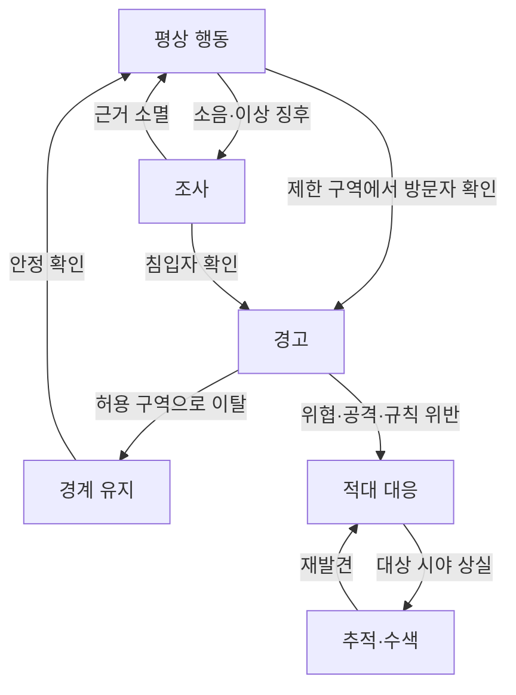

# 13. 은신, 탐지와 NPC 행동

> 기준: PC **Final Cut의 클래식 생존 모드**. 조사일: **2026-11-13**. 공개 문서의 게임 행동을 토대로 분석했다. NPC의 원본 코드, 엔진, 시야·소음 계산식은 확인하지 않았다.
>
> **[확인]** 공개 자료에 기록된 행동. **[분석]** 설계 해석. **[재구성안]** 독립 구현을 위한 상태·데이터 제안. **[검증 필요]** 정확한 수치, 빌드 차이 또는 자료가 일치하지 않는 부분.

## 1. 은신 시스템의 역할

**[분석]** 은신은 전투를 시작하기 전의 보조 단계가 아니라 조달 자체를 가능하게 하는 선택지다. 플레이어는 사람이 있는 장소에서 관찰하고, 위험한 구역을 피해 움직이며, 필요한 물자를 얻고 돌아갈 수 있어야 한다. 이때 긴장은 화면 밖에서 무슨 일이 일어나는지 완전히 알 수 없지만, 행동할 근거는 일부 제공되는 상태에서 생긴다.

NPC를 만났다는 사실과 즉시 전투가 발생한다는 사실을 분리하면 장소가 사회적 공간이 된다. 거래 가능한 사람, 자기 집을 지키는 사람, 먼저 공격하는 사람, 다른 사람을 부르는 사람이 각각 다른 판단을 요구한다.

## 2. 실제 플레이 행동의 기본 단위

| 행동·정보 | 공개 자료로 확인되는 작동 | 플레이어가 읽어야 할 의미 |
| --- | --- | --- |
| 문 엿보기 | 창고 사례에서는 문 너머 인물과 대화를 확인할 수 있다. | 문을 열기 전에 접근 위험을 판단하는 기회. **[확인: 커뮤니티]** [N18](https://this-war-of-mine.fandom.com/wiki/Warehouse) |
| 소음 표시 | 행동 소음은 시각적 파문으로 표현되며 NPC의 조사 행동과 연결된다. | 화면에 보이는 효과와 NPC 반응을 함께 읽는다. **[확인: 커뮤니티]** [N11](https://this-war-of-mine.fandom.com/wiki/Combat) |
| 조용한 이동 | Arica는 이동·수색에서 소음을 줄이는 특성을 가진다. | 같은 경로도 인물 선택에 따라 위험이 다를 수 있다. **[확인: 커뮤니티]** [N12](https://this-war-of-mine.fandom.com/wiki/Arica) |
| 은신 위치 | 지정된 어두운 은신 지점을 이용할 수 있으며 기습 행동과 연결된다. | 일반 이동 공간과 구별되는 대기·관찰 지점. **[확인: 커뮤니티]** [N18](https://this-war-of-mine.fandom.com/wiki/Warehouse) |
| 무기 꺼내기 | 우호적 NPC 앞에서 무기를 꺼내면 경고·공격을 받을 수 있다. | 상대의 반응을 고려할 행동. **[확인: 커뮤니티]** [N04](https://this-war-of-mine.fandom.com/wiki/Scavenge) |
| 침입 경고 | 가족이 있는 아파트 사례에서는 경고를 받고 떠날 기회가 있으며, 다른 가족이 경비 역할 인물을 부르기도 한다. | 현재 공간이 누구의 영역인지 파악해야 한다. **[확인: 커뮤니티]** [N20](https://this-war-of-mine.fandom.com/wiki/Small_Apartment_Building) |

이 표는 모든 NPC가 동일한 경고 시간을 주거나 같은 범위의 소리를 듣는다는 뜻이 아니다. 장소의 주민 구성과 사건 조건을 함께 읽어야 한다.

## 3. 관찰 → 이동 → 획득 → 이탈의 실제 선택

### 3.1 문 앞에서 관찰할 것인가, 바로 들어갈 것인가

**[확인: 커뮤니티]** Warehouse의 설명에는 문을 통해 안쪽을 보고 주민의 대화와 이동을 기다리는 접근이 기록되어 있다. [N18](https://this-war-of-mine.fandom.com/wiki/Warehouse)

**[분석]** 관찰은 현장 시간을 소비하는 대신 다음 행동의 불확실성을 낮춘다. 대화와 이동이 끝날 때까지 기다리면 지금 움직이지 않는 인물이 어떤 경로로 흩어지는지 알 수 있다. 이때 대사는 분위기 전달과 상황 판단의 단서를 동시에 맡는다.

관찰 결과는 두 가지 판단으로 이어진다. 하나는 지금 문을 열어도 되는지이고, 다른 하나는 그 건물을 끝까지 탐색할 필요가 있는지다. 외부에서 얻은 물자만으로 오늘 목적을 달성했다면 위험한 내부 진입을 생략할 이유가 있다.

### 3.2 빠르게 이동할 것인가, 조용히 이동할 것인가

**[확인: 커뮤니티]** 소음을 내서 NPC를 유도하는 행동이 공략에 기록되어 있고, Arica의 낮은 소음은 평범한 이동 소음 유도를 어렵게 만드는 특성으로도 설명된다. [N12](https://this-war-of-mine.fandom.com/wiki/Arica)

**[분석]** 속도와 노출을 교환하게 하면 이동 자체가 선택이 된다. 조용한 캐릭터의 특성은 단순한 위험 감소에 그치지 않고, 다른 캐릭터가 쓰던 유도 방식까지 바꿀 수 있다. 능력이 행동의 맥락을 변화시키는 사례다.

도구 선택도 같은 문제를 만든다. 지렛대와 락픽은 둘 다 잠금을 해결하지만, 상대적 소음과 소모 방식이 달라 장소에 있는 사람을 고려해야 한다. [N07](https://this-war-of-mine.fandom.com/wiki/Crowbar), [N08](https://this-war-of-mine.fandom.com/wiki/Lock_Pick)

### 3.3 은신 지점에 들어갈 것인가, 다른 경로로 빠질 것인가

**[분석]** 은신 지점은 시간이 지나는 동안 주변을 읽는 자리이지만, 거기 들어갈 수 있다는 이유만으로 모든 상황이 해결되지는 않는다. 플레이어가 이미 보였는지, 가까운 NPC가 어디로 이동하는지, 출구가 어느 쪽인지 판단해야 한다. 특정 은신 지점을 반복 이용하는 전술을 모든 장소에 일반화하면 사례별 행동 차이를 놓치기 쉽다.

**[검증 필요]** ‘NPC가 은신하는 장면을 봤을 때 반드시 잡아낸다’, ‘문 하나를 닫으면 즉시 추적이 끊긴다’ 같은 절대 규칙은 이 조사에서 확정하지 않았다. 발각 해제·추적 지속·재탐지 조건을 실제 PC 빌드에서 확인해야 한다.

### 3.4 물건에 접근할 것인가, 가져갈 것인가

**[분석]** 물리적 접근, 소유 구역 침입, 물건 취득은 별도 사건으로 읽어야 한다. 가방이 비어 있어도 들어간 방 자체가 문제일 수 있고, 사람이 없는 구역이라도 물건의 소유권은 남아 있을 수 있다. 이 구분이 있으면 플레이어는 ‘누가 봤는가’와 ‘무엇을 했는가’를 따로 고민하게 된다.

[05. 사기와 윤리](05_Morale_Relationships_and_Ethics.md)는 행동의 심리적 결과를 다룬다. 이 문서는 그 행동이 현장에서 경고·경보·공격을 발생시키는 측면에 집중한다.

## 4. 행동마다 달라지는 탐지 비용

| 선택 | 먼저 확인할 정보 | 예상되는 교환 관계 | 기획상 의미 |
| --- | --- | --- | --- |
| 문 엿보기 | 문 뒤의 인물·대화 | 시간 소비와 안전한 정보 획득 | 이동 전 판단 기회 |
| 조용한 이동 | 가까운 사람과 출구 | 이동 속도와 노출 | 같은 경로의 접근 방식 차별화 |
| 빠른 이동 | 시선·소음에 반응할 인물 | 빠른 진입·탈출과 위험 증가 | 시간 부족이 은신을 어렵게 함 |
| 락픽 사용 | 잠금과 소모품 재고 | 조용한 접근과 일회성 비용 | 안전을 재료로 구입 |
| 지렛대 사용 | 주변 주민과 사용 기회 | 반복 용도와 상대적 소음 | 도구의 다목적성이 맥락을 가짐 |
| 은신 지점 대기 | 주민의 이동·남은 시간 | 기회 확보와 시간 손실 | 기다림을 의사결정으로 만듦 |
| 무기 노출 | 상대가 거래자·민간인인지 | 즉시 대응 준비와 관계 악화 위험 | 입력 모드에 사회적 의미 부여 |

이 표의 행동 기반은 앞의 출처에서 확인했으며, 비용의 의미는 **[분석]**이다. 원작의 소음값·탐지 반경·경고 지속시간을 수치화한 표가 아니다.

## 5. 서로 다른 NPC 상황

### A. 차고: 거래 가능성과 침입 위험이 한 장소에 공존

**[확인: 커뮤니티]** Garage의 Matey는 처음에는 거래에 응하지만 사적 영역 침입에 반응한다. 아버지를 위한 의료품의 필요가 거래 조건과 연결된다. [N19](https://this-war-of-mine.fandom.com/wiki/Garage)

**[분석]** 이 장소는 ‘안전한 상인 맵’이라는 단순 분류만으로 설명하기 어렵다. 입구에서 거래하는 것과 집 안의 물품에 접근하는 것은 다른 행동이다. 거래 상대를 위협하면 이후의 안정적 조달 창구도 훼손할 수 있다는 점에서, 현장의 선택이 장기 경제에 영향을 준다.

플레이어가 비교하는 것은 당장의 물품량과 가격뿐 아니라 관계를 유지할 미래 가치다. 이 구조를 재현하려면 상점 인터페이스와 장소 주민의 반응을 별개 시스템으로 완전히 단절시키지 않아야 한다.

### B. 가족이 있는 아파트: 경고와 주변인의 알림

**[확인: 커뮤니티]** Small Apartment Building의 가족 변형에서 Aleskey는 침입자에게 떠나라고 경고하고, 부모가 침입자를 발견하면 그를 부른다. 수집 가능한 물품과 사유 물품도 구분되어 있다. [N20](https://this-war-of-mine.fandom.com/wiki/Small_Apartment_Building)

**[분석]** 비무장 인물도 상황을 바꾸는 행위자다. 직접 공격하지 않더라도 경비 인물에게 정보를 전달할 수 있으므로 무기 보유만으로 위험도를 평가하면 안 된다. 또 수집 표시가 있는 물건을 취하는 것이 허용되더라도, 그 물건에 이르는 경로의 침입 문제는 남을 수 있다.

### C. 창고: 적대적 주민의 동선과 소음 조사

**[확인: 커뮤니티]** Warehouse에는 무장한 적대 인물과 은신 지점이 있고, 기습으로 발생한 소음에 다른 주민이 접근하는 사례가 설명되어 있다. [N18](https://this-war-of-mine.fandom.com/wiki/Warehouse)

**[분석]** 한 명을 처리한 결과가 다음 위협을 부를 수 있다. 그래서 행동 하나의 성공 여부보다 후속 상황을 고려해야 한다. 수색, 대기, 유도, 기습, 이탈이 연속 선택이 되는 구조다. ‘은신 성공’은 고정된 안전 상태라기보다 현재 정보를 활용해 만든 일시적 기회로 읽는 편이 정확하다.

### D. 무장 인물이 있다고 해서 모두 같은 반응은 아니다

**[확인: 커뮤니티]** 공항 사례에서는 침입 경고를 무시하면 공격하는 군인이 소개된다. 슈퍼마켓의 수색자 변형은 무장한 민간인들이 물품을 모으는 상황이다. [N21](https://this-war-of-mine.fandom.com/wiki/Airport), [N14](https://this-war-of-mine.fandom.com/wiki/Supermarket)

**[분석]** 옷차림이나 무기만으로 `항상 먼저 공격하는 적`을 결정하지 않으면 사람의 목적을 읽는 일이 중요해진다. 군인·민간인 같은 분류와 현재의 적대 상태, 윤리적 판단은 서로 다른 정보다.

## 6. 인식과 관계를 분리하는 재구성 모델

**[재구성안]** 같은 행동 결과를 구현하려면 `인식 상태`와 `관계·허용 행동`을 구분하는 방법을 고려할 수 있다.

| 축 | 예시 상태 | 답하는 질문 |
| --- | --- | --- |
| 인식 | 평상, 의심, 조사, 대상 확인, 추적 | NPC는 무엇을 알고 있는가? |
| 관계 | 거래 가능, 중립, 경계, 적대 | 대상을 어떻게 취급하는가? |
| 공간 권한 | 공용, 주거, 제한, 사건 전용 | 어디까지 접근을 허용하는가? |
| 행동 위반 | 침입, 절도 목격, 무기 위협, 공격 | 어떤 행동 때문에 반응하는가? |
| 사건 상태 | 대화 중, 도움 요청, 이동, 대기 | 현재 장면이 어떤 행동을 요구하는가? |

이렇게 나누면 ‘소리를 들었으므로 즉시 전투’ 같은 단순 반응을 피할 수 있다. 거래 상대가 소리를 들은 상황과 적대 경비가 같은 소리를 들은 상황을 다른 결과로 연결할 수 있기 때문이다.

### 관찰을 설명하기 위한 상태 전이 예시

도식은 **원작의 FSM 또는 Behavior Tree를 추출한 것이 아니다**. 경고를 거치지 않는 적대 주민이나 사건 전용 행동은 별도 정책으로 둘 수 있다. 경고 후 언제 평상으로 돌아가는지는 실제 관찰이 필요한 부분이다.

## 7. 감각 정보의 데이터 계약

**[재구성안]** 인식 시스템을 만들 때 최소한 다음 정보를 구분하면 결과를 설명하고 시험하기 쉽다.

| 데이터 | 용도 | 주의점 |
| --- | --- | --- |
| `stimulus_type` | 소음, 시각적 발견, 동료의 알림 등 | 하나의 ‘발각’ 이벤트로 합치지 않음 |
| `source_id` | 행동을 일으킨 대상 | 사건 연출과 실제 인물 구분 |
| `origin` | 마지막으로 관찰한 위치 | 항상 현재 위치를 아는 것처럼 처리하지 않음 |
| `confidence` | 관찰의 확실성 | 플레이어에게 꼭 숫자로 공개할 필요는 없음 |
| `owner_group_id` | 구역·물건의 소유 관계 | 도둑질과 단순 수집을 구별 |
| `response_policy_id` | 상황별 대응 규칙 | 모든 NPC의 경고 시간을 동일하게 강제하지 않음 |
| `scene_state` | 진행 중 대화·사건 상태 | 연출과 일반 반응이 충돌하지 않게 함 |

### 소리 재생과 탐지 자극

**[분석]** 게임에서 들리는 효과음의 크기와 NPC가 반응하는 자극을 동일하게 취급하면 표현상의 소리를 바꿀 때 게임 난이도까지 바뀔 수 있다. 따라서 독립 구현에서는 다음 두 출력을 분리하는 편이 검증하기 쉽다.

- 청각적 피드백: 플레이어에게 행동의 질감과 긴장 전달.
- 탐지 자극: NPC가 어떤 정보를 얻는지 결정.

이것은 구현 제안이다. 원작이 두 채널을 실제로 어떻게 구성했는지, 소리가 문·층·거리에 따라 어떻게 감쇠하는지는 확인하지 않았다.

## 8. 플레이어에게 돌려주는 정보

**[분석]** 은신의 재미는 숨겨진 내부 수치가 많아서 생기는 것이 아니다. 위험을 예상하고 자신의 행동과 결과를 연결할 수 있어야 한다. 필요한 피드백은 다음과 같다.

| 순간 | 관찰할 피드백 | 기대되는 판단 |
| --- | --- | --- |
| 행동 직후 | 소음 표시와 주민의 움직임 | 지금 자극이 전달되었는가? |
| 경계 진입 | 말풍선·경고·접근 | 계속 있어도 되는가? |
| 문 앞 | 엿보기로 드러난 사람과 장면 | 문을 열 시점인가? |
| 적대 전환 | 무기 준비·공격·경보 | 수색을 계속할지 철수할지 |
| 은신 대기 | 주변 이동과 남은 시간 | 기회를 기다릴 가치가 있는가? |

**[재구성안]** 디버그 화면에서는 인식 원인을 기록하되, 플레이어 화면은 말과 행동을 중심으로 표현할 수 있다. 그러면 설계자는 오류를 추적할 수 있고 플레이어는 수치 대신 상황을 읽게 된다.

## 9. 주요 밸런스 위험

| 위험 | 나타나는 현상 | 검토 방향 |
| --- | --- | --- |
| 유도 전술의 단일 정답화 | 어떤 주민도 같은 지점으로 유도해 처리 | 동선·구역·사건 차이가 실제 선택을 만드는지 확인 |
| 알 수 없는 즉시 발각 | 이유를 알 수 없이 적대화 | 소유권과 경고, 행동 소음의 단서 점검 |
| 경고의 무의미함 | 떠날 시간 없이 공격 | 경고 표시와 대응 가능 시간의 일관성 검토 |
| 너무 관대한 은신 | 발각 직후 아무 곳에나 숨으면 완전 초기화 | 추적과 인식 기억 정책 확인 |
| 관찰의 과도한 비용 | 기다리다 수색 시간이 대부분 소진 | 순찰 대기와 우회 경로의 비용 비교 |
| 능력 한 가지의 절대 우위 | 조용한 인물만 모든 장소에 유리 | 운반·거래·건강·시간과의 교환 관계 확인 |
| 전투 전환 오조작 | 수집하려다 무기를 꺼내 관계 악화 | 현재 모드와 클릭 결과의 시각적 구분 |

모두 **[분석]**을 위한 위험 목록이며 원작에 이런 결함이 확정적으로 존재한다는 뜻은 아니다.

## 10. 검증 사례

| ID | 장면 | 확인할 내용 |
| --- | --- | --- |
| STL-01 | 문을 열지 않고 엿보기 | 어떤 범위가 보이고 NPC가 어떤 반응을 하는지 |
| STL-02 | 같은 경로를 보행·달리기로 이동 | 인물·층·문 상태별 소음과 조사 행동 차이 |
| STL-03 | 같은 잠금을 지렛대·락픽으로 해제 | 시간·자원·소음 차이가 서로 일치하는지 |
| STL-04 | 거래자 앞에서 무기 노출 후 해제 | 경고와 적대화의 조건, 관계 회복 가능 여부 |
| STL-05 | 가족 NPC에게 들키기 | 직접 공격과 다른 주민에게 알리는 반응 구분 |
| STL-06 | 주민이 보는 앞과 보지 않을 때 은신 | 추적·대기·공격 차이 |
| STL-07 | 동일 은신 위치를 연속 사용 | 반복 행동과 사건·순찰의 상호작용 |
| STL-08 | 사유 구역의 일반 수집 대상 | 침입 판정과 절도 판정이 분리되는지 |
| STL-09 | 기습 뒤 다른 주민이 근처에 있음 | 후속 자극·경보·접근 원인이 일관되는지 |
| STL-10 | 같은 장소의 다른 변형 | 관계·소유권·경고 정책이 변형에 맞게 적용되는지 |

이 표는 **[재구성안]**의 검증 계획이다. 실제 검증 결과를 추가할 때에는 플랫폼·빌드·장소 변형·인물·도구·인물 상태를 함께 기록해야 한다.

## 11. 연결 문서

- [05. 사기·관계·윤리](05_Morale_Relationships_and_Ethics.md): 현장 행동의 장기적인 심리 결과.
- [12. 지도와 수색](12_World_Map_and_Scavenging.md): 정보, 동선, 도구와 조달 목적.
- [14. 전투·부상·탈출](14_Combat_Injury_and_Escape.md): 은신 실패 또는 의도적 개입 이후.
- [15. 물물교환 경제](15_Trade_and_Barter_Economy.md): 거래자와 관계를 보존하는 가치.
- [18. UI·UX·사운드·저장](18_UI_UX_Audio_and_Save.md): 파문·경고·행동 모드의 정보 표현.
- [20. 데이터·아키텍처 재구성](20_Reconstructed_Data_and_Architecture.md): 상태와 사건의 구현 책임.

## 12. 출처와 불확실성

| ID | 출처 | 이 문서에서 채택한 범위 |
| --- | --- | --- |
| N04 | [Scavenge](https://this-war-of-mine.fandom.com/wiki/Scavenge) | 무기 노출 |
| N07 | [Crowbar](https://this-war-of-mine.fandom.com/wiki/Crowbar) | 잠금 해제의 상대적 소음 |
| N08 | [Lock Pick](https://this-war-of-mine.fandom.com/wiki/Lock_Pick) | 조용한 소모형 잠금 해제 |
| N11 | [Combat](https://this-war-of-mine.fandom.com/wiki/Combat) | 소음 파문과 NPC 조사 |
| N12 | [Arica](https://this-war-of-mine.fandom.com/wiki/Arica) | 낮은 소음과 유도 전술의 차이 |
| N14 | [Supermarket](https://this-war-of-mine.fandom.com/wiki/Supermarket) | 무장한 수색자 변형 |
| N18 | [Warehouse](https://this-war-of-mine.fandom.com/wiki/Warehouse) | 엿보기·동선·은신·후속 소음 반응 |
| N19 | [Garage](https://this-war-of-mine.fandom.com/wiki/Garage) | 거래와 사적 영역 침입 |
| N20 | [Small Apartment Building](https://this-war-of-mine.fandom.com/wiki/Small_Apartment_Building) | 경고·가족의 알림·소유권 구분 |
| N21 | [Airport](https://this-war-of-mine.fandom.com/wiki/Airport) | 침입에 대한 경고와 공격 사례 |

출처는 커뮤니티 문서의 검색 본문이다. 모든 행동을 직접 플레이로 확인한 것은 아니다. 특히 NPC의 시야각, 소음 반경, 경고 유예 시간, 정확한 추적 기억, 은신 해제 규칙은 **[검증 필요]**다. 문서의 상태 머신과 데이터 필드는 관찰을 일관되게 설명하기 위한 독립 설계이며 원작 엔진의 내부 명칭이나 구조를 뜻하지 않는다.
