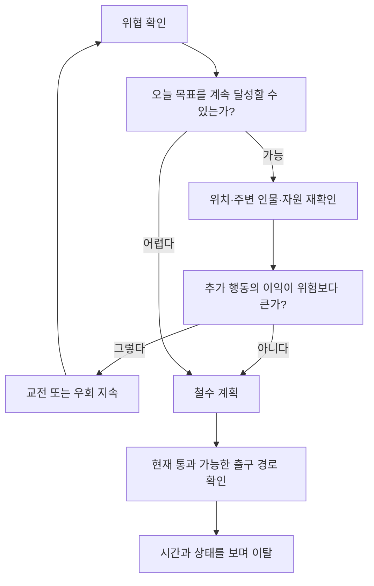

# 14. 전투, 부상과 탈출

> 기준: PC **Final Cut의 클래식 생존 모드**. 조사일: **2026-11-13**. 공개 자료 기반 역기획이다. 피해량·명중률·공격 주기 등 원작 내부 수치는 실행이나 코드로 검증하지 않았다.
>
> **[확인]** 공개 자료의 규칙이며 출처 수준을 함께 표시한다. **[분석]** 설계 해석. **[재구성안]** 독립 구현을 위한 데이터·계산·검증 제안. **[검증 필요]** 패치나 실제 빌드 확인이 필요한 조건.

## 1. 전투가 해결하는 문제와 만드는 문제

**[분석]** 전투의 가치는 적을 제거한 수보다 ‘그 행동으로 생존 목표에 얼마나 가까워졌는가’로 평가해야 한다. 수색 도중 위협을 없애거나 사람을 돕기 위해 싸울 수 있지만, 돌아왔을 때 치료가 필요해지면 그 비용이 낮의 작업과 다음 밤의 역할 배분으로 전파된다.

핵심 순환은 다음과 같다.

`현장 위험 → 전투 또는 회피 → 부상·소모·행동 기록 → 낮의 치료와 역할 재배치 → 다음 출행의 제약`

이 연결 때문에 장비가 좋아져도 모든 전투를 실행하는 것이 자동으로 유리해지지는 않는다. 오늘의 성공이 이후 며칠의 노동·치료 비용을 만들 수 있기 때문이다.

## 2. 확인되는 전투 조작과 범위

| 항목 | 실제 규칙의 요약 | 근거 |
| --- | --- | --- |
| 직접 전투 범위 | 현장 수색에서 한 명을 직접 조작해 싸운다. | **[확인: 커뮤니티]** [N11](https://this-war-of-mine.fandom.com/wiki/Combat) |
| 조작 모드 | 전투 모드에서는 수색·도구 사용이 제한되며, 피격 시 자동 전환될 수 있다. | **[확인: 커뮤니티]** [N04](https://this-war-of-mine.fandom.com/wiki/Scavenge) |
| 공격 입력 | 무기를 선택하고 대상에 표시되는 공격 인터랙션을 사용한다. | **[확인: 커뮤니티]** [N11](https://this-war-of-mine.fandom.com/wiki/Combat) |
| 공격 방식 | 정면 근접, 뒤에서 하는 기습, 은신 위치의 기습, 총기 사용이 구별된다. | **[확인: 커뮤니티]** [N11](https://this-war-of-mine.fandom.com/wiki/Combat), [N13](https://this-war-of-mine.fandom.com/wiki/Back-stab) |
| 엄폐 | 총격 대응에서 엄폐를 이용할 수 있다. | **[확인: 커뮤니티]** [N11](https://this-war-of-mine.fandom.com/wiki/Combat) |
| 방어구 | 헬멧과 방탄복은 피해를 줄이는 장비이며 함께 사용할 수 있다. | **[확인: 커뮤니티]** [N23](https://this-war-of-mine.fandom.com/wiki/Military_Vest), [N24](https://this-war-of-mine.fandom.com/wiki/Helmet) |
| 탄약 | 총기는 탄약을 소비하며 공통 Ammunition 품목을 사용한다. | **[확인: 커뮤니티]** [N25](https://this-war-of-mine.fandom.com/wiki/All_Weapons) |

은신처 습격의 자동 정산은 [11. 야간 역할과 습격](11_Night_Roles_and_Raids.md)에서 별도로 다룬다. 현장 전투의 공격 아이콘과 은신처 방어력의 계산을 같은 시스템으로 간주하지 않는다.

## 3. 플레이어의 전투 전·중·후 행동

### 전투 전: 목표와 후퇴 경로 확인

**[분석]** 첫 공격 전에 판단할 것은 적의 체력만이 아니다. 얻으려는 물자나 구하려는 사람이 어디에 있는지, 다른 인물이 소리를 듣고 접근할 수 있는지, 공격 후 출구까지 갈 수 있는지를 살펴야 한다.

전투 장비와 탄약은 가방 공간을 사용하면서 은신처에 남길 장비를 줄인다. 따라서 위험한 장소를 갈 준비는 외부와 내부의 안전을 함께 조정하는 일이다. 무기를 가져왔다는 이유로 전투를 실행할 필요는 없으며, 불리한 상황에서는 준비된 무기가 철수를 돕는 예비 수단이 될 수도 있다.

### 전투 중: 위치와 행동 기회 판단

**[분석]** 정면 교전, 기습, 엄폐 사격은 동일한 공격 버튼의 피해량 차이만으로 설명하기 어렵다. 상대가 행동할 기회를 갖는지, 접근 중 노출되는지, 공격 후 다음 행동을 할 수 있는지가 다르기 때문이다.

기습이 성공해도 다른 인물의 반응을 확인해야 한다. 원거리 공격으로 한 목표를 상대해도 가까운 위협이 생길 수 있다. 이 때문에 클릭 빈도보다 현재 위치·주변 상황·철수 가능성을 판단하는 능력이 중요하다고 해석할 수 있다.

### 전투 후: 안전 확인과 조달 재개

**[분석]** 전투가 끝났다고 수색 목적이 자동으로 달성되지는 않는다. 부상과 남은 시간을 다시 확인하고, 물자를 취할 수 있는 조작 상태로 돌아가며, 귀환할 공간을 확보해야 한다. 획득한 장비를 모두 가져가느라 정작 필요한 의약품을 포기할 수도 있으므로 가방의 우선순위도 재검토한다.

## 4. 근접전과 기습의 구분

| 방식 | 성립 맥락 | 설계적으로 중요한 차이 | 주의할 일반화 |
| --- | --- | --- | --- |
| 정면 근접전 | 서로를 인지한 상태에서 가까이 공격 | 상대의 반격에 노출되는 교환 | 도구가 있다는 이유만으로 안전한 교전이라고 보지 않음 |
| 뒤에서 기습 | 상대가 알아차리지 못한 채 후방 접근 | 접근 과정 자체가 위험 | 모든 인물·무기 조합이 한 번에 처치한다고 보지 않음 |
| 은신 지점 기습 | 지정된 은신 위치에서 가까이 온 상대 공격 | 대기 위치와 타이밍이 중요 | 일반 엄폐와 은신 위치를 같은 것으로 취급하지 않음 |
| 도구를 이용한 근접 | 지렛대·삽 같은 도구를 무기로 사용. [N07](https://this-war-of-mine.fandom.com/wiki/Crowbar), [N09](https://this-war-of-mine.fandom.com/wiki/Shovel) | 탐색과 전투를 한 품목으로 준비 | 탐색용 도구의 효용과 전투 성능을 분리해 평가 |

앞의 공격 방식 구분은 **[확인: 커뮤니티]** [N13](https://this-war-of-mine.fandom.com/wiki/Back-stab), [N25](https://this-war-of-mine.fandom.com/wiki/All_Weapons)에 근거하며, 교환 관계는 **[분석]**이다.

**[검증 필요]** 특정 인물이 특정 무기로 모든 적을 즉사시킨다는 표는 제공하지 않는다. 커뮤니티에는 인물·상대·상황에 따른 계산과 실험이 있지만, 최종 빌드와 모든 변형을 검증한 공식 수치로 볼 수 없다. ‘기습 가능 아이콘이 보임’과 ‘확정 처치’를 구별해야 한다.

## 5. 무기군의 기능적 차이

아래는 원작 무기 수치표가 아니라 실제 무기군의 용도와 설계적 선택을 정리한 표다.

| 무기군 | 자료에서 확인되는 성격 | 플레이어가 부담하는 비용 | 주요 판단 |
| --- | --- | --- | --- |
| 맨손·근접 도구·칼 | 근접 공격과 상황별 기습에 사용 | 가까이 접근하는 위험 | 접근 자체를 감수할 가치가 있는가? |
| 권총 | 탄약을 쓰는 원거리 무기군 | 탄약, 가방 공간, 주변 위협 | 거리 확보가 가능한가? |
| 산탄총 | 짧은 거리에서 강한 무기로 설명된다. [N27](https://this-war-of-mine.fandom.com/wiki/Shotgun) | 유효한 거리로 접근하는 부담 | 현재 공간이 근거리 대응에 적합한가? |
| 돌격소총 | 연사와 탄약 소비가 특징이다. [N28](https://this-war-of-mine.fandom.com/wiki/Assault_Rifle) | 빠른 탄약 지출 | 이 교전 후 남길 탄약이 충분한가? |
| 조준경 소총 | 긴 거리의 대응과 상대적으로 느린 발사가 특징이다. [N29](https://this-war-of-mine.fandom.com/wiki/Scoped_Rifle) | 희소 장비와 발사 사이의 대응 | 긴 사선을 활용할 수 있는가? |

무기군 존재와 공통 탄약은 **[확인: 커뮤니티]** [N25](https://this-war-of-mine.fandom.com/wiki/All_Weapons)에 근거한다. 비용과 판단은 **[분석]**이다. ‘최고 무기’ 하나를 고르는 대신 거리, 상대, 목적, 장비의 내부 방어 가치를 함께 비교한다.

### 방어구의 의미

**[분석]** 피해를 줄이는 장비는 위험을 제거하기보다 실수와 예측 실패를 감당할 여유를 늘린다. 그러나 장비가 가방을 차지하면 원래 출행 목적의 물품을 덜 가져올 수 있다. 전투를 하지 않는 경로에서의 방어구 가치는 위협을 피하기 어려운 경로와 다르게 평가해야 한다.

**[검증 필요]** 방어구의 정확한 감소율, 공격 종류별 적용 차이, 은신 공격과의 관계는 원작 코드 확인 없이 고정하지 않는다. 현장 방어구와 야간 자동 방어의 수치가 동일하다고 가정해서도 안 된다.

## 6. 부상은 여러 날에 걸친 비용이다

**[확인: 커뮤니티]** 부상은 붕대·휴식으로 관리하며, 상세 단계와 회복 조건은 [04. 건강과 회복](04_Needs_Health_and_Recovery.md)에 정리한다. [N26](https://this-war-of-mine.fandom.com/wiki/Injuries)

**[분석]** 부상의 실질 비용을 계산하려면 붕대 가격만 볼 수 없다.

| 비용 층 | 현장 또는 은신처에 미치는 영향 | 연결 시스템 |
| --- | --- | --- |
| 즉시 생존 | 추가 위험을 감당할 여유 감소 | 전투·탈출 |
| 귀환 | 돌아오는 경로 선택의 제약 | 시간·이동 |
| 치료 물자 | 저장한 의료품 소모 또는 새 조달 필요 | 자원·거래 |
| 침대 점유 | 다른 인원의 회복 계획 변경 | 은신처 시설 |
| 노동 손실 | 낮의 제작·조리·돌봄 배분 변경 | 주간 작업 |
| 야간 재배치 | 수색자 또는 경비의 대체 필요 | 야간 역할 |
| 정서적 결과 | 위험한 선택에 대한 반응과 부담 | 사기·관계 |

### 재구성용 비용식

**[재구성안]** `교전 비용 = 소모 장비·탄약 + 예상 치료 물자 + 잃은 활동 시간 + 인원 상실 위험 + 사건·관계 비용`

이 식은 기획 비교용이며 원작의 피해 공식이 아니다. 하루에 가치 있는 일을 많이 하는 인물이 다치면 같은 정도의 상처라도 그룹이 감당해야 할 기회비용이 커질 수 있음을 설명한다.

**[검증 필요]** ‘부상하면 명중률이 반드시 감소한다’처럼 현실 직관을 게임 규칙으로 대입하지 않는다. 이동, 행동 자격, 피해 감소, 공격 성능은 각각 확인해야 한다. 회복에 필요한 정확한 날짜도 상태 조합과 시나리오를 기록한 실측이 필요하다.

## 7. NPC를 공격하는 결정과 도덕적 판정

**[확인: 커뮤니티]** 가족이 있는 아파트의 무장 인물을 처치하면 사기에 불리한 결과가 생길 수 있다. 따라서 공격 능력이 있는 사람이라는 이유만으로 ‘처치해도 비용 없는 적’으로 취급하면 안 된다. [N20](https://this-war-of-mine.fandom.com/wiki/Small_Apartment_Building)

**[분석]** 전투 AI의 적대 상태와 행위의 윤리적 의미를 분리해야 장소의 맥락이 유지된다. 주민이 자기 영역을 지키며 공격하는 상황과 다른 사람을 해치는 인물에 개입하는 상황은 플레이어에게 다르게 읽힌다.

**[재구성안]** 시스템 간에는 단순 `enemy_killed`보다 다음 맥락을 전달하는 편이 적합하다.

| 전달할 맥락 | 필요한 이유 |
| --- | --- |
| 행위자와 대상 | 인물별 기억과 반응을 연결 |
| 장소와 사건 식별자 | 같은 공격도 사건 맥락에 따라 다르게 해석 |
| 선행 행동 | 침입·위협·구조·자기방어 등의 흐름 보존 |
| 목격과 전달 범위 | 현장에서 본 정보와 그룹이 나중에 아는 정보 구분 |
| 결과 | 피해, 사망, 탈출, 도움 성공 등을 별도 표현 |

원작이 이 필드를 모두 저장한다는 근거는 없다. 여기서는 서로 다른 시스템이 하나의 전투 결과를 다르게 해석할 수 있도록 하는 데이터 계약으로 제안한다.

## 8. 탈출을 독립 목표로 다루기

**[분석]** 공격을 시작한 뒤에도 목적이 바뀔 수 있다. 처음에는 물자를 얻으려 했지만 부상을 입었다면 사람을 살려 돌아오는 것이 최우선 목표가 될 수 있다. 이 전환을 허용해야 전투가 한 번 시작하면 끝까지 처치해야 하는 별도 미니게임으로 분리되지 않는다.

### 탈출 판단 흐름



도식은 **[분석]**을 정리한 의사결정 모델이며 원작에 이런 자동 의사결정 UI가 있다는 뜻은 아니다.

### 특수 위협: 저격 구간

**[확인: 커뮤니티]** Sniper Junction에는 배경에서 오는 저격을 엄폐물 사이로 이동하며 피하는 구간이 있다. [N17](https://this-war-of-mine.fandom.com/wiki/Sniper_Junction)

**[분석]** 이 사례는 모든 위협을 처치 가능한 NPC 하나로 환원하지 않아야 한다는 점을 보여준다. 이동 타이밍과 엄폐 배치로 다루는 위험은 무기 성능이 좋아져도 여전히 다른 판단을 요구한다. 위험 구간을 통과해 접근 경로를 넓히는 것과 적을 제거하는 것을 서로 다른 성과로 정의할 수 있다.

## 9. 대표 의사결정 사례

### 사례 A: 준비한 도구로 안전한 곳의 물자만 확보

**[분석]** 출행 목적이 조리·난방에 필요한 물자를 가져오는 것이라면 위험한 내부 구역에 들어가지 않고 귀환하는 선택을 평가해야 한다. 전투를 하지 않았다는 이유로 수색 성과가 낮은 것은 아니다. 출행 목표 달성과 동료의 활동 가능 상태 보존이 동시에 이루어질 수 있다.

### 사례 B: 개입할 사건을 발견

**[분석]** 누군가를 돕기 위해 접근할 때는 기습 가능한 위치, 다른 위협, 구조 대상의 이동과 자신의 출구를 함께 고려한다. 사건의 성공 조건이 반드시 모든 상대의 사망일 필요는 없다. 실제 사건별 성공 조건은 해당 시나리오 자료로 확인해야 한다.

슈퍼마켓의 군인 사건처럼 개입 여부가 다른 결과를 만드는 장소가 존재한다. **[확인: 커뮤니티]** [N14](https://this-war-of-mine.fandom.com/wiki/Supermarket). 이 사례의 세부 서사와 사기 판정은 [17. 선택과 엔딩](17_Narrative_Choices_and_Endings.md)에서 다룬다.

### 사례 C: 전투는 이겼으나 중상을 입음

**[분석]** 추가 전리품이 보여도 치료 물자와 귀환을 우선할 이유가 있다. 다음 날 그 인물을 대체할 사람이 없다면, 당장의 물품 수익보다 인력 보존 가치가 커질 수 있다. 결과 화면에는 ‘처치 성공’보다 생존자의 상태와 부족해진 자원을 먼저 보여주는 것이 이 게임의 관리 구조와 잘 맞는다.

## 10. 전투 결과 재구성 데이터

```yaml
# 재구성안: 이름과 값은 원작 형식이 아니다.
combat_outcome:
  encounter_id: location_04_encounter_02
  actor_id: survivor_a
  target_id: resident_b
  context:
    location_variant_id: residents_present
    action_type: ranged_attack
    initiation_context: explicit_event_context
  result:
    target_state: injured
    actor_state_changed: true
    consumed_stacks: [ammunition_delta]
  downstream:
    health_event: injury_changed
    relationship_event: context_evaluation_required
    escape_plan_dirty: true
```

**[분석]** 공격의 순간에 즉시 처리할 정보와 아침에 그룹 운영으로 전달할 정보를 구분하면 같은 사건이 이중 계산되는 것을 줄일 수 있다. `escape_plan_dirty`는 후퇴 판단을 다시 해야 함을 표현하는 제안 플래그이며 원작 내부 명칭이 아니다.

## 11. 밸런스 검토와 QA

| 조정·검증 항목 | 확인할 질문 |
| --- | --- |
| 직접 교전의 비용 | 반복 전투가 의료·탄약 부담 없이 모든 경제를 해결하는가? |
| 기습의 가치 | 관찰과 위치 선정이 보상되면서 다른 선택도 남는가? |
| 무기 특성 | 거리와 공간이 장비 선택을 실제로 바꾸는가? |
| 방어구 | 생존 여유와 운반 비용 사이에 의미 있는 선택이 있는가? |
| 부상 피드백 | 현재 상태가 바뀐 것을 알아차리고 철수할 기회가 있는가? |
| 모드 전환 | 공격·수색·은신 인터랙션이 명확하게 구분되는가? |
| 인물 차이 | 전투 전문가가 조달·제작·거래까지 항상 우월해지지 않는가? |
| 윤리 반응 | 적대 상태와 사건 맥락의 구분이 결과에 반영되는가? |

**[재구성안]** 아래 사례를 재현 가능한 실측 목록으로 사용할 수 있다.

| ID | 조건 | 확인할 내용 |
| --- | --- | --- |
| CBT-01 | 같은 인물·장비로 정면과 후방 접근 | 공격 성립 조건과 결과의 차이 |
| CBT-02 | 뒤에서 기습과 은신 위치 기습 | 아이콘·조건·피해의 차이. 확정 처치를 가정하지 않음 |
| CBT-03 | 같은 사거리에서 장비만 교체 | 공격 주기·탄약 사용·피해 결과 |
| CBT-04 | 방어구 유무와 조합 변경 | 피해 감소가 어떤 공격 종류에 적용되는지 |
| CBT-05 | 공격 직후 수색 대상으로 클릭 | 현재 모드와 허용 행동이 일치하는지 |
| CBT-06 | 탄약이 부족하거나 소진 | 공격 가능 상태와 실제 소모가 일관되는지 |
| CBT-07 | 부상 전후 같은 행동 반복 | 이동·자격·공격 성능을 각각 분리 측정 |
| CBT-08 | 공격 후 후퇴, 경로에 문·계단 존재 | 입력 취소·이동·적의 후속 반응이 일관되는지 |
| CBT-09 | 무장 민간인과 사건의 가해자 상대 | 관계·사기·사건 판정의 맥락 차이 |
| CBT-10 | 수색 도중 사망 또는 늦은 귀환 | 인원·가방·장소 상태와 아침 보고 일치 |

수치 실측에는 빌드, 인물, 대상, 양측 장비, 인물 상태, 거리·위치, 공격 형태, 시도 횟수를 함께 남겨야 한다. 한 번의 결과를 확정 확률이나 공식으로 환산하지 않는다.

## 12. 연결 문서와 출처

관련 문서: [04. 건강과 회복](04_Needs_Health_and_Recovery.md), [05. 사기와 윤리](05_Morale_Relationships_and_Ethics.md), [11. 야간 습격](11_Night_Roles_and_Raids.md), [12. 수색](12_World_Map_and_Scavenging.md), [13. 은신과 NPC](13_Stealth_Perception_and_NPC_AI.md), [21. 밸런스·검증](21_Balance_Validation_and_Test_Cases.md).

| ID | 출처 | 채택한 범위 |
| --- | --- | --- |
| N04 | [Scavenge](https://this-war-of-mine.fandom.com/wiki/Scavenge) | 모드 전환 |
| N07 | [Crowbar](https://this-war-of-mine.fandom.com/wiki/Crowbar) | 도구의 근접 무기 용도 |
| N09 | [Shovel](https://this-war-of-mine.fandom.com/wiki/Shovel) | 도구의 근접 무기 용도 |
| N11 | [Combat](https://this-war-of-mine.fandom.com/wiki/Combat) | 직접 전투, 공격 입력, 엄폐 |
| N13 | [Back-stab](https://this-war-of-mine.fandom.com/wiki/Back-stab) | 후방 공격과 은신 기습의 구분 |
| N14 | [Supermarket](https://this-war-of-mine.fandom.com/wiki/Supermarket) | 개입할 사건의 존재 |
| N17 | [Sniper Junction](https://this-war-of-mine.fandom.com/wiki/Sniper_Junction) | 배경 저격과 이동 엄폐 |
| N20 | [Small Apartment Building](https://this-war-of-mine.fandom.com/wiki/Small_Apartment_Building) | 무장 주민 처치의 심리적 맥락 |
| N23 | [Military Vest](https://this-war-of-mine.fandom.com/wiki/Military_Vest) | 방탄복과 헬멧의 보호 |
| N24 | [Helmet](https://this-war-of-mine.fandom.com/wiki/Helmet) | 방어 장비의 용도 |
| N25 | [All Weapons](https://this-war-of-mine.fandom.com/wiki/All_Weapons) | 무기군과 공통 탄약 |
| N26 | [Injuries](https://this-war-of-mine.fandom.com/wiki/Injuries) | 치료 개요 |
| N27 | [Shotgun](https://this-war-of-mine.fandom.com/wiki/Shotgun) | 근거리 용도 |
| N28 | [Assault Rifle](https://this-war-of-mine.fandom.com/wiki/Assault_Rifle) | 연사와 탄약 소비 |
| N29 | [Scoped Rifle](https://this-war-of-mine.fandom.com/wiki/Scoped_Rifle) | 사거리와 발사 주기의 성격 |

출처는 커뮤니티의 검색 본문을 확인했다. 원작 수치가 공개적으로 검증되었다고 단정하지 않으며, 문서에 제시한 수식·데이터는 **재구성안**이다. 게임의 실제 밸런스 테이블을 만드는 후속 작업에서는 원본 빌드와 조건을 고정한 측정이 필요하다.
