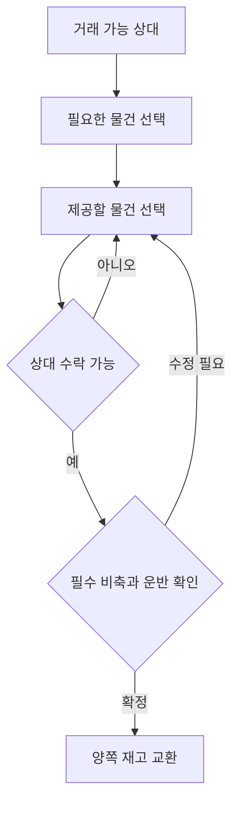

# 15. 거래·물물교환 경제 시스템 역기획

> 기준: PC 《This War of Mine: Final Cut》 클래식 생존 모드 / 조사일: 2026-11-13 / 정확한 현재 패치 번호 미확인.  
> **[확인]** 공개 자료의 규칙, **[분석]** 설계 해석, **[재구성안]** 데이터·모델 제안, **[검증 필요]** 빌드별 확인 항목. 상인의 정확한 가격표와 내부 계산식은 확인하지 않았다.

## 1. 시스템의 역할

**[분석]** 거래는 운 좋게 얻은 자원을 필요한 자원으로 바꾸는 조정 장치다. 좋은 무기나 약을 발견했더라도 집단이 당장 필요한 것은 나무나 음식일 수 있다. 교환이 있으면 모든 탐색 결과가 동일한 수요와 일치할 필요가 없으며, 비폭력적인 생존 전략도 자원 획득 경로를 갖게 된다.

그러나 거래가 언제든 가능한 완전한 시장이면 부족의 의미가 사라진다. 이 게임에서는 거래 상대의 등장, 방문 가능한 장소, 가지고 갈 물건과 돌아올 공간, 상대의 품목 선호가 함께 선택을 제약한다.

**[확인]** 거래는 물품을 서로 제안하는 물물교환 방식이다. Franko는 피난처를 방문하며, 다른 상인을 만나려면 해당 장소를 탐색해야 한다. [E11](https://this-war-of-mine.fandom.com/wiki/Trade)

## 2. 거래 경로 두 가지

| 구분 | 피난처 방문 거래 | 외부 지역 거래 |
|---|---|---|
| 대표 상대 | Franko | 정비소·군사 전초기지·중앙광장 등의 상인 |
| 핵심 제약 | 방문 여부와 보유 재고 | 야간 방문 기회, 접근 위험, 가방 |
| 준비 판단 | 집에 남길 필수 자원을 정한다 | 팔 물건과 돌아올 물건을 미리 예상한다 |
| 큰 장점 | 생활 기반을 크게 바꿀 교환 기회 | 특정 품목에 유리한 상대를 선택 가능 |
| 기회비용 | 판매한 물건의 미래 용도 | 다른 탐색 장소를 방문할 기회 |

첫 행의 상대와 방문 방식은 **[확인]**, 제약·장점·기회비용의 정리는 **[분석]**이다. 피난처에서 부피가 큰 자원을 확보하면 외부 탐색의 운반 부담을 줄일 수 있다는 점은 커뮤니티 운영 자료에서도 강조된다. [E15](https://this-war-of-mine.fandom.com/wiki/Hints_and_Tips)

**[검증 필요]** Franko가 정확히 며칠마다 반드시 방문한다고 고정하지 않는다. 방문 간격에 대한 공략의 근삿값과 캠페인 이벤트·날씨·시나리오에 따른 실제 등장 조건은 구분해야 한다.

## 3. 대표 거래 상대의 차이

다음은 **[확인 / 커뮤니티 자료]**에 기초한 대표 사례다. 해당 장소·NPC가 모든 캠페인에 동시에 등장한다는 뜻이 아니다. [E11](https://this-war-of-mine.fandom.com/wiki/Trade)

| 상대 | 주로 만나는 곳 | 확인되는 경제적 차이 | 설계 해석 |
|---|---|---|---|
| Franko | 피난처 현관 | 여러 종류의 물건을 교환 | 범용적인 자원 조정 창구 |
| Matey | Garage, 정비소 | 의료 물품에 상대적으로 유리한 교환, 도구·부품 조달 | 약품의 치료 가치와 판매 가치 경쟁 |
| Bojan | Military Outpost, 군사 전초기지 | 담배·주류를 선호, 군용 물품 등 취급 | 민간 생산품으로 희소 장비 접근 |
| Central Square 상인들 | 중앙광장 | 자재·기호품·의약·식량 등 품목별 차이 | 한 장소 내부의 분화된 교환 선택 |

**[분석]** 상대별 선호가 있으면 모든 아이템을 하나의 고정 가격으로 정렬하기 어렵다. 지금 손에 든 약품은 자가 치료, 방문 상인에게 판매, 정비소로 가져가기라는 서로 다른 미래를 갖는다. 이 차이는 지도 선택과 인물 선택까지 영향을 준다.

**[검증 필요]** 특정 상인과 거래가 가능하다는 사실은 해당 장소 전체가 안전하다는 뜻이 아니다. 거래 허용 구역·침입 금지 구역·NPC 적대 상태는 [13. 은신·인지·NPC](13_Stealth_Perception_and_NPC_AI.md)에서 따로 다룬다.

## 4. Katia의 역할

**[확인]** Katia의 `Bargaining Skills`는 거래 효율에 영향을 주며, 특성을 적용하려면 Katia가 실제 거래를 수행해야 한다. [E12](https://this-war-of-mine.fandom.com/wiki/Bargaining_Skills)

**[분석]** 이는 생산 특성과 다른 형태의 자원 효율이다. 같은 자원을 적게 소비해 만드는 대신, 이미 가진 물건을 교환할 때 집단이 확보하는 결과를 바꾼다. 따라서 그녀의 가치는 거래 기회가 얼마나 자주·안전하게 발생하는가에 영향을 받는다.

| 상황 | Katia를 배치하는 이득 | 함께 고려할 비용 |
|---|---|---|
| 피난처에 상인이 방문 | 현장에서 교환 효율 확보 | 다른 주간 작업 잠시 중단 |
| 외부 전문 상인 방문 | 목적에 맞는 교환 효율 | 그날의 수집 인물 선택 포기 |
| 위험 지역의 거래 | 고가 물품 반입 가능성 | 인물의 생존 상태와 경로 위험 |
| 상대가 필요한 물건을 보유하지 않음 | 적용할 교환 자체가 제한 | 특성만으로 재고를 만들 수 없음 |

정확한 할인율이나 모든 거래 상대에 동일하게 적용되는 단일 배수는 확정하지 않는다. 공개 자료에도 품목·상대·상황에 따른 설명이 섞여 있으므로, 제안된 품목 조합의 실제 승인 경계로 검증해야 한다.

## 5. 거래 UI의 의사결정 순서

**[확인]** 거래 화면에서는 양쪽 물품을 선택하며, 상대가 제안에 만족하는지 여부가 문구로 피드백된다. [E11](https://this-war-of-mine.fandom.com/wiki/Trade)

**[분석]** 정확한 공통 화폐 가격 대신 상대의 수락·거절 반응을 읽게 하면, 플레이어는 작은 물건을 추가하거나 빼며 제안을 조정한다. 교환 가치를 탐색하는 행동이 거래 자체의 플레이가 된다.

후반의 비축·운반 확인은 **[분석]**상 의사결정이다. 원작이 자동으로 안전 재고를 계산해 경고한다는 의미는 아니다.

## 6. 교환 가치의 구성

**[확인]** 상인별 품목 선호 및 부족 사태는 교환 조건을 바꿀 수 있다. [E11](https://this-war-of-mine.fandom.com/wiki/Trade) [E12](https://this-war-of-mine.fandom.com/wiki/Bargaining_Skills)

**[재구성안]** 원작의 숨은 공식을 확인하지 못했으므로, 재현 구현에서는 아래처럼 영향을 분리한 모델을 후보로 삼을 수 있다.

\[
OfferScore=\sum_i Quantity_i\cdot BuyValue_i(Trader,WorldState,Actor)
\]

\[
RequestScore=\sum_j Quantity_j\cdot SellValue_j(Trader,WorldState,Actor)
\]

승인 여부는 두 점수와 해당 상인의 거래 정책으로 판정한다. 같은 품목의 매입 가치와 판매 가치를 반드시 같게 둘 필요는 없다. 값은 내부 비교 단위이며 게임 안의 화폐가 새로 생겼다는 뜻이 아니다.

| 가치 요소 | 역할 | 주의할 점 |
|---|---|---|
| 품목 기준 가치 | 상대적 희소성의 출발점 | 모든 상황의 실제 가치로 고정하지 않음 |
| 상인 선호 | 특정 물품에 유리한 경로 제공 | 반복 왕복으로 무제한 이익이 생기는지 확인 |
| 세계 상황 | 부족·계절 변화 반영 | 예고·관찰 가능한 피드백 필요 |
| 거래 인물 | 고유 특성 반영 | 실제 수행자와 특성 적용자 일치 |
| 정수 수량 | 작은 차이를 물건 단위로 조정 | 반올림이 큰 이익·손해를 만들 수 있음 |

## 7. 제작과 거래의 결합

**[확인]** 밀주는 설탕·물·연료를 이용해 생산하고, 순수 알코올은 밀주를 추가 가공해 만들 수 있다. 관련 시설 설명은 교환과 의료 생산의 연결도 제시한다. [E20](https://this-war-of-mine.fandom.com/wiki/Moonshine_Still) [E21](https://this-war-of-mine.fandom.com/wiki/Alcohol_Distiller)

**[분석]** 생산품을 판매하는 전략의 비용은 재료값에 그치지 않는다.

- 시설 건설과 개선에 이미 지출한 자원.
- 다른 생활 기능에 사용할 수 있었던 물과 연료.
- 작업자의 노동과 생산 대기 기간.
- 상인을 기다리거나 외부로 이동하는 시간.
- 돌아올 물건을 위한 가방 용량.

그 결과, “만들면 비싸게 팔리는 물건”과 “현재 집단에 좋은 생산”은 달라질 수 있다. 겨울에 급수와 난방이 급한 집단은 같은 판매 공정을 유지하기 어렵다.

### 사례: 의료 물품을 팔아 건축재를 살 것인가

**[분석 사례]** 집에 약이 있고 나무가 부족한 상황을 가정한다. 당장 아픈 인물이 없다면 판매를 생각할 수 있지만, 추위가 시작되거나 위험한 장소를 방문할 예정이면 약품의 비축 가치가 올라간다. 특정 상인이 의료 물품을 우대한다고 해서 전량 판매가 자동으로 좋은 선택은 아니다.

좋은 거래는 최대 교환량보다 **남겨 두어야 할 기능을 보존하는 교환**이다. 이 판단은 게임이 직접 정답을 주기 어려운 집단 운영의 핵심 선택이다.

## 8. 데이터 모델과 확정 정책

**[재구성안]** 다음 데이터는 구현 후보이며 원작 내부 구조가 아니다.

| 데이터 | 주요 필드 | 책임 |
|---|---|---|
| `TraderDefinition` | ID, 취급 품목, 선호, 거래 제한 | 상대의 기본 특성 |
| `TraderState` | 현재 재고, 등장 상태, 관계·지역 조건 | 현재 캠페인의 가용성 |
| `TradeSession` | 거래 인물, 상대, 양쪽 원본 재고 | 한 거래의 문맥 |
| `TradeProposal` | 제공·요청 품목, 수량, 승인 상태 | 확정 전 선택 |
| `TradeContext` | 계절, 부족 사건, 특성 | 가치 계산 조건 |
| `TradeCommit` | 거래 ID, 원본 버전, 확정 결과 | 중복 실행·재고 불일치 방지 |

세션을 여는 순간 가격을 고정할지, 제안할 때마다 다시 평가할지도 명시해야 한다. 현재 빌드가 어떤 정책을 쓰는지는 확인하지 않았으므로, 재현에서는 하나의 일관된 정책을 선택하고 UI 문구와 실제 판정이 일치하도록 한다.

## 9. 밸런스의 핵심 위험

| 위험 | 발생하면 나타나는 플레이 | 확인 방향 |
|---|---|---|
| 지나치게 좋은 범용 상인 | 지역별 거래 차이가 사라짐 | 전문 상대를 찾을 이유가 남는가 |
| 무제한 차익 교환 | 재고·생존 고민이 사라짐 | 같은 품목 왕복 거래의 결과 |
| 특성의 과도한 필수화 | 특정 인물이 없는 시작이 불리함 | 특성 없이도 대안이 가능한가 |
| 정보 없는 가격 급변 | 실패가 임의적 처벌처럼 보임 | 부족·계절의 예고와 피드백 |
| 운반 제약 무시 | 현장 거래가 가방 선택을 대체 | 교환 후 실제 반입 제약 |
| 상인 재고의 과도한 부족 | 거래가 형식적 메뉴가 됨 | 중요한 필요를 가끔 해결하는가 |

**[분석]** 전문 상인과 특성이 만드는 이득은 전략의 보상이지만, 모든 위기를 지워 버리면 다른 시스템의 역할을 약화시킨다. 반대로 거래가 항상 손해라면 플레이어는 아이템을 훔치거나 약탈하는 경로에 과도하게 의존하게 된다.

## 10. 검증 사례와 연결

**[재구성안]** 최소 검증 시나리오:

1. 일반 인물과 Katia가 같은 상대·같은 품목을 제안했을 때 승인 경계를 기록한다.
2. 같은 품목을 서로 다른 상인에게 제안하여 선호 차이가 실제로 드러나는지 확인한다.
3. 부족 사건 전후를 같은 조건으로 비교한다.
4. 거래품 선택 후 원본 재고가 바뀌어도 확정 시 음수 재고가 생기지 않는다.
5. 한 번의 확정 입력이 중복 처리되어 물건이 복제되지 않는다.
6. 현장 거래 후 가방에 담을 수 없는 물량의 처리 방식이 명확하다.
7. 같은 물건을 즉시 되사고 되파는 순환에서 의도하지 않은 무제한 이익이 발생하는지 확인한다.
8. 상대가 적대 상태로 바뀌거나 사라졌을 때 열린 거래 세션을 안전하게 종료한다.

연결 문서: [03. 인물·특성](03_Characters_and_Traits.md), [07. 자원·운반](07_Resources_Inventory_and_Carrying.md), [08. 제작](08_Crafting_Recipes_and_Upgrades.md), [10. 주간 방문](10_Daytime_Labor_and_Visitors.md), [12. 지도·수집](12_World_Map_and_Scavenging.md), [16. 세계 사건](16_World_Events_Winter_and_War.md).

## 11. 근거와 남은 확인

| ID | 자료 | 확인한 범위 | 접근·신뢰 수준 |
|---|---|---|---|
| E11 | [Trade](https://this-war-of-mine.fandom.com/wiki/Trade) | 물물교환, 거래 화면, 대표 상대와 선호 | 커뮤니티 위키 검색색인 본문 확인 |
| E12 | [Bargaining Skills](https://this-war-of-mine.fandom.com/wiki/Bargaining_Skills) | Katia의 실제 거래 수행, 부족 사태의 영향 | 커뮤니티 위키 검색색인 확인 |
| E15 | [Hints and Tips](https://this-war-of-mine.fandom.com/wiki/Hints_and_Tips) | 방문 거래와 운반 부담의 관계 | 커뮤니티 운영 자료 검색색인 확인; 공략 수치 일반화 제외 |
| E20 | [Moonshine Still](https://this-war-of-mine.fandom.com/wiki/Moonshine_Still) | 밀주 생산의 입력과 교환 용도 | 커뮤니티 위키 검색색인 본문 확인 |
| E21 | [Alcohol Distiller](https://this-war-of-mine.fandom.com/wiki/Alcohol_Distiller) | 밀주의 추가 가공과 활용 | 커뮤니티 위키 검색색인 본문 확인 |

정확한 전 품목 교환비, 거래 상대별 재고 갱신, 이벤트 배수, 특성 반올림, 인벤토리 초과 처리, 현재 버전의 차익 거래 가능 여부는 확정하지 않았다. 과거 공략의 가격표는 현재 빌드의 절대 가격으로 사용하지 않는다.
