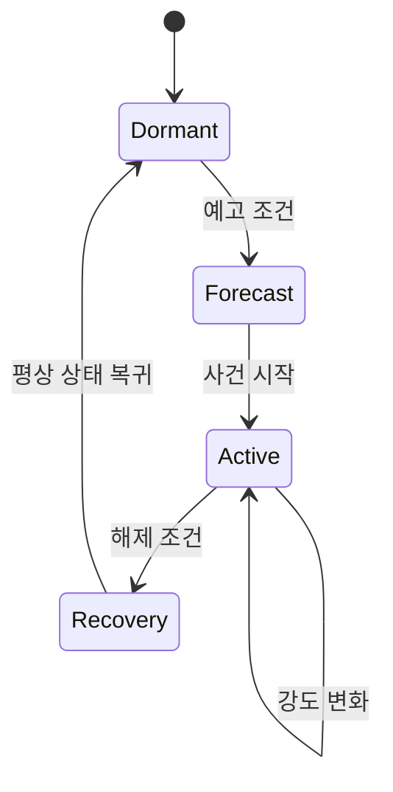

# 16. 세계 사건·겨울·전쟁 상황

> 기준: PC Final Cut 클래식 생존 모드 · 조사일: 2026-11-13  
> [확인] 공개 근거 / [분석] 설계 해석 / [재구성안] 설명용 모델 / [검증 필요] 정확한 실행 조건

## 1. 시스템 목적

**[분석]** 세계 사건은 안정된 운영법의 전제를 바꾼다. 현재 식량 생산량이 충분하더라도 추위가 오면 같은 연료를 조리와 난방에 나눠 써야 한다. 안전한 지역이 이용 불가가 되면 기존의 조달 경로를 다시 선택해야 한다.

이 시스템은 매일 독립적인 벌칙을 뽑는 장치로만 보기 어렵다. 사건을 미리 알리는 정보, 준비할 시간, 실제 영향, 회복 구간이 연결될 때 장기 계획이 성립한다.

## 2. 원작에서 확인되는 환경 변화

**[확인·커뮤니티]** 특별 사건 문서는 겨울, 추위 종료, 범죄 증가와 완화 등을 다룬다. 겨울에는 집수기 사용 제한과 눈을 통한 물 확보, 건강 부담, 일부 외부 자원·지역 접근 변화가 설명되며, 범죄 증가는 습격 위험과 관련된다. 모든 효과가 매번 같은 강도로 동시에 발생한다고 가정하지 않는다. [W03](https://this-war-of-mine.fandom.com/wiki/Special_Events)

**[확인·커뮤니티]** 라디오는 날씨, 도시 상황, 물자 부족과 가격 관련 정보, 전쟁 동향을 전달한다. 음악 채널도 존재한다. [W04](https://this-war-of-mine.fandom.com/wiki/Radio)

**[확인·개발사 문서]** 모딩 안내에는 날씨·주요 사건·가격 변경·외부 물자 소실·라디오를 조정하는 항목이 공개되어 있다. 공개된 설정 가능성과 실제 현행 캠페인의 내부 계산식을 구분한다. [P07](https://pwrcontroller.com/wp-content/uploads/2022/04/Modding-Instructions.pdf)

## 3. 사건별 기능 분해

다음 표는 확인된 사건 유형에 대한 **[분석]**이다.

| 사건 축 | 직접 바뀌는 조건 | 플레이어가 재검토할 계획 | 실패가 전파되는 경로 |
|---|---|---|---|
| 추위 | 난방 필요, 물 확보 경로 | 연료 비축·시설 투자·치료 준비 | 연료 부족 → 생활 생산 저하 → 회복 부담 |
| 범죄 증가 | 밤의 은신처 위험 | 경계 인원·방어 설비·무기 잔류 | 손실 → 치료·재조달 → 다음 밤 인력 부족 |
| 지역 접근 제한 | 선택 가능한 방문지 | 대체 수색·거래 경로 | 한 지역 의존 → 필수재 공급 중단 |
| 외부 물자 변화 | 미래 조달 기회 | 먼저 가져올 물자 | 미룬 수색의 가치 감소 |
| 교환가치 변화 | 같은 재고로 얻는 물자 | 비축·거래 시점·생산 품목 | 구매 계획 붕괴 → 긴급 수색 |
| 종전 소식 | 남은 기간에 대한 기대 | 장기 투자와 당장 소비 | 추정이 틀리면 과소·과잉 투자 |

대응은 항상 시설을 더 짓는 방향만 있는 것이 아니다. 이번 밤 수색을 줄이고 쉬기, 가방에 싣는 품목 바꾸기, 다른 상인 찾기, 식량 생산 경로 단순화하기도 대응이다.

## 4. 겨울의 핵심은 여러 비용의 겹침

**[분석]** 추위는 연료만 많이 쓰게 하는 단일 패널티보다, 기존의 생산 연결을 바꾸는 사건으로 읽을 수 있다.

| 기존 운영 | 환경 변화 후 검토 | 같은 자원에 생기는 경쟁 |
|---|---|---|
| 물을 모아 조리·생산에 사용 | 겨울에 가능한 물 확보 경로 확인 | 물 생산에 필요한 연료와 다른 용도 |
| 목재를 시설에 투자 | 즉시 연료 공급과 비교 | 미래 생산력과 오늘의 유지비 |
| 여분 의약품을 거래 | 건강 부담을 대비해 보유 | 교환가치와 보험 가치 |
| 밤마다 외부 조달 | 지역·인물 조건을 다시 확인 | 새 물자와 회복 시간 |
| 효율 높은 제작품 판매 | 생산 투입재의 생활 용도 점검 | 거래 수익과 내부 생존 |

온도가 특정 값 이상이면 모든 인물의 질병 확률이 0이 된다는 식의 단정은 피한다. 상태 변화는 여러 조건이 관련될 수 있으며, 정확한 온도 임계값과 건강 판정 주기는 [04](04_Needs_Health_and_Recovery.md), [09](09_Food_Water_and_Heating.md)의 검증 항목이다.

## 5. 범죄 증가와 방어 준비

**[분석]** 범죄 증가가 요구하는 자원은 무기뿐 아니라 **밤에 집을 지킬 수 있는 건강한 사람**이다. 낮 수면을 줄여 시설을 완성하더라도 밤 경계가 약해지면 그 투자가 당장 보호받지 못할 수 있다.

방어 계획은 다음 세 질문으로 나눈다.

1. 오늘 어떤 사람이 은신처에 남는가.
2. 그들이 사용할 수 있는 자원·방어 설비가 무엇인가.
3. 손실이 생겼을 때 다음 날 재건할 여력이 있는가.

정확한 습격 확률과 무기별 방어 기여도를 모르는 상태에서 “특정 인물 한 명이면 무조건 안전” 같은 결론을 내리지 않는다. 상세 구조는 [11번](11_Night_Roles_and_Raids.md)을 따른다.

## 6. 라디오를 정보 경제로 읽기

**[분석]** 라디오는 앞으로 어떤 물자가 중요해질지를 알려 주는 장치다. 정보가 자동으로 시설을 완성하거나 연료를 만들어 주지 않기 때문에, 들은 뒤의 행동까지가 시스템의 효과다.

| 정보 | 가능한 후속 행동 | 정보를 놓쳤을 때의 차이 |
|---|---|---|
| 추위 예고 | 난방·연료·물 준비 | 긴급 교환 또는 수색 비중 증가 |
| 범죄 관련 뉴스 | 경계 편성·방어 재점검 | 재고와 인물 피해에 대한 여유 감소 |
| 물자 부족 소식 | 사용량 조절·대체 조달 | 계획한 제작·거래가 늦어질 수 있음 |
| 전쟁 동향 | 남은 운영 기간에 대한 판단 수정 | 장기 투자 판단 불확실성 유지 |

뉴스 문구를 수치 정답표로 번역하는 것은 공략 자료에서는 유용할 수 있지만 역기획에서는 전달되는 정보의 종류와 불확실성도 기록해야 한다. 플레이어에게 “현재 확인한 사실”과 “예상되는 미래”가 구분되어 전달되는지가 중요하다.

## 7. 예고·진행·해제의 콘텐츠 구조

아래는 **[재구성안]**이다.



| 단계 | 시스템 데이터 | 표현 데이터 | 검증 질문 |
|---|---|---|---|
| 미발생 | 적격성·일정·모드 | 없음 또는 배경 | 시작 조건이 현재 시나리오에 맞는가 |
| 예고 | 예정 효과·남은 여유 | 라디오·환경 징후 | 준비 행동을 할 실제 기회가 있는가 |
| 진행 | 활성 효과·지역 제한 | 온도·뉴스·상태 변화 | 안내와 실제 효과가 일치하는가 |
| 회복 | 해제 순서·잔여 영향 | 호전 소식 | 사건은 끝나도 피해는 남는가 |
| 종료 기록 | 시작·종료·주요 결과 | 일지·후속 대화 | 이후 사건과 충돌하지 않는가 |

즉시 원상복구보다 잔여 피해가 남는 구조는 캠페인에 기억을 만든다. 다만 복구 불가능한 손실이 연속 발생하면 선택보다 운에 좌우되는 느낌을 줄 수 있어 사건 조합을 따로 검토해야 한다.

## 8. 사건 데이터 예

**[재구성안]** 고정 날짜와 수치를 비워 두어 실제 원작의 상수처럼 보이지 않게 했다.

```yaml
world_event:
  id: example_cold_period
  eligibility:
    ruleset: classic_like
    timeline: scenario_defined
  warning:
    channels: [radio_weather, environment]
    lead_time: tuned_parameter
  effects:
    - alter_ambient_temperature
    - switch_water_acquisition_rules
    - apply_configured_market_modifiers
    - apply_configured_location_restrictions
  resolution:
    end_condition: timeline_defined
    remove_only_own_modifiers: true
    keep_player_losses: true
```

추위가 끝날 때 가격·지역 제한을 무조건 초기 상태로 돌리면 다른 사건이 주는 효과까지 지워질 수 있다. 각 효과에 소유 사건 ID를 남겨 사건별로 제거하는 방법이 안정적이다.

## 9. 복합 위기 사례

> **[재구성안] 설계 검토용 복합 상황. 특정 날짜의 원작 이벤트가 아니다.**

추위 예고를 들은 직후 회복 중인 인물이 생기고, 주로 이용하던 자원 지역에 접근할 수 없게 됐다.

| 선택 | 기대 효과 | 포기하는 것 | 실패 시 대안 |
|---|---|---|---|
| 방어보다 난방을 먼저 준비 | 회복 환경과 생활 유지 | 밤 방어 투자 | 수색 횟수·잔류 인원 조절 |
| 보유 거래품을 생활 물자로 바꿈 | 즉시 부족 해소 | 이후 교환 여력 | 생산 품목 전환 |
| 더 위험한 지역 탐색 | 여러 부족 동시 해결 가능 | 수색자 안전 | 조기 철수 기준 강화 |
| 생산 시설 투자 유지 | 위기 이후 수익 | 오늘의 비축 | 단기 소비 축소 |

이 사례에서 단일 정답을 만들지 않으려면 인물 상태, 기존 시설, 상인 접근성, 남은 캠페인 기간이 대안의 순위를 바꿔야 한다.

## 10. 난이도 조정의 축

모두 **[재구성안]**이며 실제 게임의 옵션 목록이 아니다.

| 축 | 낮추면 | 높이면 | 주의할 부작용 |
|---|---|---|---|
| 예고 여유 | 즉흥 대응 비중 증가 | 준비 최적화 쉬워짐 | 너무 짧으면 정보가 무의미 |
| 지속 기간 | 비축으로 통과 가능 | 생산 경로 전환 필요 | 종전과 겹치면 투자 불능 |
| 동시 사건 수 | 문제 원인 파악 쉬움 | 자원 경쟁 심화 | 모든 선택이 실패하는 구간 |
| 대체 경로 수 | 조달 선택 감소 | 복구 여유 증가 | 많으면 사건이 체감되지 않음 |
| 정보 정확성 | 불확실성 증가 | 계획 가능성 증가 | 잘못된 정보가 부당하게 느껴질 수 있음 |
| 회복 구간 | 피로 누적 | 재건 가능성 | 위기 간격이 길면 긴장 약화 |

## 11. 검증 목록

| ID | 상황 | 검증할 계약 |
|---|---|---|
| WORLD-01 | 겨울 시작과 물 생산 경계 | 기존 작업·수령 대기 결과 처리 일관 |
| WORLD-02 | 범죄와 추위 동시 진행 | 효과 우선순위와 예외가 명확 |
| WORLD-03 | 지역 폐쇄 당일 수색 계획 | 이미 확정한 계획의 허용 정책 명확 |
| WORLD-04 | 가격 변경 후 UI 재개 | 화면과 실제 교환 판정이 같은 가격 사용 |
| WORLD-05 | 사건 종료 | 해당 사건의 효과만 제거 |
| WORLD-06 | 같은 날 반복 로드 | 사건이 중복 발생하거나 연장되지 않음 |
| WORLD-07 | 라디오 미보유 | 사건은 진행하되 다른 인지 수단을 점검 |
| WORLD-08 | 뉴스 번역 변경 | 날짜·방향·품목 의미가 보존됨 |
| WORLD-09 | 외부 지역 재방문 | 저장된 컨테이너와 물자 변화 정책 일치 |
| WORLD-10 | 종전 직전 복합 사건 | 종료와 피해 정산 순서 일관 |

## 12. 근거와 한계

| 출처 | 성격 | 사용 범위 |
|---|---|---|
| W03 · Special Events | 커뮤니티 검색 색인 | 사건 유형과 넓은 영향 |
| W04 · Radio | 커뮤니티 검색 색인 | 전달되는 정보 종류 |
| P07 · 개발사 모딩 안내 공개 복제본 | 1차 저작 문서 원문 | 데이터로 조정되는 사건 축 |

겨울 일수, 날짜별 온도, 방문 지연율, 물자 소실 대상·시점, 범죄 시작일과 습격 확률은 시나리오·패치에 따라 검증해야 한다. 특히 “겨울에는 습격이 항상 없다”처럼 조건부 기록을 전체 규칙으로 확대하지 않는다.

연결: [02 시간](02_Time_Campaign_and_Phase_Resolution.md) · [09 생활 생산](09_Food_Water_and_Heating.md) · [11 습격](11_Night_Roles_and_Raids.md) · [12 지역](12_World_Map_and_Scavenging.md) · [15 경제](15_Trade_and_Barter_Economy.md)

[목차로 돌아가기](README.md)
