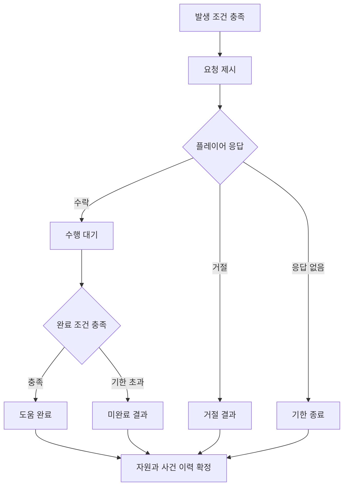

# 17. 사건·도덕적 선택·서사 기록·엔딩

> **기준:** PC판 Final Cut 클래식 생존 모드. Stories의 고정 주인공·분기 구조는 별도 비교한다.  
> **조사일:** 2026-11-13. 정확한 현재 패치 번호와 게임 실행 실측은 미확인.  
> **표기:** [확인] 공개 자료의 규칙 / [분석] 설계 해석 / [재구성안] 제안 구조 / [검증 필요] 미확정 조건. 결말 유형과 진행 구조에 대한 스포일러를 포함한다.

## 1. 서사의 작동 방식

**[분석] 이 게임에서 서사는 자원 관리 위에 붙은 설명문이 아니라, 자원 선택의 의미를 바꾸는 층이다.** 약품이 필요한 상황은 경제 문제지만, 그 약을 누구에게서 어떤 방법으로 얻는지는 사건이 된다. 같은 양의 식량을 확보해도 구매, 수색, 도움의 대가, 절도는 서로 다른 기억을 남긴다.

클래식 모드의 중요한 특징은 플레이어가 모든 큰 사건을 직접 일으키지 않는다는 점이다. 전쟁과 생활 환경은 주어진 조건으로 작동하고, 플레이어는 제한된 범위에서 대응한다. 이 때문에 서사의 중심 질문도 세계 전체를 구했는지보다, 그 조건 속에서 누가 어떻게 살아남았는지에 놓인다.

## 2. 공개 자료에서 확인한 결말 범위

**[확인·커뮤니티]** 클래식의 후일담은 개인별 생존·사망·이탈 등과 플레이 중 사건에 따라 달라진다고 정리되어 있다. 도움, 범죄, 동료의 상실 같은 사건이 에필로그에 연결되며, 항구 탈출의 경우 이를 반영하는 문구가 있다는 설명도 있다. [C15](https://this-war-of-mine.fandom.com/wiki/Endings?page=2)

**[검증 필요]** 해당 자료에 제시된 점수 증감이나 엔딩 분류는 공식 내부식으로 확인되지 않았다. 본 문서는 `선행 수 - 범죄 수`로 엔딩을 계산하지 않는다. 최종 심리 상태만으로 모든 후일담을 결정한다는 가정도 두지 않는다.

**[분석]** 이 구조에서는 적어도 세 가지 결과를 구별해야 한다.

| 결과 축 | 질문 | 같은 결과가 아닐 수 있는 이유 |
|---|---|---|
| 캠페인의 종료 | 어떤 사건으로 이번 플레이가 끝났는가? | 휴전·탈출·집단 소멸은 서로 다른 맥락 |
| 인물의 운명 | 각 인물은 살아 있거나 떠났거나 사망했는가? | 집단이 생존해도 개인은 잃을 수 있음 |
| 이후 삶의 해석 | 그 경험이 어떤 후일담으로 이어지는가? | 생존 여부만으로 경험의 질을 설명하기 어려움 |

이 분리는 **설계 해석**이며 원작 UI의 정식 데이터 분류가 아니다.

## 3. 사건을 시스템 관점에서 분류

**[재구성안]** 역기획 문서와 재구현에서는 사건을 트리거의 위치와 결과 지속성으로 나누면 관리하기 쉽다.

| 사건 유형 | 입력·트리거 | 결정 | 지속되는 결과 |
|---|---|---|---|
| 은신처 방문 | 날짜·조건에 따라 방문자 등장 | 거래, 도움, 합류, 거절 | 재고·인원·부재·개인 기록 |
| 현장 조우 | 특정 장소·NPC·상호작용 | 접근, 개입, 교환, 물러남 | 현장 상태·관계·소유권·기억 |
| 생활 사건 | 상태·자원·역할의 결과 | 치료·배분·회복 대응 | 건강·심리·노동력 변화 |
| 세계 사건 | 전쟁·날씨·접근성 변화 | 경로·비축·시설 계획 변경 | 며칠간의 행동 가능 범위 |
| 종료 사건 | 모드별 종료 조건 충족 | 최종 선택이 있는 경우 처리 | 에필로그·기록·진행 종료 |

각 사건이 반드시 별도의 모듈로 구현되어 있다는 뜻은 아니다. 다만 동일한 행동 결과가 여러 시스템에 영향을 주므로, 사건을 자원 변화만으로 축약해서는 안 된다.

## 4. 선택지가 성립하기 위한 조건

**[분석]** 의미 있는 선택에는 최소한 네 가지 조건이 필요하다.

1. **비용이 서로 다른 종류여야 한다.** 같은 물건을 더 많이 얻는 선택과 적게 얻는 선택만 있으면 판단이 단순해진다. 자원, 시간, 위험, 관계가 서로 교환되어야 한다.
2. **결과를 완전히 알 수 없어도 상황은 이해할 수 있어야 한다.** 방문자의 사정과 요구는 읽혀야 하지만, 보상이 항상 명확할 필요는 없다.
3. **거절과 미완료를 구분해야 한다.** 수락했지만 실행하지 못한 경우는 처음부터 거절한 것과 서사적으로 다를 수 있다.
4. **결정의 주체가 남아야 한다.** 누가 직접 행동했고 누가 그 결과를 겪었는지 기록되어야 개인별 이야기를 만들 수 있다.

이 기준은 사건 디자인을 평가하는 분석 틀이다. 원작의 모든 사건이 정확히 동일한 상태 머신을 가진다는 주장은 아니다.

### 실제 장소에서 드러나는 네 가지 선택 구조

다음은 **[확인·커뮤니티]**로 확인한 대표 장면이다. 장소마다 등장인물과 사건 변형이 있으므로, 특히 Supermarket 사례를 모든 방문에 적용하지 않는다.

| 장소·상황 | 실제 규칙·장면의 핵심 | 설계 해석 |
|---|---|---|
| Quiet House의 노부부 | 집 안 물건은 사유 재산으로 표시되며, 노부부는 떠나 달라고 요청한다. 약탈은 심리 반응을 일으킬 수 있다. [C33](https://this-war-of-mine.fandom.com/wiki/Quiet_House) | 전투 위험이 낮아도 선택의 비용이 작지는 않음을 보여줌 |
| Supermarket의 군인 사건 | 민간인 여성을 위협하는 군인을 보고 개입하거나 피할 수 있다. 구출이 긍정적 사건으로 다뤄지며 살해 자체가 구출의 필수조건은 아니다. [C34](https://this-war-of-mine.fandom.com/wiki/Supermarket) | 현장 위험과 도덕적 가치가 반대 방향으로 움직임 |
| Garage의 Matey | 아픈 아버지를 위한 의료 물자를 필요로 하여 해당 물건에 유리한 거래를 제공한다. [C35](https://this-war-of-mine.fandom.com/wiki/Garage) | NPC의 사정이 거래 가격의 이유가 됨 |
| Decrepit Squat의 Grisha | 음식을 부탁하는 사람에게 먹거리를 주면 숨겨진 물자 위치를 알려 준다. [C36](https://this-war-of-mine.fandom.com/wiki/Decrepit_Squat) | 친절이 자원 손실로만 끝나지 않는 사례를 제시 |

표의 오른쪽은 **[분석]**이다. 이 네 장면은 각각 약탈, 위험한 개입, 상호 이익의 교환, 직접적인 도움을 다른 방식으로 체험시킨다. 따라서 도덕 시스템을 `전투하면 나쁨`, `물건을 얻으면 좋음` 같은 단일 분류로 만들 수 없다. 장면의 맥락과 실제 행위 결과가 함께 있어야 한다.

## 5. 사건 상태 전이 모델

**[재구성안]** 다음은 도움 요청 한 종류를 만들 때 사용할 수 있는 구조다.

`요청 제시`와 `도움 완료`를 같은 사건으로 취급하지 않는다. 수락 버튼을 누르는 순간 보상을 주고, 실제 행동이 이루어지지 않아도 선행 이력이 남는 구조는 이야기와 시스템이 어긋날 수 있다. 반대로 사건에 따라서는 의사 표시 자체가 결과를 만들 수도 있으므로, 어떤 시점에 무엇을 확정하는지 콘텐츠별로 정의한다.

## 6. 현장 상태와 이야기 기억

**[분석]** 장소를 다시 방문했을 때 이전 행동을 반영하면 세계가 같은 장면을 반복하는 무대에서 벗어난다. 중요한 것은 시각적인 변화뿐 아니라 다음 행동의 가능성이 달라지는 것이다. 문을 열었다면 재방문 경로가 바뀔 수 있고, 자원을 가져갔다면 남은 수색 가치가 달라진다. NPC와 관련된 사건은 소유권·대화·위험의 해석까지 바꿀 수 있다.

**[재구성안]** 현장 저장과 서사 기록을 구분한다.

| 정보 | 저장 예시 | 용도 |
|---|---|---|
| 장소의 물리·상호작용 상태 | 열린 통로, 컨테이너 내용, 잠금 상태 | 재방문 시 동일 상태 복원 |
| NPC 상태 | 생존·이탈·경계 상태, 해결된 상호작용 | 다시 만났을 때의 행동 |
| 사건 결과 | `completed`, `refused`, `expired`, `failed` | 후속 사건과 대화 조건 |
| 개인 기억 | 행위자, 대상, 동료 반응, 날짜 | 개인 기록과 후일담 |
| 세계 진행 | 접근 가능한 장소, 종료 관련 플래그 | 캠페인 진행 |

모든 정보를 하나의 `completed=true`로 압축하면 절도 후 돌아온 장소와 도움을 준 뒤 돌아온 장소의 차이를 표현하기 어렵다. 반면 필요 이상의 대화 상태를 영구 저장하면 저장 규모와 예외가 늘어난다. 재방문·후속 사건·엔딩에 영향을 주는 정보만 지속 정보로 선택한다.

## 7. 에필로그의 생성 원리 재구성

**[재구성안]** 에필로그는 통합 점수 하나보다 여러 판단 단계를 두는 편이 설명 가능하다.

1. **종료 맥락 확정:** 휴전·탈출·패배 등 이번 캠페인의 종료 이유를 확정한다.
2. **개인 운명 확정:** 생존·사망·이탈·거절 등 각 인물의 상태를 분류한다.
3. **주요 사건 선별:** 일상적인 재고 변화보다 인물의 경험을 설명하는 사건을 우선한다.
4. **후일담 후보 선택:** 인물 고유 배경, 사건 태그, 종료 조건에 맞는 후보를 찾는다.
5. **모순 검사:** 사망한 인물이 살아서 귀향하거나 이미 떠난 인물이 마지막 전투에 참여했다고 쓰지 않는지 확인한다.
6. **표시 순서 구성:** 사건의 순서와 개인별 결과를 읽기 쉽게 배열한다.

이것은 원작의 실제 평가 알고리즘을 복원한 결과가 아니다. 확인된 후일담 차이를 재구현 가능한 책임으로 나눈 설계안이다.

### 엔딩 데이터 예시

| 데이터 | 필드 예시 | 이유 |
|---|---|---|
| `OutcomeContext` | `campaignEndReason`, `day`, `scenarioId` | 모드별 종료 의미 유지 |
| `SurvivorOutcome` | `survivorId`, `lifeState`, `departureReason` | 집단 종료와 개인 운명 분리 |
| `SignificantEvent` | `eventId`, `day`, `actors`, `outcomeTags` | 과거 사건을 중복 없이 보존 |
| `EpilogueRule` | `requiredTags`, `excludedTags`, `priority`, `textId` | 충돌하는 후일담 후보 해결 |
| `NarrativeFact` | `subjectId`, `predicate`, `value` | 모순 검사에 필요한 최소 사실 |

문구는 배경과 상태를 정확히 반영해야 한다. 텍스트를 무작위로 다양하게 만드는 것보다, 사용자가 기억하는 행동과 연결되는 문구를 선택하는 것이 우선이다.

## 8. 클래식과 Stories의 차이

**[확인·공식]** Father's Promise는 대화·단서 탐색을, The Last Broadcast는 조사·보도·라디오와 여러 결말을, Fading Embers는 예술품 수집·보존·처분 선택과 분기 서사를 소개한다. [C18](https://store.steampowered.com/app/750030/This_War_of_Mine_Stories__Fathers_Promise_ep1/), [C19](https://store.steampowered.com/app/974610/This_War_of_Mine_Stories__The_Last_Broadcast_ep2/), [C20](https://store.steampowered.com/app/1125630/This_War_of_Mine_Stories_Fading_Embers_ep_3/)

**[분석]** 이 차이는 같은 생존 규칙 위에서 무엇을 진척으로 간주하는가의 차이다.

| 관점 | 클래식 중심의 해석 | Stories 중심의 해석 |
|---|---|---|
| 진행의 중심 | 집단이 하루를 더 버티는 과정 | 특정 인물의 목표와 사건 해결 |
| 장소의 가치 | 필요한 자원과 위험의 조합 | 다음 단서·대화·선택의 위치 |
| 중요한 재고 | 생존·생산에 쓰이는 물건 | 이야기 목표에만 의미가 있는 물건도 포함 |
| 시간의 의미 | 소비·회복·위험의 누적 | 특정 사건 진행 조건과 생존 압박의 결합 |
| 결말 설명 | 생존 과정의 개인별 후일담 | 작품별 분기 조건과 중심 질문의 결과 |

동일한 지형이나 캐릭터가 등장해도 모드별 이벤트 정의를 분리해야 한다. Stories의 조사 행동이 클래식의 모든 장소에서 자동으로 제공되는 것으로 문서화해서는 안 된다.

## 9. 반복 플레이와 사건의 재사용

**[분석]** 반복 플레이에서는 사건을 처음 보았을 때의 놀라움이 줄어든다. 이때도 의미를 유지하려면 사건의 정답을 바꾸기보다, 그 사건을 만났을 때 플레이어가 가진 자원과 인물 상태가 달라질 필요가 있다. 같은 도움 요청도 식량이 남는 날과 모두 아픈 날에는 다른 판단이 된다.

**[재구성안]** 사건 변주는 세 수준으로 설계할 수 있다.

- **배치 변주:** 언제·어떤 장소에서 만나는지 바꾼다.
- **조건 변주:** 요구 자원·남은 시간·참여 가능 인물을 바꾼다.
- **의미 변주:** 대상의 사정이나 선택 후 결과를 바꾼다.

모든 수준을 무작위로 바꾸면 인과관계가 약해진다. 핵심 메시지가 있는 사건은 의미를 유지하고, 마주치는 조건만 바꾸는 편이 더 안정적일 수 있다. 이는 원작의 난수 생성 방식을 설명하는 것이 아니라 사건 재사용을 위한 설계 분석이다.

## 10. 밸런스와 검증

| ID | 시나리오 | 확인할 내용 |
|---|---|---|
| NA-01 | 요청을 보고 거절·무응답·수락 후 실패 | 각 결과가 콘텐츠 의도에 맞게 구분됨 |
| NA-02 | 같은 사건을 다시 상호작용 | 보상·심리 효과·기록 중복 방지 |
| NA-03 | 도움 수행자가 귀환 전 사망·이탈 | 후속 이벤트와 개인 기록의 주체 유지 |
| NA-04 | 사건 대상 NPC가 사라진 뒤 재방문 | 불가능한 완료 조건을 요구하지 않음 |
| NA-05 | 휴전·탈출·집단 소멸 조건 동시 충족 | 종료 우선순위를 명확히 선택 |
| NA-06 | 살아남았지만 핵심 사건이 상반됨 | 후일담 후보 충돌 해소 |
| NA-07 | 아동·특수 인물만 남음 | 모드별 플레이 가능·종료 정책 적용 |
| NA-08 | 마지막 날 상태 회복 또는 악화 | 장기 이력과 순간 상태의 역할 확인 |
| NA-09 | 저장 복원 후 선택지 재진입 | 이미 확정한 선택·자원 소비 유지 |
| NA-10 | 다른 모드에서 같은 장소 사용 | 모드 전용 단서·대사·엔딩 조건 누출 방지 |

위 표는 **[재구성안]**이다. 평가 지표로는 사건 선택률, 수락 후 완료율, 플레이어가 기억한 결정과 엔딩 문구의 일치율, 설명되지 않는 결말에 대한 반응을 사용할 수 있다. 엔딩 종류의 수를 늘리는 것보다 선택과 후일담의 연결을 이해할 수 있는지가 중요하다.

## 11. 출처와 남은 검증

| ID | 출처 | 접근·근거 수준 | 사용 범위 |
|---|---|---|---|
| C15 | [Endings](https://this-war-of-mine.fandom.com/wiki/Endings?page=2) | 커뮤니티 위키 검색 색인 | 개인별 후일담·사건 연결·탈출 문구 |
| C18 | [Father's Promise 공식 Steam 설명](https://store.steampowered.com/app/750030/This_War_of_Mine_Stories__Fathers_Promise_ep1/) | 개발사 제공 상점 본문 | 대화·단서 탐색 |
| C19 | [The Last Broadcast 공식 Steam 설명](https://store.steampowered.com/app/974610/This_War_of_Mine_Stories__The_Last_Broadcast_ep2/) | 개발사 제공 상점 본문 | 조사·보도·라디오·분기 |
| C20 | [Fading Embers 공식 Steam 설명](https://store.steampowered.com/app/1125630/This_War_of_Mine_Stories_Fading_Embers_ep_3/) | 개발사 제공 상점 본문 | 문화유산·수집·분기 |
| C33 | [Quiet House](https://this-war-of-mine.fandom.com/wiki/Quiet_House) | 커뮤니티 위키 검색 색인 | 노부부·사유 재산·약탈 반응 |
| C34 | [Supermarket](https://this-war-of-mine.fandom.com/wiki/Supermarket) | 커뮤니티 위키 검색 색인 | 군인 사건·개입·구출 |
| C35 | [Garage](https://this-war-of-mine.fandom.com/wiki/Garage) | 커뮤니티 위키 검색 색인 | 아버지의 질병과 의료 물자 거래 |
| C36 | [Decrepit Squat](https://this-war-of-mine.fandom.com/wiki/Decrepit_Squat) | 커뮤니티 위키 검색 색인 | Grisha에게 음식 제공·숨은 물자 |

**[검증 필요]** 모든 클래식 시나리오의 종료 조건, 항구 이벤트의 정확한 전제, 후일담 우선순위, 선행·범죄 가중치, 아동·보호자 동반 이탈 처리, Final Cut에서 바뀐 현장 이벤트는 실행 빌드와 시나리오를 지정해 추가 조사한다. 본 문서는 특정 결말을 보장하는 공략표가 아니다.

연결 문서: [심리·관계](05_Morale_Relationships_and_Ethics.md) · [확장 콘텐츠](19_Expansions_and_Mode_Differences.md) · [전체 목차](README.md)
