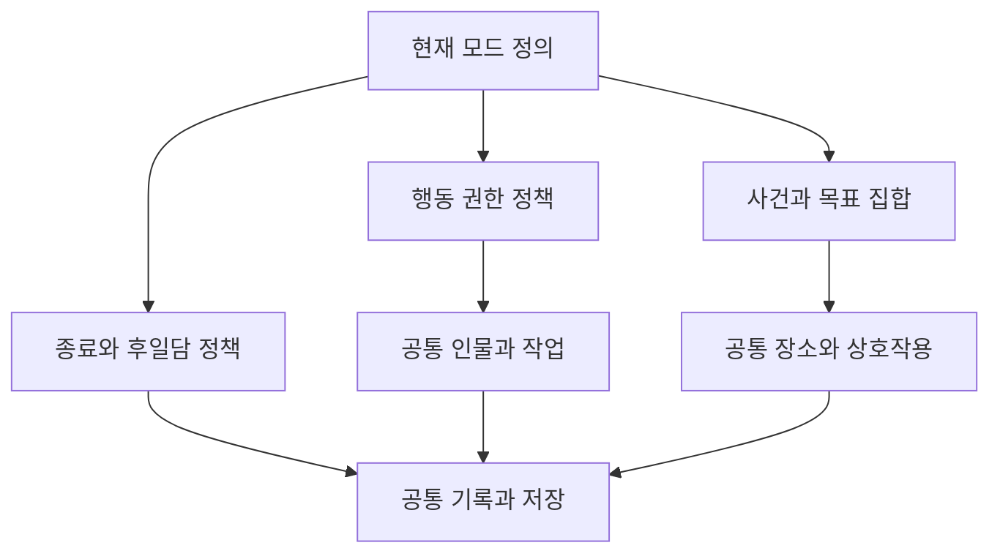

# 19. 버전·확장 콘텐츠·모드별 규칙 차이

> **기준:** PC판 Final Cut을 기본 역기획 대상으로 삼고, 출시된 주요 확장 콘텐츠를 비교한다.  
> **조사일:** 2026-11-13. 정확한 현재 패치 번호는 미확인. 플랫폼별 패키지·상품 구성의 완전 일치를 가정하지 않는다.  
> **표기:** [확인] 개발사·공개 자료에서 확인 / [분석] 설계 해석 / [재구성안] 콘텐츠 구조 제안 / [검증 필요] 실행 확인 대상.

## 1. 본편과 확장을 구분해야 하는 이유

**[분석]** This War of Mine의 확장 콘텐츠는 물건과 장소만 늘리는 방식으로 구성되지 않는다. 일부는 돌봄 대상과 행동 권한을 바꾸고, 일부는 생존 도중 추구해야 하는 이야기 목표를 바꾼다. 같은 이름의 캐릭터나 같은 장소를 사용하더라도 목표, 제약, 이벤트가 다를 수 있다.

따라서 역기획 문서에서는 “게임에 존재한다”와 “기본 클래식 모드에서 항상 사용할 수 있다”를 구분해야 한다. DLC의 라디오 보도나 자료 수집을 기본 생존 모드의 보편 기능으로 넣으면 제작·인벤토리·진행 시스템의 범위가 잘못 커진다.

## 2. 콘텐츠 범위 표

아래 출시일은 **PC Steam 상품 페이지 기준**이다. 콘솔판의 최초 출시일이나 모든 패키지의 출시일을 뜻하지 않는다.

| 콘텐츠 | 형태·범위 | 확인한 대표 추가 요소 | 근거 |
|---|---|---|---|
| 본편 클래식 생존 | 본 문서 묶음의 기본 대상 | 집단 관리와 주야간 생존 | 전체 역기획 기준 |
| Final Cut | 본편 업데이트 구성 | 클래식 시나리오·인물, 기존 지역 개선, Stories 지역의 본편 편입 | C22 |
| War Child Charity | 2015-03-09 PC DLC | 거리 예술 발견과 게임 내 갤러리 | C23 |
| The Little Ones | 2016-06-01 PC DLC | 관리 가능한 아동, 돌봄·장난감·아동 포함 시나리오 | C16 |
| Father's Promise | 2017-11-14, Stories 1편 | Adam의 가족 이야기, 대화·단서 탐색 | C18 |
| The Last Broadcast | 2018-11-14, Stories 2편 | 라디오·취재·보도·딜레마, 공식 소개상 6개 엔딩 | C19 |
| Fading Embers | 2019-08-06, Stories 3편 | Anja의 이야기, 예술품 수집·보존·처분과 분기 | C20 |
| Forget Celebrations | 2024-12-11 PC DLC | Katia의 책 자료 회수, 부상 상태에서 생존과 구조 대기 | C21 |

**[확인·공식]** Final Cut은 Stories의 장소를 본편에 추가한다고 설명한다. 이는 Stories 에피소드 전체가 본편에 포함되었다는 뜻이 아니다. [C22](https://finalcut.thiswarofmine.com/) Stories 3편의 묶음은 별도 상품으로 소개된다. [C25](https://store.steampowered.com/app/750031/)

**[분석]** `Final Cut`, `Complete Edition`, `Season Pass` 같은 이름만 보고 필요한 콘텐츠를 추론하지 말고, 실행하려는 모드와 해당 상품의 포함 목록을 대응시키는 것이 정확하다. 이 문서의 비교 대상은 게임플레이 콘텐츠이며 사운드트랙은 규칙 추가로 분류하지 않는다.

## 3. The Little Ones: 돌봄 대상과 작업 권한

### 확인되는 플레이 규칙

**[확인·공식]** The Little Ones는 성인과 아동을 함께 관리하며 장난감 제작, 함께 놀기, 보호자 역할을 추가한다. [C16](https://store.steampowered.com/app/481090/This_War_of_Mine_The_Little_Ones/)

**[확인·커뮤니티]** 아동은 야간 수색·경계·거래를 맡지 못하며, 일부 제작은 성인에게 배운 뒤 수행한다. 반복 교류로 보호자 유대를 형성할 수 있고, 보호자와 침대를 함께 사용하는 특수 수면도 정리되어 있다. [C17](https://this-war-of-mine.fandom.com/wiki/Children)

| 행동 | 일반 성인 중심 규칙 | 아동 추가 시 달라지는 점 |
|---|---|---|
| 야간 역할 | 수색·경계·수면 후보가 됨 | 아동에게 외출·경계 역할을 배정하지 않음 |
| 생산 | 인물 상태와 시설 조건이 핵심 | 작업별 교육 여부가 추가 조건 |
| 수면 | 인물별 침대 배정 | 보호자와 공유하는 선택이 생김 |
| 심리 관리 | 인물 자신의 상태와 집단 사건 | 돌봄·놀이·보호자 관계가 중요해짐 |
| 시설 투자 | 생산·방어·생활 편의 | 장난감 등 아동을 위한 투자 추가 |

표의 규칙 부분은 C16·C17에 근거하며, 중요성에 대한 설명은 **[분석]**이다. 아동의 식사량, 교육 시간, 유대 성립 횟수는 확정 수치로 제시하지 않는다.

### 설계 해석

**[분석]** 아동은 당장의 집단 생산량을 늘리기 위한 추가 일꾼으로만 설계되지 않는다. 성인이 해야 할 일이 늘어나고, 도움을 받는 존재의 상태가 집단의 성과가 된다. 돌봄을 수행하는 성인의 시간도 다른 제작·회복·거래와 경쟁하므로 보호한다는 말이 실제 일정 배분으로 바뀐다.

교육은 보호와 생존 사이의 긴장을 만든다. 어떤 일을 가르칠 수 있다는 사실과 계속 일을 시켜도 되는가는 다른 질문이다. 재구현에서는 작업 권한 해제와 돌봄·정서 규칙을 별개로 관리해야, 교육이 단순한 노동력 해금으로만 소비되지 않는다.

### 재구성 데이터

| 데이터 | 필드 예시 | 역할 |
|---|---|---|
| 아동 권한 | `canScavenge=false`, `canGuard=false`, `canTrade=false` | 모든 입력 경로에서 같은 행동 제약 |
| 교육 상태 | `learnedRecipeIds`, `teacherId`, `teachingInProgress` | 배운 작업과 배우는 중인 작업 구분 |
| 보호자 관계 | `guardianId`, `bondEvents` | 공유 수면·상실 반응·돌봄 연결 |
| 아동 활동 | `playActionIds`, `toyAvailability` | 생산 외의 유의미한 활동 제공 |

위 필드는 **[재구성안]**이며 원작 데이터의 실제 이름이 아니다.

## 4. Father's Promise: 자원 탐색에서 단서 추적으로

**[확인·공식]** 이 에피소드는 딸을 지키려는 Adam을 중심으로 하며 대화와 단서 탐색을 추가한다. [C18](https://store.steampowered.com/app/750030/This_War_of_Mine_Stories__Fathers_Promise_ep1/)

**[분석]** 같은 밤 외출이라도 목적지 선택의 이유가 달라진다. 클래식에서는 현재 부족한 물건이 핵심이었다면, 이 모드에서는 다음 정보를 얻는 일이 더 중요한 목표가 될 수 있다. 정보를 얻기 위해 자원 획득에 유리하지 않은 장소를 방문해야 한다면, 서사 진행과 생존 준비가 같은 밤 시간을 두고 경쟁한다.

| 기존 시스템 | 추가로 필요한 책임 | 재구현 시 주의점 |
|---|---|---|
| 장소 선택 | 단서가 여는 다음 방문 동기 | 단서 미획득 상태에서 무조건 다음 장소를 열지 않기 |
| NPC 대화 | 질문·정보 획득·진행 플래그 | 대화 완료와 정보 소유를 분리 |
| 물건 조사 | 생존 물자 외의 단서 판정 | 일반 판매·소비 대상과 구분 |
| 사건 기록 | 알아낸 정보와 미해결 질문 | 플레이어가 다음 행동을 추론할 수 있어야 함 |

이 표는 **[재구성안]**이다. 에피소드의 반전과 최종 장면을 장문으로 재현하기보다, 단서가 진행 조건이 되는 시스템 차이를 분석한다.

## 5. The Last Broadcast: 정보에 대한 선택을 플레이로 만들기

**[확인·공식]** 조사·보도·라디오와 도덕적 딜레마가 추가되고, 공식 설명은 비선형 이야기와 6개 엔딩을 명시한다. [C19](https://store.steampowered.com/app/974610/This_War_of_Mine_Stories__The_Last_Broadcast_ep2/)

**[분석]** 본편에서 바깥 상황을 듣는 데 쓰이던 정보 매체가, 이 에피소드에서는 플레이어가 무엇을 전할지 판단하는 목표가 된다. 이 변화의 핵심은 `정보 획득`과 `정보 공개`를 같은 행동으로 묶지 않는 것이다. 알게 된 사실을 모두 즉시 전하는 것이 유일한 선택이라면 진실과 생존의 갈등을 플레이로 만들기 어렵다.

**[재구성안]** 보고 한 건은 아래 상태를 가질 수 있다.

```text
미확인 → 조사 중 → 확보한 정보 → 전달 여부 결정 → 보도 결과 → 후속 반응
```

이 전이는 실제 스크립트를 추출한 결과가 아니다. 공식이 밝힌 조사·보도·딜레마 기능을 구현 책임으로 분해한 것이다. 정보가 확정되는 시점, 전달 대상, 방송된 내용과 NPC가 반응하는 조건을 구분하는 편이 일관적이다.

### 기획상 얻을 수 있는 교훈

**[분석]** 정보는 자원처럼 수집할 수 있지만 물리 재고와 달리 복사·전파·은폐에 의미가 있다. 인벤토리의 일반 아이템으로만 처리하면 “소유한 것”과 “공개한 것”을 구분하기 어렵다. 따라서 정보 상태는 일지와 퀘스트 기록에 연결하고, 실제 물건은 운반·교환 규칙을 따르도록 나누는 편이 명확하다.

## 6. Fading Embers: 생존 가치와 보존 가치

**[확인·공식]** Anja를 중심으로 문화유산과 사람의 생존을 다루며, 예술품을 모으고 보존하며 그 운명을 결정하는 기능을 추가한다. 공식 설명은 새 허브, 복수의 은신처, 분기 결말과 Anja·Ruben·Zoran을 소개한다. [C20](https://store.steampowered.com/app/1125630/This_War_of_Mine_Stories_Fading_Embers_ep_3/)

**[분석]** 이 모드에서는 가치가 있지만 오늘의 식사로 직접 바뀌지 않는 대상을 지켜야 한다. 생존 물자와 보존 대상을 같은 가치 척도로 환산할 수 없다는 점이 선택의 핵심이다. 확보한 예술품을 얼마나 잘 지켰는가와 인물을 살렸는가가 별도 질문으로 남는다.

| 시스템 | 분석해야 할 변화 |
|---|---|
| 인벤토리 | 생활 재고와 이야기상 고유한 수집품을 구분 |
| 제작·시설 | 현재 생존뿐 아니라 보존 목적의 작업과 연결 |
| 진행 허브 | 수집·보존 상황과 다음 목표를 읽게 함 |
| 장소 | 재료뿐 아니라 문화유산과 연결된 방문 동기 제공 |
| 엔딩 | 수집품의 처리 선택과 인물의 운명을 함께 평가 |

오른쪽은 **[분석]**이며 실제 메뉴 구조의 완전 복제는 아니다. 재구현 시 일반 창고 정리·자동 판매·소비 코드가 수집품을 제거하지 않도록 `storyCritical`, `disposition`, `collectionId` 같은 명시적 데이터가 필요하다. 필드명은 **[재구성안]**이다.

## 7. Forget Celebrations: 기록을 회수하며 살아남기

**[확인·공식]** 2024-12-11 출시된 이 DLC는 종군기자 Katia의 책 작업이 폭격으로 중단된 뒤, 부상 상태에서 구조를 기다리며 사라진 자료를 찾는 이야기다. 새 이야기·특수 물건·도덕적 선택이 공식 기능으로 소개된다. [C21](https://store.steampowered.com/app/3323700/This_War_of_Mine_Forget_Celebrations_Charity_DLC/)

**[분석]** 기존 인물을 다시 사용하더라도 클래식의 Katia 프로필을 그대로 적용해서는 이 시나리오의 의미를 설명할 수 없다. 지금의 상태와 목표가 달라졌기 때문이다. 이 모드의 핵심 분석 축은 생존 유지, 자료 회수, 구조까지의 시간이다. 자료 회수는 물건을 많이 가져오는 목적과 다르므로, 남은 공간과 외출 기회를 무엇에 쓸지 다시 판단하게 한다.

**[확인·커뮤니티]** 전용 시나리오에는 책 자료를 관리하는 책상과 자료별 수집 진행이 설명되어 있다. 이 세부 기능은 공식 상점 설명보다 근거 수준이 낮은 커뮤니티 정보로 구분한다. [C24](https://this-war-of-mine.fandom.com/wiki/Forget_Celebrations)

### 추가 규칙의 경계

- **[분석]** Katia의 시나리오 전용 상태를 모든 클래식 Katia에 적용하지 않는다.
- **[재구성안]** 일반 약품·먹거리와 자료 아이템의 분류를 분리한다.
- **[재구성안]** 구조 시점의 생존 결과와 자료 확보 결과를 별도 기록한다.
- **[검증 필요]** 정확한 구조 날짜, 자료 개수, 자료별 획득 경로, 모든 엔딩 조건은 실행 확인 없이 공략 수치로 확정하지 않는다.

이 DLC는 Stories Season Pass의 3개 에피소드와 별도 항목으로 관리한다. 상품에 포함되는지 여부와 게임 내부에서 어느 메뉴로 진입하는지는 구매 패키지·플랫폼별로 확인해야 한다.

## 8. War Child Charity: 수집과 후원의 분리

**[확인·공식]** 세계 곳곳의 거리 예술을 발견하여 게임 내 갤러리를 구성하는 DLC다. 가격 단계가 달라도 제공되는 DLC 콘텐츠는 같다고 공식 설명에 명시되어 있다. [C23](https://store.steampowered.com/app/348040/This_War_of_Mine_War_Child_Charity/)

**[분석]** 이 기능은 기본 생존 규칙을 새로 정의하기보다 장소를 바라보는 목적을 추가한다. 수색 중 발견하는 대상이 재료나 위험만이 아니라 시각적 메시지가 된다. 콘텐츠 접근 권한과 수집 완료 기록을 분리하면, 같은 장소를 반복 방문해도 이미 본 작품과 새로운 작품을 구분할 수 있다.

**[재구성안]** 필요한 최소 데이터는 `artworkId`, `locationVariantId`, `discovered`, `galleryUnlocked` 정도다. 후원 금액에 따라 게임플레이 보상을 다르게 주는 구조로 역기획하지 않는다.

## 9. 공통 시스템과 모드 전용 정책

**[재구성안]** 확장 콘텐츠는 모든 규칙에 조건문을 흩뿌리기보다 공통 기능과 모드 정책을 구분하는 편이 검토하기 쉽다.



| 공통으로 재사용할 수 있는 기능 | 모드별로 명시해야 하는 부분 |
|---|---|
| 인물 선택·이동·작업 예약 | 아동·특수 인물의 행동 제한 |
| 자원 소비·획득·컨테이너 | 단서·수집품·책 자료의 고유 처리 |
| 장소 로드·NPC 상호작용 | 같은 장소의 다른 사건 배치 |
| 날짜 전환·상태 경과 | 시나리오 진행·구조·종료 조건 |
| 대사·개인 기록·저장 | 에피소드별 분기와 고유 후일담 |

이 구조는 기술적 제안이며 11 bit studios의 실제 엔진 아키텍처를 주장하지 않는다.

## 10. 검증 매트릭스

| ID | 검증 대상 | 확인해야 할 결과 |
|---|---|---|
| EX-01 | 기본 Final Cut만 설치 | Stories 지역과 Stories 에피소드 권한을 구분 |
| EX-02 | The Little Ones 활성화 | 아동의 역할 제한·교육·돌봄 동작 |
| EX-03 | 아동 없는 시나리오 | 아동 전용 상태·UI가 잘못 표시되지 않음 |
| EX-04 | 같은 장소를 클래식·Stories에서 방문 | 모드별 사건·NPC·단서가 맞게 로드됨 |
| EX-05 | 스토리 아이템을 교환·소비하려 함 | 모드가 정한 허용·금지 규칙 적용 |
| EX-06 | The Last Broadcast의 보도 선택 | 조사 사실·방송 사실·후속 반응의 일관성 |
| EX-07 | Fading Embers의 수집품 처분 | 수집 기록·재고·엔딩 입력의 일치 |
| EX-08 | Forget Celebrations의 Katia | 클래식 프로필과 전용 상태의 분리 |
| EX-09 | DLC 활성 상태가 다른 저장 복원 | 없는 콘텐츠를 조용히 다른 콘텐츠로 대체하지 않음 |
| EX-10 | War Child Charity의 가격 단계 | 같은 게임플레이 콘텐츠 제공 |

표는 **[재구성안]**이다. 현재 판매 가격이나 할인률은 시스템 역기획에 필요하지 않아 포함하지 않았다.

## 11. 출처와 판본 주의사항

| ID | 출처 | 접근·근거 수준 | 사용 범위 |
|---|---|---|---|
| C16 | [The Little Ones](https://store.steampowered.com/app/481090/This_War_of_Mine_The_Little_Ones/) | 개발사 제공 Steam 본문 | PC 출시일·아동·돌봄·장난감 |
| C17 | [Children](https://this-war-of-mine.fandom.com/wiki/Children) | 커뮤니티 위키 검색 색인 | 권한 제한·교육·보호자·수면 |
| C18 | [Father's Promise](https://store.steampowered.com/app/750030/This_War_of_Mine_Stories__Fathers_Promise_ep1/) | 개발사 제공 Steam 본문 | 출시일·Adam·대화·단서 |
| C19 | [The Last Broadcast](https://store.steampowered.com/app/974610/This_War_of_Mine_Stories__The_Last_Broadcast_ep2/) | 개발사 제공 Steam 본문 | 출시일·라디오·조사·보도·6개 엔딩 |
| C20 | [Fading Embers](https://store.steampowered.com/app/1125630/This_War_of_Mine_Stories_Fading_Embers_ep_3/) | 개발사 제공 Steam 본문 | 출시일·문화유산·인물·분기 |
| C21 | [Forget Celebrations](https://store.steampowered.com/app/3323700/This_War_of_Mine_Forget_Celebrations_Charity_DLC/) | 개발사 제공 Steam 본문 | 출시일·Katia·자료 회수 |
| C22 | [Final Cut 공식 페이지](https://finalcut.thiswarofmine.com/) | 개발사 공식 본문 | Stories 지역의 본편 편입 |
| C23 | [War Child Charity](https://store.steampowered.com/app/348040/This_War_of_Mine_War_Child_Charity/) | 개발사 제공 Steam 본문 | 출시일·거리 예술·같은 콘텐츠 |
| C24 | [Forget Celebrations 위키](https://this-war-of-mine.fandom.com/wiki/Forget_Celebrations) | 커뮤니티 위키 검색 색인 | 책상과 자료 수집 진행 |
| C25 | [Stories Season Pass](https://store.steampowered.com/app/750031/) | 개발사 제공 상점 검색 본문 | 3개 에피소드 묶음 |

**[검증 필요]** PC·콘솔·모바일의 세부 기능 차이, 현재 번들의 구성, 모드 진입 메뉴, 모든 특수 인물의 행동 제약, DLC별 수치 균형은 개별 실행 환경을 고정해 확인한다. 보드게임의 행동 횟수·주사위·카드 규칙은 이 문서에 사용하지 않았다.

연결 문서: [생존자 구성](03_Characters_and_Traits.md) · [심리·관계](05_Morale_Relationships_and_Ethics.md) · [서사·엔딩](17_Narrative_Choices_and_Endings.md) · [전체 목차](README.md)
