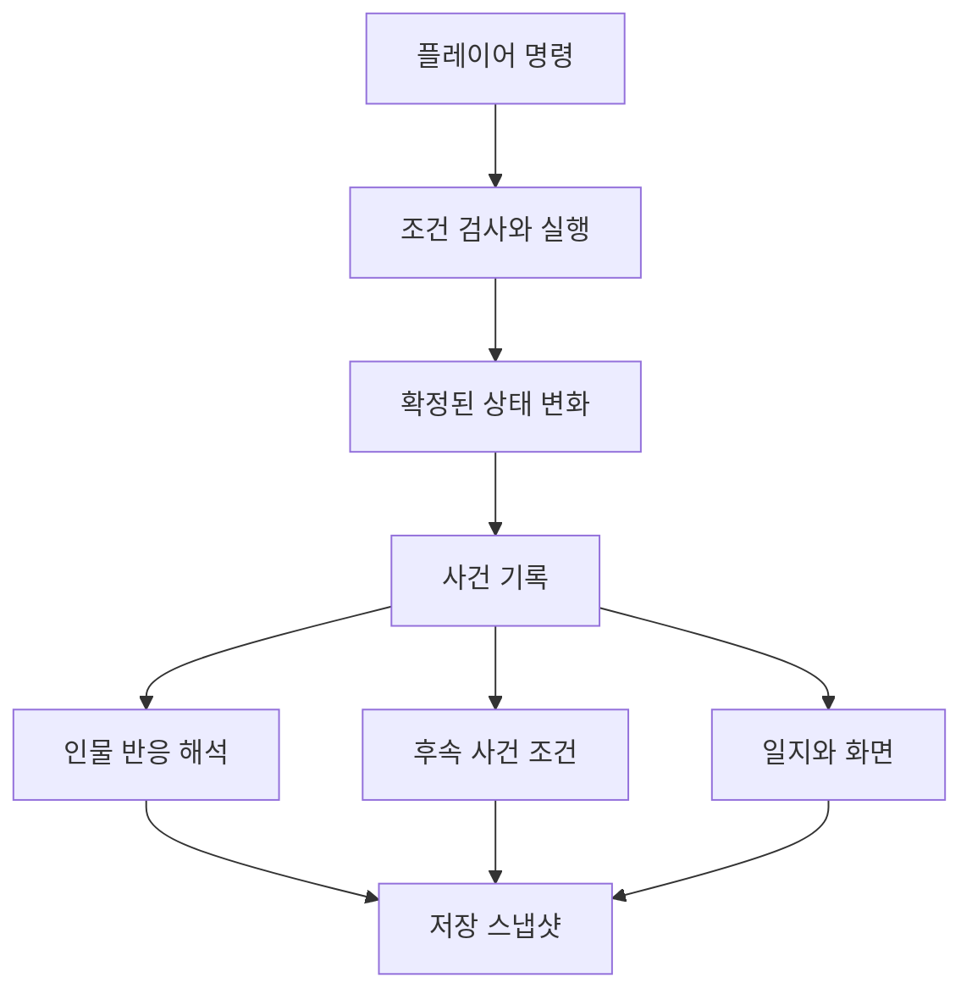

# 20. 데이터 모델과 시스템 구조 재구성

> 기준 경험: PC Final Cut 클래식 생존 모드 · 작성일: 2026-11-13  
> **2절에서 [확인]으로 명시한 공개 설정 정보를 제외한 데이터 모델·처리 순서·불변식·구현 제안은 모두 [재구성안]이다. 원작 소스 코드나 저장 포맷을 복원한 것이 아니다.**  
> 원작에서 공개된 설정 항목은 2절에서만 별도로 [확인] 표시한다.

## 1. 문서의 목적

앞선 시스템 문서의 규칙과 의사결정을 실제로 구현 가능한 경계로 옮긴다. 특정 엔진을 전제하지 않으며, 원작이 컴포넌트 시스템·행동 트리·이벤트 소싱 중 무엇을 쓰는지 추정해 단정하지 않는다.

설계에서 지켜야 할 핵심은 물자·인물·시간·사건의 일관성이다. 밤에 가져간 무기를 은신처에서 동시에 사용할 수 없고, 같은 도움을 두 번 기록해서 정서 반응을 중복 발생시킬 수 없으며, 수색 지역의 개방·루팅 상태가 재방문에 이어져야 한다.

## 2. 공개된 원작 설정과 재구성의 경계

**[확인·개발사 저작 문서]** Cold Crisis 모딩 안내에서 아래 설정 명칭을 확인할 수 있다. 현재 버전에서 동일 구조가 그대로 유지되는지는 확인하지 않았다. 공개 복제본을 열람했으며 게임 설치 폴더의 원본 파일과 대조하지 않았다. [P07](https://pwrcontroller.com/wp-content/uploads/2022/04/Modding-Instructions.pdf)

| 공개 문서의 항목 | 확인 가능한 기능 범주 |
|---|---|
| Scenarios Config | 시나리오·타임라인 |
| Winter Config | 날씨 설정 |
| Visits Config | 방문 설정 |
| Loot Generators Config | 지역 물자 구성 |
| Item Config | 아이템·제작 관련 정의 |
| Scavenge Locations Config | 지역 세트 |
| Radio Config | 방송 구성 |

아래의 CampaignState, InventoryContainer, MoralEvent 등은 설명을 위해 새로 정한 이름이다. 위 설정명과 일대일로 대응하는 원작 타입이 아니다.

## 3. 상태의 소유권

| 모듈 | 소유하는 상태 | 받아야 하는 입력 | 외부로 내보내는 결과 |
|---|---|---|---|
| 캠페인 | 날짜·페이즈·시나리오·종결 상태 | 페이즈 종료, 사건 결과 | 날짜 변경·종결 |
| 인물 | 건강·욕구·심리·부재·능력 참조 | 시간 경과, 소비, 피해, 사건 | 행동 가능성·상태 변화 |
| 은신처 | 공간·시설·방어 설비 | 건설·개방·시설 이용 | 사용 가능한 행동 |
| 재고 | 컨테이너별 물품 수량·상태 | 이동·소비·생산·거래 | 재고 변경 |
| 작업 | 점유자·진행도·예약 자원 | 작업 시작·취소·시간 | 결과물·해제 |
| 지역 | 접근성·상황 변형·지속 상태 | 방문·루팅·문 개방·사건 | 지역 변화·현장 결과 |
| NPC | 현재 위치·인지·행동·적대 상태 | 소음·시야·상호작용 | 이동·경고·공격 |
| 세계 사건 | 활성 사건·조건·효과 | 날짜·시나리오·이력 | 제한·기후·시장 변화 |
| 정서·서사 | 해석된 사건·기억·일지 | 행동 및 결과 이벤트 | 반응·후속 조건·후일담 |
| 표현 | 선택 대상·창·피드백 표시 | 확정된 상태와 알림 | 명령 요청 |

표현 모듈의 마지막 행에서 말하는 알림은 확정 결과의 표시다. UI가 직접 체력·재고를 수정하는 구조는 피한다.

## 4. 영구 정의와 플레이 상태 분리

| 영구 정의 데이터 | 실행 중 상태 데이터 | 분리 이유 |
|---|---|---|
| 인물의 기본 특성 | 현재 피로·부상·기억 | 같은 정의를 여러 시나리오에서 재사용 |
| 아이템 분류·스택 규칙 | 실제 보유 수량·위치 | 정적 규칙과 재고 변경 구분 |
| 제작 레시피 | 진행 중 작업·예약 물자 | 중단·재개를 안전하게 처리 |
| 시설 유형 | 설치 위치·등급·작동 상태 | 설치물의 지속성 |
| 지역 템플릿 | 열어 둔 문·남은 물자·NPC 결과 | 재방문 결과 보존 |
| 사건 템플릿 | 발생·수락·거절·완료 여부 | 중복 발생 차단 |
| 시나리오 규칙 | 현재 날짜·난수·선택된 변형 | 초기 선택의 지속 |

정의 데이터를 수정한 뒤 기존 저장을 불러오는 경우도 고려해야 한다. 아이템 ID가 없어졌을 때 조용히 버리거나, 필요한 시나리오가 없는데 다른 시나리오를 대신 불러오는 것은 의도하지 않은 손실을 만들 수 있다.

## 5. 핵심 엔터티 예

```yaml
CampaignState:
  campaign_id: stable_id
  ruleset_id: classic_like
  content_version: schema_version
  day: integer
  phase: Daytime
  scenario_id: stable_id
  selected_timeline_id: stable_id
  random_streams: persisted_state
  applied_resolution_ids: set

CharacterState:
  character_id: stable_id
  definition_id: stable_id
  availability: present
  condition:
    hunger: state_and_progress
    fatigue: state_and_progress
    sleep_quality: state_or_condition_tags
    illness: state_and_progress
    injury: state_and_progress
  psychology:
    visible_state: state
    active_effects: list
    remembered_event_ids: list
  current_task_id: optional_id
  current_container_id: optional_id
  night_role: unassigned

ShelterState:
  shelter_id: stable_id
  layout_id: definition_id
  cleared_obstacles: set
  facilities: list
  inventory_container_id: stable_id
  defense_assets: list
```

별도의 갈증 게이지는 이 모델에 추가하지 않았다. 물을 생활 생산의 투입재로 다루는 본편 분석과 일치시키기 위해서다. 욕구 진행의 내부 실수값 존재나 심리 상태의 실제 수치 범위는 이 예제로 확정하지 않는다.

## 6. 물품과 컨테이너

```yaml
ItemDefinition:
  item_id: stable_id
  category: food_or_material_or_tool_or_other
  stack_rule_id: definition_id
  use_actions: list
  trade_tags: list
  recipe_tags: list

InventoryContainer:
  container_id: stable_id
  kind: shelter_or_bag_or_world_or_facility_buffer_or_trade_escrow
  slot_limit: optional_integer
  access_policy: rule_id
  stacks:
    - stack_id: stable_id
      item_id: stable_id
      quantity: integer
      condition: optional_state
```

### 6.1 보존 규칙

같은 두 컨테이너 사이의 이동이면 이동 전후 품목별 총수량이 같아야 한다. 생산·소비·손실은 총량을 바꾸는 **명시적 사건**으로 기록한다. 거래는 양측 재고를 모두 모델링할 경우 두 방향 이동을 함께 확정하는 사건이며, 거래 자체가 물품을 생성하거나 소멸시키는 것은 아니다.

```text
transfer:
  source_before + destination_before
  = source_after + destination_after

craft:
  consume configured inputs once
  create configured outputs once
```

물품을 옮기는 동작과 소유권을 바꾸는 행동은 다르다. 사유 물자에 손대는 행위는 재고 이동 외에 소유권·목격·도덕적 맥락의 사건을 발생시킬 수 있다. 그렇다고 모든 이동에 동일한 절도 반응을 붙이면 안 된다.

### 6.2 슬롯 계산의 범위

호환되는 동일 품목을 최대한 합쳤을 때 필요한 최소 슬롯은 품목별로 수량을 스택 한도로 나누어 올림한 값의 합으로 분석할 수 있다. 실제 스택이 내구도·상태에 따라 나뉘거나 사용자가 일부러 분리해 두는 경우에는 개별 스택을 계산해야 한다. 질량 기반 운반 한도로 바꾸면 원작의 선택 구조와 다른 게임이 될 수 있다.

## 7. 작업·시설의 계약

| 작업 단계 | 필요한 검사 | 상태 변경 |
|---|---|---|
| 계획 | 시설·인물·재료·선행 조건 | 아직 확정 소비 없음 |
| 시작 | 접근성·점유권 재검사 | 작업·재료 예약 |
| 진행 | 인물·시설 유효성, 경과 시간 | 진행도 갱신 |
| 중단 | 중단 이유와 재개 정책 | 점유·예약·진행도 처리 |
| 완료 | 이미 완료했는지 확인 | 결과 생성·예약 해제 |

재료를 시작 시점에 소비할지 완료 시점에 소비할지는 레시피 계약으로 정한다. 예약을 사용한다면 다른 작업이 같은 물자를 동시에 써 버리지 못하도록 사용 가능 재고에서 빼야 한다.

한 시설을 두 인물이 동시에 사용할 수 있는지, 대기형 생산 중 다른 작업을 허용하는지, 업그레이드가 진행 중인 시설을 계속 사용할 수 있는지는 시설별 데이터다.

## 8. 사건 전달 구조



예를 들어 요청 수락을 처리할 때 UI 클릭 횟수가 아니라 실제로 확정된 사건 ID를 인물 반응의 입력으로 사용한다. 그래야 저장 재개나 화면 재표시 때문에 반응이 두 번 적용되지 않는다.

```yaml
DomainEvent:
  event_id: stable_unique_id
  campaign_id: stable_id
  day: integer
  phase: enum
  kind: help_or_theft_or_loss_or_other
  actor_id: optional_id
  target_id: optional_id
  location_id: optional_id
  facts:
    ownership: context_value
    hostility: context_value
    witnesses: list
    committed_resource_changes: list
  parent_event_id: optional_id
```

사건의 사실과 인물의 해석을 분리해야 한다. “물자를 가져갔다”는 사실만으로 도움이었는지, 거래였는지, 절도였는지 결정되지 않는다. 사건의 대상·소유권·상황을 함께 보존한다.

## 9. 밤 계획과 정산

자세한 페이즈 순서는 [02번](02_Time_Campaign_and_Phase_Resolution.md)에 정의한 재구성안을 따른다. 여기서는 데이터 경계를 다룬다.

```yaml
NightPlan:
  plan_id: stable_unique_id
  day: integer
  scavenger_id: optional_id
  destination_id: optional_id
  bag_container_id: optional_id
  remaining_roles:
    character_id: guard_or_sleep
  committed_shelter_snapshot: snapshot_id

NightResult:
  result_id: stable_unique_id
  plan_id: stable_id
  field_result: optional_record
  shelter_result: record
  status_changes: list
  inventory_changes: list
  generated_event_ids: list
  commit_status: pending_or_applied
```

### 필수 불변식

- 수색자가 없다면 목적지와 가방을 필수로 요구하지 않는다.
- 수색자는 같은 밤 경계·수면 역할에 중복 포함되지 않는다.
- 은신처 방어는 밤 시작에 남아 있던 물자와 인물 조건을 사용한다.
- 새로 귀환한 자원을 지난밤의 방어에 소급 적용하지 않는다.
- 같은 결과 ID를 두 번 적용하지 않는다.
- 일시 부재와 사망·영구 이탈을 구분한다.

이 불변식은 재현안에서 선택한 일관성 규칙이며, 원작의 내부 처리 순서를 입증하는 자료는 아니다.

## 10. 지역 지속성과 NPC

| 데이터 | 방문 중 변화 | 재방문 시 처리 |
|---|---|---|
| 컨테이너 물자 | 가져오기·놓기 | 캠페인 상태와 세계 사건 규칙 반영 |
| 문·잠금·장애물 | 개방·해제·제거 | 지속 정책에 따라 복구 또는 유지 |
| NPC 상태 | 부상·적대·사망·이동 | 시나리오별 지속 범위 |
| 상황 변형 | 가족·상인·적대 세력 등 | 초기 선택과 후속 사건 조건 |
| 지역 접근성 | 외부 사건에 의한 제한 | 지도와 입장 검증에 동일 적용 |
| 방문 이력 | 관찰·선택·획득 | 정보 UI와 후속 이벤트 입력 |

NPC의 전투 의사결정을 저장할 필요와 NPC에게 일어난 중대한 사건을 저장할 필요는 다르다. 순간 경로 탐색 캐시까지 저장할 필요는 없더라도, 사망한 NPC가 새 경로 계산과 함께 살아나는 오류는 막아야 한다.

## 11. 난수·재현성·콘텐츠 변형

무작위성이 있다는 이유로 모든 값이 독립적으로 매번 추첨된다고 가정하지 않는다. 시나리오 선택, 지역 변형, 물자 구성, 사건 발생, 전투 변동은 서로 다른 시점에 결정될 수 있다.

**재구성안의 권장 방식**은 용도별 난수 흐름을 구분하고 선택 결과를 저장하는 것이다.

| 흐름 | 결정 예 | 분리 이유 |
|---|---|---|
| 캠페인 생성 | 조합·타임라인·지역 변형 | UI 사용이 캠페인 자체를 바꾸지 않음 |
| 세계 사건 | 일정 범위의 사건 변동 | 제작 횟수와 사건 발생을 분리 |
| 현장 NPC | 인지·선택의 변동 | 외부 테스트 재현 |
| 정산 | 정의한 습격·상태 확률 | 실패 원인 추적 |

테스트에서는 seed만 기록하지 말고 콘텐츠 버전과 입력 순서도 기록한다. 같은 난수 seed라도 호출 순서가 달라지면 결과가 달라질 수 있다.

## 12. 저장과 버전

저장은 모든 모듈이 각자 동시에 파일을 쓰는 방식보다, 캠페인 기준의 일관된 스냅샷을 만들어 확정하는 방식이 검토하기 쉽다.

| 요구 | 제안 |
|---|---|
| 중단 내성 | 임시 기록 후 검증된 스냅샷 교체 |
| 참조 안정성 | 배열 위치 대신 지속 ID 사용 |
| 버전 변경 | 명시적 schema version과 마이그레이션 |
| DLC 누락 | 필요한 콘텐츠와 호환성 검사 |
| 중복 정산 방지 | 적용된 결과 ID 보존 |
| 관찰 가능성 | 저장 실패 이유와 복구 경로 구분 |

네트워크 동기화나 서버 권한 모델은 본편 역기획의 필수 범위로 포함하지 않는다. 이 문서는 단일 플레이어 캠페인의 일관성을 다룬다.

## 13. 최소 재현 순서

다음은 **[재구성안] 구현 순서**이며 원작 개발 이력과 다르다.

| 단계 | 구현할 최소 내용 | 검증할 질문 |
|---|---|---|
| 1 | 소수 인물, 공용 재고, 하루 소비 | 사람과 물자의 부족이 연결되는가 |
| 2 | 낮 노동·휴식·제작 | 오늘 작업이 오늘 밤 역할을 바꾸는가 |
| 3 | 한 명 수색, 한 지역, 가방 제한 | 무엇을 가져올지 선택이 생기는가 |
| 4 | 은신처 경계와 간접 정산 | 밖의 수익과 집의 위험이 연결되는가 |
| 5 | 단순 NPC 경고·인지·회피 | 싸우지 않는 경로가 선택으로 성립하는가 |
| 6 | 인물별 사건 반응과 일지 | 같은 행동의 의미가 달라지는가 |
| 7 | 거래·방문·겨울·지역 변형 | 안정된 운영법을 재검토하는가 |
| 8 | 종결·저장·시나리오 검증 | 한 회차가 일관되게 완결되는가 |

처음부터 모든 지역·대사·아이템을 만들기보다 한 회차가 의미 있는 선택을 생성하는지 확인한 뒤 콘텐츠를 늘리는 편이 검증 비용을 줄인다.

## 14. 기술적 검증 조건

| ID | 실패 유형 | 검사할 불변식 |
|---|---|---|
| DATA-01 | 가방 이동 중 재고 복제 | 컨테이너 간 이동 보존 |
| DATA-02 | 같은 재료로 제작 동시 시작 | 예약 재고 중복 사용 금지 |
| DATA-03 | 완료 이벤트 재수신 | 결과물 단일 생성 |
| DATA-04 | 이미 처리한 도덕 사건 재적용 | 사건·인물 조합 중복 방지 |
| DATA-05 | 지역 재방문 시 루팅 초기화 | 저장된 지속 상태 적용 |
| DATA-06 | 밤 장비 중복 사용 | 반출과 잔류 분리 |
| DATA-07 | 같은 날 결과 두 번 반영 | 결과 ID 멱등성 |
| DATA-08 | 콘텐츠 삭제 후 저장 로드 | 누락 참조 탐지 |
| DATA-09 | 사망자와 부재자 혼동 | 상태 종류에 따른 처리 |
| DATA-10 | 세계 사건 종료 시 다른 효과 제거 | 효과 소유권 유지 |
| DATA-11 | UI와 실제 결과 불일치 | 확정 결과에서 표시 생성 |
| DATA-12 | 재현 실행 불일치 | 버전·seed·명령·순서 기록 |

## 15. 근거와 활용 주의

P07로 확인한 것은 공개 모딩 설정의 존재와 범주다. 이 문서의 모든 데이터 타입, 저장 구조, 이벤트 설계와 처리 순서는 독립적으로 작성한 재구성안이다.

원작을 구현 대상으로 삼을 경우 [21번 검증 문서](21_Balance_Validation_and_Test_Cases.md)의 관찰 계획을 통해 숨겨진 규칙을 추가 확인해야 한다. 유사한 게임을 설계하는 목적이라면 각 계약을 유지할지 바꿀지 결정하고, 원작의 규칙과 다른 지점을 별도 기록하면 된다.

연결: [02 시간](02_Time_Campaign_and_Phase_Resolution.md) · [07 재고](07_Resources_Inventory_and_Carrying.md) · [08 제작](08_Crafting_Recipes_and_Upgrades.md) · [11 야간](11_Night_Roles_and_Raids.md) · [17 서사](17_Narrative_Choices_and_Endings.md) · [18 저장](18_UI_UX_Audio_and_Save.md)

[목차로 돌아가기](README.md)
