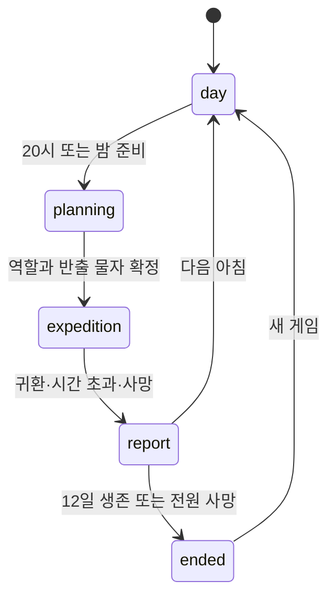

# 구현 노트

## 상태의 경계

낮의 규칙은 `engine.js`, 밤의 직접 조작은 `expedition.js`, 표현은 `scene.js`, 사용자 입력과 전환은 `app.js`, 저장과 호환 처리는 `saves.js`가 담당합니다. 게임 상태는 직렬화 가능한 데이터이며, HTML이나 Canvas 객체를 넣지 않습니다.

수색자를 선택하지 않은 밤도 `expedition`으로 진입한 뒤 즉시 `finishNight`를 호출하여 같은 정산 경로를 사용합니다. `nightPlan.resolved`와 phase 검사가 중복 귀환·중복 정산을 차단합니다.

## 재고와 작업

`inventory`는 은신처 공용 재고입니다. 작업 시작 시 재료를 예약하여 차감하고, 완료 시 결과물을 추가합니다. 작업을 중단하면 예약 재료만 한 번 반환합니다. 여러 생존자가 같은 재료를 중복 사용하는 것을 막습니다. 대기열은 행동 ID 배열로 최대 3개까지 보관합니다. 예약 단계에는 재료를 차감하지 않으며, 예상 완료 시점의 시설·재고·남은 시간으로 예약 가능 여부를 표시합니다. 실제 착수 때 자원이 없으면 해당 예약을 취소하고 다음 작업을 검토합니다. 시간 진행은 완료 시점마다 나누어 처리하므로 큰 tick과 작은 tick의 결과가 같습니다. 제작·건설의 동시 중복 제한도 엔진에서 검사합니다.

시간은 낮 동안 실제 1초당 게임 12분, 2배속에서는 24분입니다. 사용자 선택 중 생각할 시간을 위해 처음과 매일 아침은 정지 상태입니다. 낮 종료는 남은 시간을 처리하며 작업 완료 또는 취소를 정리합니다.

## 야간 물자의 소유권

밤 계획 확정 시 가방의 물품을 은신처 재고에서 차감합니다. 남은 장비만 은신처 방어에 사용합니다. 귀환 시 가방은 한 번만 재고에 들어가며, 귀환한 연료로 지난밤 난방을 소급 충족시키지 않습니다. 현장 결과의 `health`와 `fatigue`는 절대값이므로 두 번 더하지 않습니다.

가방 공간은 물품마다 정의된 묶음 크기를 사용하여 `ceil(수량 / 묶음 크기)`의 합으로 계산합니다. 상자를 조사하는 것과 아이템을 가져오는 것을 분리합니다. 내려놓은 물건은 현장에 남고, 사망 시 가방 역시 회수 가능한 흔적으로 남습니다.

## 장소의 지속 상태

각 장소는 남은 아이템, 열린 잠금, 조사 여부, 주민 상태, 버린 물자를 기억합니다. 원정이 JSON 저장을 거쳐 공유 참조를 잃더라도 `result.locationState` 스냅샷을 통해 정확한 최종 상태를 엔진에 반영합니다. 같은 장소를 다시 방문해도 이미 가져간 물자는 되살아나지 않습니다.

## 이동과 상호작용

층별 기준 높이는 Canvas 좌표 600·410·220입니다. 길찾기는 계단의 연결을 따라 이루어집니다. 화면 좌표는 렌더러에서 DPR과 letterbox를 보정한 논리 좌표로 변환합니다. 상자·은신처·문을 직접 클릭한 경우 `interact(exp, target)`에 대상 ID를 넘겨, 주변의 다른 사물과 혼동하지 않습니다.

닫힌 문은 같은 층의 이동·시야·공격·물품 가져오기를 차단합니다. 탐험 구간과 기억한 물품·문은 저장하고, NPC는 현재 시야에 들어온 경우만 표시합니다. NPC는 순찰, 경고, 조사, 추적, 공격과 도주 등 제한된 상태를 사용합니다. 이동 소음·시야·소유 물품과 행동이 연결됩니다. 실제 전투의 복잡성을 재현하기보다는 수색 위험과 철수 결정을 만드는 수준입니다.

## 캠페인 압박과 결말

허기와 피로, 추위와 질병, 약탈과 사기 저하가 지속적인 운영 부담을 만듭니다. 생존자가 남아 있는 상태에서 12번째 밤의 결과를 확인하면 승리합니다. 전원 사망은 보고 화면을 거쳐 재시작 가능한 패배 화면으로 전환합니다.

## 저장 및 오류 방지

자동 저장에는 직전 정상 스냅샷 백업과 하루 시작 시점 체크포인트가 있습니다. 손상된 기본 기록은 정상 백업, 아침 기록 순서로 복구합니다. 다른 캠페인의 체크포인트를 복원하지 않도록 seed를 비교합니다. 기존 v1 기록은 없는 대기열·상인 재고·문·탐험 정보를 보완합니다. 진행 중이던 구 버전 수색에는 새 문을 열린 상태로 넣어 경로가 막히지 않게 합니다.

자동 저장 키는 `last-light-campaign-v1`이며 envelope는 `{schema, state, expedition, savedAt}`입니다. 수동 가져오기와 자동 재개는 같은 검증 함수를 사용합니다. 캠페인 버전, 정수 재고, 알려진 아이템, 생존자 ID, phase, 작업, 장소, 좌표, 가방 용량 일치를 확인합니다. 저장 데이터에 DOM이나 실행 코드는 들어가지 않습니다.

페이지를 숨기거나 포커스를 잃으면 시간을 멈추며, 주기 저장과 주요 행동 저장을 함께 사용합니다. 여러 탭에서 같은 생존기를 동시에 조작하는 동기화 기능은 없으므로 한 탭에서 플레이하는 것을 권장합니다.

## 확장 지점

지역 콘텐츠는 `LOCATIONS`와 지도 정의, 제작법은 `RECIPES`, 시설은 `FACILITIES`, 물품은 `ITEMS`에서 추가할 수 있습니다. 실제 확장 시 가져오기 검증, 해금 규칙, 관련 UI와 테스트를 같이 갱신해야 합니다. 수치 변경만으로 원작과 동일한 시뮬레이션이 되지는 않습니다.

## 치료와 직접 교환

동료 치료는 시전자 작업에 환자 ID를 기록합니다. 시전자 특성으로 회복량을 결정하고, 취소 또는 환자의 사망에는 예약 자원을 반환합니다. 현장 응급처치는 3초 동안 정지해야 하며, 완료할 때만 붕대 1개를 소비합니다. 이동·피격 취소는 소비하지 않습니다.

상인의 재고는 직접 교환과 꾸러미가 공유합니다. 제공 물자의 판매 가치가 요구 물자의 구매 가치 이상이어야 거래하며, 같은 품목을 양쪽에 올릴 수 없습니다. 입력 오류·부족한 재고·가치 부족은 재고를 변경하지 않고 거부합니다. 고정 꾸러미와 재판매를 조합해도 가치가 늘어나지 않도록 검증합니다.

## 단일 HTML 포장

모듈 소스가 기준이며 `scripts/package-offline.mjs`가 알려진 로컬 ES 모듈 구문만 허용하여 독립 스코프의 IIFE로 묶습니다. 지원하지 않는 import/export 구문은 조용히 무시하지 않고 오류로 중단합니다. CSS와 SVG 아이콘도 내장하여 외부 파일 요청 없이 실행합니다. 포장 후 JavaScript 구문 검사와 같은 UI 통합 테스트를 수행합니다. 배포용 파일과 소스 ZIP도 같은 소스 상태에서 갱신합니다.

## 3.0의 추가 경계

### 캠페인과 유지보수

`createGame(seed, {difficulty})`는 고정 12일 프로필의 표준·봉쇄 조건을 선택합니다. 난이도는 초기 재고·밤 허기·습격 확률·강도·마모에만 정해진 차이를 주며, 현재 게임에서 임의로 전환하지 않습니다. `getShelterStatus`가 내구도와 문 보강의 유효 방어 기여를 계산하고, `getNightForecast`와 실제 습격은 같은 압박 계산을 사용합니다.

습격은 마모 전 방어력으로 한 번 판정하고 내구도를 줄입니다. 수리는 기존 작업 상태 기계에 포함하여 비용 예약·완료·취소·대기열을 공유합니다. 물자 증감은 출발 전 재고와 아침 재고를 비교하고, 인물 변화는 귀환 전후 스냅샷으로 저장합니다.

### 현장 상태와 대화

스태미나, 회피 동작·재사용 대기, NPC 공격 예고는 직렬화 가능한 상태입니다. `stepExpedition`이 시간을 진행하고 공격 예고가 끝날 때 시야·거리·문·회피를 재판정합니다. 렌더러는 현재 보이는 NPC의 상태만 사용합니다.

`getEncounter`는 근처의 보이는 비적대 주민에 대한 읽기 전용 조회입니다. `resolveEncounter`는 비용 차감 후 보상까지 들어간 최종 가방과 권한을 원자적으로 반영합니다. 출입과 물품 허락은 별개이며, 도움/교환은 하나만 완료할 수 있습니다. 공격 후 적대 상태와 허락 철회도 장소 데이터에 남습니다.

### UI와 저장의 연결

주민 대화는 기존 modal 일시정지 규칙을 사용합니다. 해제 후에는 진입 전 일시정지 상태로 돌아갑니다. 새 게임의 번호 입력은 범위를 확인한 뒤 사용합니다. 동일 번호와 다른 난이도의 아침 기록을 혼용하지 않으며, 명시적으로 새 게임을 시작하면 `startCampaign`으로 기본·백업·아침 기록을 모두 초기화합니다.

새 UI는 모든 외부 저장 문자열을 HTML로 이스케이프합니다. 야간 버튼과 키보드는 같은 Field API를 호출하고, 복수 터치는 포인터별로 추적하여 하나의 손가락 해제가 다른 이동을 취소하지 않도록 합니다.

## 시스템별 세부 명세

- [은신처·경제](docs/01-shelter-and-economy.md): 자원 소유권, 작업 예약, 수리와 방어, 보고서.
- [야간·주민](docs/02-night-and-encounters.md): 시야·이동, 전투 시간, 회피, 대화·권한·반복 방지.
- [캠페인·저장](docs/03-campaign-and-saving.md): 난이도, 시드, 개인 후일담, 이전 기록 복원과 검증 범위.

## 4.0의 캠페인 연결

`getReliefStatus`는 진행 단계·날짜·실제 보급 상태를 조회하고, 행동 자체는 기존 `performAction`/`enqueueAction`으로 수행합니다. 예약은 비용을 선점하지 않으며 실제 착수에서 확인합니다. 교신의 지연 지급은 `finishNight`에서 난방·습격을 처리한 뒤 실행하므로 미래 물자로 과거 비용을 지불하지 않습니다. 구호 준비 여부는 승리 판정을 바꾸지 않고 `ending.route`와 후일담에 반영됩니다.

`getSurvivalAdvice`는 생존 상태로 최대 네 개 행동을 정렬하며 읽기 전용입니다. UI는 조언을 선택하면 해당 생존자·카테고리를 표시하고, 구호 목표는 담당자를 선택할 수 있는 모달로 연결합니다.

## 4.0의 소리와 길 안내

`throwDistraction`은 가방 부품 1개를 차감한 뒤 별도 착지점 소리를 생성합니다. NPC는 현장 시야와 기존 공격을 먼저 판단한 뒤 소리를 조사하며, 위치나 적대 관계를 순간 이동·초기화하지 않습니다. 현장 시간과 소리·재사용·조사 시간은 모두 직렬화할 수 있습니다.

UI 조준은 잠깐 일시정지하고 원래 정지 여부를 기억합니다. 취소하면 원래 상태, 성공하면 진행 상태로 돌아갑니다. 이동·대화·탭 비활성·기록 교체는 조준 상태를 해제합니다. Canvas의 `worldPoint`는 사물 hit priority를 거치지 않고 좌표를 변환하며, 미니맵을 포함한 비상호작용 영역은 거부합니다.

`getNavigation`은 탐험한 구간과 실제 계단 그래프로 귀환 경로를 계산합니다. 정보가 없으면 거리를 알 수 없다고 반환하며 숨은 NPC와 상자 내용을 노출하지 않습니다. Canvas는 다시 현재 시야와 탐험 구간을 적용해 지도·소리 표식을 그립니다. `miniMap`과 `reducedMotion` 옵션은 시각 표현에만 영향을 줍니다.
