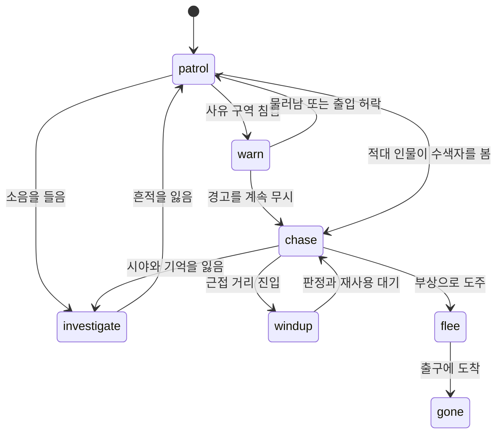

# 02. 야간 탐색·전투·주민 상호작용

LAST LIGHT Campaign Edition 4.0의 야간 규칙입니다. 기준 구현은 [expedition.js](../dist/expedition.js), 시각 표현은 [scene.js](../dist/scene.js), 연결 UI는 [app.js](../dist/app.js)입니다.

## 목표와 공간

수색은 한 명만 수행하고, 현장 시간 100초 안에 필요한 물자를 챙겨 왼쪽 아래 출입구로 돌아옵니다. 도움말·설정·주민 대화와 일시정지 중에는 시간이 흐르지 않습니다. 낮의 2배속은 현장 속도를 바꾸지 않습니다.

세계 좌표는 1280×720이며 층별 발 위치는 y=600·410·220입니다. 클릭 이동은 실제 계단 연결을 따라 경로를 만들고, 키보드 방향 입력은 기존 자동 이동을 취소합니다. 수평 이동·공격·조사·물품 회수·시야는 닫힌 문을 통과하지 못합니다.

| 장소 | 해금 | 주요 판단 |
|---|---:|---|
| 비어 있는 연립주택 | 1일 | 기본 수색과 가방 사용, 잠금 도구 |
| 폐쇄된 진료소 | 2일 | 의료 물자와 관리인의 허락 |
| 오래된 정비소 | 3일 | 도구·부품·연료와 교환 |
| 가족의 아파트 | 4일 | 가족의 식량과 도움의 대가 |
| 철도 보급 창고 | 5일 | 적대 경비, 큰 보급과 철수 위험 |

상자마다 수량이 고정되어 있으며 방문할 때 다시 생성하지 않습니다. 조사와 물품 가져오기는 다른 행동입니다. `takeAllLoot`는 현재 묶음과 남은 칸에 들어가는 수량만 가져오고, 남은 물자는 상자에 유지합니다.

## 시야와 기억

플레이어는 같은 층에서 최대 330 범위를 보며 닫힌 문이 이 구간을 잘라냅니다. 미탐험 구역은 어둡게, 이전에 본 구역은 기억으로 표시합니다. 발견한 상자와 문은 기억하지만 주민은 현재 시야에 있을 때만 렌더링·선택할 수 있습니다.

`getVisibility`와 `getEncounter`는 읽기 전용 조회입니다. 렌더러는 이 결과를 사용하여 게임 규칙과 다른 시야를 만들지 않습니다. 문 뒤 NPC의 경고 표시·공격 예고·대화 아이콘 역시 보이지 않아야 합니다.

## NPC의 상태 전환

`windup`은 설명을 위한 논리 단계입니다. 실제 상태에는 `npc.state='attack'`과 남은 `npc.windup` 시간이 함께 저장됩니다. 주민의 경고는 3.1초 누적 후 적대로 이어집니다. 허락 없이 소유 물자를 가져오거나 주민을 공격하면 관계가 악화되고, 공격으로 허락을 철회한 상태는 다음 방문에도 남습니다.

## 전투의 시간과 비용

스태미나는 야간 행동 자원입니다. 낮 화면의 기력(`100-fatigue`)과 별개입니다. 시작값과 상한은 100이며, 공격과 회피의 남용을 제한하고 위험에 대응할 여유를 만듭니다.

| 규칙 | 값 | 의미 |
|---|---:|---|
| 플레이어 공격 비용 | 스태미나 22 | 실제 공격 가능 조건을 먼저 검사 |
| 회피 비용 | 스태미나 28 | 확정된 짧은 이동에 비용 지불 |
| NPC 공격 예고 | 0.55초 | 원호와 남은 시간으로 표시 |
| 회피 동작 | 0.26초 | 방향을 고정한 이동 |
| 회피 속도 | 450 좌표/초 | 장애물이 없으면 최대 117 이동 |
| 회피 판정 시간 | 0.18초 | 근접 피해를 피할 수 있는 짧은 구간 |
| 회피 재사용 대기 | 2.4초 | 연속 무적 방지 |
| 스태미나 회복 지연 | 0.75초 | 행동 직후 즉시 회복되지 않음 |
| 스태미나 회복 속도 | 초당 14 | 공격 회복·회피·계단·조사·치료 중에는 회복하지 않음 |

Q를 누르면 이동 키 방향, 방향 키가 없다면 바라보는 쪽으로 회피합니다. 이동은 세계 경계와 닫힌 문에 막힙니다. 계단과 공격 회복 중에는 회피할 수 없습니다. 문에 충돌하여 회피가 끝나면 회피 판정도 함께 끝납니다. 조사·치료 중 회피는 진행 중 작업을 취소합니다.

NPC 공격은 가까워졌다는 이유로 즉시 피해를 주지 않습니다. 예고가 끝날 때 실제 거리, 같은 층, 시야·문, 회피 상태를 다시 검사합니다. 예고 중 물러나거나 문으로 막으면 공격은 빗나가고 재사용 대기를 가집니다. 플레이어가 먼저 공격해도 체력·소음·주민 관계·추가 경비 반응이 연결됩니다.

## 응급처치

현장 붕대는 3초 동안 정지하면 건강 30을 회복하며 상한은 100입니다. 완료할 때 붕대 1개를 사용하고 12초 재사용 대기가 생깁니다. 이동이나 피격은 진행을 취소하며 미완료 치료에는 붕대를 소비하지 않습니다. 치료 완료와 피격이 같은 프레임이면 피격 취소를 먼저 반영합니다.

## 주민 대화의 자격

R, 주민의 말풍선, 또는 오른쪽 대화 카드로 시작합니다. 같은 층에서 현재 보이고, 거리 180 이내이며 살아 있는 비적대 주민이어야 합니다. 문 너머나 교전·도주 중인 주민과는 대화할 수 없습니다. 조사·치료·회피·계단·공격 회복 중에는 선택을 실행할 수 없고 그 이유를 보여 줍니다.

대화 화면은 시간을 멈추고 정확한 비용·보상·결과를 먼저 표시합니다. 물자는 집의 재고가 아니라 수색 가방에서 사용합니다. 출발 화면에서 식사·물·약품·부품·붕대를 반출할 수 있습니다.

### 출입과 소유권

| 선택 | 비용·보상 | 권한 | 반복 |
|---|---|---|---|
| 통행 요청 | 무료 | 사유 구역 출입 허용 | 같은 요청을 다시 실행하지 않음 |
| 도움 | 장소별 비용·보상 | 출입 + 지정 사유 보관함 나눔 | 도움/교환 중 한 번 |
| 교환 | 장소별 비용·보상 | 출입 + 지정 사유 보관함 나눔 | 도움/교환 중 한 번 |

통행 허락만으로 사유 물자를 가져갈 수는 없습니다. 도움 또는 교환을 완료하면 해당 보관함의 `owned`가 해제되고 잠금도 풀립니다. 출입 요청 이후 도움/교환을 추가로 선택할 수 있지만 도움과 교환을 둘 다 받아 보상을 중복 획득할 수 없습니다.

| 장소 | 도움 비용 → 보상 | 교환 비용 → 보상 |
|---|---|---|
| 진료소 | 물 2 + 붕대 1 → 약품 1 | 식사 2 → 붕대 2 |
| 정비소 | 부품 3 → 연료 2 | 물 3 + 식사 1 → 부품 4 |
| 아파트 | 식사 2 + 물 2 → 천 2 | 약품 1 → 식재료 2 |

도움은 수색자의 사기를 3 회복시키며 `result.helped`로 밤 정산 후 공동체의 도움 통계에 한 번 반영합니다. 교환과 무료 통행 요청은 도움 통계를 늘리지 않습니다. 비용을 뺀 뒤 보상까지 담은 최종 가방의 용량을 계산하여, 공간이 부족하면 물자와 권한 모두 변경하지 않습니다.

## 지속 상태와 악용 방지

장소별 `remaining`, `opened`, `searched`, `npcState`, `dropped`에 문·탐험·발견 기억을 저장합니다. 3.0은 `encounters`, `permissions`, `hostileNpcIds`를 추가합니다. JSON 왕복과 다음 방문에서도 완료한 대화, 받은 허락, 회수한 보상, 적대 전환을 유지합니다.

상자의 남은 수량을 되살리거나 주민을 다시 방문해 보상을 무한히 얻을 수 없습니다. 보관함의 물품을 내려놓거나 사망해 남겨진 가방도 장소 데이터로 남습니다. 귀환은 `done`과 결과 스냅샷을 확정하고 이후 추가 획득·공격·치료를 막습니다.

## 중요한 검증 경계

- 공격 예고 중 거리 이탈·문 차단·회피로 피해 판정이 달라지는가.
- 스태미나 부족과 재사용 대기 상태에서 비용을 중복 소비하지 않는가.
- 회피가 문·세계 경계·계단·치료와 충돌해 잘못된 저장을 만들지 않는가.
- 대화가 현재 보이지 않는 주민이나 비용 부족 상태의 정보를 잘못 노출하지 않는가.
- 요청만 받은 상태의 절도, 도움 후 합법 반출, 공격 후 허락 철회가 구분되는가.
- 빈칸 부족·잘못된 선택·재방문에서 물자와 권한의 일부만 반영되지 않는가.

## 4.0의 소음 유인과 길 안내

부품 투척, 별도 소리 발생점, NPC 조사 우선순위와 탐험 정보 기반 미니맵을 추가했습니다. 상세 판정·입력·저장·회귀 검증은 [은밀한 행동과 길 안내](05-stealth-and-navigation.md)를 참고하세요. 기존 공격·회피·문·주민 허락 규칙을 그대로 사용합니다.
