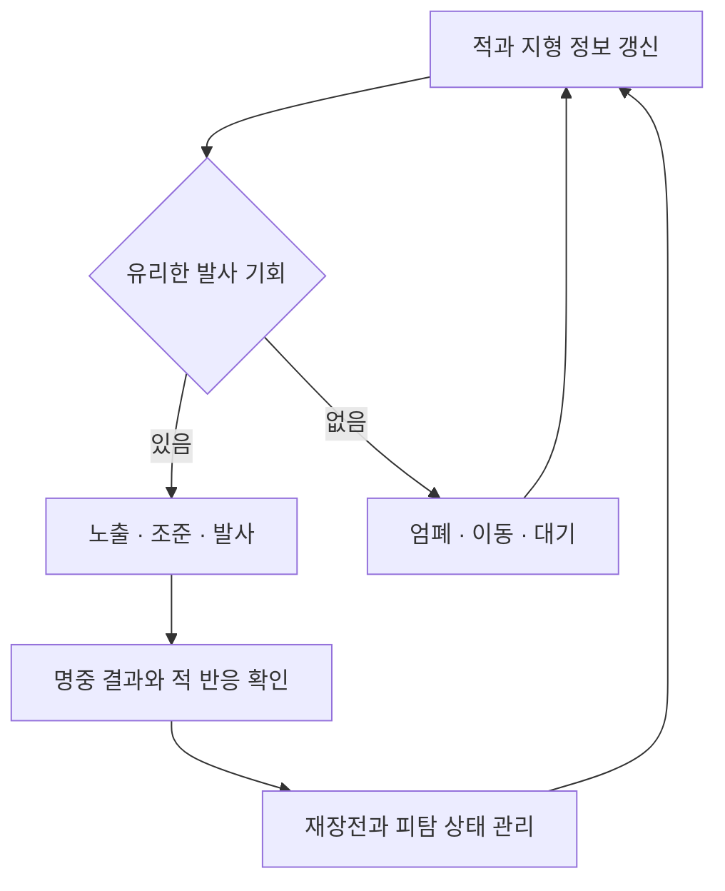
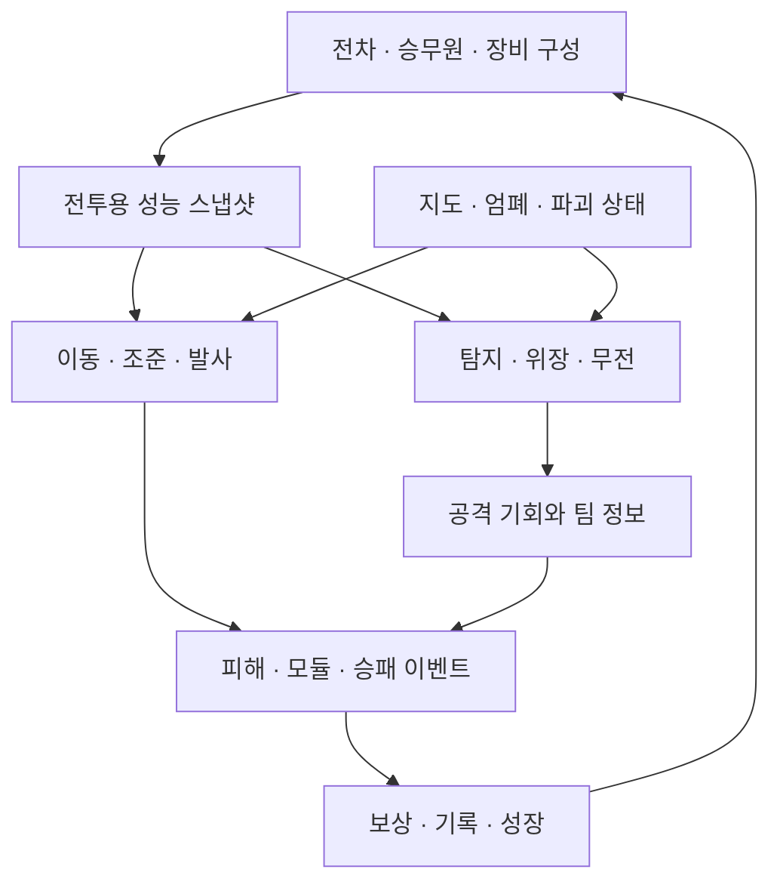

# 01. 제품 구조와 핵심 플레이 루프

> 대상: Wargaming World of Tanks PC판 · 기준일: 2026-11-13 KST  
> 문서 성격: 공개 자료 기반 역기획. 실제 클라이언트 조작, 패킷 분석, 소스 코드 검증은 수행하지 않았다.  
> 표기: **[확인]** 공개 규칙 / **[분석]** 규칙의 설계적 해석 / **[제안]** 재구성 구현 / **[검증 필요]** 공개 근거가 부족한 사항  
> 읽기 순서: [전체 목차](00_README.md) → 이 문서 → [전투 생명주기](02_Battle_Rules_and_Lifecycle.md)

## 1. 제품을 한 문장으로 정의하기

**[분석] 월드 오브 탱크는 전차의 장갑·화력·기동 차이와 불완전한 적 정보를 이용해, 유리한 발사 기회를 만들고 팀의 남은 전투력을 보존하는 세션형 전술 전투 게임이다.**

플레이어가 직접 다루는 것은 한 대의 전차이지만, 실제로 거래하는 자원은 여러 가지다. 체력은 위험을 감수할 수 있는 양, 재장전은 다음 공격까지의 시간, 시야는 불확실성을 줄이는 수단, 지형은 적의 대응을 제한하는 조건이다. 따라서 이동과 사격만으로 게임을 복제하면 핵심 경험이 재현되지 않는다. 장갑 방향, 탐지 정보, 발사 간격, 팀 화력의 동시 집중이 연결되어야 한다.

**[확인]** 공식 소개는 무작위 전투의 대표 형식을 15명 팀 간 전투로 설명한다. 다만 실제 큐의 인원 예외와 모드 차이는 별도 규칙이다. 2.0에서 11티어와 전용 성장 시스템이 도입되었으므로 10티어를 전체 게임의 최종 단계라고 정의하면 현재 제품 구조와 맞지 않는다. [S01][S02]

## 2. 범위와 서비스 구분

| 구분 | 이 문서의 취급 | 구분해야 하는 이유 |
|---|---|---|
| Wargaming PC Random Battles | 분석의 중심 | 전차·장갑·시야·차고·경제가 만나는 기본 루프 |
| PC Onslaught 및 이벤트 | 별도 규칙 집합 | 인원, 부활, 시야, 승리 조건이 달라질 수 있음 |
| PC 클랜 콘텐츠 | 조직과 장기 목표 | 개인 재화와 클랜 자원이 분리됨 |
| World of Tanks Blitz | 대상 제외 | 인원, 시간, 경제, 모듈 규칙을 PC에 이식하면 오류 |
| World of Tanks Modern Armor | 대상 제외 | 콘솔 제품 및 모드별 차이 |
| Lesta의 Mir Tankov | 대상 제외 | 서비스 분리 이후 패치와 콘텐츠가 독립적으로 변화 |
| Common Test / Supertest | 실험 또는 예정 규칙 | 라이브 적용의 증거로 사용하지 않음 |

**[분석]** 역기획서의 기본 식별자는 게임명 하나가 아니라 `제품 + 서비스 권역 + 패치 + 모드`이어야 한다. 같은 “경전차 제한”도 전투 전체, 소대 편성, 특정 이벤트 중 무엇을 제한하는지에 따라 의미가 달라진다.

## 3. 세 겹의 플레이 루프

### 3.1 1~20초: 사격 기회 루프



**[분석]** 한 발의 성공은 명중으로 끝나지 않는다. 사격 후 숨을 수 있는지, 궤도가 끊겼을 때 수리 수단이 있는지, 상대 클립에 남은 탄이 있는지까지 포함해야 한다. 이 때문에 조준 UI와 재장전 UI는 단순 조작 보조가 아니라 위험 계산 도구가 된다.

### 3.2 한 전투: 전선 형성 → 우세 확대 → 승리 확정

| 단계 | 플레이어의 질문 | 주요 시스템 | 실패가 누적되는 방식 |
|---|---|---|---|
| 배치 | 어느 방향에서 내 역할을 수행할까? | 지도·양팀 편성·기동성 | 늦은 진입, 역할 중복, 빈 전선 |
| 초반 접촉 | 어디에 적이 있고 얼마나 더 있을까? | 탐지·무전·미니맵 | 정보 없는 돌출, 초기 체력 손실 |
| 교전 | 언제 누구에게 한 발을 교환할까? | 관통·조준·재장전·장갑 | 비관통, 집중 사격, 궤도 고정 |
| 전환 | 지금 밀어야 하나, 돌아가야 하나? | 전력·이동 시간·기지 상태 | 승리한 전선의 정체, 수비 복귀 지연 |
| 종결 | 전멸과 점령 중 무엇이 안전한가? | 생존·점령·남은 시간 | 불필요한 추격, 점령 저지 실패 |

**[분석]** 위 단계는 강제 퀘스트 순서가 아니다. 전투를 해석하기 위한 모델이며, 빠른 돌파나 조기 전멸 때문에 일부 단계가 거의 생략될 수 있다.

### 3.3 여러 전투: 목표 설정 → 획득 → 구성 변경

**[확인]** 연구·구매, 승무원, 장비·소모품, 미션과 보상은 차고에서 전투 준비를 바꾸는 독립 기능으로 제공된다. 상세 규칙은 [13](13_Research_Progression_and_Tier_XI.md)~[17](17_Missions_Monetization_and_LiveOps.md)에서 설명한다. [S03]

**[분석]** 성장 루프는 “숫자 상승”만으로 이해하면 부족하다. 새 포를 장착하면 유효 교전 거리가 바뀔 수 있고, 시야 장비를 선택하면 담당할 위치가 바뀌며, 소모품 구성이 달라지면 위험을 감수할 수 있는 조건이 달라진다. 성장 결과가 전투 선택을 바꿔야 장기 진행과 세션 전투가 연결된다.

## 4. 핵심 자원과 전환 관계

| 자원 | 직접 소비 또는 손실 | 전환되는 이익 | 복구·회수의 성격 |
|---|---|---|---|
| 체력 | 피탄, 화재, 충돌 등의 피해 | 위치 선점, 적 한 발 소모, 돌파 | 일반전과 회복형 이벤트를 분리 |
| 시간 | 이동·조준·재장전·대기 | 정확한 발사, 더 좋은 각도 | 지나간 시간은 회복 불가 |
| 정보 | 탐지 후 소실, 위치 이동으로 노후화 | 집중 사격, 우회, 안전한 전진 | 재탐지·관측·팀 공유로 갱신 |
| 공간 | 전선 후퇴, 엄폐 파괴 | 적의 기동·사격 선택 제한 | 우회와 재점령으로 회수 |
| 탄약 | 발사에 따라 감소 | 피해·모듈 손상·압박 | 기본전과 재보급 모드를 구분 |
| 소모품 가용성 | 사용 후 재사용 대기 | 기동·화력·인적 성능 복구 | 종류별 효과·주기가 다름 |
| 크레딧 | 차량·탄약·정비·구성 비용 | 다음 전투의 준비 수준 | 보상과 판매 등 별도 유입 |
| 연구 진행 | 지출 또는 누적 | 새 차량·업그레이드 접근 | 계정·차량별 귀속을 관리 |

**[분석]** 체력 손실만 피하는 플레이가 항상 최적은 아니다. 팀의 핵심 정찰차를 보호하며 전선을 유지할 수 있다면 일부 체력을 쓰는 것이 이후의 화력 기회를 늘릴 수 있다. 반대로 피해량을 늘리려고 마지막 수비 위치를 비우면 팀 승리 가능성이 떨어질 수 있다.

## 5. 전차 개성을 구성하는 설계 축

**[분석]** 전차를 하나의 전투력 숫자로 비교하지 않고, 다음의 조건부 성능으로 분해한다.

| 축 | 질문 | 다른 축과의 관계 |
|---|---|---|
| 단발 화력 | 노출 한 번으로 얼마를 얻는가? | 긴 재장전·큰 분산과 결합하면 실패 비용 증가 |
| 지속 화력 | 오랫동안 쏠 수 있을 때 얼마나 강한가? | 실제 사격선 유지 시간이 필요 |
| 순간 화력 | 짧은 시간 안에 대상을 제거할 수 있는가? | 클립 소진 후 장시간 취약할 수 있음 |
| 장갑 신뢰도 | 어느 방향·상대 탄종에서 버티는가? | 지형·각도·약점 노출과 결합 |
| 위치 접근성 | 유리한 지형에 먼저 도착하는가? | 최고 속도뿐 아니라 가속·회전·지형 저항 |
| 정보 능력 | 적을 먼저 보고 자신은 숨을 수 있는가? | 시야와 위장은 상대값으로 작동 |
| 포 배치 자유도 | 차체를 숨긴 채 조준 가능한가? | 부각·앙각·포탑 회전·지형 경사 |
| 실수 회복력 | 잘못 진입했을 때 탈출 가능한가? | 후진·장갑·수리·승무원·엄폐 거리 |
| 구성 의존도 | 완성 구성과 초기 구성의 격차는? | 연구 병목과 체감 공정성에 영향 |

**[제안]** 차량 평가 화면에는 평균값 외에 “능력이 발휘되는 조건”을 노출한다. 예를 들어 “조준 완료 후 장거리 정지 사격”, “포탑만 노출한 지형”, “짧은 시간 안의 연속 발사” 같은 전투 문맥을 데이터와 연결한다. 이 설명 방식은 단순 수치 표보다 초보자의 잘못된 역할 선택을 줄일 수 있다.

## 6. 전투 의사결정을 수식으로 읽는 방법

아래는 **[분석]용 간이 모델**이며 실제 게임의 AI, 매치메이커, 보상 공식이 아니다.

```text
발사 기회의 예상 직접 기여
  ≈ 명중 가능성 × 관통 가능성 × 예상 유효 피해

순간 노출의 가치
  ≈ 직접 기여 + 팀 후속 사격 가치 + 위치 확보 가치
     - 예상 반격 손실 - 탈출 실패 비용 - 이후 기회 상실
```

예를 들어 가상의 공격에서 명중 가능성 0.7, 관통 가능성 0.6, 유효 피해 400을 가정하면 직접 피해의 기대값은 168이다. 이 숫자만으로는 발사 여부를 정할 수 없다. 같은 노출로 600의 반격을 받을 위험이 있으면 불리할 수 있고, 마지막 적 정찰차를 제거해 팀 전체가 자유롭게 움직이게 된다면 직접 피해 이상의 가치가 있다.

**[분석]** 실제 플레이어는 이런 곱셈을 매번 계산하지 않는다. 학습을 통해 “이 거리의 이 약점은 맞히기 어렵다”, “상대가 방금 쐈다”, “뒤에 아군 화력이 있다”라는 압축된 판단 규칙을 형성한다. 게임이 제공하는 피드백은 이 학습이 가능한 수준으로 일관되어야 한다.

## 7. 전형적인 두 상황의 역기획

### 상황 A: 중전차가 모퉁이에서 한 발을 교환한다

1. 상대의 마지막 발사와 후퇴를 관찰한다.
2. 차체 각도와 포탑 노출을 조절하며 발사선을 연다.
3. 목표의 약점, 이동, 조준 수렴을 비교한다.
4. 발사 후 즉시 같은 자리에서 후속 사격을 기다릴지 엄폐할지 선택한다.
5. 궤도 손상 또는 피탐·측면 위협이 생기면 원래 계획을 중단한다.

**[분석]** 장갑, 조준, 이동, 피해, 수리, 시야가 하나의 짧은 행동에 모두 관여한다. 이 중 하나의 판정 또는 UI 표현이 늦으면 “조작이 먹히지 않았다”는 인상을 줄 수 있다.

### 상황 B: 정찰차가 공격하지 않고 교전을 만든다

1. 팀의 사격선과 연결되는 관측 위치에 도착한다.
2. 자신의 위장 상태를 유지하면서 적의 이동을 드러낸다.
3. 직접 사격이 탐지 위험을 키우는지 판단한다.
4. 아군의 사격 결과와 적의 접근을 보고 위치를 바꾼다.
5. 전선이 무너지면 정찰 유지보다 생존과 다음 관측 위치 확보를 우선한다.

**[분석]** 좋은 정찰은 발견 횟수만으로 평가하기 어렵다. 아군이 실제로 쏠 수 있는 시점과 위치에서 제공한 정보인지, 정찰차가 너무 일찍 사라지지 않았는지가 중요하다.

## 8. 시스템 의존성



**[제안]** 재구현에서는 화력 계산, 탐지, 보상을 하나의 거대한 차량 클래스에 넣지 않는다. 같은 사건을 서로 다른 시스템이 해석하되, 확정 피해와 승패 같은 사실은 공통 이벤트로 전달한다. 특히 “피해를 주었다”와 “보상 대상 피해다”를 분리해야 이벤트와 훈련 모드를 안전하게 확장할 수 있다.

## 9. 역기획의 우선순위

| 우선순위 | 먼저 밝혀야 하는 질문 | 필요한 산출물 |
|---|---|---|
| P0 | 맞은 곳과 결과가 일관적인가? | 장갑·탄종·피해 판정표 |
| P0 | 누가 누구를 언제 볼 수 있는가? | 탐지·공유·표시 상태 모델 |
| P0 | 전투가 언제 어떻게 끝나는가? | 승패·점령·결과 확정 계약 |
| P1 | 전차별 역할이 실제 전투에서 구별되는가? | 조건부 성능·지도 상성 |
| P1 | 연구와 장비가 선택을 어떻게 바꾸는가? | 성장 의존성·비용·구성 규칙 |
| P1 | 매칭이 역할과 플레이 경험을 어떻게 보존하는가? | 제약과 완화 조건 |
| P2 | 장기 목표와 사회적 인정이 재참여를 만드는가? | 미션·기록·클랜·운영 구조 |

## 10. 검증 항목

| ID | 확인 방법 | 확인할 결과 |
|---|---|---|
| LOOP-01 | 같은 전차로 장비 한 종류만 변경 | 어떤 전투 선택이 바뀌는지 설명 가능 |
| LOOP-02 | 동일 위치에서 발사/비발사 비교 | 위장 변화가 사격의 비용으로 읽힘 |
| LOOP-03 | 모퉁이 교전 로그 재생 | 노출·발사·반격·수리 순서가 추적됨 |
| LOOP-04 | 저체력 생존과 무리한 추가 피해 비교 | 개인 기록과 팀 승리를 분리해서 분석 |
| LOOP-05 | 재장전 중 안전지대까지 이동 | 이동 시간이 다음 발사 기회를 제한 |
| LOOP-06 | 일반전과 회복형 이벤트 비교 | 체력 자원 모델이 모드에 따라 달라짐 |
| LOOP-07 | 차고 변경 후 전투 시작 | 구성 스냅샷이 일관되게 적용 |
| LOOP-08 | 같은 룰의 서로 다른 패치 비교 | 행동 변화가 수치·지도·큐 변경 중 어디서 왔는지 구분 |

## 11. 범위상의 한계

실제 접속자 분포, 서비스 매출, 전환율, 잔존율, 서버 처리량, 차량별 내부 경제 계수는 확보하지 않았다. 이 문서의 설계 해석을 해당 회사의 의사결정 기록으로 읽어서는 안 된다. 전차 전체 목록과 가격·성능의 실시간 데이터베이스 또한 본 문서의 목적이 아니다. 차량별 세부 수치 대신 시스템의 계약, 예외, 의존성과 검증 방법을 문서화했다.

## 출처

- [S01] [공식 게임 소개](https://worldoftanks.eu/en/game/) — 무작위 전투의 대표 형식. 2026-11-13 확인.
- [S02] [Update 2.0: Under the Hatch of Tier XI](https://worldoftanks.eu/en/news/general-news/update-2-0-tier-11-overview/) — 2025년 도입 당시의 11티어와 성장 개편.
- [S03] [공식 Full Guide](https://worldoftanks.eu/en/content/guide/) — 기능 범주의 공식 안내. 세부 규칙은 각 담당 문서의 원출처를 우선한다.

