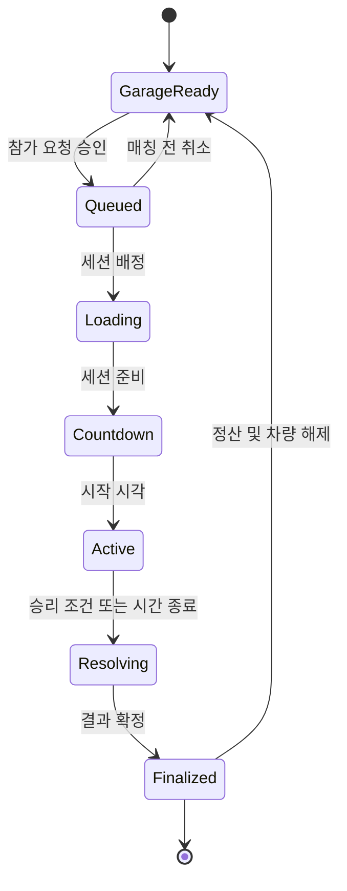

# 02. 전투 규칙·점령·세션 생명주기

> 대상: Wargaming PC판의 기본 무작위 전투(Standard Battle)  
> 기준일: 2026-11-13 KST · 라이브 확인 범위: 2.4.1 계열  
> **[확인]** 문서 규칙 / **[분석]** 설계 해석 / **[제안]** 재구성 모델 / **[검증 필요]** 현행 실측이 필요한 경계  
> 연관: [매칭](10_Matchmaking_and_Platoons.md), [모드별 예외](12_Modes_Competitive_and_Events.md), [서버 구조](19_Server_and_Data_Architecture.md)

## 1. 시스템의 책임

전투 세션은 계정과 차고에 있는 자산을 일시적인 전투 상태로 복제하고, 허용된 행동을 처리한 뒤, 승패·개인 기여·비용·성장 결과를 영속 계정에 반영하는 단위다.

**[분석]** 전차가 파괴되는 시점, 플레이어가 관전을 종료하는 시점, 서버가 전투를 종료하는 시점, 보상이 계정에 적용되는 시점은 서로 다를 수 있다. 이 네 시점을 같은 것으로 취급하면 결과 누락, 중복 보상, 전투 중 차량 재사용 같은 오류를 만들기 쉽다.

## 2. 대표 규칙과 근거 수준

| 항목 | 규칙 또는 해석 | 근거 수준 |
|---|---|---|
| 대표 인원 | 15 대 15가 기본 형식 | [확인] 공식 소개. 큐 상황 예외는 10장 |
| 기본 승리 | 적 전차 전멸 또는 적 기지 점령 | [확인] 공식 전투 매뉴얼 |
| 대표 제한 시간 | Standard Battle 최대 15분 | [확인·기존 공식 규칙] 최신 클라이언트의 지도별 예외는 실측 필요 |
| 시간 만료 | 승리 조건 미달이면 무승부라는 기존 기본 규칙 | [확인·기존 공식 규칙] Onslaught 규칙과 혼용 금지 |
| 전투 중 파괴 | 일반전은 이벤트식 무한 재출격과 구별 | [분석] 기본 규칙 모델. 모드마다 명시적 설정 필요 |
| 점령 완료 | 100% 표시만이 아니라 Base Captured 상태를 확인 | [확인] 개인미션 지원 문서 |
| 별도 무작위 모드 | Encounter·Assault·Grand Battles는 2.0에서 무작위 큐의 별도 모드로 중단 | [확인] 2.0 패치 노트 |
| 아군 사격·충돌 피해 | 일반 무작위 전투에서 비활성화된 기본 방향 | [확인] 1.6 도입. 스턴·밀기·제재 예외는 별도 |

출처: [S01]~[S06]. 오래된 매뉴얼의 UI 위치, 팀킬 설명, 모드 목록까지 현행으로 채택하지 않는다. **이 표에서 과거 공식 규칙으로 표시한 부분은 현행 재현 실험의 출발점**이며, 최신 패치에 대한 실플레이 확인을 대신하지 않는다.

## 3. 세션 입력과 출력

| 구분 | 데이터 |
|---|---|
| 입력 | 참가 계정, 팀, 차량 식별자, 모듈, 승무원, 장비, 탄약 배분, 소모품, 위장, 모드, 맵, 규칙 버전 |
| 전투 중 상태 | 위치·자세, HP, 모듈·승무원 상태, 탄약·재장전, 피탐·공유 정보, 점령 기여, 연결 상태 |
| 확정 결과 | 팀 승패, 종료 사유, 참가자별 기여, 지출 내역, 미션 판정 근거, 기록 갱신 요청 |
| 파생 결과 | 보상, 차량 잠금 해제, 자동 보급, 연구 가능 상태, 통계·리플레이 |

**[제안]** 준비 화면의 현재 장비값을 전투 중 계속 읽는 대신, 참가 확정 시 `VehicleBuildSnapshot`을 만든다. 이후 서버의 전투 계산은 이 스냅샷과 전투 중 이벤트만 참조한다. 패치와 차고 변경이 전투 도중 기존 세션의 성능을 바꾸지 않도록 하기 위한 제안이다.

## 4. 생명주기 상태도



**[제안]** 이것은 원작 내부 상태 머신을 복원한 것이 아니라 관찰 가능한 단계에 맞춘 구현 구조다. `Loading` 완료 조건, 클라이언트 지연 대기, 서버 오류 시 환불 정책은 실제 구현을 확인하지 못했으므로 독립 정책으로 둔다.

### 4.1 단계별 계약

| 상태 | 허용 행동 | 금지 또는 검증할 행동 | 다음 상태로 넘기는 정보 |
|---|---|---|---|
| GarageReady | 구성 편집·참가 요청 | 준비 미달 차량으로 참가 | 확정 가능한 구성 |
| Queued | 대기·취소 | 임의 팀 변경 | 큐 티켓·제약 |
| Loading | 맵·리소스 로드 | 전투 피해 발생 | 참가자 준비 상태 |
| Countdown | 편성 확인·계획 공유 | 시작 전 사격 판정 | 서버 시작 시각 |
| Active | 이동·발사·수리·점령 | 클라이언트의 승패 직접 선언 | 이벤트와 누적 상태 |
| Resolving | 결과 스냅샷 생성 | 결과 이후 신규 기여 반영 | 종료 사유·마지막 시퀀스 |
| Finalized | 정산·미션·통계 반영 | 같은 결과 이중 지급 | 영속 반영 확인 |

## 5. 차량 생명주기와 플레이어 생명주기를 분리하기

**[제안]** 세션과 별도로 참가자에 다음 상태를 둔다.

```text
VehicleState: Alive / Destroyed / Unavailable
ConnectionState: Connected / Disconnected / Reconnecting
ClientViewState: Driving / Spectating / Garage
SettlementState: Pending / Applied / FailedRetryable
```

예를 들어 전차는 파괴되었지만 계정은 연결 중이고 관전 중일 수 있다. 클라이언트가 차고로 돌아와도 전투 결과는 아직 `Pending`일 수 있다. 이 조합을 하나의 `isInBattle` 불리언으로 표현하지 않는 것이 좋다.

**[검증 필요]** 재접속 유예 시간, 파괴 후 차고 복귀의 세부 조건, 전투 종료 전 다른 차량 출격 가능 조건, 재접속 실패 시 AFK 판정은 클라이언트·모드 정책을 확인해야 한다. 실제 동작을 확인하지 않은 값을 하드코딩하지 않는다.

## 6. 기지 점령 모델

### 6.1 확인된 기초와 역사적 수치

**[확인]** 공식 개인미션 설명은 성공한 기지 점령을 `100%`와 `Base Captured` 상태로 설명한다. 2017년 Grand Battle 소개는 당시 Random Battle과 같은 점령 규칙을 쓰며 한 대 100초, 세 대 이상 약 33초가 걸린다고 안내했다. [S03][S07]

**[검증 필요]** 이 역사적 설명만으로 2026년 기본전의 서버 틱 반올림, 100% 이후 확정 유예, 피격 리셋 범위를 확정하지 않는다. 특히 Blitz의 “두 대 79초” 같은 값은 PC 근거가 아니므로 배제했다.

### 6.2 재구현을 위한 제안

**[제안]** 기지 하나에 진행도만 저장하지 않고 참가자별 기여를 저장한다.

```text
CaptureState
  base_id
  attacking_team_id
  contributor_points[player_id]
  total_progress
  completion_candidate_time
  capture_status: Idle / Capturing / CompletionPending / Captured
```

기여자별 저장은 피격·이탈·파괴로 특정 참가자의 기여만 제거하는 규칙을 지원한다. 다만 원작의 리셋 세부 동작은 아래 실험으로 확인한 뒤 결정해야 한다.

| 경계 조건 | 반드시 구분할 질문 |
|---|---|
| HP 피해 | 한 명의 점수만 리셋되는가? |
| 모듈 피해만 발생 | HP가 줄지 않아도 리셋되는가? |
| 비관통·도탄 | 단순 명중으로는 어떤 변화가 있는가? |
| 기지 이탈 | 해당 기여가 즉시 사라지는가? |
| 점령자 파괴 | 파괴 이벤트와 점령 완료의 우선순위는? |
| 수비 차량 진입 | Standard와 중립 기지 모드의 중단 규칙은 같은가? |
| 여러 공격자 | 기여 속도 상한을 넘긴 차량의 기여 저장 방식은? |
| 동시에 100% | 동률 판정에 서버 시각·이벤트 순서가 어떻게 쓰이는가? |

### 6.3 순수 예시

가상 재구현에서 A가 40점, B가 20점을 기여했다고 가정한다. A 피격 시 A의 기여만 제거하는 정책을 채택했다면 남는 진행도는 20점이다. 이는 **제안 모델의 계산 예시**이며, 특정 패치의 실제 서버 계산을 관측한 기록이 아니다.

## 7. 승패 판정과 동시 사건

**[분석]** “전멸 또는 점령”이라는 설명만으로는 구현이 완성되지 않는다. 마지막 적이 파괴되는 프레임에 우리 팀 점령이 완료되거나, 양팀 마지막 차량이 상호 파괴될 수 있다. 일관된 결과를 위해 사건 시각과 평가 순서를 정해야 한다.

**[제안]** 매 틱 확정된 사건을 먼저 수집한 후 모드별 승패 규칙을 한 번만 실행한다.

```text
EvaluateBattleEnd(snapshot, confirmed_events, rule_set):
    candidates = collect_end_conditions(snapshot, confirmed_events)
    result = rule_set.resolve_conflicts(candidates)

    if result exists and battle.result is not finalized:
        freeze_result(result, last_event_sequence)
        publish_result_once(battle_id, result_version)
```

**[검증 필요]** 위 의사코드의 충돌 해결 우선순위는 원작의 실제 순서가 아니다. 기본전은 기본전의 실험 결과로, Onslaught는 공개된 별도 동률 규칙으로 설정해야 한다.

## 8. 아군 피해·탈주·정상 이탈

**[확인]** 현재 공정 플레이 안내는 아군 스턴, 밀어서 침수·전복·추락을 일으키는 행동 등을 팀 피해의 범주로 설명한다. 따라서 “아군 포탄 피해가 없다”를 “아군에게 어떤 방식으로도 피해를 줄 수 없다”로 확대하면 안 된다. [S06]

**[확인]** 지원 문서는 전차가 살아 있는데 부당하게 이탈하는 행위와 관련한 경고·제재를 설명한다. 네트워크 장애인지 고의 이탈인지 판정하는 내부 임계값은 공개 자료만으로 확정하지 않는다. [S08]

**[분석]** 전투 시스템은 정상적인 파괴 후 관전 종료, 갑작스러운 연결 끊김, 반복적 무행동, 고의적 팀 방해를 분리해야 한다. 이벤트만으로 의도를 완벽히 판별할 수 없으므로, 즉시 행동 제한과 사후 검토를 별도 계층으로 두는 편이 추적하기 쉽다.

## 9. 전투 결과와 차고 정산의 연결

**[제안]** 세션 종료 시 다음과 같은 불변 결과를 만든다.

```json
{
  "battle_id": "example-battle",
  "ruleset_id": "pc_random_standard",
  "ruleset_revision": "example-r1",
  "outcome": "win",
  "end_reason": "enemy_eliminated",
  "last_event_sequence": 9123,
  "participants": [
    {
      "account_id": "example-player",
      "vehicle_snapshot_id": "example-build",
      "damage_events": [],
      "assistance_events": [],
      "ammo_consumption": [],
      "capture_contributions": []
    }
  ]
}
```

실제 게임 데이터 형식을 제시한 것이 아니다. 경제 시스템은 이 결과와 자신이 관리하는 보상 규칙으로 원장을 생성한다. 미션 시스템은 같은 결과를 자신의 조건으로 평가한다. 이를 통해 결과를 재전송하더라도 보상은 한 번만 지급하고, 특정 미션 오류를 수정할 때 전투 자체를 다시 실행할 필요를 줄일 수 있다.

## 10. 두 가지 시나리오

### 시나리오 A: 파괴 후 다른 화면으로 이동

플레이어가 전투 중 파괴되어 차고로 이동한다. 서버에서는 다른 팀원들이 계속 전투한다. 이후 승패가 정해지면 해당 계정으로 정산 알림이 도착한다.

**[제안] 확인할 계약:** UI를 떠났다는 이유로 결과 대상에서 제거하지 않는다. 차량 사용 가능 여부, 참가자 상태, 결과 알림 구독은 별도 속성으로 관리한다. 이 사례의 실제 차량 잠금 정책은 실측 후 채택한다.

### 시나리오 B: 점령 완료와 마지막 적 파괴가 근접

두 조건이 근접 시각에 발생한다. 참가자 화면에서는 표시 지연으로 서로 다른 순서처럼 보일 수 있다.

**[제안] 확인할 계약:** 최종 승패는 서버가 확정한 사건 시퀀스로 결정하고, 결과 화면에는 종료 사유 하나를 일관되게 보여 준다. 클라이언트가 먼저 본 애니메이션 순서는 정산의 근거로 쓰지 않는다.

## 11. QA와 재현 실험

| ID | 준비 | 조작 | 확인점 |
|---|---|---|---|
| BAT-01 | 같은 구성의 두 참가자 | 정상 참가·완료 | 구성과 비용 스냅샷 일치 |
| BAT-02 | 대기 중 참가자 | 취소와 매칭 확정 경합 | 유령 참가·이중 배정 없음 |
| BAT-03 | 기본전 점령자 1/2/3/4명 | 같은 시각에 진입 | 속도·상한·반올림 실측 |
| BAT-04 | 두 명이 점령 중 | 한 명에게 HP 피해 | 기여자별 리셋 범위 |
| BAT-05 | 점령 중 외부 모듈만 피격 | 궤도 손상 유발 | HP 피해와 리셋 차이 |
| BAT-06 | 99% 이상 점령 | 마지막 적 제거 | 종료 순서·유예 실측 |
| BAT-07 | 양팀 마지막 차량 | 동시 치명 피해 | 동률·지연 일관성 |
| BAT-08 | 전투 중 연결 종료 | 재접속 | 차량 상태·입력 재개 |
| BAT-09 | 결과 확정 직후 접속 종료 | 다시 접속 | 중복 보상·보상 누락 없음 |
| BAT-10 | 일반전·이벤트 각각 | 아군 사격/스턴 | 모드별 정책 분리 |
| BAT-11 | 파괴 후 관전 중 | 차고 복귀 | 결과 귀속 유지 |
| BAT-12 | 제한 시간 임박 | 기본전과 Onslaught 비교 | 잘못된 동률 규칙 공유 없음 |

## 출처

- [S01] [공식 게임 소개](https://worldoftanks.eu/en/game/) — 대표 15인 팀 형식.
- [S02] [World of Tanks 공식 매뉴얼 PDF](https://worldoftanks.eu/dcont/fb/manuals/world_of_tanks_game_manual_eu_web.pdf) — 기본전 승리·시간·무승부의 기존 규칙. 문서 내 구형 UI·모드는 현행으로 채택하지 않음.
- [S03] [How Do I Complete Personal Missions?](https://www.wargaming.net/support/en/products/wot/article/15110/) — 성공한 점령의 판정 설명.
- [S04] [Release Notes 2.0](https://worldoftanks.eu/en/content/docs/release_notes/release-notes-2-0/) — 무작위 전투 큐 개편.
- [S05] [Update 1.6](https://worldoftanks.eu/en/1.6/) — 아군 사격·충돌 피해 비활성화의 도입 기록.
- [S06] [Teamkill](https://worldoftanks.eu/en/content/guide/fair-play/teamkill/) — 현재 공정 플레이 안내의 팀 피해 분류.
- [S07] [Update 9.20: Grand Battle](https://worldoftanks.eu/en/news/general-news/update-920-grand-battles/) — 당시 기본전 점령 시간의 공식 설명. 역사 자료.
- [S08] [Unfairly Leaving a Battle: Desertion and Warnings](https://wargaming.net/support/en/products/wot/article/31581/) — 이탈·경고·제재 안내.

