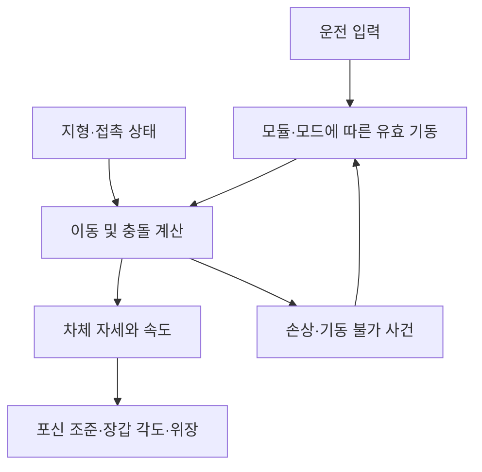

# 03. 전차 병과·역할·기동·물리 상호작용

> 기준일: 2026-11-13 KST · 대상: Wargaming World of Tanks PC판 · 확인 범위: 공식 현행 가이드와 2.4까지의 관련 변경, 업데이트 목록 2.4.1 확인.
> **[확인]** 공식 공개 규칙, **[분석]** 규칙의 설계 의미, **[제안]** 재구현 모델, **[검증 필요]** 공개 자료만으로 확정할 수 없는 요소. 직접 플레이·패킷·실행 코드 검증은 수행하지 않았다.

## 1. 시스템 목적과 경계

**[분석]** 전차의 이동은 단순히 조준할 장소까지 운반하는 기능이 아니다. 차체를 돌리면 장갑의 입사각과 약점 노출이 변하고, 차체를 움직이면 사격 안정성과 은폐가 달라지며, 후진 성능은 상대 재장전 사이에 살아 돌아올 수 있는지를 결정한다. 따라서 기동은 화력·방어·정보 세 시스템에 동시에 비용을 지불하는 행동이다.

병과는 전투에서 기대하는 기능을 압축해 보여주는 분류이고, 역할은 같은 병과 안의 운영 차이를 설명한다. 이동 방식은 궤도·차륜·특수 주행 모드처럼 실제 조작과 제약을 결정한다. 이 세 축을 하나의 `TankType` 열거형으로 합치면 신규 전차와 특수 메커니즘 추가 때 예외가 급증한다.

연계 문서: [조준·사격](04_Aiming_Firing_and_Ammunition.md), [장갑·관통](05_Armor_Penetration_and_Damage.md), [모듈 손상](06_Modules_Crew_Damage_and_Repair.md), [특수 메커니즘](07_Artillery_and_Special_Mechanics.md), [시야·위장](08_Spotting_Concealment_and_Radio.md).

## 2. 병과와 전투 역할

### 2.1 공식 분류

**[확인 C01]** PC판의 기본 병과는 경전차, 중형전차, 중전차, 구축전차, 자주포의 다섯 가지다. 공식 가이드는 병과별 강점을 설명하지만, 이는 모든 소속 전차가 같은 장갑·기동을 가진다는 뜻은 아니다. 2.4에서 Tier VI–XI 경전차에 Scout·Versatile·Support 역할이 부여되었다. **[확인 C03]**

다음 표의 전술적 책임과 실패 형태는 분류를 해석한 **[분석]**이다.

| 병과 | 팀에 제공하는 핵심 기여 | 전투 중 판단 기준 | 전형적 실패 형태 | 기동 설계와의 연결 |
|---|---|---|---|---|
| 경전차 | 적 위치·접근 방향 정보, 기동 지원 | 발견 가치가 피격 위험보다 큰가 | 첫 정찰에서 파괴되어 팀 정보원이 사라짐 | 작은 노출 시간과 탈출 경로 확보 |
| 중형전차 | 측면 압박, 전선 간 화력 재배치 | 지금 합류하면 국지적 수적 우위가 생기는가 | 한 위치에서 기다리며 기동 이점을 소모 | 가속·선회·후진을 묶어 평가 |
| 중전차 | 엄폐를 이용한 전선 유지와 돌파 | 장갑과 HP를 써서 아군 사격 기회를 만들 수 있는가 | 이동 도중 집중 사격, 고립된 HP 교환 | 느린 방향 전환을 초반 배치로 보완 |
| 구축전차 | 사선 통제 또는 공격 지원 | 공격 가능한 사선과 후퇴 가능성이 함께 있는가 | 사선이 끊긴 위치에 잔류, 측면 포위 | 고정포·제한포탑 여부가 재조준 비용 결정 |
| 자주포 | 간접 사격과 스턴 지원 | 탄착 시점에도 목표가 유효한가 | 아군이 이미 이긴 구역에 사격, 장전 중 방치 | 저기동 특성을 사전 재배치로 보완 |

**[분석]** 구축전차를 모두 저격수, 중전차를 모두 정면 탱커로 정의하면 실제 운용을 설명하지 못한다. 전차의 장갑 분포·포탑 회전 범위·장전 방식·차체 크기를 함께 보아야 한다. 같은 중전차라도 버티는 전차와 짧은 시간에 탄창을 비우는 전차의 노출 주기는 다르다.

### 2.2 경전차 역할의 세분화

**[확인 C03]** 2.4의 세 역할은 정찰 특화, 균형형, 화력 지원형이라는 구분이며 매치메이킹도 이 차이를 고려하도록 변경되었다. 정확한 매칭 완화 조건은 매치메이킹 문서에서 다룬다.

**[분석]** 이 변경의 의미는 “경전차 수가 같다”는 조건만으로 정보전 공정성을 보장할 수 없다는 데 있다. 한 팀이 정찰 성능을, 다른 팀이 순간 화력을 받은 경우 개활지에서는 첫 발견 시점부터 전투 가능성이 달라질 수 있다. 역할은 콘텐츠 설명뿐 아니라 상대 팀을 구성하는 입력 데이터다.

## 3. 입력·출력과 상태

### 3.1 이동 시스템 계약 — 재구성안

아래 계약은 **[제안]**이며 실제 엔진의 컴포넌트 이름이나 틱 순서를 뜻하지 않는다.

| 분류 | 데이터 | 소비하는 시스템 |
|---|---|---|
| 플레이어 입력 | 전진·후진, 좌우 조향, 제동, 모드 전환 | 이동 상태기 |
| 전차 정의 | 질량, 출력, 전후진 제한 속도, 선회 성능, 접지 특성 | 이동 계산 |
| 전차 현재 상태 | 궤도·바퀴·엔진·조종수, 부스트·특수모드 | 유효 성능 계산 |
| 환경 | 지면 재질, 경사, 접촉 법선, 장애물 | 이동·충돌 계산 |
| 결과 | 위치·속도·각속도·접지 여부 | 서버 상태·카메라·조준·위장 |
| 게임플레이 사건 | 충돌, 추락, 전복·침수 위험, 기동 불가 | 피해·UI·전투 종료 |



### 3.2 이동 상태와 무장 상태는 분리

**[분석]** 정지했다고 발사 준비가 완료되는 것은 아니다. 재장전 중일 수 있고, 포신이 차체 이동을 뒤따라 회전 중일 수 있으며, 차량은 이동할 수 있지만 포탑 구동부가 손상됐을 수도 있다. 다음 두 상태 집합을 독립적으로 유지해야 조작 결과가 일관된다.

- 기동 상태: 정상 주행, 감속, 주행모드 전환, 현가장치 손상, 기동 불가, 복구 중.
- 무장 상태: 포신 추적, 조준 수렴, 장전, 발사 가능, 특수 사격 준비, 발사 후 잠금.

이 분리는 “고정된 전차의 포탑은 정상 회전”, “움직이는 전차의 주포는 아직 장전 중” 같은 상황을 자연스럽게 표현한다.

## 4. 기동 규칙과 전술적 의미

### 4.1 최고속도 하나로 기동성을 설명할 수 없는 이유

**[확인 C04]** 공식 전차 소개는 최고속도 외에 출력 대비 중량과 지형 저항을 함께 사용해 기동성을 설명한다. **[분석]** 최고속도는 긴 직선에서 도달할 수 있는 상한에 가깝고, 엄폐 사이 수십 미터 이동에서는 가속과 후진이 더 직접적인 차이를 만든다.

| 요소 | 읽어야 할 의미 | 설계·분석 시 실수 |
|---|---|---|
| 전진 최고속도 | 넓은 구역 재배치 능력의 상한 | 짧은 구간 이동 시간을 최고속도만으로 계산 |
| 후진 최고속도 | 사격 직후 차체 방향을 유지한 채 엄폐 복귀 | 전진의 일정 비율로 모든 전차에 동일 처리 |
| 출력/중량 | 가속과 등판 성능에 영향을 주는 요인 | 지면·궤도·손상 상태를 제거하고 절대 성능으로 단정 |
| 차체 선회 | 측면 방어, 좁은 길 방향 전환 | 포탑 회전 성능과 동일 변수 사용 |
| 지형 저항 | 포장·흙·연약지에서 유지하는 운동 능력 | 시각적으로 같은 땅이면 성능도 같다고 판단 |
| 포탑 선회 | 이동 표적 추적과 차체 회전 보상 | 카메라 방향이 즉시 발사 방향이라고 처리 |
| 부각·앙각 | 경사지에서 가능한 포신 방향 | 차체 기준과 월드 기준 각도를 혼동 |

**[제안]** 재구현에서 지형별 감속을 모델링할 때는 실제 서버 물리식을 복제했다고 주장하지 말고, 목표 구간 통과 시간으로 보정하는 것이 안전하다. “0→20 km/h”, “후진으로 8 m 이동”, “젖은 지면에서 90° 회전”과 같은 사용 상황별 결과를 검증해야 한다.

### 4.2 차체 자세와 장갑

**[확인 C02]** 9.14 물리 설명은 서버에서 차량 운동을 계산하며 차체의 흔들림과 경사 변화가 유효 장갑에 영향을 줄 수 있다고 설명한다. 해당 설명은 차체 흔들림 자체가 조준원 동작을 그대로 흔드는 것과 구분한다. 이 자료는 도입 당시 설계 근거이며, 현재 틱 주기나 전체 물리 구현을 공개하는 자료는 아니다.

**[분석]** 여기서 필요한 분리는 세 가지다.

1. 충돌 판정에 쓰이는 차체 자세.
2. 포신이 향하는 실제 발사 방향.
3. 화면에 보이는 카메라 흔들림과 현가 애니메이션.

이를 한 transform으로 취급하면 연출용 흔들림이 명중 판정이나 서버 권위와 충돌한다. 반대로 차체 자세를 무시하면 경사와 차체 각도로 장갑 효율을 바꾸는 전술이 사라진다.

### 4.3 고정포와 회전포탑

**[분석]** 포탑이 없는 전차는 좁은 수평 포각 밖의 목표를 추적할 때 차체 회전이 필요하다. 이때 차체의 위치·장갑 면·위장·조준 분산이 함께 바뀔 수 있어 “같은 사격을 위한 기동 비용”이 크다. 포탑이 있다는 사실도 무제한 360° 회전을 보장하지 않으므로 데이터는 `hasTurret`와 별도로 허용 회전 구간을 가져야 한다.

고지에서 목표를 내려다볼 때 포신 부각이 부족하면 전진해 차체를 더 드러내야 한다. 이 때문에 부각은 단순한 조준 편의가 아니라 노출 면적과 피격 확률을 조절하는 방어 자원이다.

## 5. 이동 방식별 예외

### 5.1 궤도·차륜·예비 궤도

**[확인 C05]** 프랑스 차륜 계통에는 순항/고속 주행 모드가 도입되어 있다. 이를 모든 차륜 전차의 공통 기능으로 일반화하지 않는다. **[확인 C06]** Yoh 계통의 예비 궤도는 주 궤도가 손상되어도 감속 상태로 이동할 수 있게 하며, 주 궤도와 예비 궤도를 함께 파괴하는 상황은 별도다.

**[분석]** 따라서 “궤도 파괴 → 속도 0”이라는 전역 규칙보다 `mobilityCapability`를 다시 계산하는 구조가 필요하다. 차륜 손상 수, 어느 쪽 예비 궤도가 살아 있는지, 엔진 작동 여부를 조건으로 삼는다. 예비 궤도 세부 수리 순서는 모듈 문서에 있다.

### 5.2 충돌·밀기·낙하

**[분석]** 충돌은 직접 HP 피해와 위치 변화라는 서로 다른 결과를 낼 수 있다. 피해가 작아도 상대를 엄폐 밖으로 밀어내거나 탈출 경로를 막으면 전술 효과가 크다. 반대로 빠른 차량이 충돌해도 상대의 질량·접촉 부위·자신의 손상 위험을 무시하면 손해일 수 있다.

**[제안]** 물리 기반 복제에서는 운동량·접촉 충격량을 이용한 밀기와 게임플레이 HP 산식을 분리한다. 순수 운동에너지 `½mv²`를 그대로 HP로 바꾸었다는 주장은 하지 않는다. 알려진 공개 규칙만으로 충돌 피해 계수·배분·접촉 장갑 적용을 완전히 복원할 수 없다. 추락·침수·전복의 시간 임계값도 모드와 차량별 검증 항목으로 둔다.

### 5.3 주행 강화 능력

**[확인 C07]** 2.1.1의 PTZ-78은 좌우 추진기를 독립 사용하며, AT-FV230 Breaker는 전진 지속과 연결된 Direct Drive를 가진다. **[분석]** 전차의 유효 기동성은 고정 능력치뿐 아니라 “현재 입력 이력·사용 가능한 자원”에 의해 달라진다. 특수 상태를 무시한 평균 이동 시간만으로 대칭 맵을 평가하면 초반 핵심 거점 접근성이 달라질 수 있다.

## 6. 구체적인 상황 분석

### 상황 A: 최고속도가 더 높은 전차가 엄폐 싸움에서 느린 경우

**[제안 예시, 실제 전차 수치 아님]** A는 전진 60·후진 15 km/h, B는 전진 50·후진 25 km/h라고 하자. 두 전차가 사격 후 10 m 후퇴해야 한다면 정속 가정의 이동 시간은 A 약 2.40초, B 약 1.44초다. 실제 값에는 가속·지형·입력 지연이 추가된다.

**[분석]** 전진 최고속도가 높은 A가 더 오래 노출된다. 비교표는 최고속도 한 줄 대신 사격 후 복귀 시간과 후진 가속을 보여줘야 하며, 전차의 “민첩함”을 최고속도만으로 평가하면 사용자가 잘못된 장비 선택을 할 수 있다.

### 상황 B: 선회 추적 중 장갑을 잃는 구축전차

**[제안 상황]** 전방 좁은 포각 안에 적이 있을 때는 차체를 기울여 장갑을 활용할 수 있다. 적이 측면으로 이동해 포각을 벗어나면 차체를 돌려야 한다. 회전으로 사격 기회는 회복되지만 이전의 유리한 입사각과 은폐 상태는 유지되지 않을 수 있다.

**[분석]** 플레이어에게는 “쏠 수 있음”과 “안전하게 쏠 수 있음”이 다르다. 튜토리얼은 단순히 적을 따라 조준하라는 지시보다, 차체 회전으로 바뀌는 위험을 함께 알려야 한다.

## 7. 데이터 모델과 유효 성능 계산

다음은 **[제안]**이다.

```yaml
VehicleMobilityDefinition:
  locomotionType: tracked
  classId: heavy
  roleId: breakthrough
  massTonnes: vehicle_specific
  enginePower: vehicle_specific
  speedLimits: {forward: vehicle_specific, reverse: vehicle_specific}
  terrainProfiles: [hard, medium, soft]
  hullTraverseProfile: vehicle_specific
  turretTraverseLimits: vehicle_specific
  gunElevationLimits: vehicle_specific
  abilities: []
MobilityRuntime:
  moduleState: {}
  crewState: {}
  movementMode: normal
  activeModifiers: []
  supportContacts: []
  velocity: server_authoritative
```

```text
effective = ResolveBaseMobility(vehicle, loadout)
effective = ApplyModuleAndCrewState(effective, state)
effective = ApplyModeAndAbilityModifiers(effective, abilities)
contacts = QueryTerrainAndObstacleContacts(transform)
nextState = SimulateAuthorizedInput(input, effective, contacts, dt)
PublishMovementState(nextState)
EmitGameplayContacts(nextState.contacts)
```

**[검증 필요]** 실제 계산의 곱연산/합연산 순서, 마찰 모델, 변속·엔진곡선, 궤도별 접지 계산, 고속 충돌 보정은 공개 자료로 확정하지 않는다. 재구현 시에는 한 요인의 조정이 다른 특수모드에 중복 적용되지 않도록 수정자 우선순위를 명시한다.

## 8. 검증 계획

실제 게임에서 모두 수행한 결과가 아니라, 원작 대조·재구현을 위한 **[제안 QA]**다.

| ID | 재현 조건 | 확인할 결과 | 중요성 |
|---|---|---|---|
| MOB-01 | 같은 전차, 같은 방향, 포장/흙/연약지 반복 | 가속·정속·통과 시간 차이 | 지형과 성능의 결합 검증 |
| MOB-02 | 0속도·중속도에서 각각 90° 회전 | 회전 반경과 소요 시간 | 차고 선회값의 해석 |
| MOB-03 | 후진 중 차체 회전·제동 | 전진과 별도의 제한이 일관되는지 | 엄폐 복귀 판단 |
| MOB-04 | 포탑 구동부만 파괴, 이후 엔진만 파괴 | 사격 추적과 이동 능력이 독립적으로 손상 | 상태 분리 |
| MOB-05 | 주 궤도/예비 궤도를 순서별로 파괴 | 이동 가능 여부와 복구 순서 | 특수 기동 예외 |
| MOB-06 | 모드 전환 중 부스트 시작·종료 | 능력치가 중복 적용되거나 누락되지 않음 | 특수모드 안정성 |
| MOB-07 | 같은 경사에서 정지·가속·제동 사격 | 차체 자세와 조준 연출 구분 | 물리와 판정 연결 |
| MOB-08 | 경량/중량 전차 충돌, 같은 속도 반복 | HP 피해·밀림·기여 귀속을 따로 기록 | 실제물리식 오인 방지 |
| MOB-09 | 저FPS·높은지연 환경에서 급회전 | 서버 위치·조준 방향의 표시 불일치 측정 | 네트워크 체감 |
| MOB-10 | 특수 지형 경계에서 이동 반복 | 지형분류 전환 시 급격한 수치 튐 확인 | 콘텐츠 QA |

## 9. 설계 해석과 한계

**[분석]** 기동성의 핵심 가치는 “전투가 일어날 장소를 고르는 능력”과 “불리해진 전투에서 나오는 능력”이다. 최고속도와 방향 전환·후진을 분리하고, 사선과 엄폐까지 이동해야 실제 기동 가치가 드러난다. 장갑이 강한 전차를 느리게 만드는 설계는 단순한 능력치 상쇄뿐 아니라 잘못된 초기 배치를 수정하는 데 더 큰 비용을 부과한다.

**[검증 필요]** 물리 엔진 이름·서버 업데이트 주기·정확한 충돌 HP 공식은 이 문서에서 확정하지 않는다. 9.14 개발 설명은 서버 권위와 설계 의도를 확인하는 역사 자료이며, 오늘의 소스 구조나 수치가 그대로라는 증거는 아니다.

## 10. 출처

- **C01** [Vehicle Types and Functions](https://worldoftanks.eu/en/content/guide/game-mechanics-and-achievements/vehicle-types-and-functions/) — 현행 병과·역할 가이드, 게시일 미표기.
- **C02** [Version 9.14: Improved Vehicle Movement Physics and Sounds](https://worldoftanks.eu/en/news/general-news/version-914-sounds-physics/) — 9.14 도입 당시 서버 물리·차체 자세 설명. 역사 자료.
- **C03** [Light Tanks Rebalanced: New Roles, Smarter Matchmaking](https://worldoftanks.eu/en/news/general-news/2-4-lt-roles-rebalance/) 및 [Release Notes 2.4](https://worldoftanks.eu/en/content/docs/release_notes/release-notes-2-4/) — 2026 경전차 역할 변경.
- **C04** [T54 Heavy Tank Review](https://worldoftanks.eu/en/news/guides-reviews/how-to-play-t54-heavy-tank/) — 최고속도·출력중량비·지형저항을 함께 다루는 공식 전차 설명.
- **C05** [Release Notes 1.6](https://worldoftanks.eu/uk/content/docs/release_notes/Release-Notes-1-6/) — 차륜 주행모드 개선의 역사 기록.
- **C06** [American Yoh Tanks Are Here!](https://worldoftanks.eu/uk/news/general-news/brand-new-yoh-tanks/) — 예비 궤도 동작과 수리 순서.
- **C07** [Release Notes 2.1.1](https://worldoftanks.eu/en/content/docs/release_notes/release-notes-2-1-1/) 및 [Tier XI TDs and LT](https://worldoftanks.eu/en/news/general-news/update-2-0-tier-11-tank-destroyers-light-tanks/) — 특수 기동 사례.

모든 URL 확인 기준일은 2026-11-13이며 일부 공식 페이지는 직접 열기가 제한되어 검색 서비스가 제공한 공식 본문 색인을 이용했다.
