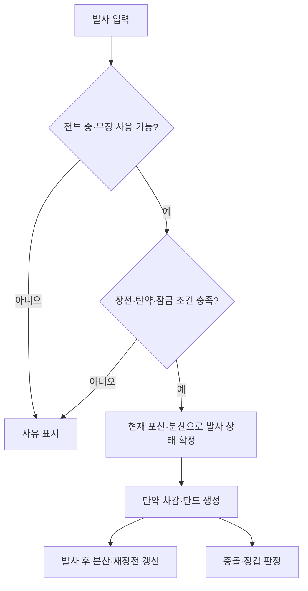

# 04. 조준·사격·재장전·탄종

> 기준일: 2026-11-13 KST · Wargaming World of Tanks PC판 · 일반 무작위 전투를 기준으로 하되 특별모드·특수 무장 예외를 구분한다.
> [확인]은 공식 문서 사실, [분석]은 설계 해석, [제안]은 재구현용 모델, [검증 필요]는 확인하지 못한 세부값이다. 직접 플레이·코드 검증은 수행하지 않았다.

## 1. 시스템 목적

**[분석]** 사격은 버튼을 누르는 한 번의 행위지만, 플레이어는 그 전에 시간·노출·탄약·명중 가능성을 교환한다. 완전히 조준하면 맞힐 가능성이 좋아지지만 적에게 더 오래 노출되고, 즉시 발사하면 안전하게 빠질 수 있지만 약점을 놓칠 수 있다. 재장전은 공격의 공백이면서 상대의 전진 신호가 된다.

이 문서는 발사 가능 상태까지의 과정을 다룬다. 충돌 이후 판정은 [장갑·관통·피해](05_Armor_Penetration_and_Damage.md), 자주포와 고유 무장은 [특수 메커니즘](07_Artillery_and_Special_Mechanics.md), 장비 보정은 장비 문서로 연결한다.

## 2. 카메라·포신·조준원의 분리

**[확인 C08]** 공식 조작 가이드는 화면 중앙 조준표시가 바라보는 방향을, 지연되어 따라오는 조준원이 실제 주포 위치를 나타낸다고 설명한다. 차체·포탑 회전은 조준원을 확대하고 정지 후 수렴을 기다리면 정밀 사격에 유리하다.

**[분석]** 따라서 “크로스헤어가 적 위에 있다”는 사실만으로 포신이 그 적을 향한다고 판단하면 안 된다. 카메라를 빠르게 돌렸거나 차체가 경사면에 올라간 직후에는 시선·총구·포각 제한이 서로 다른 결과를 낼 수 있다.

| 요소 | 의미 | 잘못 해석했을 때 생기는 문제 |
|---|---|---|
| 카메라 중앙점 | 사용자가 원하는 방향 | 원하는 방향을 곧바로 실제 발사 방향으로 취급 |
| 실제 포신 방향 | 회전 속도·포각 제약을 적용한 방향 | 포신이 벽에 막히거나 차체가 필요한 상황 무시 |
| 조준원 | 현재 사격 분산의 표시 | 조준원이 작아지면 무조건 관통한다고 오해 |
| 목표 거리 | 사격 위치와 예측의 입력 | 거리 불확실성을 제거한 직선 레이 발사 |
| 서버 기준 사격 상태 | 최종 입력 처리와 실제 판정의 기준 | 화면 연출과 서버 결과 불일치의 원인을 숨김 |

마지막 행의 구체 네트워크 구조는 **[제안]**이며 공개 가이드가 특정 서버 틱·보정 알고리즘을 보증하는 것은 아니다.

## 3. 정확도와 조준 수렴

### 3.1 서로 다른 성능 축

**[분석]** 최종 분산, 조준 수렴 속도, 이동 중 분산은 서로 다른 축이다. 작은 최종 조준원을 가진 전차도 이동 후 수렴이 오래 걸리면 짧은 노출 사격에 불리할 수 있다. 반대로 최종 분산이 평범해도 기동 중 분산 증가가 작으면 순간 대응이 편할 수 있다.

**[확인 C09]** 공식 재조정 내역은 100 m 분산, 조준 시간, 차체 이동/회전·포탑 회전·발사 후 분산을 별도 항목으로 수정한다. 이는 하나의 명중률 수치로 통합하면 게임의 조작 차이를 충분히 표현하지 못한다는 근거다.

| 성능 항목 | 사용자가 느끼는 차이 | 재구현 시 분리할 변수 |
|---|---|---|
| 100 m 분산 | 충분히 기다린 뒤의 정밀도 | `baseDispersion` |
| 조준 시간 | 커진 조준원이 회복되는 속도 | `aimConvergenceProfile` |
| 이동 분산 | 직선 주행 중 사격 위험 | `movementBloom` |
| 차체 회전 분산 | 방향 전환을 동반한 사격 위험 | `hullTraverseBloom` |
| 포탑 회전 분산 | 다른 목표로 전환할 때의 위험 | `turretTraverseBloom` |
| 발사 후 분산 | 연속 사격 시 회복 부담 | `afterShotBloom` |
| 특수모드 보정 | 냉각·충전·구축 모드에 따른 성능 변화 | `activeGunModifiers` |

변수명은 **[제안]**이다. 실제 결합식이 단순 합인지 제곱합인지, 내부 분포가 어떤 확률밀도를 쓰는지는 별도 검증한다.

### 3.2 흔한 수치 오독

- **[분석]** 표시된 “조준 시간 2초”를 어떤 상태에서도 2초 후 완전 조준된다는 의미로 사용하지 않는다. 출발 분산과 적용 보정이 다르므로 실측 정의가 필요하다.
- **[분석]** 조준원 안의 모든 위치가 같은 확률이라고 가정하지 않는다. 원의 경계는 분포를 설명하는 유일한 정보가 아니다.
- **[분석]** 명중률과 관통률은 분리한다. 차체에 맞힐 확률이 높아도 특정 약점에 맞힐 확률은 낮을 수 있다.
- **[검증 필요]** 100 m 분산 표시값을 화면 조준원 지름·반지름과 직접 일치시키는 계산은 현행 HUD 투영·서버 분산 검증 후 적용한다.

## 4. 발사 처리와 입력 우선순위

### 4.1 재구성 처리 흐름

아래는 **[제안]**이다. 원작의 함수 호출 순서가 아니라 관측 가능한 결과를 설명하는 논리 순서다.



완전 조준은 일반적으로 “발사 가능”을 잠그는 조건으로 취급하지 않는다는 점이 핵심이다. 플레이어는 불리한 명중 확률을 감수하고 발사할 수 있어야 순간 사격 선택이 존재한다. 특정 특수모드의 준비 완료 조건은 별도로 둔다.

### 4.2 탄종 변경

**[분석]** 탄종 선택은 탄약 창고의 종류를 바꾸는 행동과 현재 장전 중인 한 발을 바꾸는 행동으로 나뉜다. 사용자는 다음 발부터 바꾸기와 지금 바꾸기를 혼동하기 쉽다. 구현·QA에서는 `selectedAmmo`, `loadedAmmo`, `nextAmmo`를 구분하고 장전 취소·직관(Intuition)·탄창 교체 예외를 명시해야 한다. 실제 단축키·교체 시간 보정은 현행 설정과 승무원 문서를 기준으로 검증한다.

**[제안]** UI는 장전된 탄과 예약된 탄을 별도 표시하며, 교체 명령이 무시됐을 때 남은 대기시간이나 탄 부족을 알려야 한다. 탄약 표시만 즉시 바꾸고 서버의 실제 탄종이 남아 있으면 관통 결과가 불공정하게 느껴진다.

## 5. 장전 방식별 시간 구조

**[확인 C10·C11]** 이탈리아 자동 재장전 방식은 탄창을 한 발씩 채우며 발사 시 진행 중인 장전이 중단될 수 있다. 소련 쌍열포는 단발 순환·연속 발사·동시 발사의 시간 구조가 다르다. 세부 수치는 전차와 업데이트별로 달라진다.

아래 비교의 전술 의미는 **[분석]**이다.

| 방식 | 시간 자원 구조 | 강점 | 실제 비용 |
|---|---|---|---|
| 단발포 | 매 발 뒤 재장전 | 노출 주기를 예측하기 쉬움 | 한 발 실패가 재장전 전체의 손실 |
| 탄창식 자동장전 | 탄간 간격 + 탄창 전체 재장전 | 짧은 시간에 집중 피해 | 탄창 소진 후 긴 무력 구간 |
| 자동 재장전 | 탄 수별 한 발 재장전 | 단발 운용과 순간 화력 선택 | 미완료 장전의 손실, 빈 탄창 복구 부담 |
| 역자동 재장전·보정형 | 남은 탄 수나 보정 규칙별 시간 변화 | 기존 자동 재장전과 다른 최적 운용 | “모든 자동재장전은 같음”이라는 학습 오류 |
| 소련 쌍열포 | 포신별 상태·전환·일제사격 잠금 | 단발과 높은 순간 피해 사이 선택 | 준비시간, 두 포신 잠금, 장전 순서 |
| 기관포·연속사격 | 발사열·탄창·과열 자원 | 노출된 얇은 장갑에 집중 피해 | 장시간 노출, 열/탄 관리, 낮은 단발 관통 |

**[확인 C12]** 2.1.1의 미국 Ares 계통은 열 관리 기관포와 예비 궤도를 사용한다. 이를 오래된 저단계 자동포나 다른 국가 기관포의 동일한 규칙으로 취급하지 않는다.

### 5.1 DPM·탄창 피해·킬 시간

다음은 실제 전차 제원이 아닌 **[제안 계산 예시]**다.

단발 피해 `D`, 재장전 `R`이면 이상적인 지속 화력은 `60D/R`이다. 피해 390, 재장전 10초라면 2,340 HP/분이다. 이동·재조준·도탄·목표 부재를 제외한 값이므로 실제 전투 성과와 다르다.

탄창 4발, 발당 300, 탄간 2초, 마지막 발 후 전체 재장전 30초인 가상 전차는 첫 발을 0초에 쏘고 2·4·6초에 나머지를 발사한다. 다음 탄창의 첫 발은 36초다. 따라서 장기 주기 기준 DPM은 `1,200×60/36 = 2,000`이고, 최초 6초에는 1,200 피해를 집중할 수 있다. 초반 폭발력과 장기 화력 순위가 다르다.

적 HP를 `H`라 하고 피해가 고정이며 모든 발이 관통한다고 가정하면 필요한 발수는 `ceil(H/D)`, 첫 발이 이미 준비됐을 때 킬 시간은 `(ceil(H/D)-1)R`이다. 실제로는 피해 변동·포신 정렬·이동시간을 추가해야 하므로 이 식을 확정 승리 판정으로 쓰지 않는다.

## 6. 탄종을 선택하게 만드는 차이

**[확인 C13]** 공식 가이드는 AP·APCR·HEAT·HE를 구분하며, APCR이나 HEAT가 일부 차량에서는 기본 탄약일 수 있다고 설명한다. 따라서 “AP=일반탄, APCR=유료탄”처럼 물리 탄종과 경제 분류를 동일시하지 않는다. HESH는 높은 관통력을 가진 HE 성격으로 설명되며 독립적인 실물 탄두 시뮬레이션을 추정하지 않는다.

| 계열 | 판단 시 봐야 할 항목 | 유리한 기회 — 분석 | 경계할 상황 — 분석 |
|---|---|---|---|
| AP | 관통력·거리 감쇠·정규화·탄속 | 장갑 각도와 구경을 고려한 안정적 사격 | 극단적 각도·긴 거리·약점 빗나감 |
| APCR | 실제 탄별 탄속·관통·정규화 | 이동 표적 리드 부담 감소, 높은 관통 활용 | 높은 표기 관통력만 믿고 경사장갑을 무시 |
| HEAT | 거리 손실·공간장갑·장애물 | 두꺼운 단일 주장갑을 적절한 각도로 공격 | 궤도·공간장갑·장애물에 선행 접촉 |
| 일반 HE/HESH | 관통/비관통 피해·장갑 두께 | 얇은 부위, 낮은 HP 적, 점령 방어 | 외부 장갑에서 멈춤, 두꺼운 부위의 낮은 피해 |
| 자주포 HE | 스플래시·스턴·탄도 | 다수 목표 지원 또는 직접 피해 | 일반 전차 HE 규칙으로 판정 |
| 기관포 HE | 낮은 관통·파편/폭발 예외 | 드러난 얇은 장갑에 연속 명중 | 비관통 최소피해를 기대하며 두꺼운 장갑 공격 |

**[확인 C13]** 현행 가이드는 기관포 HE에 일반 HE의 파편피해와 표준 폭발피해가 없다고 명시한다. 이 예외 때문에 “HE는 모든 직격에 항상 피해”라는 범용 규칙을 만들 수 없다. 일반 HE와 자주포 HE의 판정은 다음 문서에서 별도 분기한다.

**[분석]** 탄 가격이 높아도 관통을 보장하지 않고, 빠른 탄속이 조준원 분산을 자동으로 줄이지도 않는다. 탄종 이름보다 선택한 전차·포·탄의 실제 조합 데이터가 우선이다.

## 7. 탄도와 리드 사격

**[확인 C14]** 공식 관통 설명은 포탄이 탄도 궤적으로 날며 높은 탄속의 주포에서는 거의 직선처럼 보일 수 있다고 설명한다. **[분석]** 발사 시점의 적 위치를 겨누는 것과 명중 시점의 위치를 겨누는 것은 다르다.

**[제안 근사]** 낙하와 탄속 변화를 무시하면 비행시간은 `거리/탄속`이다. 거리 400 m, 탄속 1,000 m/s면 0.4초다. 표적이 사선에 직각으로 10 m/s 움직이면 약 4 m 앞을 겨냥하는 출발점이 된다. 실제 리드는 표적의 선회·가속, 고저차, 탄도 보정, 네트워크 표시 상태 때문에 달라진다. 이 계산은 조작 학습을 돕는 근사이고 엔진 탄도식이 아니다.

## 8. 두 가지 상황별 의사결정

### 상황 A: 완전 조준을 기다릴까

**[분석]** 적이 후퇴하기까지 1초 남았고 내 조준이 아직 수렴 중이면, 지금 쏘는 것이 유일한 기회일 수 있다. 반대로 적이 정지했고 내 차체가 안전하다면 수렴을 기다리는 편이 합리적이다. 최적 행동은 명중률 하나가 아니라 `발사기회 × 관통가능성 × 반격노출`을 함께 본다.

**[제안]** QA에서 조준이 덜 된 상태의 발사를 막거나 자동으로 완전조준 때까지 큐에 넣지 않도록 한다. 이런 편의 기능은 원작의 위험 선택 자체를 없앤다.

### 상황 B: 자동 재장전 중 남은 탄을 쏠까

**[제안 상황]** 다음 한 발 장전이 거의 끝났지만 적이 낮은 HP로 노출되어 있다. 바로 쏘면 확정에 가까운 제거 기회가 생기지만 미완료 장전 이득을 잃을 수 있다. 기다리면 이후 장기 화력은 좋아지지만 적이 엄폐할 수 있다.

**[분석]** 이 구조는 탄창을 단순한 “남은 총알 수”에서 “미래 화력의 가치”로 바꾼다. UI는 현재 탄 수뿐 아니라 다음 탄 완성까지 남은 시간, 발사로 중단되는 구간을 명확히 보여야 한다.

## 9. 데이터와 사건 설계

아래는 **[제안]**이다.

```yaml
GunDefinition:
  loadingModel: single | clip | autoreload | dual_barrel | heat
  traverseProfile: vehicle_specific
  aimProfile: vehicle_specific
  shellIds: []
  magazineSize: vehicle_specific
  reloadByMagazineState: []
ShellDefinition:
  physicsType: AP | APCR | HEAT | HE
  sourceFamily: conventional | artillery | autocannon | special
  damageProfileId: configurable
  penetrationByDistance: configurable
  velocityProfile: configurable
  economicCategory: standard | special
GunRuntime:
  loadedShells: []
  pendingShellType: optional
  reloadEndTime: authoritative
  currentDispersion: authoritative
  heat: optional
  lockUntil: optional
```

사건은 `FireRejected(reason)`, `ShotCommitted(shotId)`, `AmmoConsumed`, `ReloadStarted`, `ReloadInterrupted`, `AimStateChanged`, `ShellTypeSwitchQueued` 등으로 분리한다. 발사 확정과 탄약 차감을 서로 다른 비동기 거래로 처리하면 중복 발사·음수 탄약 문제가 생길 수 있다. 서버 권위로 한 명령을 한 번만 소비하는 구조가 필요하다.

## 10. QA와 분석 지표

| ID | 조건 | 확인할 결과 |
|---|---|---|
| GUN-01 | 카메라 급회전 직후 발사 | 실제 포신 제한이 적용되고 표시 방향과 혼동되지 않음 |
| GUN-02 | 이동·차체 회전·포탑 회전을 각각 실행 | 분산 요인을 별도로 측정 가능 |
| GUN-03 | 재장전 완료 시각 직전·직후 입력 | 중복 발사·탄약 차감 누락 없음 |
| GUN-04 | 탄종 예약 중 마지막 탄 소모 | 불가능한 탄종으로 발사하거나 재장전 고착 없음 |
| GUN-05 | 자동 재장전 직전 발사·취소 반복 | 남은 장전 진행의 보존/손실 규칙 일관 |
| GUN-06 | 쌍열 준비 중 취소·주포 파손 | 준비·잠금·장전 상태가 모순되지 않음 |
| GUN-07 | 기관포 HE로 두꺼운 주장갑 공격 | 일반 HE 비관통 피해 규칙을 잘못 공유하지 않음 |
| GUN-08 | 동일 표적을 탄속만 다르게 반복 사격 | 리드 요구량과 탄도 차이 확인 |
| GUN-09 | 능력 종료 순간 발사 | 피해·분산 보너스가 언제 확정되는지 검증 |
| GUN-10 | 서버지연 변화·낮은프레임 | 발사 화면·사운드·결과 간 시간차 기록 |

**[제안 지표]** 첫 유효 사격까지 시간, 발사 시 분산/완전조준 비율, 탄창 미소진 교체율, 탄종별 명중·관통·순수익, 재장전 완료 후 유휴시간을 함께 본다. 단순 DPM이 높은데 실전 피해가 낮다면 장갑 관통뿐 아니라 노출시간·조준 복귀·맵 사선이 원인일 수 있다.

## 11. 출처와 미확인 범위

- **C08** [Controls and Firing](https://worldoftanks.eu/en/content/guide/newcomers-guide/game_controls/) — 카메라 중앙점·조준원·사격 조작.
- **C09** [Widespread Vehicle Rebalancing in Update 1.26](https://worldoftanks.eu/en/news/general-news/vehicle-rebalances-1-26/) — 서로 분리된 분산·조준 파라미터의 공개 사례.
- **C10** [Get Ready for Italian Tanks](https://worldoftanks.eu/hu/news/general-news/italian_tanks/) — 자동 재장전의 도입 원리. 역사적 기본 규칙만 참조.
- **C11** [Colossal Double-Barreled Heavies Are Coming!](https://worldoftanks.eu/en/news/general-news/1-7-1-double-barreled/) — 소련 쌍열포의 발사·장전 구조. 영국 쌍열포와 혼용하지 않음.
- **C12** [Update 2.1.1: Fresh Tier XI Firepower](https://worldoftanks.eu/en/news/updates/wot-2-1-1/) — Ares 열 관리 기관포.
- **C13** [Upgrading Your Vehicles: Ammunition](https://worldoftanks.eu/en/content/guide/newcomers-guide/upgrading_vehicles/) — 탄종, 경제분류와의 차이, 기관포 HE 예외.
- **C14** [Armor Penetration](https://wargaming.net/support/en/products/wot/article/10220/?lang=en) — 탄도·분산·관통의 개요.

**[검증 필요]** 정확한 조준 수렴식, 현행 분산 샘플링 분포, 포별 거리 감쇠 곡선, 탄종 교체의 모든 입력 조합은 공개 문서만으로 완전 복원하지 않았다. 원작 내부 구조처럼 표시한 공식은 없으며, 수치 예제는 모두 가상의 분석용 입력이다.
