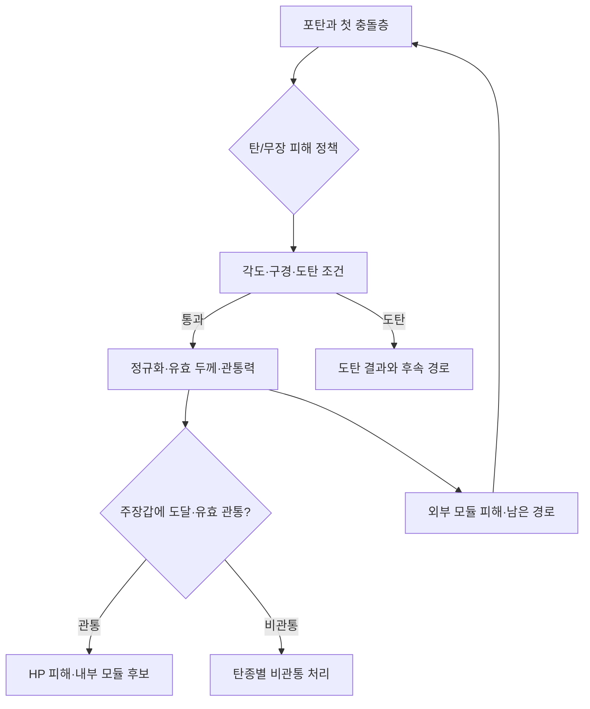

# 05. 장갑·관통·도탄·피해 판정

> 기준일: 2026-11-13 KST · Wargaming World of Tanks PC판 · 일반 전차의 주포, 자주포, 기관포의 탄 처리 예외를 분리한다.
> [확인] 공식 공개 규칙 · [분석] 설계 해석 · [제안] 재구현 모델 · [검증 필요] 미확정 값. 소스 코드와 실제 전투 로그를 직접 검증하지 않았으므로 아래 의사코드는 원작 코드가 아니다.

## 1. 핵심 구조

**[분석]** 이 게임의 방어는 HP만으로 결정되지 않는다. 플레이어가 어느 면을 어떤 각도로 보여주는지, 상대가 어떤 포탄으로 어느 부위를 맞히는지에 따라 공격을 무효화하거나 작은 피해로 줄일 수 있다. 공격도 “명중” 이후 외부 장갑·도탄·주장갑·내부 모듈이라는 서로 다른 결과를 거친다.

따라서 시스템은 적어도 다음 결과를 구분해야 한다.

| 결과 | 의미 | 전술적 후속 판단 |
|---|---|---|
| 빗나감 | 전차 또는 관련 판정체에 유효 접촉하지 않음 | 리드·조준·포신 정렬 수정 |
| 외부 모듈/공간장갑 접촉 | 궤도·주포·외부 판정에만 영향 가능 | 같은 위치를 재조준할지 결정 |
| 도탄 | 각도·탄종 규칙으로 튕김 | 관통력만 높여도 해결되지 않을 수 있음 |
| 비관통 | 해당 층의 관통 조건 미달 | 더 얇은 부위·유리한 각도·다른 탄 고려 |
| 주장갑 관통 | 전차 HP 피해의 중요한 조건 | 피해량·추가 모듈 손상 확인 |
| 일반 HE 비관통 피해 | 주장갑 접촉에 따른 제한적 피해 | 낮은 HP 적 제거·점령 방어 가능성 판단 |
| 치명적 모듈 결과 | 탄약고 폭발 등으로 별도 격파 | HP와 모듈 상태를 함께 평가 |

각 결과가 항상 하나만 발생하는 배타적 목록은 아니다. 한 발이 궤도를 파괴하고 주장갑을 관통하면서 HP 피해와 승무원 부상을 함께 만들 수도 있다. **[분석]**

## 2. 장갑의 세 가지 두께

**[확인 C15]** 공식 가이드는 명목 두께, 탄도 방향에서의 유효 두께, 장갑 법선에 대한 입사각을 구분한다. 같은 전면 장갑에도 약점과 서로 다른 판이 존재하므로 차고의 전면/측면/후면 숫자를 모든 위치에 적용할 수 없다.

- **명목 두께 `t`**: 해당 장갑 부위의 데이터상 두께.
- **기하학적 시선 두께**: 경사 때문에 탄이 지나가야 하는 길이.
- **실제 판정용 유효 저항**: 탄종 정규화·다중 장갑·선행 손실 등의 영향을 반영한 값.

**[제안, 평판 근사]** 균질한 한 장의 평판에 입사각 `θ`를 법선에서 측정하면 기하학적 길이는 `t/cos(θ)`다. 두께 100 mm, 각도 60°면 200 mm가 된다. 이 식만으로 원작의 관통을 완성할 수 없다. 곡면·맞닿은 판·공간장갑·도탄·구경 규칙이 추가되며, 실제 hit point의 장갑 데이터를 사용해야 한다.

### 장갑을 활용하는 행동의 분석

| 행동 | 의도 | 비용 또는 역효과 |
|---|---|---|
| 차체 각 주기 | 정면의 유효 두께 증가 | 측면 노출이 커지거나 다른 약점이 드러남 |
| 사이드스크래핑 | 장애물로 전면을 가리고 측면을 높은 각도로 제시 | 과회전하면 측면 관통 가능성이 증가 |
| 헐다운 | 차체를 지형 뒤로 숨기고 포탑 중심으로 교전 | 포탑 약점·부각·자주포 사선에 의존 |
| 짧은 좌우 이동 | 상대가 작은 약점을 지속 추적하기 어렵게 함 | 자신의 조준 분산과 노출이 증가 가능 |
| 고저차 이용 | 유리한 장갑 면과 사격 각도 확보 | 상판·하부 노출 등 반대 효과도 가능 |

위 전술 효과는 **[분석]**이며 특정 전차가 항상 같은 방식으로 안전하다는 보장이 아니다.

## 3. 탄종별 관통 규칙과 확실성

### 3.1 공식 본문으로 확인한 핵심

**[확인 C15]** AP/APCR은 공식 설명상 입사각이 70°보다 큰 경우 도탄할 수 있으며, 구경이 접촉 장갑의 명목 두께의 3배를 **초과**하면 해당 도탄을 방지한다. HEAT는 85°보다 큰 입사각에 대한 별도 규칙을 가지며 AP/APCR의 3구경 예외를 그대로 적용하지 않는다. HE는 도탄하지 않는다.

| 항목 | AP/APCR | HEAT | 일반 HE |
|---|---|---|---|
| 일반 도탄 기준 | 70°보다 큰 입사각에 대한 규칙 | 85°보다 큰 입사각에 대한 규칙 | 도탄하지 않음 |
| 3구경 초과 예외 | 도탄 방지 | 같은 예외 적용 안 함 | 도탄 판정 자체가 없음 |
| 거리와 관통 | 탄별 거리 손실 고려 | 일반 비행거리 관통 감소 없음 | 거리 관통 감소 없음 |
| 공간장갑 | 선행 층과 주장갑을 구분 | 선행 접촉·층간 간격의 영향 중요 | 외부 장갑 소모 계수의 별도 규칙 |
| HP 피해 | 주장갑 관통 여부가 핵심 | 주장갑 관통 여부가 핵심 | 주장갑 직격 후 관통/비관통 처리 분리 |

거리 관련 사실은 **[확인 C13·C16]**이며, 다중 층을 분리해야 한다는 해석은 **[분석]**이다. 표의 `>`는 공식 자연어 설명을 옮긴 것이며, 정확히 70.000°·85.000°에서의 부동소수점 경계는 실측 없이 확정하지 않는다.

### 3.2 정규화와 2구경 규칙의 취급

**[분석]** 정규화는 AP 계열이 경사장갑을 평가할 때 고려하는 중요한 차이다. 이것을 탄이 실제로 벽 속에서 정해진 각도로 꺾인다는 시각 효과와 동일시하지 않는다. 재구현에서는 충돌 법선, 판정용 각도, 관통 후 경로를 명시적으로 구분해야 한다.

**[확인 C19, 역사 기록]** 8.6 공식 패치 노트는 APCR 정규화를 5°에서 2°로 낮췄다고 기록한다. 그러나 이 문서 하나는 현재 모든 탄과 모든 장갑 층에서 적용되는 처리 순서를 보증하지 않는다.

| 흔히 인용되는 항목 | 이 문서의 증거 상태 | 재구현 결정 |
|---|---|---|
| AP 기본 정규화 5° | 현행 PC 공식 본문에서 수치를 독립 확인하지 못함 | 검증 전 원작 확정 상수로 고정하지 않음 |
| APCR 기본 정규화 2° | 8.6 공식 변경 기록 확보 | 현행 장갑 검사기·통제 사격으로 재확인 |
| 2구경 초과 시 추가 정규화 | 과거 테스트 설명에 언급되나 현행 공식 수식 미확보 | 추가 정규화와 도탄 면제를 구분하고 실험 |
| HE/HEAT 무정규화 | HE는 공식 지원 문서로 확인, HEAT 세부식은 별도 확인 필요 | 탄별 정책을 분리하고 정규화량을 데이터화 |
| 3구경 초과 시 무조건 HP 피해 | 잘못된 확대 해석 | 도탄 면제 이후 남은 층·관통·주장갑 접촉을 판정 |

**[검증 필요]** 모바일 Blitz와 콘솔의 공식 지원 문서에는 비슷한 표현과 다른 상수가 섞여 있다. 이번 분석에서는 그 수치와 수식을 PC판의 증거로 가져오지 않았다. 9.17 Common Test의 2·3구경 통합 제안도 실제 적용 여부 확인 없이 현행 규칙으로 채택하지 않는다.

## 4. 관통력과 피해량의 확률

**[확인 C14·C20]** PC 공식 자료는 일반 관통력 변동의 ±25% 범위를 설명하고, 표준 WoT 피해량 변동 역시 ±25%라고 명시한다. 특별모드, 승무원 특전, 전차 고유 능력 등으로 수정된 범위는 별도다. 승무원 특전의 현행 수치와 합성은 [14번](14_Crew_and_Perks.md)을 참조한다. 범위를 안다고 내부 표본 분포까지 아는 것은 아니다.

**[제안 예시]** 거리 등 조건을 적용한 평균 관통력이 200 mm라면 기본 ±25% 범위는 150~250 mm다. 유효 저항이 260 mm이면 이 단순 모델에서 범위를 벗어나고, 140 mm이면 범위보다 낮다. 200 mm라고 해서 검증 없이 정확히 50% 관통률을 기입하지 않는다. 경사·도탄·외부 장갑·분산으로 다른 부위에 맞는 확률도 따로 존재한다.

평균 피해 390 HP를 같은 기본 범위로 설명하면 292.5~487.5 HP다. 화면 정수 표기·반올림·남은 HP 상한·특수 피해 보정은 별도로 처리한다. 적의 잔여 HP가 100이면 표시/정산 피해를 390으로 중복 집계하지 않아야 한다.

**[분석]** 무작위성을 공격자와 수비자 모두에게 같은 방식으로 설명할 수 있어야 한다. 결과창에서 “최대 이론 피해”와 “실제 HP 감소”를 섞으면 피해 기여·미션·경제 정산이 일관되지 않는다.

## 5. 공간장갑·궤도·외부 모듈

**[분석]** 공간장갑은 서로 떨어진 다수 충돌층이라는 관점으로 이해하면 예외를 정리하기 쉽다. 첫 접촉은 외부 화면일 수 있고 그 뒤에 주장갑이 없을 수도 있다. 궤도 옆을 맞힌 탄이 지면으로 빠진 경우, 외부 모듈을 손상시켜도 전차 HP 피해는 없을 수 있다.

| 접촉 순서 | 가능한 결과 | 사용자에게 필요한 설명 |
|---|---|---|
| 궤도 → 주장갑 → 내부 | 궤도 손상과 HP 피해 동시 발생 가능 | 모듈과 차체 피해를 함께 표시 |
| 궤도 → 지면 | 궤도만 손상 가능 | “맞혔지만 피해 0”의 이유 구분 |
| 공간장갑 → 주장갑 | 남은 관통 성능으로 재평가 | 첫 관통을 전체 전차 관통으로 표시하지 않음 |
| 공간장갑에서 정지 | HP 피해 없음 가능 | 공간장갑 비관통 피드백 |
| 주포 외부 → 전차 밖 | 주포 손상만 가능 | 외부 모듈 피해와 HP를 구분 |

**[확인 C17]** 1.13은 화면·궤도·바퀴 비관통과 주장갑 미접촉을 구분하는 결과 메시지를 추가했다. 이는 “관통 실패” 하나로 원인을 숨기면 플레이어가 다음 사격을 개선하기 어렵다는 문제를 다룬다. **[분석]**

**[검증 필요]** HEAT의 공간 거리별 감쇠량은 8.6 역사 자료에 특정 수치가 있으나, 당시 문서의 도탄 기준도 현행 안내와 다르다. 오래된 숫자 하나를 골라 현재 공식처럼 조합하지 않고 현행 데이터를 확인할 항목으로 남긴다.

## 6. HE를 하나의 처리기로 만들면 안 되는 이유

### 6.1 일반 전차의 일반 HE

**[확인 C16·C17]** 1.13 이후 일반 전차·구축전차의 HE는 차량 HP에 대해 직접 맞힌 단일 목표를 처리한다. 주장갑 관통 시 해당 탄의 관통 피해를, 비관통 시 명중 부위를 기준으로 줄어든 피해를 계산한다. 주장갑에 닿기 전에 외부 층에서 멈추거나 주장갑을 빗나가면 HP 피해가 없을 수 있다.

공식 지원 설명의 HE 관통력 소모는 파괴 가능 장애물에 두께의 ×1, 공간장갑·궤도·바퀴·외부 모듈에 ×3이다. HE가 20 mm 외부 층을 관통했다면 이 설명상 관통력 60 mm가 소비된다. 이 예시는 계수 이해용이며 실제 입사각·층 조합을 추가해야 한다. **[확인 C16]**

**[분석]** 시각적인 폭발 이펙트가 인접한 다른 전차에도 HP 피해를 준다는 뜻은 아니다. 주변 나무·울타리 파괴 연출과 전차 피해 대상을 분리해야 한다.

### 6.2 자주포 HE

**[확인 C21]** 자주포 HE는 폭발 반경과 스턴 등의 별도 규칙을 가진다. 스턴탄은 비관통 시 내부 모듈·승무원 피해 제한이 있고 대체 HE는 스턴 없이 다른 피해 특성을 가진다. 자세한 탄종 선택과 지원 기여는 [07](07_Artillery_and_Special_Mechanics.md)에서 다룬다.

### 6.3 기관포 HE

**[확인 C13]** 기관포 HE에는 일반 HE의 파편피해와 표준 폭발피해가 없다. **[분석]** 일반 HE의 “주장갑에 맞으면 작은 피해라도 기대”하는 가정을 기관포 HE에 복사하면 두꺼운 장갑에 대한 연사 효율이 완전히 달라진다. `physicsType=HE` 외에 `sourceFamily` 또는 피해 정책을 추가해야 한다.

### 6.4 보조 무장·특수 탄

**[분석]** Tier XI 보조 무장이나 로켓이 HE와 비슷하다고 소개되어도 기존 HE 구현을 100% 공유한다고 단정할 수 없다. 독립 재사용 시간, 최소피해, 탄속, 탄약 소모, 기여 집계를 해당 능력의 정의로 검사한다.

## 7. 재구성 판정 흐름



**[제안]** 이 도식은 결과의 논리적 의존성을 표현한다. 원작이 도탄과 정규화를 어느 함수에서 평가하는지, 난수를 언제 뽑는지, 최대 몇 번 충돌하는지는 공개 근거로 확인하지 않았다.

```text
ResolveShellContact(shot, contact):
    policy = RulesFor(shot.shellType, shot.weaponFamily, battleMode)
    layer  = ResolveArmorLayer(contact)
    if policy.ShouldRicochet(shot, layer, contact.angle):
        return policy.ResolveRicochet(shot, contact)
    resistance = policy.EffectiveResistance(layer, contact, shot)
    outcome = policy.ComparePenetration(shot, resistance)
    ApplyExternalModuleEffectsIfAny(outcome)
    if layer.isMainArmor:
        ApplyHullDamage(policy.ResolveHullDamage(outcome))
        ResolveInternalEffects(policy, outcome)
    else:
        ContinueOrStopAccordingToPolicy(shot, outcome)
```

실제 구현에서는 중복 접촉 방지, 파괴 후 상태 갱신, 피해 최소값·최대값, 서버 전투 사건의 순서를 추가해야 한다. 소위 “치명타”는 반드시 HP 피해 배율이라는 뜻이 아니며 모듈 손상 결과일 수 있다.

## 8. 두 가지 판정 사례

### 사례 A: 122 mm 포탄과 40 mm 장갑

**[확인 규칙을 사용한 분석 예시]** 122는 40의 3배인 120보다 크다. 따라서 AP/APCR에 대해 공식 3구경 초과 도탄 방지 조건을 만족한다. 이것은 도탄 조건 하나를 제거한다는 뜻이다. 그 뒤에 주장갑이 있는지, 남은 관통력이 충분한지, 어느 층에 맞았는지까지 해결한 것은 아니다.

정확히 120 mm 대 40 mm의 경계는 공식의 “초과” 표현과 실측을 대조할 대상이다. 121·122·120처럼 경계 주변을 함께 시험해야 자료의 `>`와 `≥` 혼용을 잡아낼 수 있다.

### 사례 B: 고관통 HEAT보다 다른 탄이 유리한 사격선

**[분석 상황]** 적 차체 측면 앞에 궤도·외부 장갑이 있고 그 뒤로 공간이 있다고 하자. 표기 관통력이 높은 HEAT도 선행 접촉과 경로 손실 때문에 기대한 효과를 못 낼 수 있다. 이때는 탄을 바꾸는 선택 외에도 궤도를 피한 주장갑 부위, 다른 각도, 더 가까운 위치를 택하는 선택이 있다.

이 사례의 목적은 특정 탄이 항상 더 좋다는 결론이 아니라, 장갑 레이어와 탄종 규칙이 조준 위치의 가치를 바꾼다는 설명이다. 실제 결과는 전차·탄·거리·입사각 조합으로 검증한다.

## 9. QA·통제 실험

| ID | 시험 | 통제 변수/관찰값 |
|---|---|---|
| ARM-01 | 같은 장갑 부위를 0·30·60°로 공격 | 탄·거리·전차 구성을 고정하고 관통률 측정 |
| ARM-02 | 69.9·70·70.1° 주변 AP/APCR | 내부 경계 처리, 입사각 정의, 도탄 결과 |
| ARM-03 | 84.9·85·85.1° 주변 HEAT | AP 규칙과 분리 여부 |
| ARM-04 | 명목 두께의 3배 전후 구경 | `>`/`≥`와 도탄 면제 이후 관통 조건 |
| ARM-05 | 2구경 전후를 여러 경사에서 비교 | 추가 정규화 후보 검증, 다른 요인 고정 |
| ARM-06 | 외부 장갑·주장갑을 따로 맞힘 | 외부 모듈 피해와 HP 피해 독립 집계 |
| ARM-07 | 일반 HE 주장갑/궤도/주포/지면 명중 | 일반 HE 직접 피해와 미접촉 0피해 |
| ARM-08 | 기관포 HE와 일반 HE를 같은 장갑에 사용 | 무장군별 비관통 피해 예외 |
| ARM-09 | 일반 HE와 SPG HE를 인접 두 표적에 사용 | 다중 목표 피해 정책 분리 |
| ARM-10 | 저HP 목표에 큰 피해 포탄 명중 | 남은 HP 제한, 킬·보조 기여 중복 없음 |
| ARM-11 | 동일 조건 다수 발사 | RNG 범위·분포, 특수능력 영향 분리 |
| ARM-12 | 차고 장갑 검사기와 전투 결과 비교 | 정적인 예측과 동적 명중점 차이 설명 |

**[제안]** 확률 검증은 단발 사례로 결론 내리지 않는다. 반복 횟수와 관통률 신뢰구간을 기록하고, 장갑 검사기와 실전에서 다른 포신·장비·승무원·모드가 적용되지 않았는지 먼저 확인한다.

## 10. 설계 결론

**[분석]** 이 시스템은 적 전차의 HP를 깎는 과정에 공간적 지식을 넣는다. 같은 공격력을 가진 플레이어도 약점을 알고 각도를 바꾸면 다른 성과를 낸다. 성공적인 재구현은 수치를 많이 넣는 것보다 실패 이유를 설명할 수 있는 판정 모델과 피드백에서 시작한다. 비관통·도탄·외부 모듈 명중을 한 종류의 실패로 합치지 않아야 플레이어가 학습할 수 있다.

## 11. 출처

- **C13** [Upgrading Your Vehicles](https://worldoftanks.eu/en/content/guide/newcomers-guide/upgrading_vehicles/) — AP/APCR/HEAT/HE 및 기관포 HE. 04 문서와 동일 출처.
- **C14** [Armor Penetration](https://wargaming.net/support/en/products/wot/article/10220/?lang=en) — 관통 변동·탄도 개요.
- **C15** [How to Survive](https://worldoftanks.eu/en/content/guide/newcomers-guide/how_to_survive/) — 장갑, 도탄, 3구경 초과 규칙.
- **C16** [High-Explosive (HE) Shells](https://wargaming.net/support/en/products/wot/article/15053/) — 일반 HE·외부 장갑·자주포와의 구분.
- **C17** [Release Notes 1.13](https://worldoftanks.eu/en/content/docs/release_notes/release-notes-1-13/) — HE 개편과 판정 피드백.
- **C19** [Release Notes 8.6](https://worldoftanks.eu/hu/content/docs/release_notes/release-notes-86/) — APCR 정규화의 역사 기록. 현행 HEAT 기준으로 사용하지 않음.
- **C20** [Arcade Cabinet: Railgun and Element of Surprise](https://worldoftanks.asia/en/news/general-news/arcade-cabinet-railgun-eos-feb-2025/) — 표준 피해 ±25%와 특별모드 예외를 구분하는 공식 설명.
- **C21** [Changes to Vehicles and SPGs in Update 1.13](https://worldoftanks.eu/en/news/general-news/update-1-13-spg-changes/) — 자주포 탄별 피해·스턴 차이.
- 보조 검증 안내: [Tank Academy: Armour Angling and Side-Scraping](https://worldoftanks.asia/en/content/tank-academy/armour-angling-side-scraping/), [공식 Armor Penetration 영상](https://www.youtube.com/watch?v=RqVfdeGCov4). 영상은 추가 시청용이며 본문에서 확인하지 않은 발언을 인용하지 않았다.
