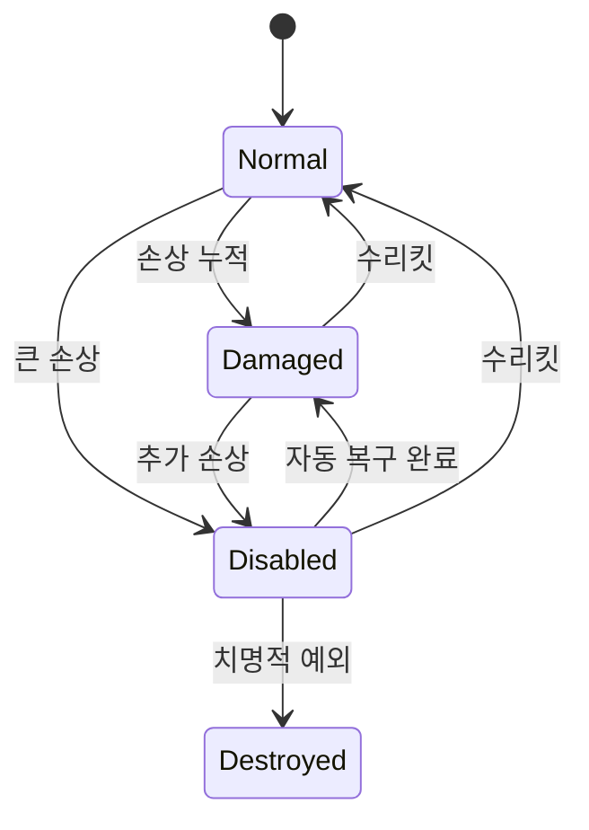

# 06. 모듈 손상·승무원 부상·화재·복구

> 기준일: 2026-11-13 KST · Wargaming World of Tanks PC판 · 소형 수리/구급상자를 단일 대상 선택형으로 설명하는 구버전 규칙은 사용하지 않는다.
> [확인] 공식 공개 규칙 · [분석] 설계 의미 · [제안] 재구현·QA · [검증 필요] 정확한 내부 상수. 직접 플레이 또는 원작 코드를 확인한 문서는 아니다.

## 1. HP와 별도의 전투 능력 손실

**[분석]** 전차 HP는 생존 잔량이고, 모듈·승무원 상태는 남은 HP를 얼마나 효과적으로 쓸 수 있는지를 결정한다. HP가 많이 남아도 궤도가 끊겨 측면을 노출하거나 장전수가 부상해 사격 주기를 놓치면 즉시 불리해질 수 있다. 반대로 모듈을 수리한다고 이미 잃은 전차 HP가 회복되는 것은 아니다.

이 계층이 만들어내는 세 가지 효과는 다음과 같다.

1. 적을 격파하지 못한 공격도 이동·사격·정보 능력을 줄이는 기여가 된다.
2. 특정 부위를 노리는 기술과 전차 구조 지식에 가치를 준다.
3. 수리/구급/소화기 사용 시점을 결정하는 전투 중 자원 관리가 생긴다.

모듈은 HP 총량과 별도 상태를 가지며, 승무원 부상은 역할에 따른 성능 저하를 만든다는 점이 공식 설명의 핵심이다. **[확인 C22]**

## 2. 외부와 내부를 나누는 이유

**[확인 C23]** 공식 개인 임무 설명은 궤도·주포·관측장치를 외부 모듈 예시로 들고, 내부 모듈 손상 조건과 구분한다. 단순 손상과 파괴도 서로 다른 조건이다.

| 계층 | 대표 대상 | 주된 결과 | 설계상 별도 기록 이유 |
|---|---|---|---|
| 전차 본체 | 차체 HP | HP 감소·격파 | 보상·생존 판정의 기준 |
| 외부 모듈 | 궤도·바퀴·주포·관측장치 | 기동·명중·정보 제한 | 주장갑 관통 없이도 결과 가능 |
| 내부 모듈 | 엔진·탄약고·연료탱크·포탑 구동부·무전기 | 성능 저하·기능 상실·화재·폭발 | 내부 배치와 진입 방향의 의미 |
| 승무원 | 전차장·포수·조종수·장전수·무전수 | 직책에 따른 성능 저하 | 치료 대상과 피해 기여 구분 |
| 일시 상태 | 스턴·화재·특수능력 디버프 | 시간에 따른 성능/HP 변화 | 모듈 상태와 다른 지속시간·해제 수단 |

표의 설계상 해석은 **[분석]**이다. 실제 전차마다 승무원 수, 겸직, 모듈 배치가 다르며 일부 기능은 여러 하위 부품을 하나의 게임플레이 모듈로 묶어 표현할 수 있다.

## 3. 손상 상태기

**[확인 C22]** 지원 문서는 노란 상태를 손상, 붉은 상태를 기능 불능 수준의 치명 손상으로 설명하고, 승무원의 자동 수리가 모듈을 다시 작동 가능한 손상 상태로 돌린다고 안내한다. 지원 문서의 50% 설명을 모든 모듈의 정확한 임계값·복구 HP로 일반화하지 않는다.



**[제안]** `Normal / Damaged / Disabled`는 기능 상태이고, `currentHP`는 별도 값으로 보관한다. 자동 복구 후 성능 회복과 모듈 내구 회복을 하나의 불리언으로 합치면 “한 번 더 맞으면 다시 끊어지는 궤도” 같은 재손상 위험을 표현하기 어렵다. 장비가 복구 후 현가장치 HP를 바꾸는 경우도 구분한다.

## 4. 부위별 동작 규칙

다음 표는 공식 지원의 기능 방향을 간결하게 정리한 **[확인 C22·C23]**과 재구현 시 필요한 **[분석]**을 함께 표시한다. 정확한 배율·손상 확률은 별도의 데이터다.

| 부위 | 확인된 기능 방향 또는 분류 | 분석·설계상 영향 | 미확인 세부값 |
|---|---|---|---|
| 엔진 | 파괴 시 기동 불가, 화재 가능성 존재 | 화력과 독립적으로 탈출 능력 제거 | 출력 저하 배율, 화재 확률, 재피격 처리 |
| 탄약고 | 손상 시 장전 성능 저하, 완전 파괴 시 폭발 가능 | 상대 사격 주기 예측과 즉사 위험 | 모듈 HP, 보호효과 적용 우선순위 |
| 연료탱크 | 파괴가 화재 원인 | 작은 HP 피해가 지속 손실로 이어질 수 있음 | 화재 틱·지속·연속발화 처리 |
| 포탑 구동부 | 손상 시 회전 저하, 파괴 시 회전 불가 | 차체 회전으로 조준을 보완하는 위험 발생 | 제한포탑·고정포의 예외 |
| 무전기 | 손상 시 신호 범위 저하 | 팀 정보 공유 능력 저하 | 최신 전차별 무전기 피해 예외 |
| 주포 | 외부 모듈로 분류 | 조준 성능과 발사 가능 상태 분리 필요 | 손상/파괴의 정확한 적용값 |
| 관측장치 | 외부 모듈로 분류 | 탐지 능력 저하를 위한 별도 상태 필요 | 감시점·시야 보정·복구값 |
| 궤도·현가장치 | 외부 모듈, 파괴/복구 기록 필요 | 적을 사선에 묶는 지원 가치 | 단측 궤도·차륜·예비 궤도별 조건 |

**[분석]** 위 표를 그대로 “명중한 부위는 항상 손상”이라는 규칙으로 바꾸지 않는다. 시각적인 명중점, 장갑 관통, 내부 경로, 모듈 피해 판정은 서로 다른 단계다. 모듈의 적중 확률·피해량·손상 임계값은 공개 문서만으로 모두 확정하지 못했다.

### 4.1 승무원 역할별 손실

**[확인 C22]** 공식 설명에서 전차장은 관측, 조종수는 이동, 포수는 조준/정확도·회전, 장전수는 장전, 무전수는 신호 성능과 연결된다. 모든 승무원이 부상한 경우 전차는 운용할 수 없는 상태로 간주된다.

**[분석]** 겸직 승무원은 한 명의 부상으로 여러 기능에 영향을 줄 수 있으므로 `crewMemberId`와 `qualificationIds`는 일대일이 아니다. 또한 기본 숙련 체계가 바뀌어도 부상에 의한 전투 성능 제한이라는 구조는 별도로 존재한다. 과거 “주특기 숙련도를 0%로 만든다”는 문장을 현재 UI의 숙련 수치와 직접 동일시하지 말고 실제 유효 성능을 검증한다.

## 5. 화재·탄약고·스턴을 분리

### 5.1 화재

**[확인 C22]** 엔진 손상과 연료탱크 파괴는 서로 다른 화재 경로다. **[분석]** 화재는 1회 피해 사건이 아니라 지속 상태로 보아야 소화기 사용·자동 소화·추가 손상·격파 원인 귀속을 일관되게 처리할 수 있다.

**[제안]** 화재 사건에는 시작 시각, 원인 공격자, 피해 정책, 다음 틱, 종료 조건을 보관한다. 같은 틱에 소화기와 화재 피해가 처리될 때 순서를 고정해야 “소화했는데 추가 틱이 두 번 발생”하는 문제를 막는다. 불이 꺼졌다고 손상된 엔진·연료탱크를 무조건 정상화하지 않는다.

### 5.2 탄약고 폭발

**[확인 C22]** 탄약고 파괴는 전차 전체 파괴로 이어질 수 있다. **[분석]** 남은 전차 HP를 그냥 한 번의 주포 평균 피해로 제한하는 방식과 다르므로 격파 원인에 별도 플래그가 필요하다. 보호 장비·특수능력의 방어/공격 예외가 있다면 치명 결과를 적용하기 전에 우선순위를 결정해야 한다.

**[검증 필요]** “탄약을 모두 사용하면 탄약고가 폭발하지 않는다”와 같은 민간 설명은 이번 공식 본문 확인 범위에서 확정하지 않았다. 해당 조건을 제품 규칙으로 복제하려면 실제 통제 실험이 필요하다.

### 5.3 스턴

**[확인 C24]** 스턴은 일정 시간 동안 여러 성능을 저하시키는 효과이며 구급상자로 제거할 수 있다. **[분석]** 영구적인 승무원 부상과 스턴을 하나의 상태로 합치면 스턴이 끝날 때 부상까지 잘못 회복시키거나, 치료한 뒤에도 중복 패널티가 남는 문제가 생긴다. 두 상태의 합성은 별도 계층이어야 한다.

## 6. 복구 수단과 최신 규칙

### 6.1 자동 수리

**[확인 C22]** 작동 불능 모듈은 시간이 지나면 승무원에 의해 일부 기능이 복구된다. **[분석]** 자동 수리의 목적은 전차를 영구 정지 상태에서 꺼내는 것이고, 전투력을 완전히 초기화하는 것과 다르다. 재피격으로 수리 진행이 어떻게 바뀌는지, 복수 모듈을 병렬 수리하는지, 궤도별 시간이 어떻게 달라지는지는 실측 항목이다.

### 6.2 소모품 — 구식 단일 대상 규칙 폐기

**[확인 C25·C26]** 1.26 이후 소형 수리킷도 모든 손상 모듈을 수리하고, 소형 구급킷도 모든 부상 승무원을 치료한다. 현행 가이드는 재사용 소모품의 기본 대기시간을 일반형 90초, 개량형 60초로 안내한다. 수리킷·구급킷·소화기는 한 전투에서 재사용할 수 있으며, 사용 횟수마다 새 아이템 비용을 반복 지불하는 구조가 아니라 그 전투에서 사용했다면 종료 후 보충 대상이 된다.

| 수단 | 처리 대상 | 사용 판단 — 분석 | 주의 |
|---|---|---|---|
| 소형 수리킷 | 모든 손상 모듈 | 지금 노출을 끊거나 사격 주기를 회복할 필요 | 과거 한 모듈 선택 방식과 혼동 금지 |
| 대형 수리킷 | 모든 손상 모듈 | 짧은 재사용 대기·부가효과의 가치 평가 | 상세 패시브 수치는 장비/소모품 문서 확인 |
| 소형 구급킷 | 부상 승무원·스턴 해제 기능 | 주요 직책 부상이나 즉시 행동 회복 | 다음 피격까지 대기시간 고려 |
| 대형 구급킷 | 부상 승무원·스턴, 부가효과 | 반복 상태이상 대응 | 부상과 스턴 상태 둘 다 검증 |
| 수동/자동 소화기 | 화재 | 지속 HP 손실 차단 | 소화와 모듈 수리를 동일 효과로 취급 금지 |

**[분석]** 대형 소모품의 가치는 “한 번에 여러 개 고침”이라는 옛 설명으로 충분하지 않다. 재사용 속도와 패시브 효과, 전투에서 실제로 두 번째 사용 기회를 얻는 빈도가 핵심 비교 대상이다.

### 6.3 장비·승무원 보정

**[확인 C27]** 공식 장비 설명에는 현가장치 내구와 복구 성능을 개선하는 장비, 탄약고·연료탱크·엔진의 치명 결과를 제한하는 장비가 존재한다. **[분석]** 이를 단순 HP 증가로 통합하면 어떤 피해를 한 번 막았는지와 해당 보호가 소진됐는지를 표시할 수 없다. `preventedCatastrophe`와 같은 전투 중 소모 상태를 별도로 보관하는 편이 명확하다.

## 7. 예비 궤도와 복구의 예외

**[확인 C06]** Yoh 예비 궤도 설명에 따르면 주 궤도만 손상됐을 때는 감속 상태로 계속 이동할 수 있다. 예비 궤도까지 손상된 경우 예비 궤도를 먼저 복구하고 이어서 주 궤도를 복구한다. 움직이는 동안 주 궤도 복구 시간에 불이익이 생길 수 있으며 수리킷은 궤도를 한꺼번에 복구한다.

**[분석]** 이 메커니즘은 수리의 전형적인 “멈춘 채 기다리기”를 “느리게라도 엄폐로 들어가기”로 바꾼다. 따라서 멈춤/이동 상태를 단순하게 파괴 여부에 매핑하면 안 된다. 2.1.1 Ares 계통도 예비 궤도 기능을 사용하므로 국가·병과명으로 하드코딩하지 않고 기능 태그를 활용한다. **[확인 C12]**

## 8. 상황별 복구 의사결정

### 상황 A: 궤도와 탄약고가 동시에 손상

**[제안 상황]** 적 사선에 서 있고 궤도가 끊긴 동시에 탄약고도 손상됐다고 하자. 지금 수리킷을 사용하면 이동과 장전 성능을 함께 회복한다. 소형 수리킷으로 궤도만 고를지 탄약고만 고를지 선택하는 구버전 판단을 현재 규칙에 적용하지 않는다.

**[분석]** 실제 판단은 “지금 사용해야 생존하는가, 곧 더 위험한 재피격을 받을 가능성이 있는가”로 옮겨간다. 아군이 엄호해 주는 동안 자동 수리를 기다려도 된다면 쿨타임을 아낄 수 있고, 집중 사격 중이면 즉시 복구의 가치가 높다.

### 상황 B: 적 재장전 사이 반복 궤도 파괴

**[제안 상황]** 첫 궤도 파괴로 상대가 수리킷을 사용했다. 아군은 상대의 대기시간이 남은 구간에 다시 궤도를 공격해 탈출을 제한하려 한다.

**[분석]** 이때 궤도 손상은 직접 HP 피해가 없더라도 아군 화력 기회를 만든다. 지원 기여는 단순한 “누가 마지막으로 궤도를 맞혔나”가 아니라 실제 이동 불가 상태와 아군 피해 시점의 관계를 다뤄야 한다. 원작의 모든 중복 기여 배분식은 본문에서 확정하지 않으며 보상 문서의 검증 항목과 연결한다.

### 상황 C: 스턴 중 포수 부상

**[제안 상황]** 스턴이 걸린 전차에 포수 부상까지 추가되었다. 구급킷 사용은 해당 해제 대상들을 처리해야 하지만, 장비 보너스·남은 열·주포 자체 손상까지 무조건 초기화하면 안 된다.

**[분석]** 성능 저하를 원인별로 분리하지 않으면 치료 후 조준이 비정상적으로 빠르거나 계속 느린 상태가 될 수 있다. UI에 “포수 부상, 스턴, 주포 손상”을 구분하여 표시할 필요가 있다.

## 9. 데이터와 사건 처리 — 제안

```yaml
ModuleDefinition:
  id: ammo_rack
  category: internal
  hitVolumeId: vehicle_specific
  durability: vehicle_specific
  stateThresholds: configurable
  damagedModifiers: []
  disabledModifiers: []
  autoRepairProfile: configurable
  catastrophicResult: optional
ModuleRuntime:
  hp: current
  state: normal | damaged | disabled
  repairProgress: current
CrewRuntime:
  memberId: unique
  roles: []
  injuryState: active | injured
TemporaryEffect:
  effectId: fire | stun | other
  sourceActorId: optional
  startTime: server_time
  endCondition: configurable
```

```text
OnModuleImpact(hit):
    result = EvaluateModuleDamagePolicy(hit)
    oldState = module.state
    ApplyDurabilityChange(module, result)
    ResolveProtectionBeforeCatastrophe(module, loadout)
    newState = ResolveModuleState(module)
    RebuildAffectedCapabilities(oldState, newState)
    EmitModuleEvent(oldState, newState, hit.source)

OnRepairConsumableActivated():
    ValidateCooldownAndInventoryOnce()
    RepairAllEligibleModules()
    StartCooldown()
    MarkConsumedForPostBattleResupply()
```

**[분석]** 기능을 매번 원본 능력치에서 다시 합성하면 패널티를 중복 곱하거나 수리 후 역연산으로 되돌리는 오차를 줄일 수 있다. 손상/복구/보호발동 사건에는 고유 ID를 두어 리플레이·임무·보상이 같은 사건을 중복 집계하지 않게 한다.

## 10. QA와 계측 계획

| ID | 조건 | 기대 또는 검증할 결과 |
|---|---|---|
| DMG-01 | 외부 모듈만 타격 | HP 감소 없이 모듈 결과가 가능하며 UI가 구분 |
| DMG-02 | 손상·파괴·자동수리 순차 발생 | 작동 가능과 완전 정상 상태를 구분 |
| DMG-03 | 여러 모듈 손상 후 소형 수리킷 | 현행 규칙대로 모든 대상 복구 |
| DMG-04 | 여러 승무원 부상+스턴 후 소형 구급킷 | 부상·스턴 해제를 각각 처리 |
| DMG-05 | 같은 전투 내 소모품 여러 번 사용 | 대기시간과 전투 후 보충 비용의 단위 일치 |
| DMG-06 | 대기시간 종료와 재피격을 같은 프레임에 처리 | 입력·피해·복구 순서가 결정적 |
| DMG-07 | 화재 중 소화기·엔진 수리 각각 사용 | 화재와 모듈 상태를 혼동하지 않음 |
| DMG-08 | 탄약고 보호효과가 있는 상태에서 치명 손상 | 보호 소진과 실제 격파 원인 일치 |
| DMG-09 | 주/예비 궤도 파괴 순서를 바꿈 | 이동 가능성·수리 순서·시간 보정 검증 |
| DMG-10 | 겸직 승무원 부상 | 관련 기능이 함께 바뀌며 중복 적용되지 않음 |
| DMG-11 | 궤도 지원과 정찰 지원이 중첩 | 피해 기여를 모드별 정책대로 중복/배분 처리 |
| DMG-12 | 전차 격파 직전 예약된 자동 복구 완료 | 파괴된 전차가 잘못 다시 활성화되지 않음 |

**[제안 지표]** 기동 불가 누적시간, 수리킷 사용 후 생존시간, 보호 장비 발동률, 모듈별 손상 빈도, 구급킷의 부상/스턴 해제 비중, 수리킷 두 번째 사용 도달률을 수집한다. 수리킷 소지율만으로 상태이상 시스템이 공정한지 판단할 수 없다.

## 11. 설계 해석과 미확인 영역

**[분석]** 모듈 손상은 피해를 단순 숫자에서 “행동의 제한”으로 바꾼다. 공정성을 유지하려면 왜 행동이 안 되는지 즉시 이해할 수 있어야 하고, 복구 후 무엇이 남아 있는지 확인할 수 있어야 한다. 손상 효과가 크지만 피드백이 약하면 사용자는 조작 오류나 서버 문제로 받아들이기 쉽다.

**[검증 필요]** 각 모듈의 비공개 HP, 피격 회피 확률, 내부 탄 이동 거리, 화재 틱 계수, 복구 진행 리셋 조건, 모든 승무원 부상 예외는 이번 문서의 확정 사양이 아니다. 특히 인터넷에서 널리 인용되는 모듈별 27%·33%·45% 같은 수치를 모바일 공식 자료에서 PC판으로 옮기지 않았다.

## 12. 출처

- **C22** [What Happens When a Shell Hits a Vehicle?](https://wargaming.net/support/en/products/wot/article/15762/) — 모듈과 승무원 손상의 공식 개요. 임계값 설명은 단순화된 가이드로 취급.
- **C23** [How Do I Complete Personal Missions?](https://www.wargaming.net/support/en/products/wot/article/15110/?redirect_lang=en) — 내부/외부 모듈, 손상/파괴의 집계 구분.
- **C24** [Stun Mechanic](https://wargaming.net/support/en/products/wot/article/19514/?lang=en&redirect_lang=en) — 스턴·구급킷·지원 피해 개요. 과거 계수 전체를 현행으로 복사하지 않음.
- **C25** [Consumables](https://worldoftanks.eu/en/content/guide/game-mechanics-and-achievements/consumables/) — 현재 소모품·기본 재사용 대기·보충 단위.
- **C26** [Update 1.26: Hailstorm](https://worldoftanks.asia/en/wot-1-26/) — 소형 수리/구급킷의 전체 대상 처리 변경.
- **C27** [How Equipment 2.0 Works](https://wargaming.net/support/en/products/wot/article/33291/?lang=en&redirect_lang=en) — 현가 복구·치명 손상 보호의 기능 예시. 최신 장비 수치는 장비 문서 우선.
- **C06** [American Yoh Tanks Are Here!](https://worldoftanks.eu/uk/news/general-news/brand-new-yoh-tanks/) — 예비 궤도·수리 순서.
- **C12** [Update 2.1.1](https://worldoftanks.eu/en/news/updates/wot-2-1-1/) — Ares 계통의 예비 궤도 사용.
