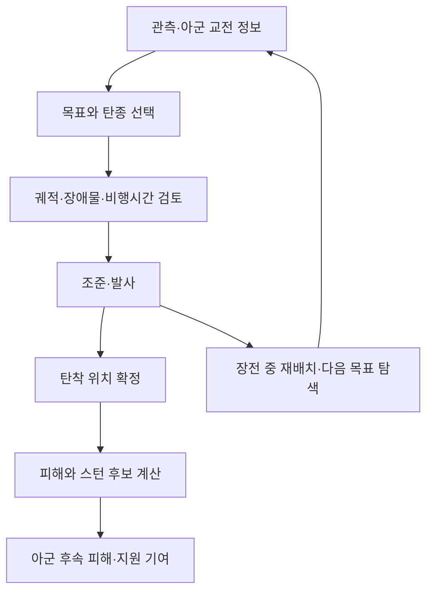
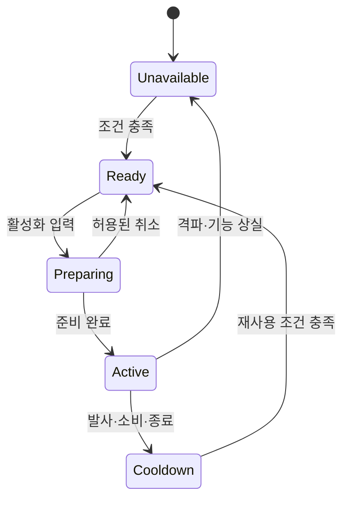

# 07. 자주포·스턴·전차 고유 메커니즘

> 기준일: 2026-11-13 KST · Wargaming World of Tanks PC판 · 공식 자료로 확인 가능한 2.4 관련 고유 기능까지 포함한다.
> [확인] 공식 문서 사실 · [분석] 설계 해석 · [제안] 재구현·실험 · [검증 필요] 수치·예외 미확정. Tier XI의 최초 출시 16대를 현재 전체 전차 수로 취급하지 않는다.

## 1. 시스템 목적

**[분석]** 자주포와 고유 메커니즘은 기본적인 “이동 → 조준 → 발사 → 재장전” 순환에 다른 시간 자원을 추가한다. 자주포는 긴 비행시간과 폭발 반경, 스턴을 사용하고, 고유 전차는 열·추진기·모드·축적 단계·독립 보조 무장을 사용한다. 이들을 모두 단순한 공격력 증가로 표현하면 대응 행동과 위험의 차이가 사라진다.

공통 분석 단위는 다음과 같다.

| 질문 | 필요한 명세 |
|---|---|
| 무엇으로 시작하는가 | 버튼, 명중, 이동 지속, 재장전 시작, 시간 경과 |
| 무엇을 소비하는가 | 탄약, 열 여유, 충전, 주행 자유, 노출 시간 |
| 무엇을 바꾸는가 | 피해·관통·조준·이동·탐지·상대 상태 |
| 언제 끝나는가 | 발사, 시간 만료, 과열, 이동, 취소, 격파 |
| 상대가 어떻게 아는가 | 외형·사운드·마커·발사 간격·능력 표시 |
| 어떤 예외가 있는가 | 미관통/명중만 성공, 보조 무장, 모듈 보호, 특별모드 |

Tier XI 성장·업그레이드 비용은 성장 문서에서 다룬다. 여기서는 전투 중 입력과 결과를 중심으로 정리한다.

## 2. 자주포의 기본 전투 순환

**[확인 C21]** 공식 자주포 설명은 탄마다 탄속과 궤적이 다르고, 포격 모드·궤적 보기 및 예상 비행시간 표시가 존재한다고 안내한다. 탄종을 바꾸면 같은 목표라도 다시 조준할 필요가 있다.

**[분석]** 자주포는 현재 보이는 적을 즉시 때리는 시스템이 아니다. 발사 후 탄착까지 목표의 위치가 바뀔 수 있으므로 “관측 정보의 나이”가 공격 신뢰도에 직접 영향을 준다. 아군이 제공한 탐지, 적의 예상 이동, 지형 가림을 함께 판단해야 한다.



이 도식은 **[제안]** 분석 모델이다. 탄착·시야·피해 계산의 실제 서버 틱 순서를 주장하지 않는다.

### 2.1 기본 규칙과 현재 인원 제한

**[확인 C33]** 2.3 공식 패치 노트는 팀당 자주포 제한을 2대로 변경했다. 구버전의 팀당 3대를 현행 일반 규칙으로 쓰지 않는다. 별도의 이벤트 모드에는 자주포 금지나 다른 편성 조건이 있을 수 있다.

**[분석]** 인원 상한은 단순 대기열 옵션이 아니라 피격자가 얼마 동안 기동·사격 성능을 제한당할 수 있는지에 영향을 준다. 자주포 한 대의 피해량만 맞추고 중첩 노출 시간을 무시하면 체감 공정성을 설명할 수 없다.

## 3. 자주포 탄종의 기능 분리

**[확인 C21·C17]** 1.13은 다수 자주포의 탄을 스턴 HE, 대체 HE, 전술 AP/HEAT의 목적이 다른 선택지로 재구성했다. 모든 저단계 자주포가 동일한 탄 세트를 가진다고 일반화하지 않는다.

| 구분 | 확인된 기능 방향 | 선택 이유 — 분석 | 위험 — 분석 |
|---|---|---|---|
| 스턴 HE | 넓은 폭발 반경·스턴, 상대적으로 낮은 직접 피해·낮은 탄속·높은 궤적 | 아군이 집중 사격할 적 묶음 지원 | 비행 중 적 이탈, 직접 피해만 보면 낮은 성과 |
| 대체 HE | 스턴 없음, 더 작은 반경, 더 큰 피해/관통·더 빠르고 낮은 궤적 | 얇은 장갑이나 직접 피해 기회 | 좁은 범위와 지형 가림 때문에 실효 감소 |
| 전술 AP/HEAT | 스플래시·스턴 없는 단일 표적, 높은 관통·탄속·낮은 궤적 | 잘 맞힐 수 있는 표적에 관통 피해 | 빗나감·도탄·비관통이면 지원 효과까지 잃음 |

**[확인 C21]** 스턴 HE는 주장갑 비관통 시 내부 모듈·승무원 피해가 제한된다. 대체 HE와 동일한 내부 피해 정책을 쓰지 않는다.

**[분석]** “탄속이 빠르면 항상 좋은 자주포 탄”이 아니다. 높은 궤적으로 넘어가던 지형에 낮은 궤적이 막힐 수 있으며, 한 발의 피해량이 큰 탄은 아군이 활용할 스턴 기회를 줄일 수 있다. UI는 탄종의 포구 속도보다 실제 선택 위치까지 도달할 수 있는지와 예상 도착 시각을 보여주는 것이 중요하다.

## 4. 스턴의 상태와 중첩

**[확인 C24]** 스턴은 이동·회전·관측·조준·재장전 등 여러 성능을 일정 시간 저하시킨다. 실제 지속시간은 폭발 위치·받은 피해·보호 효과 등에 영향을 받으며, 복수 스턴을 단순히 모두 더하는 방식으로 설명할 수 없다. 구급킷은 스턴을 해제하는 수단이다.

### 4.1 분리해야 할 세 가지 상태

1. **현재 조작 제한**: 지금 유효한 성능 저하.
2. **각 공격의 효과 기간**: 어느 자주포의 스턴이 언제까지 유효한지.
3. **지원 피해 기여**: 효과 기간 중 아군 피해가 누구에게 귀속되는지.

위 분리는 **[제안]**이다. 성능 패널티 하나로 줄여 저장하면 실제 효과 종료와 기여 기간을 일관되게 처리하기 어렵다. 반대로 모든 효과를 곱하면 중첩 스턴이 과도한 행동 불능 상태를 만들 수 있다.

### 4.2 스턴과 영구 부상

**[분석]** 스턴은 시간이 지나면 끝나지만 승무원 부상은 별도의 치료 상태다. 같은 구급킷이 여러 상태를 해제하더라도 내부에서는 두 종류의 효과를 처리해야 한다. 스턴 해제 때 주포 자체 손상이나 현재 재장전 진행까지 초기화하면 다른 시스템의 규칙을 침범한다.

### 4.3 지원 피해

**[확인 C24]** 스턴 중 다른 아군이 준 피해는 지원 기여로 집계될 수 있으며, 자주포 자신의 직접 피해를 같은 의미의 지원 피해로 이중 계산하지 않는다. 복수 자주포 중첩의 구체 배분 계수는 최신 패치와 실제 결과창을 대조해야 한다.

**[분석]** 원작 재구성에서 필요한 것은 “스턴을 걸었다”는 사건만이 아니다. 각 후속 피해의 시각, 피해를 준 아군, 효과를 건 자주포, 중첩 효과와 해제 사건을 연결할 수 있어야 한다.

## 5. 자주포 대응과 피드백

**[확인 C21]** 1.13의 대응 수단에는 더 잘 보이는 탄 흔적, 미니맵의 포격 정보, Sound Detection과 관련한 경고가 포함된다. 이 기능의 존재와 실제 표적 위치를 완전히 공개하는 것은 다른 문제다.

**[분석]** 피격자에게 필요한 정보는 “위험이 예상되는 방향·시간·범위”다. 자주포의 모든 정확한 좌표를 공개하면 탐지 시스템을 무력화하고, 아무 정보도 주지 않으면 대응 행동이 없다. 전술 경고는 정보 정확도와 행동 시간을 함께 설계해야 한다.

| 피드백 | 플레이어 판단 | 설계 점검 |
|---|---|---|
| 탄착 위험 경고 | 이동 또는 엄폐 선택 | 늦게 표시되어 행동 불가능하지 않은가 |
| 스턴 타이머 | 구급킷 사용·재장전 기다림 | 종료 시각이 서버 결과와 일치하는가 |
| 피해·스턴 지원 수치 | 팀 지원 효과 이해 | 직접 피해와 중복 표기되지 않는가 |
| 탄도 차단 표시 | 목표/탄종 변경 | 작은 장애물·지형 변화에도 갱신되는가 |
| 비행시간 표시 | 이동 표적 예측 | 모드·탄종 변경 후 오래된 값이 남지 않는가 |

## 6. 고유 메커니즘을 분류하는 관점

**[분석]** 개별 전차의 이름을 외우는 방식보다 자원과 입력을 분류하면 새 전차를 추가해도 기본 사양을 재사용할 수 있다.

| 패턴 | 소비·축적하는 자원 | 바뀌는 행동 | 필요한 공통 인터페이스 — 제안 |
|---|---|---|---|
| 모드 전환 | 전환시간·이동 자유 | 정밀 사격/기동 중 선택 | 모드별 수정자·전환 취소 |
| 열 관리 | 발열 여유·냉각 시간 | 연사와 휴식 | 열량·과열 잠금·냉각 조건 |
| 충전 후 발사 | 기다린 시간·충전량 | 큰 한 발과 즉시 사격 | 충전 소비·발사 시 확정 |
| 명중 연계 | 연속 명중·처치 | 공격 성공이 다음 공격 강화 | 결과 이벤트·중첩 수·만료 |
| 추진·주행 보조 | 횟수·연료·입력 지속 | 접근·이탈·선회 개선 | 운동계 수정자·재충전 |
| 독립 보조 무장 | 별도 재사용 대기 | 주포 공백 보완 | 주포와 다른 무장 슬롯 |
| 정보 표식·탐지 | 활성화·명중·위험 노출 | 팀 전체의 발견·집중화력 | 정보 정책·표식 권한·만료 |
| 결과 적응형 탄 | 이전 발 결과 | 관통 실패/성공 뒤 다음 발 변화 | 사격 결과 참조·장전 연계 |

## 7. 기존 고유 무장을 혼동하지 않는 원칙

### 7.1 소련 쌍열과 영국 쌍열

**[확인 C11·C34]** 소련 쌍열은 동시 발사 준비와 발사 후 잠금이 특징인 반면, 영국 Selective Fire Modes는 단발/일제 모드의 성능 조합을 바꾸는 구조다. 영국 일제 모드는 순간 피해와 기동·조준의 교환을 가지며, 소련식 준비·잠금을 그대로 적용할 수 없다.

**[분석]** 외형이 주포 두 개라는 사실은 하나의 무장 로직을 공유할 근거가 아니다. UI는 모드 선택, 발사 준비, 포신별 장전, 잠금의 의미를 각 계통에 맞게 보여야 한다.

### 7.2 자동 재장전과 열 관리

**[확인 C35]** Ares 계통의 기관포는 발열에 따라 정확도가 나빠지고 과열 시 냉각까지 무장이 잠기는 구조로 소개되었다. **[분석]** 탄창식 전차의 “남은 탄 수를 모두 쓰고 숨기”와 열 관리의 “더 쏘면 곧 스스로 잠김”은 유사한 긴장감을 다른 자원으로 만든다. 최근 재조정이 있는 계통이므로 출시 당시 발열·냉각 수치를 현재 상수로 사용하지 않는다.

## 8. Tier XI 대표 메커니즘

표의 “확인된 작동 핵심”은 공식 소개 또는 현행 Tankopedia를 압축한 것이며, 구체 보너스와 시간값은 업그레이드·재조정으로 달라질 수 있다. “검증할 경계”는 **[제안]**이다. 이 표는 전체 전차 목록이 아니라 구현 유형을 넓게 포괄하는 사례집이다.

| 전차·기능 | 확인된 작동 핵심 | 검증할 경계 |
|---|---|---|
| T803 · Semi-Automatic Ammo Rack | 명중 시 일시적 장전 효율 단계 축적, 포탄으로 격파 시 추가 단계 **[C36]** | 관통하지 않은 명중도 인정하는지, 단계 만료와 발사 시각 |
| Taschenratte · Auxiliary Weapons | 주포 외 HE 성격의 보조 무장 **[C28]** | 주포 장전과 독립인지, 별도 탄·기여 처리 |
| KR-1 · Ramming Configuration | 충돌 공격 능력을 강화 **[C28]** | 활성 조건·접촉 피해·이동 제한·보호효과 |
| Object 432U · Thermo-Ballistic Overcharge | 시간을 들여 강화 사격을 준비 **[C29]** | 충전 취소·탄종 변경·피격·발사 때 소비 |
| Strv 107-12 · Pillbox Mode | 기동을 포기해 화력·조준 성능 강화 **[C30]** | 일반 구축 모드와의 전환·기동 명령 충돌 |
| AT-FV230 Breaker · Direct Drive | 전진을 지속하며 기동 보너스 증가 **[C30]** | 제동·후진·접촉·궤도 손상이 누적에 미치는 영향 |
| leKpz Borkenkäfer · Laser Target Designator | 활성화 후 명중 시 적의 발견 상태에 따라 표식 효과 분기 **[C37]** | 명중 시점의 탐지 상태와 효과가 일치하는지 |
| PTZ-78 · Sequential Rocket Thrusters | 좌우 추진기 독립 작동으로 기동 보조 **[C07]** | 좌우 입력·후진·회전의 조합 |
| STK-2 · Active Gun Cooling | 발사 후 재장전 중 냉각하며 정확도 회복 **[C07]** | 장전 완료와 냉각 완료의 시간 분리 |

**[확인 C30·C37]** 공식 소개는 명중 시점의 발견 상태로 효과를 나눈다고 설명한다. Borkenkäfer의 현행 Tankopedia는 발견된 적에게 명중하면 더 오래 드러나고 더 큰 피해를 받게 하는 표식, 발견되지 않은 적에게 명중하면 위치를 별도 표시하는 효과를 구분한다. **[분석]** 따라서 기본 “안 보이는 적을 맞혀도 피드백이 제한된다”는 정보 규칙에 예외가 생긴다. 능력 설명은 정보가 팀 전체에 어떻게 전달되는지까지 명세해야 한다.

### 8.1 2.4에서 추가된 기능 사례

**[확인 C32]** 2.4 공식 릴리즈에는 아래 기능이 명시되어 있다. 짧은 기능 요약 외 세부 전환시간·수치·예외는 검증 대상으로 남긴다.

| 사례 | 작동 핵심 | 분석상 중요한 연결 |
|---|---|---|
| WZ-219 · IRST | 전방 구역을 탐색하며 미발견 적을 찾아내면 자신도 발견되는 위험 | 정보 획득과 자기 위치 공개의 교환 |
| Ho-Ri Shugo · Coaxial Rocket Launcher | 주포와 독립 대기시간을 가진 로켓 보조 무장 | 주포 재장전 공백과 보조 피해의 상호작용 |
| Vz. 63P · Adjustable Fuze Setter | 첫 발 관통 결과에 따라 두 번째 탄이 피해 또는 관통 강화 | 이전 사격 결과를 다음 탄의 입력으로 사용 |
| BV-111 · External Ammunition Feed | 외부 탄 공급 모드로 피해를 늘리는 대신 기동·발사속도 비용 | 모드 전환과 위치 선정의 연결 |
| CAV 71 · Forced Loading Mechanism | 충전을 써 한 발 장전시간을 짧은 고정시간으로 변경 | 탄창 상태·충전 회복·순간화력의 결합 |
| 독일 신규 중전차 계통 · Shell Calibration | 발사 전 모드로 탄 성능을 바꿈 | 탄 자체 정의와 활성 수정자의 분리 |

**[분석]** 이 기능들은 무작위 전투를 단순히 능력치가 더 큰 전차끼리 싸우는 형태로 설명하기 어렵게 만든다. 상대가 다음 발에 어떤 성능을 갖는지 추론해야 하고, 이를 위한 시각·음향 신호가 없으면 학습 비용이 급증한다.

## 9. 상황 분석

### 상황 A: 스턴 피해가 더 낮아도 팀에 좋은 사격

**[제안 상황]** 아군 중전차 여러 대가 적의 돌파를 막고 있으며 적은 좁은 위치에 모여 있다. 스턴 HE로 여러 대를 제한하면 낮은 직접 피해라도 아군이 재장전·회피·집중 공격할 기회를 얻는다. 반대로 아군 사격이 전혀 닿지 않는 적에게 스턴만 걸면 지원 가치가 작다.

**[분석]** 자주포 AI나 튜토리얼이 “가장 많은 적이 모인 곳”만 고르면 부족하다. 아군이 효과 지속시간 안에 공격할 수 있는지, 적이 곧 엄폐하는지까지 포함해야 한다.

### 상황 B: 결과 적응형 두 번째 발

**[제안 상황]** 첫 발이 관통하면 다음 발의 높은 피해를 살려 낮은 HP 표적을 제거하고 싶다. 첫 발이 실패했다면 강화 관통을 같은 장갑에 쓰거나 다른 표적으로 돌릴 수 있다.

**[분석]** 구현에서는 “첫 발 발사 시점”, “서버의 관통 결과 확정 시점”, “두 번째 발 준비 시점”을 분리해야 한다. 비행시간이 긴 상황에서 첫 발 결과가 오기 전에 두 번째 발을 쏠 수 있는지, 효과가 어떤 탄에 붙는지가 중요한 경계다. 원작에 대한 답을 임의로 정하지 않고 Vz. 63P 통제 실험으로 확정한다.

### 상황 C: 탐지 능력을 켤까

**[제안 상황]** 수풀 뒤의 적을 찾을 수 있지만 자기 위치도 공개되는 능력이 준비되어 있다. 아군이 사격할 수 없는 상태라면 발견 이득보다 자신이 피격당할 위험이 클 수 있다. 아군이 조준을 끝냈다면 같은 사용이 돌파의 시작이 된다.

**[분석]** 이런 능력의 효과는 발견한 적 수보다 “자기 손실 대비 팀이 실제로 활용한 정보”로 측정해야 한다. 무조건 준비되자마자 쓰는 자동화는 전략적 선택을 제거한다.

## 10. 공통 상태기와 데이터 — 제안



모든 능력에 준비·재사용 상태가 반드시 존재한다는 뜻은 아니다. 수동 버튼 없는 축적형은 이벤트 기반으로 상태를 갱신하고, 독립 보조 무장은 주포와 별도 상태기를 가진다.

```yaml
AbilityDefinition:
  id: vehicle_specific
  trigger: manual | on_hit | on_penetration | while_moving | while_reloading
  resource: charge | heat | stack | cooldown | none
  activationConditions: []
  cancelConditions: []
  modifierTargets: []
  consumePolicy: on_activation | on_fire | on_hit | over_time
  visibilityPolicy: owner | allies | spotted_enemies | public
  stackingPolicy: replace | refresh | accumulate | strongest
  battleModeOverrides: {}
AbilityRuntime:
  state: ready
  resourceValue: current
  effectEndTime: optional
  sourceShotId: optional
  affectedTargets: []
```

**[분석]** 수치 수정과 상태 전환을 분리하면 일시 효과가 끝났을 때 원본 제원을 다시 계산하기 쉽다. 단순한 “최종 공격력에 +25%를 더했다가 빼기”는 장비·승무원·다른 효과가 중간에 바뀌었을 때 오차가 생긴다.

## 11. QA와 밸런스 측정

| ID | 시험 | 확인할 결과 |
|---|---|---|
| SPC-01 | 자주포 동일 목표에 탄 세 종류 사용 | 도달 가능성·탄속·범위·스턴 정책을 별도 확인 |
| SPC-02 | 스턴 상태에서 두 번째 스턴·구급킷 | 지속시간·성능·지원 기여를 일관되게 갱신 |
| SPC-03 | 스턴 HE 비관통과 대체 HE 비관통 | 내부 모듈·승무원 정책을 혼용하지 않음 |
| SPC-04 | 자주포 발사 직후 목표 탐지 소실 | 이미 발사한 포탄과 관측 상태가 독립적 |
| SPC-05 | 소련·영국 쌍열 동시발사 비교 | 준비·잠금·모드 전환의 차이 유지 |
| SPC-06 | 기관포 발열 임계 직전 연사 중단 | 냉각 시작·과열 잠금·정확도 회복 조건 |
| SPC-07 | 명중 축적 능력으로 도탄/비관통/격파 | 효과를 유발하는 사건의 정확한 범위 |
| SPC-08 | 주포와 보조 무장 동시 입력 | 재사용 시간·탄약·피해 ID 충돌 없음 |
| SPC-09 | 충전 중 장전완료·피격·탄종변경 | 충전 소비/취소 규칙 일관 |
| SPC-10 | 탐지 표식 탄 발사 후 탐지 상태 변경 | 효과 분기 기준 시점 확정 |
| SPC-11 | 첫 발 결과보다 두 번째 발이 먼저 준비됨 | 적응형 탄의 이벤트 순서·지연 처리 |
| SPC-12 | 특수능력 활성 중 모드 전환·격파 | 수정자 잔존·유령 피해·충전 복제 없음 |

**[제안 지표]** 자주포 피격자의 행동 제한 시간/분, 스턴 후 실제 아군 피해 비율, 구급킷 강제 사용률, 능력 미사용률, 능력 종료 직후 격파율, 특수모드별 손익을 수집한다. 전차 승률 하나로 능력의 이해 가능성과 대응 가능성을 판단하지 않는다.

## 12. 출처와 해석 한계

- **C17** [Release Notes 1.13](https://worldoftanks.eu/en/content/docs/release_notes/release-notes-1-13/) — 자주포 탄 개편의 확정 릴리즈.
- **C21** [Changes to Vehicles and SPGs in Update 1.13](https://worldoftanks.eu/en/news/general-news/update-1-13-spg-changes/) — 탄도·스턴·대응 수단.
- **C24** [Stun Mechanic](https://wargaming.net/support/en/products/wot/article/19514/?lang=en&redirect_lang=en) — 스턴 상태·지원 기여. 상세 계수는 현행 재검증 대상으로 둠.
- **C33** [Release Notes 2.3](https://worldoftanks.eu/en/content/docs/release_notes/release-notes-2-3/) — 팀당 자주포 2대.
- **C11** [Colossal Double-Barreled Heavies Are Coming!](https://worldoftanks.eu/en/news/general-news/1-7-1-double-barreled/) — 소련 쌍열.
- **C34** [Meet the Twin-Barreled British Heavies!](https://worldoftanks.eu/en/news/general-news/1-27-1-british-heavy-tanks/) — 영국 쌍열의 별도 설계.
- **C35** [Fresh Steel: New Tier XI Tanks, U.S. Line, and Tier XI Rebalancing](https://worldoftanks.eu/en/news/general-news/update-2-1-1-tanks-overview/) — Ares 계통의 열 관리 설계.
- **C28** [Tier XI Heavy Tanks](https://worldoftanks.eu/en/news/general-news/update-2-0-tier-11-heavy-tanks/) — 보조 무장·충돌 강화 등 도입 구조.
- **C29** [Tier XI Medium Tanks](https://worldoftanks.eu/en/news/general-news/update-2-0-tier-11-medium-tanks/) — 충전형 사격 사례.
- **C30** [Tier XI TDs and LT](https://worldoftanks.eu/en/news/general-news/update-2-0-tier-11-tank-destroyers-light-tanks/) — 고정 모드·전진 강화 사례.
- **C36** [T803 Tankopedia](https://worldoftanks.eu/en/tankopedia/69153-A182_T803/) — 명중/격파에 따른 장전 효율.
- **C37** [leKpz Borkenkäfer Tankopedia](https://worldoftanks.eu/en/tankopedia/41233-G188_LeKpz_Borkenkafer/) — 명중 대상의 발견 상태별 표식.
- **C07** [Release Notes 2.1.1](https://worldoftanks.eu/en/content/docs/release_notes/release-notes-2-1-1/) — PTZ-78·STK-2.
- **C32** [Release Notes 2.4](https://worldoftanks.eu/en/content/docs/release_notes/release-notes-2-4/) — 2026 신규 특수 메커니즘.

**[검증 필요]** 각 전차의 현재 최대 보너스, 충전시간·횟수·냉각률, 업그레이드별 변화, 모든 보호효과와의 우선순위는 이 사례집의 확정 수치 목록이 아니다. 출시 소개는 동작 유형을 확인하는 데 사용했고, 나중 패치로 바뀔 수 있는 수치는 대부분 생략했다. 원작을 복제하려면 전차·포·탄·업그레이드 구성과 모드·서버 버전을 함께 기록해 재검증해야 한다.
