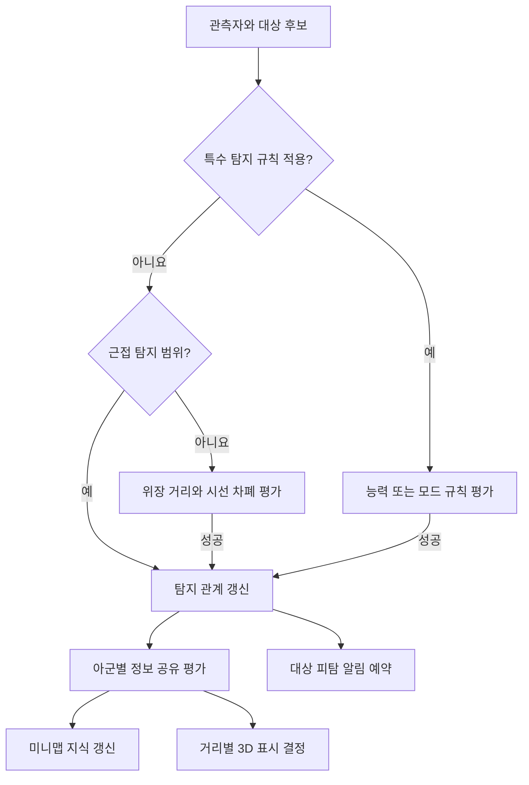

# 08. 시야·탐지·위장·무전 역기획

> 대상: Wargaming **World of Tanks PC**, 일반 무작위 전투를 기본값으로 사용. 작성 기준일: **2026-11-13 KST**. 공개 자료에서 2.4.1까지 확인했다. `[확인]`은 공식 문서가 설명한 규칙, `[분석]`은 규칙의 설계적 해석, `[제안]`은 재구현용 모델, `[검증 필요]`는 공개 자료만으로 확정하지 못한 부분이다. 게임 클라이언트 실험이나 서버 코드 열람 결과가 아니다.

관련 문서: [지도와 파괴](09_Maps_Terrain_and_Destruction.md) · [매칭과 소대](10_Matchmaking_and_Platoons.md) · [조작·HUD](11_Controls_HUD_and_Garage_UX.md) · [승무원](14_Crew_and_Perks.md)

## 1. 시스템의 역할

[분석] 월드 오브 탱크의 시야 시스템은 적의 존재를 화면에서 숨기는 장치이면서, 정찰·원거리 화력·기동을 연결하는 협동 시스템이다. 정찰 차량은 자신이 직접 피해를 주지 않아도 다른 차량에 공격 기회를 제공한다. 장거리 포격 차량은 자기 시야가 부족해도 정찰자의 정보를 받아 화력을 행사한다. 적을 발견했다는 사실과 적을 공격할 수 있다는 사실은 별도이다.

이 구조는 다음 네 가지 질문을 분리한다.

| 질문 | 담당 판단 | 설계상 결과 |
|---|---|---|
| 적이 탐지되었는가? | 관측자 시야·대상 위장·지형·특수 탐지 | 차량별 정찰 능력의 차이 |
| 그 정보를 내가 받는가? | 아군의 탐지 정보와 무전 공유 | 정찰과 원거리 지원의 연결 |
| 내 전투 화면에 모델을 표시하는가? | 정보 보유 여부와 표시 거리 | 미니맵 정보와 3D 화면의 차이 |
| 해당 위치를 사격할 수 있는가? | 포 사거리·발사선·탄도·장애물 | 탐지 상태와 탄환 충돌 판정의 분리 |

[제안] 구현에서는 `WorldExistence`, `Detection`, `Knowledge`, `Presentation`을 같은 불리언으로 합치지 않는다. 차량이 미탐지로 전환되어도 물리 월드에서 제거해서는 안 된다. 반대로 화면에 표시할 필요가 없다고 해서 미니맵 정보까지 삭제해서도 안 된다.

## 2. 공식 규칙의 기준값

[확인] 일반전 안내에서 근접 탐지는 50m, 자력 탐지의 상한은 445m, 차량 표시 거리는 565m이다. 시야 수치가 445m를 넘으면 탐지 상한이 늘어나는 대신 그 안에서 적 위장에 대응하는 데 도움이 된다. 공유 가능한 아군의 탐지 정보는 3D 표시 거리 밖에서도 미니맵에 나타날 수 있다. [V01]

| 구분 | 일반전 기준 | 혼동하면 생기는 오류 |
|---|---:|---|
| 근접 탐지 | 50m | 건물 뒤 차량이 가까워져 드러나는 현상을 버그로 판단 |
| 차량 시야 능력 | 차량·장비·승무원에 따른 값 | Garage 수치가 곧 실제 발견 거리라고 판단 |
| 자력 탐지 상한 | 445m | 시야 500m이면 500m에서 자력 발견한다고 판단 |
| 3D 표시 거리 | 565m | 지도에 표시된 모든 적을 화면에서 볼 수 있다고 판단 |
| 무전 공유 | 송수신 조건에 따른 정보 전달 | 내 눈으로 발견한 적과 아군이 발견한 적을 동일시 |

이 표의 값은 **일반전 규칙의 문서 기준**이다. 맵 크기, 포탄 사거리, 자주포 조준 화면, 이벤트 모드의 시야 규칙을 뜻하지 않는다.

[확인] 2.4 Onslaught의 특정 야간 맵은 최대 시야 315m, 표시 거리 445m, 정지·이동 위장 +15% 규칙을 별도로 사용한다. 같은 업데이트의 WZ-219는 IRST 탐지 기능을 도입했으며, 미탐지 적을 드러내면 사용 차량도 즉시 탐지된다. 일반전 기본 시야와 특수 능력은 구분해야 한다. [V05]

## 3. 입력·상태·출력

[제안] 아래는 공식 서버 구조를 주장하지 않는 재구성 명세이다.

| 영역 | 필요한 데이터 | 갱신 계기 |
|---|---|---|
| 관측자 | 차량 시야, 관측 장치 상태, 승무원/장비 효과 | 장착 변경, 피해, 상태 효과 |
| 피관측자 | 정지·이동·발포 위장, 차체 자세, 탐지 표본점 | 이동, 발포, 수풀 진입 |
| 환경 | 지형 차폐, 건물 차폐, 식생, 파괴 후 상태 | 위치 변경, 파괴 이벤트 |
| 통신 | 아군 공유 가능 여부, 무전 관련 상태 | 거리 변화, 장치 손상 |
| 탐지 관계 | 관측자, 대상, 최초·최근 발견 시각 | 탐지 성공·갱신 |
| 플레이어 지식 | 현재 발견, 마지막 확인 위치, 정보 출처 | 탐지 공유, 유지 시간 만료 |
| 표시 | 모델, 윤곽, 미니맵, 피탐 알림 | 지식 변경, 표시 거리 통과 |

출력은 `EnemySpotted`, `EnemyKnowledgeUpdated`, `EnemyLost`, `SixthSenseAlert`처럼 나누는 편이 추적하기 쉽다. 동일 차량이 세 명에게 탐지되면 마지막 관측자 한 명이 시야를 잃었다고 전체 팀 정보가 사라져서는 안 된다.

## 4. 위장과 식생

[확인] 공식 생존 가이드는 수풀·쓰러진 나무를 위장 요소로 설명한다. 포신이 수풀 밖으로 나오는 것은 예외이나 차량의 주요 부분이 가려져야 한다. 수풀과 15m 이내에서는 그 너머를 볼 수 있고, 발포는 차량 위장과 주변 15m 식생의 위장 효과에 불리하게 작용한다. 정지 중 포탑·포 회전은 위장에 영향을 주지 않으며, Tier V 이상 경전차는 이동·정지 위장값을 유지한다. [V02]

### 4.1 행동에 따른 선택 비용

[분석] 동일 수풀에 있는 두 차량도 다음 행동 선택에 따라 제공하는 가치가 달라진다.

| 행동 | 얻는 가치 | 발생하는 비용 | 플레이어가 확인할 것 |
|---|---|---|---|
| 수풀 안에서 정지 관측 | 적 이동 정보 유지 | 자기 화력 사용을 보류할 가능성 | 아군이 실제 사격 가능한 위치인가 |
| 수풀 뒤로 물러나 발포 | 식생을 사이에 둔 공격 기회 | 자신이 제공하던 직접 관측이 끊길 수 있음 | 다른 아군이 계속 관측하는가 |
| 능선을 넘는 능동 정찰 | 짧은 시간 넓은 구역 확인 | 노출·전복·궤도 파괴 위험 | 복귀 경로가 엄폐되는가 |
| 첫 발견 직후 사격 | 즉시 피해 기회 | 적에게 위치를 노출할 가능성 | 피해 기대값이 정보 가치보다 높은가 |
| 같은 수풀에서 반복 사격 | 계속 화력 지원 | 적의 예상 사격에 취약 | 마지막 노출 이후 이동했는가 |

[제안] `VehicleCamo`와 `FoliageCamo`를 따로 저장한다. 발포했다고 맵 전체 식생의 위장 효과를 무효화하거나, 차량 위장이 높다고 지형 차폐를 무시하게 만들면 안 된다. 여러 수풀의 합산, 최대 위장값, 발포 후 회복 곡선은 각각 별도 정책으로 둔다.

### 4.2 교육용 탐지 거리 모델

[제안] 위장과 시야의 상호작용을 설명하기 위한 간이 모델은 다음처럼 둘 수 있다. **실제 2.4.1 서버 식을 검증한 결과가 아니다.**

```text
D_model = clamp(V - (V - R_proximity) × C, R_proximity, R_max)
V = 보정된 관측자 시야
C = 이 설명용 모델의 유효 위장 계수(0~1)
R_proximity = 50m, R_max = 445m  // 일반전 기준 예시
```

예시로 `V=450m, C=0.20`이면 모델상의 거리는 `370m`이고, `V=500m`라면 `410m`이다. 두 값 모두 최대 탐지 거리보다 작다. 따라서 표시된 시야 능력이 상한을 넘는 것과 상한 밖의 적을 발견하는 것은 다른 문제임을 설명할 수 있다. 실제 장비·특전·식생·발포의 중첩 순서와 계수는 공개된 기본 가이드만으로 확정하지 않는다.

## 5. 탐지부터 HUD까지의 흐름

[제안] 다음은 의존 관계를 보여 주는 설계 흐름이다. 실제 서버의 검사 순서, 체크 주기, 레이 개수를 복원한 다이어그램이 아니다.



[분석] 탐지와 알림이 분리되어야 “알림이 켜지기 전에 피격되었다”는 경험을 설명할 수 있다. 알림은 적이 내 정보를 획득한 시점을 사후에 전달한다. 이 시스템이 허용하는 정보 비대칭 때문에 정찰자는 보이는 적만 계산해서 움직이면 늦는다.

[확인] 공식 Tank Coach는 Sixth Sense 기본 알림을 피탐 후 3초로 설명한다. Sixth Sense는 1.18.1부터 모든 전차장의 기본 기능이다. 현재 승무원 가이드가 특전 100% 훈련 기준으로 제시한 수치는 Signal Interception의 알림 지연 0.75초 감소와 Jamming의 피탐 유지 시간 1초 감소다. [V03][V04][V07]

[분석] 실제 적용값은 승무원 효율과 관련 수정자의 영향을 받을 수 있으므로 표의 수치를 고정된 최종값으로 취급하지 않는다. 학습 수준·직책 평균·효율의 차이는 [14번](14_Crew_and_Perks.md)을 참조한다.

### 5.1 시간축 설계

| 시간 상태 | 플레이어에게 보이는 정보 | 검증할 핵심 |
|---|---|---|
| 아직 탐지되지 않음 | 경고 없음 | 경고 없음이 안전을 보증하지 않음 |
| 적이 탐지했으나 경고 전 | 상대는 공격 준비 가능 | 서버 탐지와 클라이언트 알림의 시간 분리 |
| 경고 표시 | 현재 또는 최근 피탐 사실 | 어떤 적에게 들켰는지까지 알려 주는지 구분 |
| 엄폐 후 탐지 유지 | 상대가 계속 표시를 볼 수 있음 | 유지 시간을 단일 상수로 가정하지 않음 |
| 정보 소멸 후 | 마지막 위치만 참고 가능 | 예측 위치를 확정 정보처럼 표시하지 않음 |

[검증 필요] 기본 피탐 유지 시간, 특전 중첩, 최초 탐지와 재탐지의 갱신 방식, 서버 검사 주기와 지연 분포는 동일 버전 훈련방 실험 대상으로 남긴다. Blitz 문서에서 찾을 수 있는 검사 주기나 체크포인트 수를 PC 규칙으로 옮기지 않는다.

## 6. 무전과 팀 정보

[확인] 무전은 아군이 발견한 차량의 위치 정보 공유에 관여한다. 정보를 받는 차량의 표시 거리 밖에 있는 적도 미니맵으로 전달될 수 있다. [V01]

[분석] 정찰의 실질 가치는 `발견한 적 수`만으로 평가하기 어렵다. 적이 탐지된 시각에 아군의 포가 준비되어 있는지, 포신이 다른 방향인지, 발사선이 벽에 막혔는지, 자신의 위치와 적 사이가 너무 가까워 안전하게 대응할 수 없는지가 전부 중요하다.

[제안] 어시스트 분석에는 탐지 사건과 사격 기회 사건을 구분해 저장한다.

```text
SpotContribution {
    observerId, targetId, firstSeenAt, lastRefreshAt,
    detectionReason, shareRecipients,
    sourceRuleVersion
}
ShotOpportunity {
    shooterId, targetId, knownThroughObserver,
    gunReady, estimatedFireLineClear, observedAt
}
```

이 모델이면 정찰이 성공했지만 아군 지원이 불가능했던 장면과, 지원이 가능했으나 화력을 사용하지 않은 장면을 나누어 볼 수 있다. 공식 보상 계산식을 그대로 뜻하지는 않는다.

[검증 필요] 무전 거리를 합산하는 구체식, 여러 아군을 거치는 중계 여부, 무전 장치 손상과 정보 소멸의 정확한 순서는 별도 조사해야 한다. “아군 한 명이 보면 전원이 거리와 무관하게 항상 안다”라는 구현은 피한다.

## 7. 대표 상황 분석

### 상황 A: 아군이 본 적이 500m에 있다

[제안 사례] 자신의 시야 능력은 400m이고, 적은 자신과 500m 떨어져 있다. 전방 아군이 적을 발견하고 무전 공유 조건도 충족한다.

- 자력 발견 여부와 공유 정보 수신 여부를 따로 계산한다.
- 일반전 표시 거리 안이므로 표시 자격이 생길 수 있지만, 실제 지형 차폐와 조준 화면 조건까지 별도로 확인한다.
- 적이 자기 탐지 범위 밖에 있다는 이유로 사격 명령을 차단하지 않는다.
- 정찰 아군이 사라지면 즉시 적의 물리 실체를 삭제하지 말고 탐지 유지 정책을 따른다.

이 장면은 정찰을 기동·화력에 연결하는 핵심 협동이다. 표시된 적만을 공격 대상으로 사용하는 AI와 실제 탄환 물리 시스템을 같은 규칙으로 묶지 않도록 주의한다.

### 상황 B: 수풀 안 경전차의 첫 발

[제안 사례] 경전차는 수풀 뒤에서 적 두 대를 관측하고 있으며 아군 구축전차가 재장전 중이다. 지금 발포하면 적 하나를 손상시킬 수 있지만 정찰 위치를 잃을 가능성이 있다.

정찰자는 현재 한 발의 기대 피해, 자기 생존 확률, 아군 재장전 완료까지의 시간, 반대편 정찰자의 존재를 비교한다. 발포를 보류한 행동은 소극적인 플레이가 아니라 미래 공격 기회를 보존하는 선택일 수 있다. 역기획의 목표는 “정찰은 무조건 쏘지 않는다”는 공식을 만드는 것이 아니라, 발포의 기회비용을 설계 변수로 표현하는 것이다.

### 상황 C: 능력 탐지의 대가

[분석] IRST처럼 발견에 자기 노출이 연결된 능력은 정보 획득을 무료 이득으로 만들지 않는다. 적을 한 번 드러내는 가치와 자기 위치를 알려 주는 비용이 교환된다. 재구현 시 능력의 탐지 반경뿐 아니라 사용자의 정보 노출, 취소 지연, 재사용 대기시간, 능력 표시를 함께 정의해야 한다.

## 8. 재현 시험과 QA

다음은 실제 시험 결과가 아니라 **검증 계획**이다. 계측 시 클라이언트 영상 외에 가능하면 서버 사건 시각을 함께 기록한다.

| ID | 시험 조건 | 기대 확인 항목 |
|---|---|---|
| VIS-01 | 벽 양쪽에서 50m 경계 왕복 | 근접 탐지와 벽 차폐의 관계, 거리 기준점 |
| VIS-02 | 시야 장비 유무를 바꿔 445m 이상 표적 관측 | 시야 상한과 위장 대응 능력의 분리 |
| VIS-03 | 공유 적을 565m 안팎에서 관찰 | 3D 모델과 미니맵 정보의 분리 |
| VIS-04 | 같은 수풀에서 14.9m·15.1m 위치 발포 | 식생 기준점·경계 오차·발포 페널티 |
| VIS-05 | 정지·차체 회전·포탑 회전을 분리 | 위장 변화와 조준 분산 변화의 혼동 방지 |
| VIS-06 | 기본 전차장과 Signal Interception 비교 | 기본 경고와 보정 경고의 상대 지연 |
| VIS-07 | 두 아군 중 한 명만 관측을 잃음 | 다중 관측자 정보의 유지 |
| VIS-08 | Jamming 유무·재발견 시각을 교차 | 피탐 유지의 갱신 및 중첩 |
| VIS-09 | WZ-219로 이미 보이는 적/안 보이는 적 탐지 | 자기 노출 조건과 특수능력 예외 |
| VIS-10 | 일반 맵과 Onslaught 야간 맵 비교 | 모드별 시야 프로파일의 격리 |
| VIS-11 | 그래픽 식생 옵션만 변경 | 렌더 품질 변경이 탐지 판정을 바꾸지 않는지 |
| VIS-12 | 관측자 끊김·재접속·관전자 전환 | 지식 캐시 정리 및 과도한 정보 노출 방지 |

## 9. 설계 결론과 남은 불확실성

[분석] 좋은 정찰 시스템은 높은 시야값만으로 우위를 만들지 않는다. 자신의 정보를 보존하며 타인의 정보를 획득하는 위치 선정, 그 정보를 공격으로 바꾸는 아군 배치, 들킨 뒤 살아서 돌아오는 경로가 함께 중요하다. 반면 수풀·경고 지연·표시 거리의 원인을 UI가 설명하지 못하면 학습 가능한 전술이 불합리한 판정처럼 보인다.

[제안] 개발 도구에는 차량 간 `발견 실패 원인`을 표시하는 디버그 모드를 둔다. 원인은 `거리`, `지형 차폐`, `위장`, `공유 불가`, `표시 거리`, `모드 규칙`으로 나누고, 실제 플레이 UI에는 허용된 정보만 전달한다. 서버 성능 최적화는 이 의미적 구분을 유지한 상태에서 후보 검색·갱신 빈도·이벤트 갱신으로 수행한다.

## 10. 출처

모든 URL 확인 기준: 2026-11-13. 공개 페이지가 갱신되면 본문의 버전 표기와 함께 다시 확인해야 한다.

- **[V01]** Wargaming Player Support, [About: Spotting and Concealment](https://www.wargaming.net/support/en/products/wot/article/10222/?redirect_lang=en). 일반전 거리·무전·표시 구분. 작성일 미표시.
- **[V02]** World of Tanks, [How to Survive](https://worldoftanks.eu/en/content/guide/newcomers-guide/how_to_survive/). 식생·15m·차량 행동과 위장. 상시 갱신 가이드.
- **[V03]** World of Tanks, [Tank Coach: Spotting and View Range](https://worldoftanks.eu/en/content/guide/tank-coach-video-guides/tank-coach-spotting/). Sixth Sense 기본 지연 설명.
- **[V04]** World of Tanks, [Crew Training](https://worldoftanks.eu/en/content/guide/game-mechanics-and-achievements/crew-training/). Signal Interception·Jamming. 상시 갱신 가이드.
- **[V05]** World of Tanks, [Release Notes 2.4](https://worldoftanks.eu/en/content/docs/release_notes/release-notes-2-4/). 2026-09 업데이트: Onslaught 야간 규칙·WZ-219 IRST.
- **[V06]** World of Tanks, [Tank Coach: Light Tank Essentials](https://worldoftanks.eu/en/content/guide/tank-coach-video-guides/tank-coach-light-tanks/). 능동·수동 정찰의 공식 교육 범위.
- **[V07]** World of Tanks, [Sixth Sense: A Special Commander Feature](https://worldoftanks.eu/en/news/general-news/1-18-1-sixth-sense-perk/). 1.18.1부터 전차장 기본 기능화. 과거 도입 자료이며 현 승무원 가이드로 지속 여부를 교차 확인.
