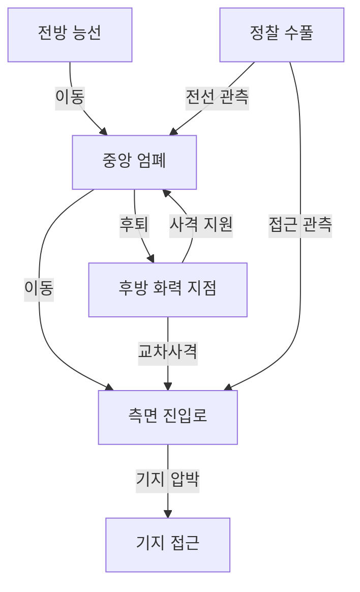
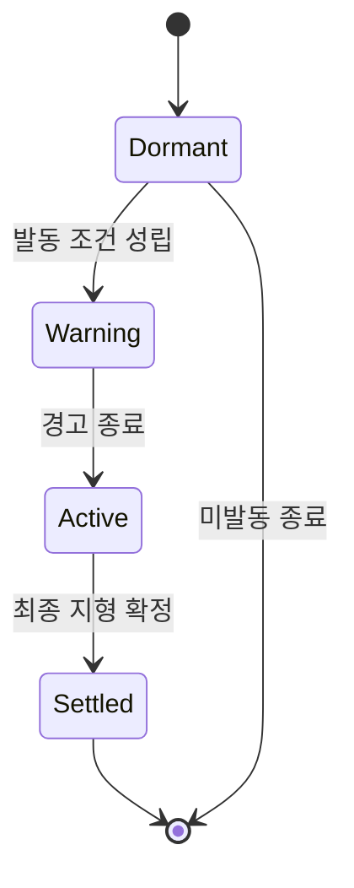

# 09. 지도·지형·엄폐·파괴·전술 공간 역기획

> 대상: Wargaming World of Tanks PC. 기준일: **2026-11-13 KST**, 공개 자료상 **2.4.1** 지도 변경까지 반영. `[확인]` 공식 자료, `[분석]` 설계적 해석, `[제안]` 재구현 구조, `[검증 필요]` 미확정 항목. 지도 좌표별 실플레이 공략집이 아니라 전술 공간을 만드는 규칙과 제작·검증 방법을 분석한다.

관련 문서: [차량과 기동](03_Vehicle_Classes_and_Mobility.md) · [장갑·관통](05_Armor_Penetration_and_Damage.md) · [시야·위장](08_Spotting_Concealment_and_Radio.md) · [매칭](10_Matchmaking_and_Platoons.md)

## 1. 지도의 설계 역할

[분석] 지도는 차량 성능이 실제 전투 효율로 변환되는 조건을 만든다. 포탑 장갑이 두꺼워도 차체를 감출 높낮이가 없으면 장점을 쓰기 어렵고, 빠른 차량도 우회로가 없으면 기동력을 화력으로 전환하기 어렵다. 시야가 긴 차량도 수풀·경사·건물의 배치에 따라 정보 우위를 확보하는 시간이 달라진다.

따라서 지도 역기획의 기본 단위는 예쁜 지형 하나가 아니라 **이동·탐지·사격·퇴각의 연결 관계**이다.

| 공간의 기능 | 필요한 조건 | 그 조건을 활용하는 행동 | 실패 시 나타나는 문제 |
|---|---|---|---|
| 초기 정찰 | 안전한 접근과 관측 가능한 영역 | 적 배치 확인 | 먼저 도착한 팀의 일방적 정보 독점 |
| 근거리 교전 | 견고한 엄폐, 측면 진입의 제한 | 장갑·재장전 교환 | 두꺼운 전면 장갑만 지배 |
| 중거리 지원 | 아군 전선과 연결된 발사선 | 교차사격·견제 | 전선과 무관한 후방 저격 |
| 우회 | 시간과 위험을 감수하는 대체 경로 | 측후방 공격 | 기동 차량의 역할 소멸 |
| 퇴각 | 전진 경로와 다른 탈출 선택 | 피해 교환 후 생존 | 첫 진입이 사실상 확정 사망 |
| 기지 압박 | 전선 붕괴와 연결되는 접근로 | 승리 조건 전환 | 킬 경쟁과 승리 조건의 단절 |

## 2. 공식 자료에서 확인한 지도 변화

[확인] 2.4.1은 Nebelburg를 일반 무작위 전투에 맞게 재구성하며 크기를 1,400×1,400m에서 1,000×1,000m로 줄였다. Himmelsdorf·Ruinberg·Siegfried Line·Fisherman's Bay·Overlord도 조정했다. 예를 들어 Himmelsdorf는 남쪽 팀의 대응 위치, Ruinberg는 발사선, Siegfried Line은 지형과 벽의 개구부를 다듬었다. [M01]

[분석] 이런 변경은 지도 밸런스를 “양쪽 지형이 거울처럼 같은가”로만 평가하지 않음을 보여 준다. 각 팀이 비슷한 시간과 위험으로 대응 위치를 점유할 수 있는가, 한 차종의 강점이 다른 차종의 일방적 무력화를 초래하는가가 더 유용한 평가 기준이다.

과거 지도 공략의 격자 좌표는 최신 버전에서 의미가 달라질 수 있다. 좌표가 맞더라도 수풀 밀도, 작은 지형 굴곡, 창문 발사선 하나가 바뀌면 동일 전술이 재현되지 않을 수 있으므로, 공략 데이터를 `mapId + geometryVersion`으로 관리하는 것이 합리적이다.

## 3. 지형의 네 가지 의미층

[제안] 다음 구분은 재구현용 데이터 모델이다. 실제 WoT의 에셋 포맷을 의미하지 않는다.

| 층 | 주요 데이터 | 질문 |
|---|---|---|
| 이동층 | 경사, 통과 폭, 접지 재질, 물, 경계 | 어떤 차량이 얼마 만에 지나갈 수 있는가 |
| 사격층 | 포탄 충돌, 파괴 가능 여부, 천장·창문 | 어떤 탄도가 어느 방향으로 통과하는가 |
| 탐지층 | 지형 차폐, 식생, 관측 표본점 관계 | 보이지 않는 것과 관통 가능한 것을 구분하는가 |
| 표현층 | 메쉬, 파편, 먼지, 연기, 소리 | 플레이어에게 변화가 읽히는가 |

### 3.1 같은 물체가 서로 다른 규칙을 갖는 이유

[분석] 수풀은 정보를 가릴 수 있지만 두꺼운 벽처럼 탄환을 정지시키는 역할로 단순화하면 안 된다. 창문은 포탄이 통과할 수 있어도 차체가 통과하는 경로가 아닐 수 있다. 파괴 연출 뒤의 잔해는 화면상 많이 남아 있어도 실제 통과 가능 영역과 반드시 일치한다고 가정해서는 안 된다.

[제안] 에셋에는 다음 태그를 각각 명시한다.

```yaml
MapObject:
  object_id: stable_id
  gameplay_state: intact | damaged | destroyed
  vehicle_collision: policy_id
  projectile_collision: policy_id
  visibility_occlusion: policy_id
  concealment_provider: optional_id
  destruction_transition: optional_id
  visual_variant_by_quality: set_id
```

태그를 분리해야 “보이지 않는 벽”, “파편이 없는 저사양에서만 길이 뚫리는 현상”, “부서졌지만 여전히 시야를 막는 문”을 찾기 쉽다.

## 4. 이동선·발사선·정찰선의 그래프

[제안] 한 지도에 최소 세 개의 그래프를 겹쳐 분석한다.

- **이동 그래프:** 경로의 길이·폭·경사·차량별 통과시간을 기록한다.
- **발사선 그래프:** 두 위치 사이에 어느 차체 높이·포각·탄도로 공격할 수 있는지 기록한다.
- **정찰 그래프:** 어느 위치에서 어느 지역의 진입을 확인할 수 있는지 기록한다.

이 세 그래프의 간선은 서로 같지 않다. 정찰자가 보는 적을 지원 차량이 쏠 수 있어야 협동이 성립하고, 진입로를 관측할 수 없는데 교차사격만 가능한 구간은 이용자에게 예측하기 어려운 피해를 준다.



이 다이어그램은 특정 실제 맵의 좌표를 복사한 것이 아니라 전술 역할의 예시이다. 경로를 하나 추가하는 변경이라도 지원 사격과 관측 관계가 바뀌면 전선 전체가 이동할 수 있다.

### 4.1 기동력의 유효 가치

[제안] 각 차량의 목표 지점 도달 시간은 단순 최고속도 대신 다음을 샘플링해 비교한다.

```text
T_arrival = T_acceleration + Σ(path_segment_time) + T_turning + T_obstacle
Risk_arrival = exposed_duration × enemy_fire_opportunity
```

이 식은 계측 항목의 분해이며 WoT 물리식이 아니다. 같은 300m 경로라도 초반 급경사·좁은 회전·무른 지면·차량 병목이 있는 경우 실제 도착 순서가 바뀐다. 양 진영의 빠른 차량을 비교할 때는 스폰 위치 분포도 함께 고려한다.

## 5. 높낮이·포각·장갑의 연결

[분석] 지형의 작은 높이 차이는 전차의 노출 면적을 바꾸므로 장갑과 분리해서 평가할 수 없다.

| 공간 형태 | 전술적 효과 | 설계 검증 질문 |
|---|---|---|
| 완만한 능선 | 차체를 숨기고 포탑을 노출 | 포 내림각이 부족한 차량에도 대응 경로가 있는가 |
| 급한 능선 | 순간적으로 하부·바닥이 드러남 | 기동 중 예상하지 못한 취약부 노출인가 |
| 건물 모서리 | 차체 각도와 전후진 교환 | 측면 장갑 사용에 적절한 회전 공간이 있는가 |
| 좁은 길 | 차량 수적 우위가 제한됨 | 파괴된 차량 한 대로 영구 봉쇄되는가 |
| 상하 사격 | 상대 상판·하판 노출 변화 | 높은 곳이 모든 측면에서 무조건 유리한가 |
| 깊은 움푹한 지형 | 포탄·관측을 피하기 쉬움 | 빠져나올 경로와 반격 가능성이 있는가 |

[제안] “차체 은폐 가능”이라는 단일 태그 대신 차량별 포 높이·포 내림각·차체 길이를 적용한 샘플 자세를 저장한다. 테스트 대표 차량에는 낮은 포탑, 높은 차체, 고정 전투실, 긴 차체, 차륜 차량을 포함한다.

## 6. 파괴 가능한 엄폐와 Random Events

[확인] 1.23의 Random Events는 일부 맵에서 경로·엄폐·사격 위치를 변화시키는 기능으로 도입됐다. 이벤트는 전투 상황과 확률에 따라 발생하며 매 전투 발생을 보장하지 않는다. 위험 구역은 붉은 연기와 알림으로 표시되고 큰 물체와 충돌하면 차량이 파괴될 수 있다. [M02]

### 6.1 두 종류의 환경 변화

[분석] 작은 파괴물과 대규모 이벤트는 플레이어에게 다른 예측 방법을 요구한다.

| 구분 | 원인 | 시간 규모 | 판단 방식 |
|---|---|---|---|
| 개별 파괴물 | 공격·접촉 등의 국지 사건 | 즉시 또는 짧은 반응 | 엄폐가 몇 번의 교환을 버티는가 |
| 대규모 이벤트 | 맵의 이벤트 시나리오 | 경고와 진행 구간 | 변화 뒤 새 진입로를 누가 먼저 쓰는가 |
| 표현용 잔해 | 사건 결과의 시각화 | 짧은 연출 및 잔존 | 실제 충돌·시야 기능이 있는가 |

[제안] 이벤트 상태는 `대기 → 예고 → 위험 진행 → 지형 확정 → 종료`로 정의한다. 발동 여부의 무작위성과 발동 후 결과 지형의 재현성을 분리한다. 결과 지형까지 완전히 불규칙하면 경쟁전의 학습성이 약해지고, 모든 사건이 고정 시각에 반복되면 일회성 관전 연출로 느껴질 수 있다.



[확인] 2.4.1은 Random Events 허용 체크박스를 제거하여 모든 플레이어가 해당 맵 구성으로 매칭될 수 있게 했다. 이는 모든 경기에서 이벤트가 반드시 발생한다는 뜻과 다르다. [M03]

### 6.2 파괴를 실제 게임 규칙으로 연결하는 경계

[확인] 2018년 Update 1.0의 공식 그래픽 자료는 Havok Destruction을 통한 파괴 표현과 잔해를 설명한다. 이것만으로 2026년 현재 서버 물리의 엔진, 파편별 네트워크 방식, 모든 파편의 충돌 참여 여부를 단정할 수 없다. [M04]

[제안] 재구현 시 서버가 보장해야 하는 상태와 클라이언트가 자유롭게 표현할 수 있는 요소를 구분한다.

| 서버가 동일하게 유지할 상태 | 클라이언트에서 품질을 조절할 표현 |
|---|---|
| 통로 개폐, 엄폐 충돌, 위험 구역 판정 | 작은 파편 수, 먼지 입자 수 |
| 발동 사건 ID와 상태 전환 시각 | 흔들림, 세부 파괴 애니메이션 |
| 피해 대상과 피해 결과 | 오디오 반사·잔향의 품질 |
| 최종 게임플레이용 잔해 형상 | 작은 잔해의 수명·상세 메쉬 |

연출용 파편이 서버의 포탄을 임의로 막게 하거나, 낮은 그래픽 옵션에서 실제 엄폐 자체를 제거하는 구조는 피한다. 이 분리는 WoT의 비공개 구현 설명이 아니라 경쟁형 물리 게임을 위한 설계 제안이다.

## 7. 지도 유형별 플레이 패턴 분석

[분석] 아래 분류는 전차의 역할을 비교하기 위한 추상적 분석 틀이다. 각 실제 지도는 여러 유형을 섞는다.

| 유형 | 핵심 자원 | 강해지는 판단 | 반드시 제공할 대응 |
|---|---|---|---|
| 도시형 | 엄폐 모서리·짧은 이동거리 | 재장전 읽기·장갑 각도·교차사격 | 우회·복수 발사선·퇴각로 |
| 개활지형 | 수풀·능선·탐지 지속 | 정찰 유지·발포 절제·이동 타이밍 | 정보 상실 뒤 재접근 수단 |
| 혼합형 | 도시와 들판의 연결 | 전선 간 지원과 병력 이동 | 한 전선 승리가 다른 전선에 영향을 주는 경로 |
| 고저차형 | 능선 점유·포각 | 초기 도착·상하 노출 관리 | 고지 독점을 깨는 측면 또는 간접 공격 |
| 산업형 | 건물 내부·창문·긴 직선 | 발사선 학습·엄폐 내 재배치 | 지나친 관통 구멍·예상 밖 시야의 교정 |

시야 차량의 영향력은 수풀 수만으로 결정되지 않는다. 정찰 위치가 화력 지원 위치와 연결되는 비율이 더 중요하다. 마찬가지로 구축전차 위치를 많이 만든다고 구축전차 플레이가 건강해지지는 않는다. 후방 고정 사격이 승리에 기여하는 시점과 전진해야 하는 시점을 지도 구조가 드러내야 한다.

## 8. 대표 전술 장면

### 상황 A: 초기 능선 경쟁

[제안 사례] 양 팀의 빠른 차량이 중앙 능선에 도착하려고 한다. 한쪽은 거리가 짧지만 마지막 80m가 두 방향에서 공격받고, 다른 쪽은 길지만 완전히 가려져 있다.

도착 시간만 같게 맞추면 전자는 HP를 잃고 위치를 얻으며 후자는 온전한 상태로 같은 위치를 얻는다. 따라서 비교 지표는 `최초 도착 시간`, `도착 HP`, `후속 지원 도착`, `퇴각 가능 시간`의 네 가지여야 한다. 이 구조를 검증할 때 특정 고수 한 명의 성공 사례보다 여러 차량·스폰 조합의 분포를 보는 편이 낫다.

### 상황 B: 건물이 무너지며 발사선이 열린다

[제안 사례] 중앙 엄폐가 파괴되어 후방 지원 위치에서 측면 진입로가 보이기 시작한다. 이전에는 안전했던 복귀 경로가 위험해진다.

파괴는 단순한 통로 개방이 아니라 `관측 그래프`, `발사선 그래프`, `이동 비용`을 동시에 바꾸는 상태 전환이다. 미니맵과 공간 연출이 이 변화를 읽게 해야 한다. 특히 효과가 끝난 뒤 최종 충돌 형상이 정확히 일치하는지, 사건 직전에 발사된 포탄이 어떤 월드 상태로 판정되는지 확인해야 한다.

### 상황 C: 수적 열세 팀의 후퇴 지점

[분석] 수적 열세 팀이 방어할 수 있는 후방 위치는 역전 가능성을 남긴다. 그러나 전선과 무관하게 처음부터 그 위치에 머무는 것이 최선이면 수동적인 경기가 늘 수 있다. 좋은 방어 위치는 초반 영향력이 제한되고, 상대의 전진 이후에 가치가 커지며, 다른 경로로 압박받을 수 있는 형태가 바람직하다.

## 9. 제작용 데이터와 툴

[제안] 지도 변경은 에셋 수정과 함께 다음 검증 메타데이터를 보관한다.

```yaml
MapRevision:
  map_id: sample_map
  geometry_revision: revision_id
  allowed_modes: [random_standard]
  spawn_sets: [team_a, team_b]
  capture_areas: [base_a, base_b]
  gameplay_collision_hash: hash
  foliage_revision: revision_id
  event_scenarios: [scenario_id]
  balance_probes:
    - arrival_time_pairs
    - firing_lane_pairs
    - concealment_positions
    - escape_routes
```

경로마다 “누가 이 지점을 쓰는가”만 적지 말고 “누가 이 지점을 견제하는가”를 적는다. 전차 모델 변경도 지도 적합성에 영향을 주므로 테스트 차량의 충돌·포각·기동 프로파일 버전을 함께 기록한다.

## 10. QA와 계측

| ID | 검증 대상 | 방법과 합격 판단 |
|---|---|---|
| MAP-01 | 진영별 초기 접근 | 동일 역할 차량의 도착시간·HP·지원 도착 분포 비교 |
| MAP-02 | 포 내림각 의존성 | 대표 포각 3종 이상의 동일 능선 노출 비교 |
| MAP-03 | 차체 통과 | 좁은 길·교량·문에서 차량 크기별 진입·회전·퇴각 |
| MAP-04 | 포탄 충돌 일치 | 보이는 창·잔해와 실제 충돌 메시를 디버그 중첩 |
| MAP-05 | 탐지 차폐 일치 | 파괴 전후 같은 관측 관계의 변화를 기록 |
| MAP-06 | Random Event 안전 | 경고 시점, 진입·탈출, 큰 물체 충돌, 재접속 상태 복원 |
| MAP-07 | 그래픽 옵션 공정성 | 시각 품질만 바꾸고 이동·시야·피해 결과 동일성 확인 |
| MAP-08 | 잔해에 의한 영구 봉쇄 | 좁은 길에서 대형 차량 여러 대가 파괴되는 경우 |
| MAP-09 | 경계·끼임 | 지도 외부 진입, 급경사 정지, 지형 틈 탈출 시험 |
| MAP-10 | 변경 후 기존 공략 | 이전에 유효하던 핵심 사격 위치의 성공 조건 재검증 |
| MAP-11 | 후반 기지 압박 | 소수 생존 상황에서 양 진영의 복귀 시간 비교 |
| MAP-12 | 네트워크 사건 경계 | 파괴 시각 전후 포탄·차량의 충돌 결과 재현 |

[제안 KPI] 진영별 승률만 보면 문제를 놓치기 쉽다. 차량 역할·티어·초기 스폰·이벤트 발생 여부를 통제한 뒤 첫 피해 시각, 첫 정찰 기여, 전선별 체류 시간, 기지 도달 경로, 경직된 교착 시간, 막힘 발생률을 함께 본다. 승률 차이가 작아도 특정 역할이 게임에 참여할 공간이 없을 수 있다.

## 11. 출처와 검증 한계

- **[M01]** World of Tanks, [Update 2.4.1: Map Reworks and Rebalances](https://worldoftanks.eu/en/news/general-news/2-4-1-map-rebalance/). 2026-10 업데이트 지도 재구성. 구체 좌표·규모는 이 버전에서만 유효하다.
- **[M02]** World of Tanks, [Introducing Random Events in Update 1.23](https://worldoftanks.eu/en/news/general-news/random-events-new-gen-maps/). 2023-11-20. 도입 목적, 비보장 발동, 경고와 위험의 공식 설명.
- **[M03]** World of Tanks, [Release Notes 2.4.1](https://worldoftanks.eu/en/content/docs/release_notes/release-notes-2-4-1/). 2026-10. Random Events 설정과 매칭 변경. 직접 열기는 보안 페이지가 반환되어 검색 도구가 제공한 공식 페이지 인덱스 본문으로 확인.
- **[M04]** World of Tanks, [Update 1.0: Graphics Settings Explained](https://worldoftanks.eu/en/news/general-news/update-1-0-graphics-settings/). 2018년 역사 자료. Havok Destruction의 당시 표현 기능 근거이며 현재 서버 아키텍처의 근거로 사용하지 않음.
- **[M05]** World of Tanks, [Recon Mission 2023: The Results](https://worldoftanks.eu/en/news/general-news/recon-mission-2023-results/). 2023년 개발·검증 과정 참고. 테스트 결과를 2026년 일반전 통계로 쓰지 않음.

모든 출처 확인일: 2026-11-13. 본 문서의 경로 그래프·스키마·테스트와 세 전술 장면은 독자적 설계 분석이다. 실제 최신 맵의 모든 충돌 메시, 지형 저항값, 사건 발동 확률을 추출한 문서가 아니다.
