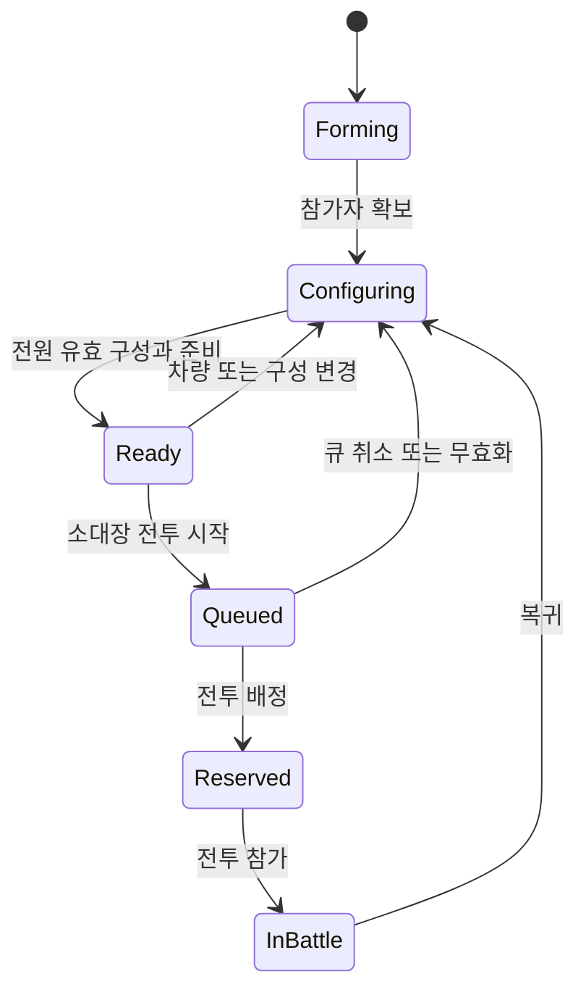

# 10. 매치메이킹·대기열·소대 역기획

> 대상: Wargaming World of Tanks PC, **일반 무작위 전투** 중심. 기준일: **2026-11-13 KST**. 2.0을 현재 규칙으로 고정하지 않고 **2.3 → 2.4 → 2.4.1**의 누적 변경을 반영했다. 2.4.2 Common Test는 라이브 기준에 포함하지 않았다. `[확인]` 공식 문서, `[분석]` 설계적 해석, `[제안]` 재구현 모델, `[검증 필요]` 미공개·충돌 항목을 뜻한다.

관련 문서: [차종·기동](03_Vehicle_Classes_and_Mobility.md) · [시야](08_Spotting_Concealment_and_Radio.md) · [모드](12_Modes_Competitive_and_Events.md) · [서버 구조](19_Server_and_Data_Architecture.md)

## 1. 매치메이킹이 해결하는 문제

[분석] 월드 오브 탱크의 매칭은 실시간 대기 중인 차량들을 모아 양 팀이 기능적으로 싸울 수 있는 전투를 만드는 문제다. 차량 수만 같아서는 충분하지 않다. 동일 티어라도 정찰 중심 경전차와 화력 중심 경전차, 돌파형 중전차와 지원형 중전차는 맵에서 제공하는 기회가 다르다. 동시에 이상적인 조합을 계속 기다리게 하면 이용자는 전투에 들어가지 못한다.

따라서 다음 목표가 충돌한다.

| 목표 | 강화했을 때 장점 | 지나치게 강화했을 때 비용 |
|---|---|---|
| 티어 근접성 | 정면 교전 격차 감소 | 큐 분할, 대기 증가 |
| 역할 대칭성 | 정찰·돌파·지원의 기회 균형 | 인기 없는 역할 차량의 대기 증가 |
| 소대 대응 | 협동 단위의 비대칭 완화 | 동시 접속 인구에 민감 |
| 같은 차량의 분산 | 단조로운 편성 감소 | 인기 차량 출시 직후 대기 증가 |
| 지도 다양성 | 연속 플레이 피로 감소 | 모든 참가자의 최근 기록을 만족시키기 어려움 |
| 빠른 시작 | 세션 전환 비용 감소 | 덜 이상적인 편성을 수용해야 함 |

[제안] 매칭 설계 문서에는 최적화 목표와 절대 금지 조건을 나눠 기록한다. “되도록 비슷한 역할을 맞춘다”는 목표를 “항상 완전히 같은 역할 수를 보장한다”는 계약으로 바꾸지 않는다.

## 2. 버전 변화와 현재 적용 기준

| 버전 | 확인된 변경 | 본 문서의 적용 |
|---|---|---|
| 2.0 / 2025-09 | 매칭 재구축, 고티어 역할 균형, 차종 제한, 큐 통합 | 도입 배경으로 사용 [Q01][Q02] |
| 2.3 / 2026-06 | SPG 최대 2, Tier VII–IX의 +2 전투 빈도 감소, 소대 균형 개선 | 이전 SPG 최대 3을 대체 [Q03] |
| 2.4 / 2026-09 | Tier VII+ 경전차 최대 2, 새 경전차 역할과 소대 제한 | 이전 고티어 경전차 최대 3을 대체 [Q04] |
| 2.4.1 / 2026-10 | 최근 지도 이력을 더 길게 고려, 인구 부족 시 적응, Random Events 큐 통합 | 현재 확인 기준 [Q05] |

[확인] 2.0은 Encounter·Assault·Grand Battles의 **일반 무작위 큐 운영을 중단**했다. 별도 기간제 모드에서 Encounter라는 규칙 이름이 사용되는 것까지 없어진 것은 아니다. Tier XI는 IX–X 차량과 매칭되도록 추가됐다. [Q01]

[분석] “월탱은 항상 3-5-7이다”, “SPG는 언제나 팀당 세 대다”, “최고 티어는 X다”처럼 오래된 설명을 하나의 고정 규칙으로 사용하는 것은 현재 서비스의 역기획에 맞지 않는다. 3-5-7은 역사적으로 알려진 편성 예시이며, 최신 공개 자료는 단일 고정 템플릿만으로 전체 전투를 설명하지 않는다.

## 3. 확인된 구성 제약

아래 표는 공개된 패치의 누적 결과이다. 특정 운영 지역·이벤트의 추가 제약은 별도 프로파일로 확인한다.

| 조건 | 확인된 규칙 | 근거·해석 경계 |
|---|---|---|
| SPG | 팀당 최대 2 | 2.3에서 변경 [Q03] |
| 경전차, Tier VII 이상 전투 | 팀당 최대 2 | 2.4의 제한 [Q04] |
| 경전차, Tier V–VI 전투 | 2.0에서 팀당 최대 3 도입 | 2.0에서 확인, 현재 유지 여부는 잠정 적용. 2.4의 명시적 변경은 VII 이상 [Q01][Q04] |
| 차륜 경전차, Tier VI | 팀당 최대 2 | 2.4 예외 [Q04] |
| 다른 티어의 차륜 경전차 | 팀당 최대 1 | 2.4 설명의 유지 규칙 [Q04] |
| 구축전차, Tier V 이상 전투 | 통상 최대 5, 드물게 6 | 2.0에서 확인, 현재 유지 여부는 잠정 적용. 조사한 후속 공개 변경에서 대체 규칙을 확인하지 못함 [Q01] |
| 역할 균형 | Tier VIII–XI에서 큐 인구를 고려해 조정 | 완전 대칭 보장이 아님 [Q02][Q04] |
| 티어 폭 | ±1 전투 확대 방향, ±2도 존재 | 모든 차량·모드가 동일한 허용표는 아님 [Q02][Q03] |
| Tier XI 편성 | Tier IX·X와 매칭 | Tier VIII가 XI를 만난다고 일반화하지 않음 [Q01] |

[검증 필요] 차량별 전투 티어 테이블, 같은 차량의 정확한 허용 대수, 제약 완화의 우선순위·대기시간 임계값, 각 지역 서버의 최신 운영 파라미터는 공개 소개만으로 확정할 수 없다. 표의 “후속 변경 미확인”은 비공개 변경이 절대 없다는 뜻이 아니다.

## 4. 차종과 역할의 차이

[확인] 2.4는 경전차에 Scout·Versatile·Support 역할을 부여하고, 매칭이 역할 차이를 고려하도록 변경했다. 역할 대응은 가용 인구의 영향을 받는다. 별도 경전차 개편 소개는 차륜 차량 중 VCS 6x6 TS 90을 Versatile 역할로 다루는 예외도 명시한다. 차륜이라는 외형만으로 매칭 분류를 결정하지 않는다. [Q06][Q10]

[분석] 차종은 큰 분류이고 역할은 실제 전술 기여의 분류이다. 같은 경전차 두 대라는 숫자만 맞추면 정찰 능력과 화력 능력이 다른 구성을 서로 대응시킬 수 있다. 이런 차이는 개활지에서 특히 크게 나타날 수 있으므로, 매칭의 결과를 차종 숫자만으로 평가해서는 안 된다.

[제안] 차량 데이터는 다음을 분리한다.

```yaml
MatchVehicleProfile:
  vehicle_id: stable_id
  tier: integer
  class: light | medium | heavy | td | spg
  role: role_id
  wheel_group: none | wheeled_light
  allowed_battle_tiers: data_table_ref
  preferential_rule: optional_rule_id
  duplicate_group: family_or_vehicle_id
  eligibility_version: patch_and_region
```

역할을 단순히 장갑 두께나 시야 수치 한 개로 자동 결정하지 않는다. 실제 역할이 변경되면 매칭·차고 필터·임무 분류·야전 개량·교육 문구를 함께 갱신해야 한다.

## 5. 소대의 구성과 준비 상태

[확인] 일반 무작위 소대는 최대 3명이며 같은 티어 차량을 선택한다. 소대장과 준비 상태를 가진다. 우대 매칭 차량이 일반 매칭 차량과 소대를 만들면 우대 조건을 유지하지 못할 수 있다. 전투 중 만드는 동적 소대는 큐 진입 전에 구성한 소대와 구분된다. [Q07]

[확인] 2.4 패치가 명시한 경전차 소대 제한은 Tier I–V 별도 제한 없음, Tier VI 최대 2대, Tier VII–XI 최대 1대이다. [Q04]

### 5.1 공개 문서 간 불일치 처리

[검증 필요] 상시 Platoons 가이드는 한때 사용하던 “Tier VII 이상에서 다른 역할의 경전차 두 대” 설명을 포함하고 있다. 이 문서에서는 이후의 명시적 변경인 **2.4 패치노트의 총 1대 제한**을 우선했다. 출처가 공식이라는 이유만으로 서로 다른 시점의 규칙을 섞지 않는다. [Q04][Q07]

### 5.2 상태 전이

[제안] 소대는 구성원 목록이 아니라 “출전 합의” 상태를 관리하는 단위로 모델링한다.



준비 완료 후 티어·장비·승무원·대여 만료·모드 자격이 바뀌면 준비를 해제하거나 다시 검증해야 한다. UI가 Ready로 보인다는 이유로 서버가 이전 차량 구성으로 배정하면 안 된다.

[분석] 동적 소대는 이미 만들어진 팀 안의 협동 관계이다. 전투 중 동적 소대가 생겼다고 적 팀을 다시 매칭할 수 없으므로, “큐 진입 소대의 균형”과 “경기 중 협동 그룹”을 동일한 정책으로 취급하지 않는다.

## 6. 소대 탐색과 전투 매칭의 구분

[확인] 자동 소대원 탐색은 WTR, 티어별 경험, 보유 차량, 같은 서버 등으로 함께 플레이할 사람을 찾는다. 2.3의 전투 매칭 개선은 상대 소대를 같은 티어로 대응시키는 방향이며, 당시 공식 소개는 Tier VIII–XI 소대 전투에서 약 90%의 티어 대응을 목표 결과로 설명했다. [Q07][Q08]

[분석] 자동 소대원 탐색에 WTR가 사용된다는 사실을 근거로 일반 무작위 전투가 모두 개인 실력 기반으로 팀을 나눈다고 결론내릴 수 없다. 다음 서비스는 서로 다른 문제를 푼다.

| 서비스 | 짝짓는 대상 | 결과 |
|---|---|---|
| 소대원 탐색 | 함께 플레이할 이용자 | 협동 그룹 생성 |
| 일반전 매칭 | 출전 차량·소대 등 대기 단위 | 양 팀 전투 구성 |
| 순위전 매칭 | 해당 모드의 경쟁 참가자 | 모드 전용 상대 구성 |
| 초보자 큐 | 보호 대상 이용자 | 학습 단계에 맞춘 전투 |

[검증 필요] 일반전의 내부 점수식·가중치·개인별 보정은 공개된 현재 자료에서 전부 확인되지 않았다. “연승하면 강제로 패배팀에 넣는다” 같은 설명은 이 문서의 규칙으로 채택하지 않는다.

## 7. 초보자 큐와 AI

[확인] 공식 저티어 가이드는 Tier I–V 초보자 큐와 필요할 때 AI 보충을 설명한다. 연구 가능한 Tier VII 이상 차량을 플레이한 경험 및 초보 큐 내 성과가 분류에 관여한다. 높은 티어 프리미엄 차량 구매만으로 저티어 초보 자격이 자동 소멸하는 것은 아니다. AI 사용은 지역·시각·대기 인구에 영향을 받는다. [Q09]

[분석] 이는 전체 서비스에서 하나의 균일한 매칭 알고리즘만 동작하지 않음을 뜻한다. 학습 구간은 조작·탐지·기본 전투를 익히는 목적이 강하며, 고티어 일반전과 같은 목표함수를 적용하기 어렵다.

[제안] 계정 분류와 차량 분류를 별도 보관한다. `playerExperienceBucket`와 `vehicleTier`를 하나의 값으로 합치면 대여 차량·프리미엄 구매·복귀 이용자 같은 상황에서 보호 정책이 잘못 적용된다. AI는 식별 가능하게 유지하고, 인간보다 더 많은 숨은 적 정보를 사용하지 않는지를 별도로 검증한다.

## 8. 지도 선택과 세션 다양성

[확인] 2.4.1 매칭은 더 긴 최근 지도 기록을 고려해 반복을 줄이며 인구가 적으면 기록을 고려하는 범위를 조절한다. Random Events 허용 설정 제거도 큐를 통합하는 변경이다. [Q05]

[분석] 지도 다양성은 한 명의 최근 기록이 아니라 최대 30명 참가자의 기록을 동시에 다루는 문제다. 모든 참가자가 서로 다른 지도를 많이 플레이했다면 교집합이 빠르게 줄어든다. 지도 반복 회피를 절대 규칙으로 만들면 대기열이 막힐 수 있다.

[제안] 지도 후보 점수는 다음처럼 분해할 수 있다.

```text
MapScore(m, players)
  = eligibility(m)
  - recent_repeat_penalty(m, players)
  - exclusion_conflict_penalty(m, players)
  - role_extreme_penalty(m, roster)
```

이 식은 자체 설계 예시이며 공식 WoT 점수식이 아니다. 실제 구현에서는 제외 지도·모드·티어·서버 설정을 먼저 검증하고, 어떤 지도에서 누구의 최근 기록 제약을 완화했는지 로그를 남기는 것이 좋다.

공식 발표의 “대부분 세션에서 지도 반복 감소”를 개별 이용자에게 반복이 절대 없다는 보증으로 사용하지 않는다. 인구·세션 길이·지도 풀·제외 설정에 따라 체감이 달라질 수 있다.

## 9. 매칭 처리의 재구성

[제안] 실제 매칭 서버 코드를 재현한 것이 아니라, 확인된 정책을 수용하는 논리적 파이프라인이다.

```text
1. 출전 요청 검증
   - 차량/티어/모드 자격, 소대 구성, 대여 만료 확인
2. 적절한 큐 프로파일 결정
   - 지역, 모드, 초보자 정책, 전투 티어 범위
3. 후보 전투 생성
   - 소대를 분리하지 않고 후보 단위를 묶음
4. 절대 제약 검증
   - 최대 인원, 금지 차종, 명시된 차종 상한
5. 균형 점수 평가
   - 역할, 소대 티어, 동일 차량 분포, 대기시간
6. 적응 가능한 제약만 단계적으로 완화
7. 지도 후보 평가 및 배정
8. 요청을 원자적으로 예약하고 중복 배정 방지
9. 로딩 실패/이탈을 정책에 따라 처리
```

[분석] 제약 완화는 품질 저하를 숨기는 장치가 아니라 서비스 가용성을 유지하는 선택이다. 다만 “대기시간이 길면 모든 제한 해제”처럼 정의하면 공식 하드캡도 깨질 수 있다. 규칙마다 `hard`, `soft`, `regionOverride`, `modeOverride`, `version`을 명시하는 것이 중요하다.

## 10. 대표 상황

### 상황 A: 소대에 경전차 두 대를 넣는다

[제안 사례] Tier VIII 차량 세 대로 소대를 만들려 하며 두 대가 경전차다. 2.4의 VII–XI 소대 제한을 기준으로 출전 가능 상태가 될 수 없다. UI는 “차량 선택이 잘못됨”보다 “이 티어 소대는 경전차 1대까지”처럼 원인을 표시해야 한다. 한 대를 바꾼 뒤에는 차량 자격과 전원 준비 상태를 다시 검증한다.

### 상황 B: 큐에 구축전차가 과도하게 많다

[제안 사례] 특정 신규 차량 출시로 구축전차가 몰린다. 대기시간을 낮추기 위해 모든 전투를 구축전차 다수로 만들면 역할 균형 정책의 의미가 약해진다. 반면 인기 차량을 계속 기다리게 하면 이용자가 나갈 수 있다. 운영자는 시간대별 큐 구성과 해당 역할의 대기시간 백분위, 제약 완화 빈도를 함께 봐야 한다. 이 사례의 해결값은 실제 운영 데이터 없이 수치로 확정하지 않는다.

### 상황 C: 지도 다양성과 낮은 인구가 충돌한다

[제안 사례] 몇 명은 방금 지도 A를 플레이했고 다른 몇 명은 B를 플레이했다. 현재 전투 티어와 제외 설정을 만족하는 맵은 A·B뿐이다. “최근 지도 회피”를 선호로 두고 한쪽 반복을 수용하면 전투가 성립하지만, 절대 금지로 두면 무한 대기가 가능하다. 반복 자체보다 같은 이용자에게 반복 부담이 집중되는지를 추적해야 한다.

## 11. QA와 운영 지표

| ID | 입력·상황 | 검증 항목 |
|---|---|---|
| MM-01 | SPG 요청 다수 | 팀당 최대 2 규칙이 대기 중에도 유지 |
| MM-02 | Tier VI와 VII 경계 | 경전차·차륜차 제한이 올바른 프로파일 선택 |
| MM-03 | 경전차 2대 소대 | VI 허용과 VII 이상 제한의 차이 |
| MM-04 | Tier IX·X·XI 후보 | XI 허용 범위와 VIII 혼입 방지 |
| MM-05 | 우대 차량+일반 차량 소대 | 우대 조건 변동을 사전에 설명 |
| MM-06 | 소대 준비 뒤 차량 변경 | 이전 준비 상태와 큐 요청 무효화 |
| MM-07 | 동일 차량 대량 대기 | 동일 차량 분산과 대기시간의 정책 기록 |
| MM-08 | 낮은 접속 인구 | 하드캡 보존, 소프트 조건만 완화 |
| MM-09 | 초보자와 고티어 프리미엄 | 계정 상태·현재 차량 티어의 분리 |
| MM-10 | 동적 소대 생성 | 현재 전투 구성 불변, 전투 후 그룹 처리 |
| MM-11 | 최근 지도 이력 상충 | 반복 회피 완화와 참가자별 부담 기록 |
| MM-12 | 배정 직전 취소·접속 종료 | 한 요청의 중복 배정·유실 방지 |

[제안 KPI] 큐 대기시간 P50/P90/P99, 차종·티어별 대기 이탈, 역할 불균형 빈도, 소대 티어 비대칭 빈도, 편성 인원 미달 비율, 지도 반복 간격, 초보자의 첫 세션 완료율을 함께 본다. 승률 하나로 매칭 품질을 평가하지 않으며, 짧은 패치 전후 기간의 변화에는 차량 출시·이벤트·요일·시간대가 섞여 있음을 표시한다.

## 12. 출처

- **[Q01]** [Release Notes 2.0](https://worldoftanks.eu/en/content/docs/release_notes/release-notes-2-0/). 2025-09. 도입 당시 차종 제한, Tier XI, 큐 통합.
- **[Q02]** [Update 2.0: Matchmaker Reforged](https://worldoftanks.eu/en/news/general-news/update-2-0-matchmaker/). 2025-09. 역할 균형·티어 폭·중복 차량·대기 논리의 목적.
- **[Q03]** [Release Notes 2.3](https://worldoftanks.eu/en/content/docs/release_notes/release-notes-2-3/). 2026-06. SPG 최대 2와 매칭 개선.
- **[Q04]** [Release Notes 2.4](https://worldoftanks.eu/en/content/docs/release_notes/release-notes-2-4/). 2026-09. 경전차·차륜 경전차·소대 제한.
- **[Q05]** [Release Notes 2.4.1](https://worldoftanks.eu/en/content/docs/release_notes/release-notes-2-4-1/). 2026-10. 지도 이력과 큐 통합.
- **[Q06]** [Matchmaker: Improvements Added in Update 2.4, and the Next Phase](https://worldoftanks.eu/en/news/general-news/2-4-matchmaker-update/). 2026-08-21. 준비된 변경과 테스트 계획을 구분해 설명.
- **[Q07]** [Platoons](https://worldoftanks.eu/en/content/guide/game-mechanics-and-achievements/platoons/). 상시 가이드. 소대 일반 규칙·자동 탐색. 경전차 제한은 구버전 설명이 남아 있어 Q04 우선.
- **[Q08]** [Matchmaker: Changes Ready to Deploy, With More Coming](https://worldoftanks.eu/en/news/general-news/matchmaker-changes-may-2026/). 2026-05. 소대 티어 대응 개선 발표. 당시 발표 비율을 현재 보장치로 쓰지 않음.
- **[Q10]** [Light Tanks Rebalanced: New Roles, Smarter Matchmaking](https://worldoftanks.eu/en/news/general-news/2-4-lt-roles-rebalance/). 2026년 2.4 경전차 개편, VCS 6x6 TS 90 예외.
- **[Q09]** [Matchmaker for Low-Tier Battles](https://worldoftanks.eu/en/content/guide/game-mechanics-and-achievements/matchmaker-for-low-tier-battles/). 초보자 큐·AI의 공식 설명.

모든 출처 확인일: 2026-11-13. 일부 EU 문서는 직접 열기에서 보안 페이지를 반환하여 검색 도구가 제공한 해당 공식 페이지의 인덱스 본문으로 확인했다. 내부 가중치·코드·운영 파라미터는 추정하여 실제 값처럼 기재하지 않았다.
