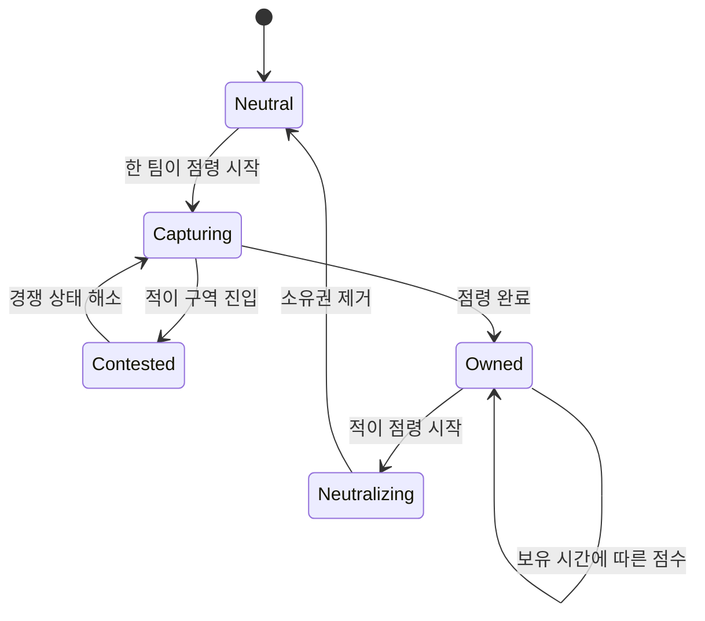
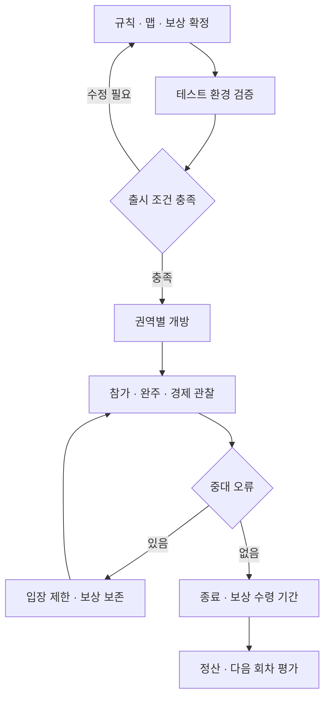

# 12. 전투 모드·경쟁전·기간 이벤트

> 대상: Wargaming PC · 기준일: 2026-11-13 KST  
> 기준: 라이브 2.4.1 계열과 실제 게시된 2026년 이벤트 안내. Common Test는 라이브 규칙으로 채택하지 않는다.  
> **[확인]** 공개 규칙 / **[분석]** 설계 해석 / **[제안]** 구현 재구성 / **[검증 필요]** 비공개·불명확 항목  
> 연관: [기본 전투](02_Battle_Rules_and_Lifecycle.md), [매칭](10_Matchmaking_and_Platoons.md), [미션·운영](17_Missions_Monetization_and_LiveOps.md), [클랜](18_Social_Clans_Replays_and_Fair_Play.md)

## 1. 모드 시스템을 분리해야 하는 이유

**[분석]** 모드는 맵과 인원만 바꾸는 옵션이 아니다. 부활, 회복, 점령 방식, 정보 전달, 사용 가능 차량, 보상과 소모 비용을 바꾼다. 같은 “적 전차 파괴”도 기본전에서는 상대 팀의 영구적인 전력 손실이지만, 무한 부활 이벤트에서는 일정 시간 동안 목표를 비우게 만드는 효과가 중심이 된다.

**[확인]** 2.0에서는 Encounter·Assault·Grand Battles가 무작위 전투의 별도 큐 모드로 중단되었다. 그러나 2026년 11월 Maneuvers는 Encounter 규칙을 사용한다. 따라서 “Encounter가 제품 전체에서 삭제됐다”는 설명도 부정확하다. 큐의 제공 여부와 규칙의 재사용을 구별해야 한다. [S01][S07]

## 2. 모드 비교

| 모드 | 참가 구조 | 핵심 경쟁 자원 | 세션 성장 | 운영 성격 |
|---|---|---|---|---|
| Standard Random | 대표 15v15 | 남은 전투력·기지·시간 | 전투 외 연구와 구성 | 기본 상시 경험 |
| Onslaught | 7v7, 적격 Tier X | 순위 점수·역할 기술·팀 구성 | 전투 내 기술 활용 | 시즌 경쟁전 |
| Frontline | 30v30, 해당 회차 Tier VIII | 구역·방어선·주요 목표 | 계급·전투 비축물자 | 주기적 대규모 이벤트 |
| Steel Hunter | 솔로 또는 2인 소대 | 생존·전리품·안전 구역 | 차량 내 즉석 업그레이드 | 배틀로얄 이벤트 |
| Black Signal | 7v7, Tier X, SPG 제외 | 안테나 보유와 점수 수입 | 부활 시 구성 적응 | 2026년 11월 신규 이벤트 |
| Maneuvers | 클랜 7v7, 해당 회차 Tier XI | 승리·명예 점수·차량 가용성 | 클랜 단계 및 수리 자원 | 기간 한정 클랜 경쟁 |
| PvE 이벤트 | 회차별 솔로 또는 협동 구성 | AI 파형·목표·생존 | 회차별 전용 성장 | 서사·도전·변칙 실험 |

근거: [S02]~[S08]. 이 표의 인원·티어는 특정 모드의 영구 불변 규칙이 아니라 확인한 가이드 또는 회차 기준이다. 이벤트가 현재 열려 있는지는 운영 일정과 권역을 별도로 확인해야 한다.

## 3. Onslaught: 승패를 순위 경쟁으로 연결

### 3.1 확인된 차이

**[확인]** 공식 가이드는 7v7, 적격 Tier X 차량, 순위 기반 매칭, 전투 전 편성 변경, 역할·전술 기술을 설명한다. 2026–27 Phoenix 첫 시즌에는 Super Platoon이 비활성화되었으며, 시간 만료 시 생존 차량 수 → 가한 피해 → 첫 격파 팀 순서로 우열을 판단한다. 세 기준으로도 승자를 정할 수 없으면 무승부다. 오래된 상시 가이드에 Super Platoon 설명이 남아 있어도 해당 시즌의 새 안내를 우선한다. [S02][S03]

**[확인]** 2.4의 지정 야간 맵은 최대 시야 315m, 표시 거리 445m, 위장 보정 +15%를 사용한다. 조명탄 효과도 일반전 탐지와 다른 별도 규칙이다. 이 변경을 모든 일반전 지도에 적용하면 안 된다. 상세 탐지 예외는 [08](08_Spotting_Concealment_and_Radio.md)을 따른다. [S04]

### 3.2 설계 해석

**[분석]** 순위 경쟁에서는 긴 무승부가 반복될 때 진행 정체를 느끼기 쉽다. 동률 해소 규칙은 종료 시점의 우세를 결과로 변환한다. 동시에 첫 격파가 마지막 기준이 되면 초반 사건이 후반 의사결정에 영향을 줄 수 있으므로, 플레이어가 우선순위를 알아야 한다.

**[제안]** HUD에는 일반전과 다른 시간 만료 조건을 표시한다. 시즌 설정은 `SeasonRuleSet`으로 버전 관리하고, 전투 후 순위 점수 계산과 일반 경제 정산을 별개 결과로 만든다. 같은 참가자의 실력 점수와 연구 경험치를 하나의 값으로 취급하지 않는다.

## 4. Frontline: 전선을 여러 단계로 나누는 대규모 전투

**[확인]** 2026년 11월 회차는 Tier VIII의 30v30 형식, 3km × 3km 규모 지도, 구역 확보와 주요 목표 파괴, 재보급 구역을 제공했다. 공격팀은 조건을 열고 다섯 주요 목표 중 세 개를 파괴하는 구조다. 회차에는 기본·작전 지원·운명의 장난 시나리오가 있으며 비축물자 획득·대기 규칙이 달라진다. [S05]

**[분석]** 기본전의 단일 전선 실패를 되돌리기 어렵다면, Frontline은 방어선 이동과 재출격으로 전투의 여러 국면을 만든다. 공격팀에는 현재 구역의 진입·점령이, 수비팀에는 완전한 격파보다 시간 지연이 더 큰 가치를 갖는 상황이 생긴다.

**[제안] 구역 상태 모델**

| 상태 | 공격 측 의미 | 수비 측 의미 | 데이터 요구 |
|---|---|---|---|
| Locked | 아직 진입·점령 대상 아님 | 미래 방어선 | 선행 구역 |
| Contestable | 현재 점령 가능 | 지연·격퇴 대상 | 점령 상태·시간 |
| Captured | 다음 단계 개방 | 후퇴 또는 재배치 | 점령 확정 사건 |
| ObjectiveOpen | 주요 목표 공격 가능 | 최종 방어 | 목표 HP·접근 조건 |

**[검증 필요]** 회차별 부활 대기, 재보급 재사용 제한, 전투 시간 추가, 차량 회수·재사용 규칙을 독립 실측한다. 이벤트 소개에 있는 대표값을 다른 회차에 일괄 적용하지 않는다.

## 5. Steel Hunter: 계정 성장과 전투 내 성장을 분리

**[확인]** 현재 공식 가이드는 특수 차량 8종, 솔로 15명 또는 소대 모드 총 20명, 최대 15분, 위험 구역의 점진적 축소를 설명한다. 차량은 전투 도중 I~VII 단계로 발전하며 최후 생존자 또는 소대가 목표다. [S06]

**[분석]** 이 모드의 업그레이드는 차고의 연구 계통도와 다른 자원 경제다. 지금 적과 싸워 성장 자원을 얻을지, 안전 구역으로 이동할지, 전리품을 둘러싸고 위험을 감수할지가 핵심 선택이다. 전차 수집 수준과 전투 내 빌드가 같은 역할을 하지 않는다.

**[제안]** `BattleUpgradeGraph`는 세션 소유 데이터로 두고 계정 영속 연구에 쓰기 접근을 주지 않는다. 전리품 획득, 모듈 선택, 안전 구역 변화, 전용 능력 사용을 별도 사건으로 기록한다. UI에는 업그레이드 선택 중에도 위험 구역과 적 접근을 인지할 수 있는 표현이 필요하다.

**[검증 필요]** 탐지·무전·파괴 후 복귀의 세부 정책은 모드 전용 설명으로 확인한다. 기본전의 수풀·시야 수치를 그대로 복사하는 것을 금지한다.

## 6. Black Signal: 점령이 회복과 재교전을 만든다

**[확인]** 2026년 11월 안내에서 승리 기준은 안테나 유지로 얻는 2,500점 또는 시간 종료 시 우세 점수다. 적이 점령 구역에 있으면 점령이 멈추며 아군을 더 넣어도 점령 속도가 빨라지지 않는다. 점령 시 점령 차량의 HP 25%를 회복하고 점령 구역 안의 아군 차량에도 회복을 제공한다. 아군의 정확한 회복 비율은 별도 검증 대상이다. 무한 재출격·20초 준비 후 자동 출격·출격 후 10초 피해 보호가 안내되며 사용한 탄은 전투 후 반환된다. [S08]

**[분석]** 기여 속도가 인원에 비례하지 않으면 전원이 한 점에 몰리는 것보다 여러 목표를 압박하는 편성이 유리해질 수 있다. 점령 회복은 체력 손실과 목표 플레이를 직접 연결한다. 사망은 영구 퇴장이 아니라 이동·재출격 시간의 손실로 바뀐다.

**[제안] 안테나 상태 머신**



이 상태 머신은 문서화된 동작을 재구현하기 위한 제안이다. 중립화 시간, 점수 틱 간격, 동시 목표 확보로 임계값을 넘기는 순서 등은 라이브 실험으로 보완해야 한다. 회복·재출격·보호 상태를 같은 점령 시스템 안에 하드코딩하지 않고 효과 이벤트로 분리한다.

## 7. Maneuvers: 전투 결과가 다음 편성을 제한

**[확인]** 2026년 11월 회차는 클랜 7v7 Tier XI Encounter, 10분, 전장의 안개를 사용한다. 파괴되거나 패배한 편성의 차량은 Out of Commission 상태가 되어 단계 진행과 명예 점수 기여에 제약을 받는다. 클랜 단계 초기화와 수리 부품이 차량 가용성 복구에 연결된다. [S07]

**[분석]** 한 판의 강한 조합만 반복하는 문제를 차량 가용성이라는 장기 제약으로 다룬다. 개인 최고 성능과 클랜 전체의 차량 풀이 다른 자산이 되며, 지휘자는 승률뿐 아니라 다음 판의 편성 여유를 고려해야 한다.

**[제안]** 차량의 전투 중 파괴 상태와 이벤트의 Out of Commission 상태를 구분한다. 전자는 세션 종료와 함께 해제될 수 있는 임시 상태이고, 후자는 이벤트 규칙에 따라 남는 메타 상태다. 클랜 초기화 요청에는 권한, 영향 차량, 소비·획득 내역, 적용 버전을 기록한다.

## 8. PvE 이벤트의 재사용 가능한 부분

**[확인]** 2.4.1은 Babylon: Dark Tower를 포함해 협동 PvE, 전용 적과 보스, 진행 보상을 안내한다. 이는 기본 PvP의 상시 규칙으로 취급하지 않는다. [S09]

**[분석]** PvE는 동일한 이동·포탄·피해 기반 위에 AI 행동, 목표 스크립트, 전용 능력, 보상 진행을 얹는 실험 공간이다. 시각적으로 큰 파괴나 보스 행동이 있더라도, 기본전에서 모든 오브젝트가 같은 방식으로 파괴된다고 추론할 수 없다.

**[제안]** 기본 무기 판정은 재사용하되 AI 위협도, 공격 예고, 보스 단계 전환은 별도 시스템으로 둔다. 전용 피해 배율이나 무적 단계는 모드 조건으로 명시하며, 일반전 데이터에 역으로 흘러가지 않도록 한다.

## 9. 모드 규칙을 데이터로 표현하기

아래는 **[제안] 스키마**로, 실제 Wargaming 데이터 포맷이 아니다.

```yaml
mode_definition:
  id: example_mode
  revision: 1
  availability:
    realm: example
    begins_at_utc: null
    ends_at_utc: null
  eligibility:
    allowed_tiers: []
    allowed_classes: []
    rental_policy_id: null
  battle:
    team_size: null
    duration_seconds: null
    respawn_policy_id: null
    victory_rule_id: null
    tie_break_rule_id: null
    visibility_rule_id: null
    friendly_interaction_rule_id: null
  economy:
    repair_policy_id: null
    ammo_policy_id: null
    reward_formula_id: null
  progression:
    event_progression_id: null
    ranking_season_id: null
  map_pool_id: null
```

**[제안]** `null`은 “기본전 기본값으로 자동 상속”이 아니라 미설정 오류로 처리하는 편이 안전하다. 숨은 기본값은 복잡한 이벤트에서 탐지·보상 오류를 만들기 쉽다. 공통 기본값이 필요하면 상속 관계를 명시하고 최종 해석된 규칙표를 검토 가능하게 출력한다.

## 10. 운영 생명주기



**[분석]** 이벤트 종료는 전투 입장 종료, 진행도 획득 종료, 보상 교환 종료가 다를 수 있다. 세 시점을 각각 정의해야 마지막 날의 진행 손실과 보상 미수령을 줄일 수 있다.

## 11. QA

| ID | 조건 | 확인점 |
|---|---|---|
| MOD-01 | 일반전에서 Onslaught로 전환 | 허용 차량·장비·규칙 재검증 |
| MOD-02 | 야간 Onslaught 지도 | 일반전 445/565 규칙의 오적용 없음 |
| MOD-03 | Onslaught 시간 종료 | 생존→피해→첫 격파 순서 확인 |
| MOD-04 | Black Signal 한 구역에 여러 아군 | 인원 증가가 점령 속도를 바꾸지 않음 |
| MOD-05 | Black Signal 보호 중 발사/이동 | 보호 해제 예외는 실측 결과로 확정 |
| MOD-06 | Frontline 다음 구역 개방 | 이전·현재 구역 접근 상태 일관성 |
| MOD-07 | Steel Hunter 전투 종료 | 전투 내 업그레이드가 영속 연구를 오염시키지 않음 |
| MOD-08 | Maneuvers 차량 파괴·패배 | Out of Commission 전이와 기여 제한 |
| MOD-09 | 이벤트 종료 시 전투 진행 중 | 진행도·보상 마감 정책 일관성 |
| MOD-10 | 탄약 반환 이벤트 | 반환과 일반 보급이 중복 실행되지 않음 |
| MOD-11 | 테스트 전용 차량 | 라이브 큐에 노출되지 않음 |
| MOD-12 | 지역별 일정 차이 | UI 현지시간과 서버 UTC 일치 |

## 출처

- [S01] [Release Notes 2.0](https://worldoftanks.eu/en/content/docs/release_notes/release-notes-2-0/)
- [S02] [Onslaught Guide](https://worldoftanks.eu/en/content/guide/modes-and-events/onslaught/) — 상시 가이드의 시즌 구형 항목은 S03/S04로 교정.
- [S03] [Onslaught: Year of the Phoenix Begins](https://worldoftanks.eu/en/news/general-news/onslaught-season-of-the-phoenix-1/)
- [S04] [Release Notes 2.4](https://worldoftanks.eu/en/content/docs/release_notes/release-notes-2-4/)
- [S05] [Frontline 2026: Autumn Launch](https://worldoftanks.eu/en/news/general-news/frontline-autumn-november-2026/)
- [S06] [Steel Hunter Guide](https://worldoftanks.eu/en/content/guide/modes-and-events/steel-hunter/)
- [S07] [Maneuvers: Rally Your Clan — November 2026](https://worldoftanks.eu/en/news/general-news/maneuvers-november-2026/)
- [S08] [Welcome Black Signal](https://worldoftanks.eu/en/news/general-news/black-signal-november-2026/)
- [S09] [Update 2.4.1: Season of Action](https://worldoftanks.eu/en/news/updates/wot-2-4-1/)

