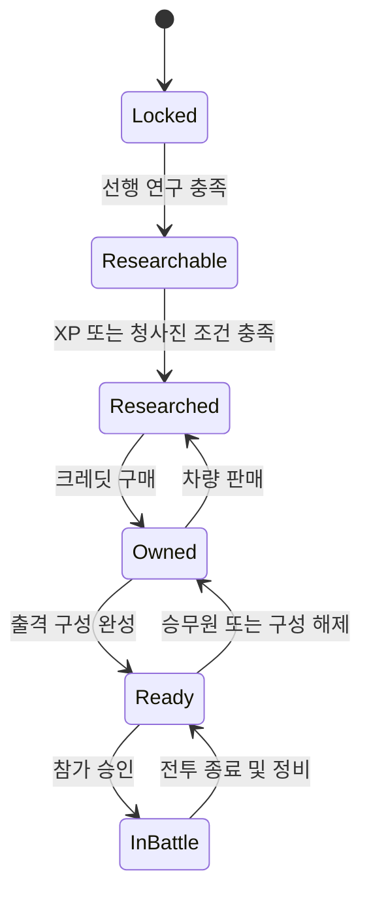

# 13. 연구·차량 성장·Tier XI 업그레이드 역기획

> **대상:** Wargaming World of Tanks PC판. **자료 확인일:** 2026-11-13 KST. EU 공식 가이드를 우선하며 지역 이벤트 가격은 일반화하지 않는다. 2.0의 출시 사양과 이후 확장을 구분한다. 게임 클라이언트 실행·서버 코드 검증을 수행한 문서는 아니다.
>
> **표기:** `[확인]` 공식 공개 규칙, `[분석]` 규칙에서 도출한 설계 해석, `[제안]` 재구현을 위한 구조, `[검증 필요]` 공개 자료만으로 확정할 수 없는 내용.

## 1. 시스템 목적과 경계

[분석] 차량 성장은 단순한 레벨 상승이 아니라 **전투 경험을 특정 계통의 접근 권한으로 바꾸는 과정**이다. 플레이어는 경험치로 다음 선택지를 열고, 크레딧으로 소유하며, 모듈·장비·승무원 조합으로 실제 전투 성능을 완성한다. 따라서 연구 완료, 구매 완료, 출격 준비 완료는 서로 다른 상태여야 한다.

이 문서는 연구 계통도, 모듈 연구, 청사진, Elite 상태, Tier XI 성장에 집중한다. 장비와 현장 개량은 [15번](15_Equipment_Consumables_and_Field_Mods.md), 경험치·크레딧 정산은 [16번](16_Economy_and_Battle_Rewards.md), 승무원은 [14번](14_Crew_and_Perks.md)이 담당한다. 임무 보상 차량의 획득 경로는 [17번](17_Missions_Monetization_and_LiveOps.md)에서 다룬다.

## 2. 확인된 기본 규칙

### 2.1 연구와 소유를 분리한다

[확인] 일반 연구 차량은 선행 차량과 필수 모듈을 연구해야 다음 차량을 연구할 수 있다. 차량별 전투 경험치, 자유 경험치, 청사진을 성장에 사용하며, 연구한 차량은 크레딧으로 구매한다. 다음 차량으로 가는 데 필요한 모듈만 우선 연구할 수도 있다. 모든 모듈과 후속 차량을 연구하면 일반 차량은 Elite 상태가 되고, 이후 경험치는 승무원 가속 훈련이나 자유 경험치 전환에 사용할 수 있다. [P13-1]

[확인] 모듈은 연구 후 구매·장착하는 절차를 거친다. 교체한 이전 모듈은 판매하지 않으면 보관소로 보내진다. 주포·포탑·현가장치·엔진·무전기 등의 개선은 성능을 바꾸며, 대부분의 Tier X·XI 차량은 일반 하위 차량과 다른 모듈 구성을 가진다. 모든 차량에 동일한 개수의 모듈이 있다고 가정하면 안 된다. [P13-2]

| 구분 | 입력 | 보존할 상태 | 결과 |
|---|---|---|---|
| 연구 | 차량 XP, 자유 XP, 선행 조건 | 연구 해금 목록 | 구매·다음 연구 가능 |
| 차량 구매 | 크레딧, 선택한 초기 구성 | 차량 소유권 | 차고에 차량 생성 |
| 모듈 구매·장착 | 크레딧 또는 보관 모듈, 호환성 | 보관 수량, 장착 구성 | 차량 성능 변경 |
| 전투 참가 | 완성된 차량 구성 | 전투용 구성 스냅샷 | 차량별 전투 XP 획득 |
| 판매·재구매 | 소유 차량, 보관 선택 | 연구와 소유 상태를 별도로 취급 | 차량 운용 자산 재배치 |

표는 [분석]에 따른 기능 경계다. 판매 시 모든 관련 상태의 실제 보존 범위는 개별 항목별 확인이 필요하다.

### 2.2 청사진이 줄이는 비용

[확인] 공식 상시 가이드는 청사진을 Tier II–X 차량의 **차량 연구 XP 할인**으로 설명한다. 모듈 연구비를 할인하지 않으며, 선행 차량과 필요한 모듈의 연구 요건도 없애지 않는다. 차량 청사진 조각은 즉시 할인을 제공하고, 국가·범용 조각은 해당 차량 조각으로 조합할 수 있다. 완성 청사진은 차량 연구 XP를 없앨 수 있지만 차량 구매 크레딧을 대신하지 않는다. Tier XI에 동일하게 적용된다고 확대 해석하지 않는다. [P13-3]

[분석] 이 구조는 플레이어에게 세 종류의 부족함을 만든다. 필요한 연구가 남았는지, 구매 자금이 부족한지, 장착 구성이 미완성인지가 각각 다르다. UI가 이 셋을 모두 “해금되지 않음”으로 표시하면 청사진 보상을 받아도 진전이 없다고 느끼게 된다.

## 3. 차량 연구 상태 모델

다음은 [제안] 상태 모델이다. Wargaming 내부 클래스 구조를 의미하지 않는다.



### 3.1 상태별 차고 UX

| 상태 | 주 행동 | 함께 보여줄 정보 | 실패 시 설명 |
|---|---|---|---|
| 선행 미충족 | 선행 연구 보기 | 가장 가까운 미해금 노드 | “선행 주포 연구 필요”처럼 원인 표시 |
| 연구 가능 | 연구 | 차량 XP/자유 XP 차감 내역 | 필요한 자원별 부족량 |
| 연구 완료 | 구매 | 차량값과 선택 구성 총액 | 차고 공간·자금 등 개별 원인 |
| 소유·미장착 | 장착 또는 정비 | 호환성·수량·성능 변화 | 상위 모듈이라는 이유만으로 자동 장착 금지 |
| 출격 가능 | 전투 시작 | 전투 구성·보급 설정 | 모드의 티어·차량 제한 |

[분석] “구매” 버튼을 누를 때 실제 운용 비용을 숨기면 새 차량을 얻은 직후 탄약·장비·승무원 준비 비용으로 좌절한다. 차량 기본값, 선택 구성비, 이후 매 전투 유지비를 서로 다른 행으로 보여주는 편이 이해하기 쉽다.

### 3.2 연구 그래프 규칙

[제안] 연구 계통도는 화면상의 화살표와 권한 판정을 분리한 유향 비순환 그래프로 표현한다. 모듈 연구와 다음 차량 연구는 같은 그래프의 서로 다른 노드 유형이다. 동일 노드의 연구 여부, 차량 소유 여부, 물리적인 모듈 재고 수량은 별도 데이터다.

- `prerequisite_ids`는 연구할 수 있는 조건이다.
- `compatible_mounts`는 장착할 수 있는 조건이다.
- `required_for_next_vehicle`은 플레이어에게 최단 진행 경로를 설명하는 메타데이터다.
- `research_unlock`은 권한이므로 한 번의 구매 요청 중복으로 두 번 차감하면 안 된다.
- 패치로 계통이 바뀌면 현재 보유자와 신규 진입자의 권한을 별도로 이관한다.

## 4. Tier XI의 성장 구조

### 4.1 출시 사양과 현재 범위

[확인] 2.0은 기존 Tier X 계통에서 이어지는 Tier XI와 별도 임무 보상 차량을 도입했다. 출시 당시에는 15대의 연구 차량과 1대의 임무 보상 차량이 소개되었다. 당시 안내의 일반 Tier XI 연구·구매 예시는 **325,000 XP / 7,400,000 크레딧**이다. Tier XI는 VI–X의 현장 개량 대신 전용 업그레이드 트리를 사용하며, 소형 10,000 XP·대형 20,000 XP·최종 25,000 XP 노드, 최대 25노드가 안내되었다. 수치는 **2.0 발표 사양**으로 기록한다. [P13-4]

[확인] 2.4에는 독일 중전차 계통과 추가 Tier XI 차량이 소개되었다. [P13-5]

[분석] 따라서 “Tier XI는 총 16대”라는 문장을 2026년 전체 보유 목록으로 사용하면 틀린다.

[제안] 개별 차량의 현재 가격·노드 수·구성은 해당 패치 데이터로 관리해야 한다.

| 성장 차원 | 일반 연구 차량 | Tier XI 전용 성장 |
|---|---|---|
| 핵심 진전 | 필수·선택 모듈, 다음 티어 | 차량 성능과 고유 메커니즘 업그레이드 |
| 기본 개조 구조 | 호환 모듈 연구·장착 | 차량별 업그레이드 노드 |
| 후반 조정 | 해당 차량의 현장 개량 | 전용 업그레이드로 분리 |
| 선택의 성격 | 당장 성능 개선과 빠른 다음 차량 진입 | 어떤 강점을 먼저 완성할지 결정 |
| 완성 이후 | Elite 경험치 활용·숙련 | 모든 성장 노드 완료 후 Elite·시각 보상 |

표의 선택 해석은 [분석]이다. Tier XI 전투 고유 동작은 [07번](07_Artillery_and_Special_Mechanics.md)을 참조한다.

### 4.2 업그레이드가 전투에 들어가는 시점

[제안] 업그레이드 적용은 차고 구성 변경으로 취급하고 전투 참가 시 고정한다. 전투 도중 플레이어가 다른 차량의 연구를 진행하더라도 이미 시작한 전투의 성능이 바뀌지 않아야 한다. 특수 메커니즘을 강화하는 노드는 단순 스탯 가산과 구분해 `mechanic_parameter_override`로 기록한다.

예를 들어 어떤 노드가 메커니즘 자원 충전 시간을 줄인다면 다음을 별도로 정의한다.

1. 기준 파라미터의 단위와 허용 범위.
2. 장비·승무원·모드 효과와 겹칠 때의 계산 정책.
3. 이미 충전 중인 상태를 재계산할 수 있는지 여부.
4. 차고 비교창과 전투 툴팁에 표시할 최종값.
5. 업그레이드 취소·보상 정책을 지원할지 여부.

실제 Tier XI 노드가 모두 이러한 구현을 사용한다는 뜻은 아니다. 공개된 “고유 메커니즘 강화”를 안전하게 재구성하기 위한 데이터 요구사항이다.

## 5. 성장 속도와 선택 비용

[분석] 플레이어가 느끼는 진행 속도는 총 경험치 하나로 설명되지 않는다. 전투당 XP, 전투 길이, 대기 시간, 승률, 차량 운용 숙련, 유지비, 할인 보유 여부가 함께 작용한다.

아래는 **가정한 연구 계획**이며 실제 전차의 비용·수익 예측이 아니다.

- 다음 차량에 필요한 잔여 연구비: 80,000 XP.
- 전투당 차량 XP의 계획값: 600 XP.
- 보유 자유 XP: 20,000 XP.
- 1회 전투·대기 합계: 8분.

모든 자유 XP를 연구에 쓴다고 가정하면 필요한 전투는 `ceil((80,000 - 20,000) / 600) = 100회`다. 이 계산은 13시간 20분의 전투 참여량을 뜻하지만, XP 보너스·일일 승리·실력 향상·일정 등의 영향을 반영하지 않는다. 따라서 고객에게 보장하는 완료 시간으로 사용하면 안 된다.

성능 개선 모듈에 12,000 XP를 먼저 쓰면 잔여 비용은 늘어난다. 그러나 생존과 피해 기여가 좋아져 전투당 XP가 상승한다면 장기적으로 진행이 빨라질 수 있다. 이 선택을 “모듈은 낭비”로 단순화하지 않고, 현재 차량에서 얼마나 더 싸울 예정인지와 함께 판단하게 하는 것이 성장 UX의 역할이다.

## 6. 구체 상황 분석

### 사례 A. 청사진 100%인데 다음 차량을 구매할 수 없다

[분석] 청사진은 한 종류의 비용만 제거한다. 확인 순서는 선행 차량 연구 → 필수 모듈 연구 → 대상 차량 연구 실행 → 구매 크레딧 → 출격 구성이다. 차량의 연구 XP가 0이라는 이유로 소유권까지 주어지지 않는다. 화면에는 “연구 XP 면제”와 “구매비 필요”를 동시에 보여줘야 한다.

[제안] QA용 테스트 계정에 청사진만 완성시키고 필수 모듈을 남겨 둔다. 구매 버튼의 비활성 사유가 재화 부족으로 잘못 표시되지 않는지 확인한다. 필수 모듈을 연구한 후에는 할인 적용이 누락되거나 자유 XP가 소비되지 않아야 한다.

### 사례 B. Tier X에 쌓인 XP와 새 Tier XI의 성장 XP

[분석] 이전 차량의 XP로 후속 차량을 해금하는 것과 새 차량을 운용하며 업그레이드하는 것은 서로 다른 성장 구간이다. “Tier X에서 325,000 XP를 쌓았으므로 Tier XI 업그레이드도 완료됐다”라는 기대가 생기지 않도록 연구·구매·업그레이드를 분리해서 설명해야 한다.

[검증 필요] 자유 XP의 Tier XI 각 노드 사용 가능 범위, 패치별 업그레이드 가격 변경, 보상 차량의 초기 노드 상태는 해당 차량 화면으로 확인한다. 일반 차량의 기존 동작을 그대로 확장하여 확정하지 않는다.

## 7. 재구현 데이터 계약

```yaml
# [제안] 설명용 스키마. 실제 클라이언트 데이터 형식이 아님.
VehicleProgression:
  vehicle_id: stable_id
  ruleset_version: patch_id
  progression_type: MODULE_TREE | TIER_XI_UPGRADES | REWARD_ONLY
  combat_xp: integer
  unlocked_research_nodes: [node_id]
  owned_vehicle: boolean
  blueprint_discount_basis_points: integer
  unlocked_upgrade_nodes: [node_id]
  elite_status: boolean
ResearchNode:
  id: stable_id
  kind: MODULE | NEXT_VEHICLE | UPGRADE
  prerequisites: [node_id]
  xp_cost: integer
  eligible_xp_wallets: [wallet_type]
  grant_id: stable_id
  mechanic_overrides: []
```

```text
# [제안] 중복 차감과 패치 혼선을 막는 처리 순서
Research(request):
    lock(account_progression)
    if request.id already committed: return stored_result
    rules = resolve(request.ruleset_version)
    validate_prerequisites(rules, account, request.node)
    quote = compute_cost(rules, account, request.node)
    require request.accepted_quote == quote
    require account.can_pay(quote)
    atomically debit wallets, grant node, record request.id
    emit ResearchCompleted(version, node, paid_amounts)
```

[분석] 연구 이벤트는 분석용 통계뿐 아니라 복구 근거다. 할인 이벤트 종료 직전 요청, 클릭 중복, 네트워크 재시도, 새 패치에 의한 노드 이동을 모두 처리하려면 **무엇을 어떤 규칙으로 얼마나 지불했는지**가 남아야 한다.

## 8. 검증 시나리오

| ID | 조건·행동 | 기대 결과 / 확인점 |
|---|---|---|
| P13-01 | 선행 모듈 미연구, 대상 차량 청사진 완성 | XP 면제와 선행 조건 미충족을 구분 |
| P13-02 | 연구비만 보유, 구매비 부족 | 연구는 가능하되 차량 소유는 부여하지 않음 |
| P13-03 | 연구 요청 네트워크 재전송 | XP 한 번 차감, 해금 한 번 발생 |
| P13-04 | 상위 모듈 구매 후 원래 모듈 보관 | 장착과 재고 수량이 일치 |
| P13-05 | 필수 모듈만 연구하여 다음 차량 진행 | 선택 모듈과 Elite 조건을 혼동하지 않음 |
| P13-06 | 할인 시작·종료 시각에 연구 요청 | 서버의 단일 규칙 시각과 견적 적용 |
| P13-07 | 패치로 새 후속 차량 추가 | 기존 Elite·XP 활용 정책의 이관 결과 확인 |
| P13-08 | XI 일반 차량과 임무 보상 차량 비교 | 획득 경로를 동일 구매 절차로 처리하지 않음 |
| P13-09 | 출격 이후 차고 성장 데이터 변경 | 이미 시작한 전투의 성능 스냅샷 유지 |
| P13-10 | 소유 차량 판매 후 재구매 | 연구·업그레이드·장비·승무원의 보존 범위를 개별 검증 |

이 표는 [제안] 검증 계획이다. 실제 실행한 테스트 결과가 아니다.

## 9. 설계 평가와 미확인 항목

[분석] 일반 차량의 연구는 계통 학습과 성능 개선을 결합한다. Tier XI는 다음 티어로 넘어가는 목표 대신 현재 차량의 고유 기능을 완성하는 동기를 제공한다. 두 구조를 같은 진행 막대로 합치면 어느 자원이 어디에 쓰이는지 불투명해진다. 연구 막대·보유 막대·숙련 보상은 서로 다른 의미로 유지해야 한다.

[분석] 주의할 운영 지표는 최고 티어 도달 속도뿐 아니라 **신규 차량 구매 후 첫 20전의 이탈률**, 기본 구성과 완성 구성의 성과 격차, 자유 XP 소진 후 플레이 중단, 다음 차량 직전 크레딧 부족률이다. 이 지표는 아직 숙련되지 않은 플레이어에게 강한 성능 격차를 오래 부담시키는 구간을 찾는 데 적합하다.

[검증 필요] 전체 현행 연구비 테이블, 모든 차량의 호환성 조건, Tier XI별 노드 상세, 청사진·할인의 예외, 판매 시 업그레이드 보존, 계통 변경 시 자동 보상은 별도 데이터 수집 대상이다. 본 문서의 출시 가격을 라이브 데이터 테이블 대신 사용하지 않는다.

## 10. 출처

- **P13-1** — [Purchase and Research Vehicles](https://worldoftanks.eu/en/content/guide/game-mechanics-and-achievements/purchase-and-research-vehicles/). 상시 공식 가이드. 선행 연구·구매·Elite 구조.
- **P13-2** — [Upgrading Your Vehicles](https://worldoftanks.eu/en/content/guide/newcomers-guide/upgrading_vehicles/). 상시 공식 가이드. 모듈 연구·장착·보관.
- **P13-3** — [Vehicle Blueprints](https://worldoftanks.eu/en/content/guide/game-mechanics-and-achievements/vehicle-blueprints/). 상시 공식 가이드. 할인 범위·선행 조건.
- **P13-4** — [Update 2.0: Under the Hatch of Tier XI](https://worldoftanks.eu/en/news/general-news/update-2-0-tier-11-overview/). 2.0 출시 안내, 2025년. 가격·노드는 당시 사양으로 한정.
- **P13-5** — [Update 2.4: Overdrive](https://worldoftanks.eu/en/news/updates/wot-2-4/). 2026년 9월 업데이트 안내. Tier XI 추가 확장.
- **P13-6** — [About: Experience](https://wargaming.net/support/en/products/wot/article/10223/). 공식 고객지원. 차량 XP·Elite XP·자유 XP 구분.

모든 출처는 2026-11-13 확인. 일부 공식 페이지의 직접 열기는 보안 페이지로 반환되어 검색 서비스에 제공된 공식 색인 본문으로 교차 확인했다. 오래된 매뉴얼을 현행 수치 근거로 사용하지 않았다.
