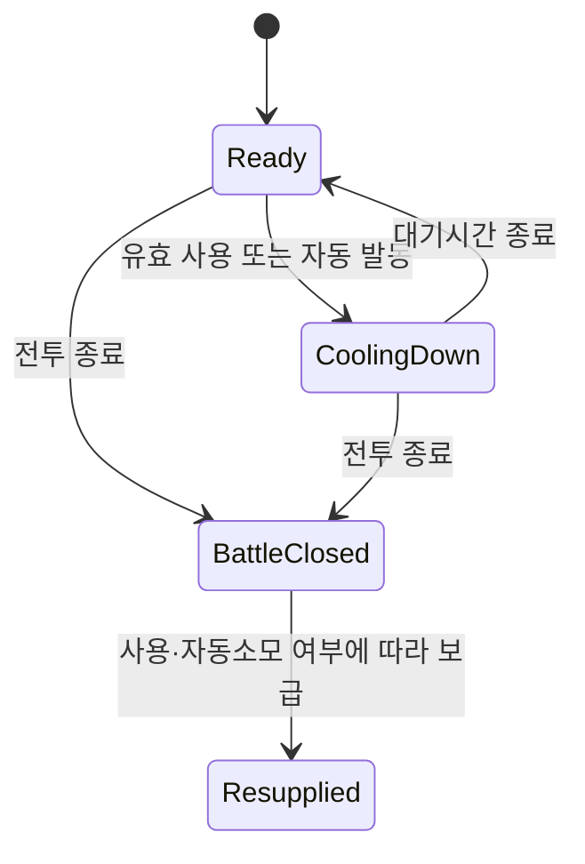

# 15. 장비·소모품·지휘명령·현장 개량 역기획

> **대상:** Wargaming World of Tanks PC판. **자료 확인일:** 2026-11-13 KST. 상시 공식 가이드와 확정 릴리스 노트를 사용한다. 1.26 이후 소형 수리·구급 규칙을 반영하고, VI–X 현장 개량과 XI 전용 업그레이드를 구분한다.
>
> `[확인]` 공개 규칙 / `[분석]` 설계 해석 / `[제안]` 재구현 구조 / `[검증 필요]` 미확정 범위. 가격은 할인·지역·버전에 따라 변할 수 있으며 여기의 기본값을 결제 견적으로 사용하지 않는다.

## 1. 네 가지 구성 계층

[분석] 장비와 소모품은 같은 슬롯형 UI를 쓰더라도 수명과 경제적 의미가 다르다. 현장 개량까지 단일 “강화 수치”로 합치면 구매, 장착, 소모, 영구 해금의 차이를 잃는다.

| 계층 | 기능 | 수명 | 주요 비용 성격 | 전투와 연결 |
|---|---|---|---|---|
| 장비 | 차량 강점 강화·약점 보완 | 차량에 장착하여 반복 사용 | 구매·개선·해체 | 시작 구성에 반영 |
| 소모품 | 복구·소화·전투 성능 보조 | 사용 또는 전투 단위 소모 | 전투 유지비 | 사용 조건·쿨타임 |
| 지휘명령 | 장비·특전의 추가 효과 | 한 전투 | 지속 지출 또는 보상 재고 | 적합한 장비·특전 필요 |
| 현장 개량 | 완성 차량의 운용 방향 조절 | 연구·구매한 개조 상태 | XP·크레딧 | 성능 교환·구성 선택 |

재구현 시 `ItemDefinition`과 `MountedItemInstance`, `BattleConsumableState`, `PermanentModification`을 별도로 관리한다. [제안]

## 2. 장비 시스템의 실제 규칙

[확인] 일반 장비에는 화력·생존·기동·정찰 범주가 있고, Tier VI부터 첫 슬롯에 차량 유형에 따른 범주가 지정된다. 범주가 일치하면 해당 일반 장비의 보너스가 증가하고, 불일치하면 기본 효과를 사용한다. 동일 효과의 장비를 여러 개 중복 장착할 수 없다. 현상금 장비와 실험 장비는 개선 가능하며, 현상금은 한 번, 실험 장비는 I–III 단계로 안내된다. [P15-1]

| 차량 유형 | 기본 첫 슬롯 범주 | 설계 해석 |
|---|---|---|
| 경전차 | 정찰 | 정보 역할을 낮은 비용으로 완성 |
| 중형전차 | 기동 | 위치 전환·기동 기여를 강화 |
| 중전차 | 생존 | 전선 유지와 교환 능력을 강화 |
| 구축전차·자주포 | 화력 | 사격 임무를 강화 |

범주 매핑은 [확인, P15-1], 설계 해석은 [분석]이다. 개별 특수 차량·모드·추가 슬롯의 예외를 이 표만으로 판정하지 않는다.

### 2.1 장비 유형과 기획 목적

| 유형 | 구별할 상태 | 선택이 만드는 비용·보상 구조 |
|---|---|---|
| 일반 장비 | 클래스·슬롯 범주 | 저비용 기본 구성과 슬롯 최적화 |
| 개선 장비 | 획득 재화·해체 규칙 | 희소 자원을 특정 차량에 집중 |
| 현상금 장비 | 개선 전·후 상태 | 보상 아이템에 추가 투자 |
| 실험 장비 | 개선 단계·주/부 효과·부품 | 여러 성능을 섞어 조정 |

표의 구조는 [분석]이며 모든 장비 가격·수치의 목록은 아니다.

[확인] 실험 장비는 여러 효과를 결합하고 부품으로 개선한다. 주 효과와 같은 장비의 중복 제한, 결합 효과의 장착 요건이 존재하며, 일반 장비와 달리 슬롯 범주 추가 보너스를 받지 않는다. 개선해도 효과 종류가 바뀌기보다는 해당 수치가 강화되는 구조다. 해체 비용 역시 단계별로 다르다. [P15-2]

### 2.2 스탯 비교에서 피해야 할 오류

[분석] “장비 A가 10%, 장비 B가 10%이므로 합계 20% 향상”은 일반 공식이 될 수 없다. 장전 시간, 조준 속도, 분산, 승무원 효율처럼 파라미터가 다르며, 같은 결과에 영향을 주어도 계산 단계가 다를 수 있다.

[제안] 장비 정의에는 `target_parameter`, `operation`, `stack_group`, `slot_bonus_policy`, `compatibility_predicate`를 명시한다. 비교창은 최종 결과와 함께 무엇이 바뀌었는지 설명해야 한다. 범주 이동만으로 효과가 변하는 일반 장비와 변하지 않는 실험 장비를 동일 애니메이션으로 표시하지 않는다.

## 3. 소모품: 발동과 전투 종료 소모를 분리

### 3.1 현재 복구 규칙

[확인] 1.26부터 소형 수리킷은 모든 손상 모듈을 수리하고, 소형 구급킷은 모든 부상 승무원을 치료하면서 스턴을 해제한다. 기본 재사용 대기시간은 각각 90초다. 대형 수리·구급킷, 자동 소화기의 기본 대기시간은 60초로 바뀌었다. 이전의 “소형은 한 부위·한 명만 선택” 규칙은 현행 설명에 사용하지 않는다. [P15-3]

[확인] 상시 소모품 가이드는 동일 아이템 두 개의 중복 장착은 금지하지만 소형과 대형 같은 서로 다른 대응품의 동시 장착은 허용한다. 수리·구급·소화는 한 전투에서 쿨타임 후 재사용할 수 있고, 한 번이라도 사용하면 전투 후 한 개를 보급한다. 음식·연료 등 자동 효과 소모품은 전투 단위로 소비된다. 기본 슬롯 키는 4·5·6이지만 재지정할 수 있다. [P15-4]

| 소모품 분류 | 발동 방식 | 지속 상태 | 주의할 설계 경계 |
|---|---|---|---|
| 수리킷 | 수동 발동 | 쿨타임 후 재사용 | 모듈 수리와 차량 HP 회복은 다름 |
| 구급킷 | 수동 발동 | 쿨타임 후 재사용 | 부상·스턴을 별도로 처리 |
| 수동 소화기 | 사용자 반응 | 쿨타임 | 반응 지연 동안 추가 화재 피해 가능 |
| 자동 소화기 | 조건 자동 발동 | 쿨타임·부가 효과 | 자동 조건과 사용자 입력 구별 |
| 음식·연료 | 전투 시작 효과 | 전투 전체 | 실제 전투 사용량과 무관한 유지비 |

표의 경계 설명은 [분석]이다. 기본 쿨타임에 특전·모드 효과가 적용되면 최종 시간은 달라질 수 있다.

### 3.2 슬롯 수와 보급

[확인] 소모품 슬롯은 Tier II 1개, III 2개, IV 이상 3개로 안내된다. 자동 보급은 전투 후 지정 소모품을 구매·장착한다. [P15-4]

[분석] 재고가 있는 것과 지갑에서 즉시 돈이 나가는 것은 다르다. 보관소에서 보급했다면 전투 후 현재 잔액은 줄지 않을 수 있지만 보유 자산은 소비된다. 경제 분석에서는 “현금 지출”과 “소비한 자산 가치”를 따로 집계해야 한다. 자세한 원장은 [16번](16_Economy_and_Battle_Rewards.md)을 참조한다.



이 다이어그램은 [제안]이다. `used_at_least_once`와 `cooldown_end_time`을 별도로 저장해야 전투 중 3번 썼다는 이유로 아이템 3개를 잘못 차감하지 않는다.

## 4. 지휘명령

[확인] 지휘명령은 출격 전에 하나를 장착하며 한 전투 동안 효과가 있다. 장비용은 장착 장비의 효과를 늘리고, 승무원용은 관련 특전을 강화하거나 훈련되지 않은 특전을 활성화할 수 있다. 그러나 지휘명령이 주 특전 상한을 넘는 일곱 번째 특전을 만들어 주지는 않는다. 자동 보급을 설정할 수 있고, 이벤트 전용 명령은 보관 재고가 소진되면 계속 구입할 수 없는 경우가 있다. [P15-5]

[분석] 장비용 지휘명령은 독립적인 파워업이 아니라 **선행 구성에 의존하는 소비 효과**다. 장비를 제거하거나 대체 구성으로 전환했을 때 효과가 계속 붙는지, 명령이 소비되는지, 경고가 표시되는지 명확해야 한다.

[검증 필요] 지휘명령 가이드의 적용 티어 문구에는 과거 V–X 범위가 남아 있다. 이를 근거로 XI에서 모든 명령이 불가능하다고 결론 내리지 않는다. 개별 차량 슬롯과 최신 데이터에서 가능 여부를 검증한다. 같은 이유로 “시야 최대 445m”라는 명령 설명도 시야 수치와 탐지 상한을 혼동하지 않도록 [08번](08_Spotting_Concealment_and_Radio.md)과 함께 해석한다.

## 5. 현장 개량과 대체 구성

### 5.1 기본 구조

[확인] 현장 개량은 Elite 상태의 VI–X 차량에서 운용 성격을 조절하도록 도입되었다. XP로 수준을 올리고, 크레딧으로 양자택일 개조 및 관련 조정을 수행하는 구조다. 대체 탄약·소모품 구성과 대체 장비 구성, 추가 슬롯 범주 등 선택 기능도 포함된다. 개조는 차량의 전투 역할에 따라 달라지므로 같은 차종이라고 동일 트리가 아니다. [P15-6][P15-7]

[확인] Tier XI는 2.0에서 소개된 전용 업그레이드 체계를 사용한다. [P15-8]

[분석] XI에 VI–X의 장단점 교환형 현장 개량을 그대로 적용했다고 설명하지 않는다.

[확인] 2.4의 경전차 역할 재편은 현장 개량 트리에도 반영되었다. 변경의 영향을 받는 기존 개조는 자동 초기화되고 지출 크레딧을 전액 보상하도록 안내되었다. [P15-R24]

[제안] 패치 이관은 선택값의 보존뿐 아니라 초기화 대상과 보상 원장을 함께 관리한다.

### 5.2 개조의 선택 의미

[분석] 양자택일 개조는 모든 수치를 조금씩 올리는 성장과 다르다. 이득과 손실을 특정 환경에서 교환하게 한다. 사격 안정성을 늘리며 다른 조작성을 희생한다면 좁은 도시 지도와 개활지 지도에서 가치가 달라질 수 있다. 선택 평가의 단위는 전차 전체가 아니라 **플레이 패턴 × 지도 × 모드**다.

대체 구성은 매치 진입 전에 모르는 지도를 전투 준비 단계에서 확인한 뒤 대응하도록 하는 장치로 읽을 수 있다. 다만 해금 단계와 선택 가능한 구성 종류를 명시해야 한다. 출격 준비 후 서버가 잠근 구성은 전투 중 자유롭게 바꾸는 장비 교체와 구분된다.

### 5.3 재구현 시 잠금 시점

[제안] 구성 선택을 허용할 마지막 시점을 `LoadoutLockDeadline`으로 명시한다. 선택 요청에는 `loadout_revision`을 넣고 서버가 유효한 최신 구성인지 확인한다. 전투 시작 이후 도착한 요청은 거절하고 실제 적용 구성을 회신한다. 탄약 수량 합계, 보유 소모품, 장비 중복, 슬롯 범주를 최종 검증한다.

## 6. 구체 상황 분석

### 사례 A. 수리킷을 두 번 썼는데 전투 후 얼마를 내는가?

[확인] 재사용 소모품의 전투 후 보급은 전투 중 발동 횟수와 무관하게 사용된 아이템 한 개를 기준으로 한다. [P15-4]

[분석] 90초 기본 쿨타임 수리킷을 한 전투에서 두 번 사용했다고 두 개를 구매하지 않는다. 반대로 수리킷을 한 번도 쓰지 않았더라도 음식은 전투 단위로 소모될 수 있다. 결과 화면은 발동 횟수와 소모 아이템 수를 분리해야 한다.

[제안] `activation_count=2`, `consumed_units=1`을 저장한다. 상시 자동 효과는 `activation_reason=BATTLE_START`를 가진다. 사용 요청을 눌렀지만 대상도 없고 특전 예외도 없는 경우에는 승인되지 않은 사용을 소비로 세지 않는다.

### 사례 B. 실험 장비를 범주 슬롯으로 옮겼다

[확인] 실험 장비는 범주 슬롯 추가 보너스를 받지 않는다. [P15-2]

[분석] 일반 장비의 보너스를 기억한 사용자는 같은 변화가 생긴다고 기대하기 쉽다. 따라서 슬롯 드래그 시 강조색만 바꾸는 UI는 오해를 만든다. “장착 가능”과 “범주 추가 보너스 발생”을 서로 다른 아이콘으로 표현하는 편이 좋다.

### 사례 C. 정찰 구성에서 교전 구성으로 바꾼다

[분석] 개활지에서는 정찰 장비가 큰 기여를 할 수 있지만, 시야가 가려진 좁은 지도에서는 생존·사격 성능의 가치가 상대적으로 커질 수 있다. 대체 구성은 하나의 전차를 다른 클래스로 만드는 기능이 아니라 같은 기본 특성의 운용 중심을 조절하는 기능이다.

[제안] 구성 이름에 “최고 성능”을 붙이기보다 사용 목적과 바뀌는 핵심 값 3개를 보여준다. 보유하지 않은 소모품·명령이 들어 있다면 자동 보급에 필요한 자원까지 함께 알려야 한다.

## 7. 데이터 모델과 처리 순서

```yaml
# [제안] 설명용 구조
Loadout:
  vehicle_id: stable_id
  revision: integer
  equipment_slots: [{slot_category, equipment_instance_id}]
  shell_counts: {shell_id: integer}
  consumable_slots: [item_id]
  directive_id: optional_id
  field_mod_choices: {node_id: option_id}
  resupply_policy: {ammo: boolean, consumables: boolean, directive: boolean}
EquipmentDefinition:
  effect_groups: [group_id]
  modifiers: [{target, operation, value}]
  slot_bonus_policy: MATCHING_CATEGORY | NONE
  compatibility_rule: rule_id
  upgrade_path: optional_id
BattleConsumable:
  item_id: stable_id
  cooldown_end_time: server_time
  used_at_least_once: boolean
  activation_count: integer
  consumed_units: integer
```

```text
# [제안] 장착 승인
ValidateLoadout(vehicle, loadout, mode, rules):
    check_slot_count_and_vehicle_tier()
    check_item_ownership_or_authorized_purchase()
    check_vehicle_compatibility_and_duplicate_effects()
    check_consumable_identity_conflicts()
    check_directive_dependencies()
    check_field_mod_unlocks()
    compute_final_parameters_with_versioned_rules()
    return immutable_battle_configuration
```

[분석] 소모품 가격, 장비 해체 비용, 현장 개량 크레딧은 같은 지갑을 쓸 수 있지만 서로 다른 거래다. 일괄 장착 버튼은 사용자에게 총액을 보여주고, 구매 일부만 성공한 상태를 남길지 전체 취소할지 명시해야 한다. 서버 요청 재시도로 두 번 구매되는 문제도 막아야 한다.

## 8. 검증 시나리오

| ID | 조건·행동 | 기대 결과 / 확인점 |
|---|---|---|
| P15-01 | 일반 장비를 일치·불일치 범주에 배치 | 기본·범주 효과 정확히 구분 |
| P15-02 | 실험 장비를 같은 범주로 이동 | 범주 추가 보너스가 붙지 않음 |
| P15-03 | 같은 효과 장비 두 개 장착 시도 | 중복 그룹과 차량별 예외 판정 |
| P15-04 | 소형 수리킷으로 복수 모듈 손상 복구 | 현재 전체 수리 규칙 적용 |
| P15-05 | 소형 구급킷, 복수 부상과 스턴 | 치료와 스턴 해제가 함께 처리 |
| P15-06 | 한 소모품을 한 전투에서 여러 번 사용 | 발동 횟수와 전투 후 소모 수량 분리 |
| P15-07 | 소형과 대형 수리킷 동시 장착 | 서로 다른 아이템 허용 및 독립 쿨타임 확인 |
| P15-08 | 기본 쿨타임에 특전 적용 | 90/60초 원본과 최종 시간을 혼동하지 않음 |
| P15-09 | 장비 제거 후 대응 지휘명령 유지 | 비활성 사유와 소비 정책 확인 |
| P15-10 | 전투 시작 경계에 대체 구성 선택 | 서버 잠금 전후 결과 일관 |
| P15-11 | 자동 보급 중 자금·재고 부족 | 부족 항목 표시, 무단 대체 구매 없음 |
| P15-12 | 개선 장비 해체 후 다른 차량 장착 | 개선 단계·인스턴스·비용 보존 |

## 9. 설계 평가와 검증 한계

[분석] 이 시스템은 사용자가 “어떤 결함을 감수할 것인가”를 선택하게 한다. 수리·구급·소화의 안전 구성을 포기하고 음식 등 성능 효과를 택할 때에는 전투 성과와 경제적 부담이 함께 바뀐다. 그러므로 장비 추천은 승률만으로 평가하지 않고 평균 순수익, 모듈 장애로 잃은 시간, 부상·화재 이후 생존률을 함께 보는 것이 적합하다.

[분석] 현장 개량과 추가 구성은 숙련자에게 상황 대응 폭을 준다. 동시에 신규 차량을 막 해금한 플레이어와 충분히 투자한 플레이어 사이에 성능·정보 격차를 늘릴 수 있다. 동일 차량의 기본/완성 구성 성과를 따로 집계해야 차량 자체의 밸런스를 오판하지 않는다.

[검증 필요] 모든 장비의 정확한 수치·클래스 호환성, XI 지휘명령 적용, 모드별 무료 소모품, 기본 탑재 수리킷, 전투 후 보급 실패 우선순위, 대체 구성의 실제 잠금 시점은 추가 데이터 수집 대상이다. 공식 가이드의 오래된 티어 범위 문구를 전체 적용 제한으로 하드코딩하지 않는다.

## 10. 출처

- **P15-1** — [Equipment](https://worldoftanks.eu/en/content/guide/game-mechanics-and-achievements/equipment/). 장비 범주·슬롯·중복 제한·개선.
- **P15-2** — [Experimental Equipment Guide](https://worldoftanks.eu/en/news/general-news/experimental-equipment-guide/). 주/부 효과·슬롯 보너스·개선/해체.
- **P15-3** — [Release Notes 1.26](https://worldoftanks.eu/en/content/docs/release_notes/release-notes-1-26/). 소형 전체 복구, 대형 쿨타임, 연료 개편.
- **P15-4** — [Consumables](https://worldoftanks.eu/en/content/guide/game-mechanics-and-achievements/consumables/). 상시 소모품 규칙·보급.
- **P15-5** — [Directives](https://worldoftanks.eu/en/content/guide/game-mechanics-and-achievements/directives/). 지휘명령 구조. 티어 범위의 일부 표현은 추가 검증 필요.
- **P15-6** — [Improved Field Modification: How It Works](https://worldoftanks.eu/en/news/general-news/1-14-field-modification-how-it-works/). 도입 구조·대체 구성.
- **P15-7** — [Field Modification FAQ](https://worldoftanks.eu/en/news/general-news/field-modifications-faq/). XP·크레딧과 슬롯 범주.
- **P15-8** — [Update 2.0: Under the Hatch of Tier XI](https://worldoftanks.eu/en/news/general-news/update-2-0-tier-11-overview/). XI 전용 업그레이드 구분. 상세 성장 수치는 13번에서 다룬다.

- **P15-R24** — [Release Notes 2.4](https://worldoftanks.eu/en/content/docs/release_notes/release-notes-2-4/). 경전차 역할에 따른 개조 변경·초기화·크레딧 보상.

자료 확인일은 2026-11-13이며, 오래된 도입 문서는 현재 가이드·후속 업데이트와 충돌하지 않는 구조만 사용했다.
